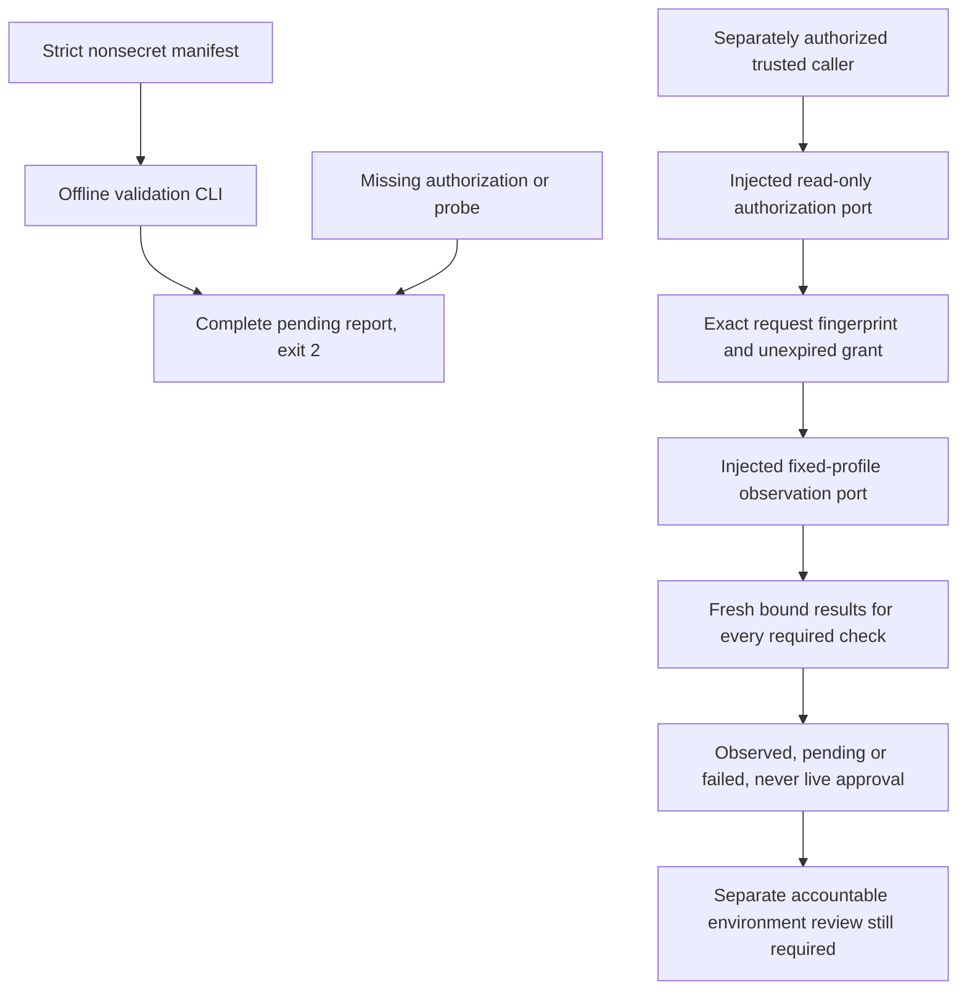

# Live Environment Qualification

## Current Decision

**Pending, not qualified.** No environment, real identity/probe adapters, deployed-image proof,
provider eligibility, privacy approval or live delivery evidence has been supplied or verified.
The existing user authorizations permit isolated local controls, not T099 cloud authentication,
provisioning, deployment, calls, pod removal or live probes. No such action occurred.

[qualify_environment.py](../../tools/scripts/qualify_environment.py) now supplies a locally
tested observation harness and an **offline-only** CLI. This is partial T099 implementation;
the task remains unchecked. Neither a valid manifest nor all-passing injected observations
grants live permission. The tool never returns `live_qualification=qualified`: that field stays
`pending`, even when its observation status is `observed`. It is not a release credential,
signed attestation, environment provisioner or substitute for accountable environment review.

## Recorded Offline Result

On 2026-10-26 the actual no-environment CLI returned a complete pending JSON report. A real
subprocess regression verifies exit code **2** and an empty stderr, independently of terminal
wrapper status. No empty profile is accepted as success. All checks below were **unavailable**
with reason `live_probes_unavailable`; no live check was skipped and relabeled passing.

| Required check | Evidence still required from the authorized environment |
|----------------|--------------------------------------------------------|
| `terraform_deployment` | Exact reviewed Terraform revision/plan, reconciled actual resources and approved dev deployment; no implicit real plan/apply |
| `image_deployment` | Actual running runtime/management image digests and intended configuration, not just image existence or mutable tags |
| `workload_identity` | Exact service accounts/federation, current token exchange, audiences and least-privileged runtime/management/operator roles |
| `private_network` | Actual private DNS, routing, endpoints, effective policies and denied public/key paths, including the approved operator runner |
| `storage_ownership` | Strong-consistency owned-container operations and effective negative cross-service access checks, without real caller payloads |
| `phone_provider` | Approved supported scenario, lifecycle/licensing/region, eligible resource access and actual bidirectional/control protocol compatibility |
| `model_provider` | Approved Azure deployment, GA realtime compatibility, model access and identity behavior with no public/preview fallback |
| `quota_budget` | Current reviewed model/service/node/connection ceilings, overlap headroom and cost/admission budgets; synthetic capacity is not a measurement |
| `privacy_approval` | Accountable review of applicable disclosure, residency, retention, provider handling and safe test inputs; no invented legal default |
| `monitoring_delivery` | Qualified collection/mapping/query and both-service alert firing, receipt/runbook/recovery evidence; T097 remains open |
| `rollout_enforcement` | Actual persistent independent-removal protection, conditional UID-bound retirement and durable reconciliation; local T098 doubles are not enforcement |

The qualifier places no phone call or model session and does not deploy, remove or mutate
resources. Any future check requiring such a side effect needs separately explicit scope,
safe input and operator authorization, not a general read-only qualification grant. Deferred
live journeys/load and failure/removal scenarios still require their T099/T100/T118 gates.

## Observation Boundary



`EnvironmentRequest` binds an opaque environment reference, exact Terraform commit, immutable
runtime/management image digests, plan/privacy/provider/quota review references and an explicit
observation-age limit. Its SHA-256 fingerprint covers the complete canonical request, including
reviews and age. Key order does not change the fingerprint; changing an image or review does.
No URL, token, client secret, shell command, endpoint override, plugin path or arbitrary check
list is accepted. A review reference is **not** proof of approval, existence or provider selection.

`AuthorizationPort.authorize` is a trusted, explicitly injected implementation boundary. It
must authenticate separately approved read-only scope, resolve actual reviewed references and
bind the exact request. No default identity implementation exists. Its typed `Authorization`
is an in-process result, not an unforgeable credential or an input accepted by the CLI. The
harness requires a matching fingerprint and an unexpired UTC timestamp before every probe
and after it returns. Authority failure, denial or expiry prevents further observations.

`ProbePort.observe` is likewise trusted and explicit; it receives only one fixed check, the
bound request and the original deadline. A valid observation has the exact check/fingerprint,
a UTC timestamp no later than the current clock and age within the explicit 1-3600 second
bound, plus a closed `passed`/`failed`/`unavailable` outcome. Unknown or mismatched observations
cannot become passing evidence. These checks validate local control logic, not an adapter's
truthfulness, actual Azure authorization or independent proof of the claimed resource state.

One finite positive budget up to ten seconds covers authorization and all sequential probes.
There is no polling, retry, subprocess fallback, credential discovery, disk report/cache or
automatic SDK/client creation. Async ports must cooperatively honor deadlines/cancellation;
a blocking or cancellation-suppressing adapter is not qualified. Cancellation propagates.
Remaining checks stay visible and unavailable after the deadline or authorization loss.
Explicit access denial is a failed check; transport/missing evidence is unavailable. Other
successful checks never erase a failure or absent check.

Reports use fixed check/outcome/reason categories and an optional request fingerprint, not raw
environment references, payloads or exception details. Operational observation events contain
UTC timestamp, severity, fixed service/environment/event/outcome and an opaque correlation ID.
Fingerprints still link metadata and should be handled as operational records, not described
as anonymous. The report is not a durable, authenticated live evidence receipt; provenance,
review, per-check evidence and later freshness need the separately qualified workflow.

## Offline Usage

```powershell
uv run --project code/tools --locked --no-sync python code/tools/scripts/qualify_environment.py
uv run --project code/tools --locked --no-sync python code/tools/scripts/qualify_environment.py --check-manifest PATH_TO_REVIEWED_NONSECRET_MANIFEST
```

Both commands exit **2** while `mode=offline_manifest_only` and live qualification is pending.
A zero exit code is not available as a shortcut. Malformed input has fixed `invalid_manifest`
categories without reflecting the path, arguments or candidate values. `--execute` and extra
credential/approval arguments are rejected. The CLI cannot load an authorization/probe adapter.

The manifest has exactly these fields; every value below is synthetic test input, not approval:

```json
{
  "environment_ref": "environment-fixture",
  "terraform_revision": "aaaaaaaaaaaaaaaaaaaaaaaaaaaaaaaaaaaaaaaa",
  "runtime_image": "sha256:bbbbbbbbbbbbbbbbbbbbbbbbbbbbbbbbbbbbbbbbbbbbbbbbbbbbbbbbbbbbbbbb",
  "management_image": "sha256:cccccccccccccccccccccccccccccccccccccccccccccccccccccccccccccccc",
  "plan_review_ref": "plan-review-fixture",
  "privacy_review_ref": "privacy-review-fixture",
  "provider_review_ref": "provider-review-fixture",
  "quota_review_ref": "quota-review-fixture",
  "max_observation_age_seconds": 60
}
```

Input is at most 16 KiB. Unknown, duplicate or missing fields, mutable image tags, invalid
references and nonintegral/boolean/out-of-range ages fail. Only nonsecret opaque references
belong here; syntax validation is not comprehensive credential detection. Do not include actual
credentials or caller data in manifests, evidence, command arguments or assistant messages.

## Executed Local Evidence

The new qualification suite passes **38 cases**, and the complete tooling suite passes **97
cases**, on the prepared native Windows Python 3.12 environment. Strict mypy passes the new
module; repository Ruff and editor diagnostics are clean. Tests cover unauthorized/expired/
foreign grants, expiry during observation, fixed complete checks, denied/unavailable/exception
outcomes, exact digest/review binding, stale/future/naive timestamps, original deadline and
cancellation, partial/duplicate reports, malformed metadata, no network/process/credential
fallback, safe errors and actual process exit behavior. Normal CI tooling discovery includes
the suite; no new dependency or live CI privilege was added.

```powershell
uv run --project code/tools --locked --no-sync pytest code/tools/tests -q
uv run --project code/tools --locked --no-sync mypy --strict code/tools/scripts/qualify_environment.py
```

No application route/default, Terraform resource, dependency lock or frontend changed in this
increment, so application/browser and native Terraform suites were not rerun. Prior full-suite
Azure deadline/media/browser-export failures, advisory, native Linux/remote CI and release
gates remain open; local qualification tests do not waive them.

## Next Authorized Work

An accountable operator must identify the actual reviewed environment, approve observation
scope and safe inputs, supply nonsecret review/resource references, and review/implement the
real read-only identity/probe adapters. Do not use fixtures or self-submitted booleans as those
adapters. Keep credentials in approved workload identity/secret-store mechanisms, entered
directly in the appropriate tools, never through the assistant. Any plan/apply, deployment,
provider connection or destructive test requires its own explicit authorization.

Keep T099 unchecked until actual evidence is available and reviewed. T097 and integrated T043,
effective cluster enforcement and the later live profiles remain pending. This artifact records
the missing evidence rather than manufacturing a qualified environment or accepting a release.
