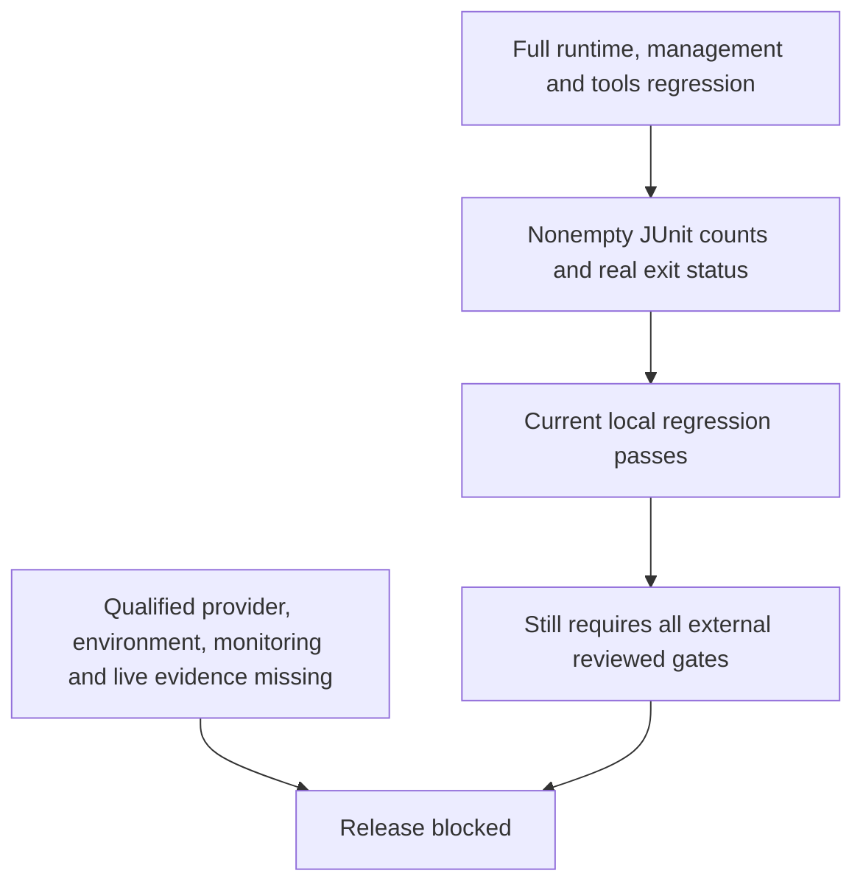

# Release Gates

**Release blocked.** The current full local profile passes runtime **384**, management **407**
and tools **149** cases with zero failures/errors/skips. Overall local status is passed.
The runner correctly keeps live status pending and release status blocked.

The user explicitly authorized remaining local-only implementations with injected doubles.
The user later separately approved sanitized source commit/push/draft-PR review. Neither scope
permits provider selection, cloud/backend authentication, calls, deployment, image publication
or live qualification. Source publication does not waive failed or missing release evidence.

| Remaining gate | Required evidence |
|----------------|-------------------|
| Native editor export | Current complete local suite passes with eager preview initialization; new Windows CI and changed-image evidence still required |
| T042 qualified telephony | Approved supported scenario/provider, lifecycle/licensing/region and verified bidirectional codec/control API; no fabricated wire protocol |
| T031 complete native verification | Ubuntu native/image jobs pass on 9e76e90 and T028/T029 have observed evidence; Windows editor setup still fails, so full two-platform acceptance is blocked |
| T097 live monitoring | Qualified exporter mapping/query/on-call receipt and recovery for both services; disabled local rules are not delivery |
| T099 actual environment | Approved provisioned/pre-provisioned resources and real identity/probe adapters; eleven offline unavailable checks are not qualification |
| T117 actual protected plan/publication | Reviewed identity, immutable artifacts, protected repository controls and qualified adapters; read-only blocked workflow is not publication |
| T118 live acceptance | Approved real phone/model/Cosmos/load/drain/cost/diagnosis measurements; missing evidence is blocked, never skipped/passed |
| Privacy approvals | Accountable disclosure/residency/retention/provider decisions; no invented legal default or certification |
| SC-008 | Explicitly deferred participant study, not passed; automated management/accessibility remains required |



## Commands and Trust Boundary

```powershell
uv run --project code/tools --locked --no-sync python code/tools/scripts/verify_release.py --profile local
uv run --project code/tools --locked --no-sync python code/tools/scripts/verify_release.py --profile live
python code/tools/scripts/release_checks.py --preflight
```

Local runs full test directories, owns child trees and parses bounded temporary JUnit results.
Missing, empty, malformed, failed, errored, skipped or nonzero results fail. Raw failure bodies
and candidate content are not emitted in the summary; temporary reports are deleted. There is
no automatic retry, selected-test exemption or media-error waiver. Passing this profile would
prove regressions only, not current static/advisory/image/remote/live approval.

The live profile refuses execution and exits 2. Protected preflight also exits 2 with no plan
applied or images published. It loads no execution/identity adapter. Real release ports must
authenticate fresh protected scope, bind exact commit/digests/environment, complete reviewed
plan work, recheck authority and idempotently reconcile publication. Unknown submission remains
uncertain, never a blind retry. The in-process typed port results are trusted abstractions,
not unforgeable credentials or proof that an external service is configured.

The manual `release-review` workflow is read-only, full-SHA pinned, has no PR trigger/secrets/
identity-token grant/apply and invokes only the blocked helper. Its environment name does not
configure GitHub reviewers; those external controls and real adapters still need review.

See [requirement coverage](requirements.md), [local handoff](final.md),
[live environment status](live-environment.md), [security](../security.md) and
[capacity/cost](../capacity.md). No task marker, image existence, virtual latency or manifest
can replace missing evidence or grant merge/release approval.

Current strict advisory/image rerun passes Python 69/92/60 packages, frontend 294 coordinates
and three actual rebuilt images with zero HIGH/CRITICAL findings. Current actual image smoke
also passes offline non-root startup and three shell widths; these preceding image results
are not another audit execution. Feed isolation changes Docker build inputs; fresh public
build/audit results were pending at that snapshot. The later c60f7b0 Linux image job now passes
the public-input build, offline/non-root/three-width smoke and all three HIGH/CRITICAL scans.
Its strict Python audits report 68/90/59 packages, frontend 294, zero findings. These results
are scoped to that actual job/revision, not a future live environment or whole-workflow pass.

## Local Failure and Recovery History

The 2026-10-27 baseline reproduced 379 management passes/24 editor-export errors. Unattended
editor build and diagram processes now receive closed stdin rather than the interactive
terminal; their launch regressions fail before the change and pass afterward. Standalone
management and the combined runner then both pass all 403 cases, and all 33 documents/27
diagrams render again. The earlier renderer-18 timeout/interruption and editor failures remain
recorded; stdin is not established as the cause of every historical timeout. No SSR, timeout,
assertion, dependency or suite-selection waiver exists. Future recurrence still fails locally.
The later feed-isolation complete run recurred with 24 root-prerender setup errors while
runtime 384 and tools 129 cases pass. The guard caught private URLs regenerated by the local
frontend compiler, then verified lock relocation restored publishable state. GitHub inspection
was initially rate-limited (HTTP 403). Later observed c60f7b0 Ubuntu results pass runtime 384,
management 403 and the exact 0/1/0 starter assertion gate; T028 closes. Its Mermaid step fails,
and Windows still has 24 editor setup errors. Local follow-up passes 143 tools cases, adds
safe non-content failure categories and preserves all failed gates; T029/T031 remain open.

The later 381e38d run identifies Ubuntu's renderer failure as `browser_sandbox_unavailable`;
Windows editor failure remains unclassified. A user-approved follow-up selects only installed
sandboxed Chrome on Ubuntu CI, records its version and fails if it is absent. Local rendering
and all timeout/TLS/assertion controls are unchanged. Tail-based categories remain bounded and
content-free. No success is claimed until the next actual remote result establishes it.

The next actual result, run 40495295307 on 9e76e90, confirms full native Ubuntu and Linux image
success. All 33 documents/27 diagrams render with sandboxed Chrome 155.0.8059.39, and strict
Python/frontend audits pass. T029 documentation verification closes. Windows still fails its
application-test step with `editor_frontend_build_failed:unclassified`; T031 and release stay
blocked. No participant study, provider/environment qualification or Windows result is invented.
