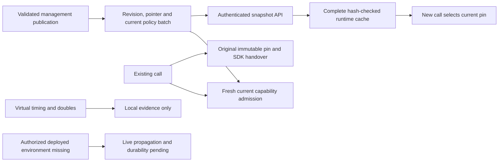

# US4 Local Revision Evidence

## Decision and Scope

The local revision components are implemented and focused deterministic tests pass. This
records component evidence, not a passing full regression/release gate or live SC-007/SC-012
qualification. No cloud identity, Cosmos/provider connection, deployment, live media route,
manager study or unapproved package/feed was used. Default application business capabilities
remain unavailable. Read the [update runbook](../runbooks/configuration-updates.md) and
[pending live environment record](live-environment.md).

## Executed 2026-10-26 Evidence

| Slice | Actual result and assertions |
|-------|------------------------------|
| Runtime revision/cache/client | 29 pass: absent/restarted cache decline, exact detached-byte validation/pins, schema/hash/catalog/reference rejection, revision-order/identity fences, coalesced due refresh, token scope/expiry, bounded invalid/oversized/duplicate responses and no redirect/fallback |
| Runtime activation | 7 pass: twenty valid changes on the virtual 30-second cadence, new-call selection, original call metadata across actual SDK handover, real lifecycle admission, FunctionTool current-revocation denial and owned worker/live-startup cleanup |
| Management snapshot API | 20 pass: explicit-only composition, service identity before reads, full integrity-checked envelope/ETag, private cache headers, authenticated current 304, unsupported input and safe dependency/corrupt-store failures |
| Management publication | 6 pass: twenty saves on local and Cosmos doubles, immutable prior revisions, stale manager edit rejection, real gateway denial after publication revocation, authority-only conflict retry preserving admission sequence and all-or-nothing failed batch |
| Snapshot/publication/current-authority combined | 45 pass, including the existing permission-ordering suite; every counted case executes assertions |
| Runtime strict types | All 28 source modules pass |
| Management strict types | All 32 source/configuration modules pass |
| Complete runtime discovery | 349 passed, 13 existing missing-media setup errors; full gate remains red |
| Complete management discovery | 378 passed, 24 editor frontend-export setup errors; full gate remains red |

The earlier Azure deadline assertion did not recur in this complete runtime run, but its
intermittent cause is not proven fixed. The editor helper removes the temporary build log, so
the inner cause of this management export failure is unavailable; do not infer the historical
prerender timeout as this run's diagnosis. No retry/exclusion/profile or timeout change hides
either gate. Existing shell/recovery/SDK/policy tests were discovered normally.

The runtime cache uses full canonical validated revision bytes; representations and telemetry
do not expose content. Agent discovery projections preserve the existing deny-by-default tool
and community isolation boundary. Complete graphs are trusted orchestration data, not model
prompts. Capability execution uses the separate pinned/current/reviewed gateway contract,
not cache state. No credential or provider tracing policy was loosened.

The final integrity regression clears the caller-owned dictionary immediately after byte
serialization. It first reproduced a validation failure; validation now decodes the same
frozen bytes used for the retained pin. The final full backend run above occurred after that
repair, not as a retry that excluded or hid a failed gate.

## Timing and Persistence Meaning

Twenty changes are exercised with explicit virtual due ticks: before 30 seconds no extra read
occurs, then a successful authenticated fetch installs the new revision for a new pin. Old
pins remain unchanged across every update. This proves cadence/selection logic and supports
the local SC-007 contract; it is not measured wall-clock propagation, network/model latency or
a load result. Deployed observation must demonstrate the actual 60-second target later.

The real SDK handover fixture commits destination metadata while retaining the original
configuration and physical owner. The real FunctionTool case dispatches each attempt to the
gateway even after a newer ordinary revision exists. Management's real local gateway case
denies the next old-pinned action after the same-transaction revocation, with no second tool
effect. Local/Cosmos-double publication cases preserve the original revision and sequence;
no cross-service private-container reads occur.

The cache is memory-only and empty on restart. A restarted runtime must fetch through the
management API; no configured/live dependency means decline, never initialize a local fallback.
Actual Cosmos consistency, durable publication/restart and external identity/network behavior
remain the authorized T099/T118 profile, including the existing real-Cosmos restart/snapshot
scenarios. No live profile or destructive cleanup was run.

## Open Obligations

T043 media/callback/provider composition, T097 live telemetry delivery and T099 qualification
remain pending. Independent source/schema/capability review, approved live origins/audiences,
real private access, deployed per-instance/fleet refresh, current-policy outage behavior and
SC-007/SC-012 evidence must be verified before live acceptance. No partial snapshot, rejected
save, stale permission cache or model-requested target may become authority.

Full-suite media/editor-export failures, advisories, native Linux/remote CI and all other
release gates remain open. This local component checkpoint does not permit merge/release
despite the red full gates. The feature adds no draft/schedule/rollback or manager playground
workflow and no participant recruitment. The same-change runbook records safe failure,
revision conflict, admission and current-revocation handling.
