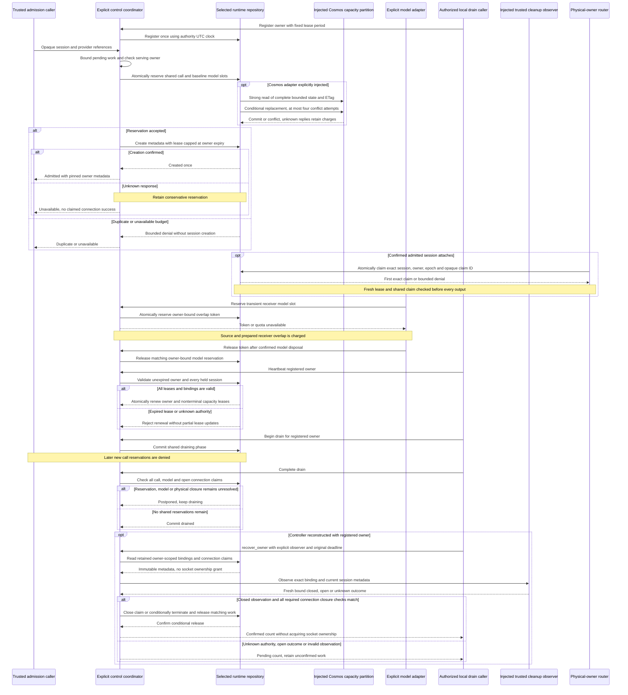
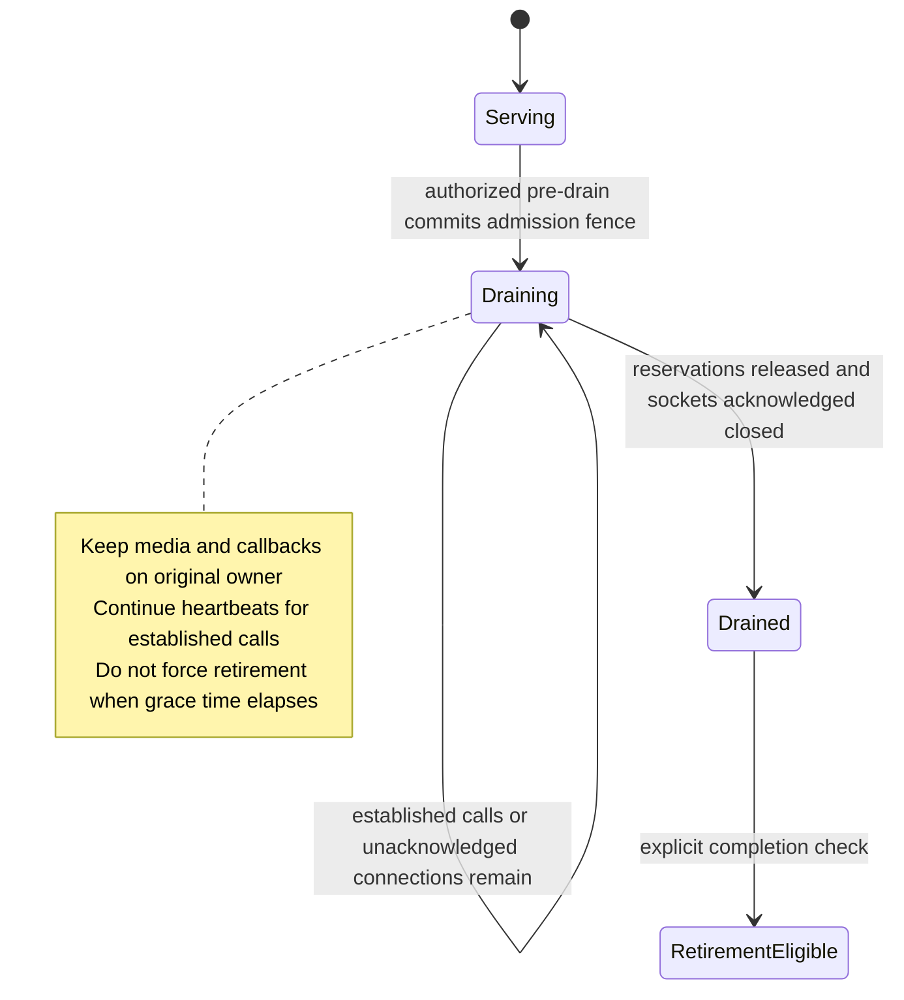

# US6 Local Scaling Acceptance

## T123 Complete: 2026-10-28

T123's shared-authority, physical-owner fencing and conservative recovery implementation is
complete under controlled/injected ports. The final increment fixes two red-first gaps:
independent routers could both attach the same durable session, and no observation-gated
pass reconciled retained physical/call/model work after controller reconstruction.

| T123 requirement | Implemented behavior and executed evidence |
|------------------|-------------------------------------------|
| Shared call and overlapping-model limits | Strong-read/ETag conditional authority, fixed per-owner/aggregate limits and current quota; two spawned OS processes contend for call/model slots and exactly one obtains the last slot |
| Duplicate admission and physical ownership | Conditional session creation plus shared exact owner/epoch/opaque connection claims; independent local/Cosmos routers cannot attach twice |
| Stale leases and output fencing | Each output checks session/agent/connection epochs, nonterminal lease and current shared claim; expired/missing/unavailable/changed authority produces no output |
| Drain across reconstruction | Shared open connection claims remain occupied even after terminal metadata and call-reservation release; acknowledged closure is required before retirement |
| Conservative restart recovery | Known bindings are rediscovered without socket adoption; one injected trusted observer pass handles physical, baseline and overlap work under the original deadline |
| Release only after verification | Exact binding and fresh UTC closed observation required; open/unknown/foreign/stale/future/naive/error observations retain unconfirmed work, and an open connection blocks baseline release |
| Uncertainty and authority loss | Lost/canceled attachment claims cannot be reassigned, missing authority never resets, release acknowledgment is idempotently reconciled, and legacy authority schema fails closed |
| Original budget and no socket migration | One at-most-ten-second recovery deadline, cancellation propagation, no lease revival or socket reattachment; blocked-observer and existing owner/drain contracts pass |

The final increment adds 22 cases, including real spawned-process contention against one
authenticated loopback test CAS authority. The complete backend passes **512 cases** with
zero failures/errors/skips and only the expected blocked-egress warning. Strict runtime
typing passes all 33 sources; all eight repository/type/Terraform/secret/publication gates
and **175 tooling cases** pass. Earlier red/green quota, lease, discovery and reconciliation
evidence below remains part of the task's regression coverage.
All 33 documents/28 diagram sources validate; the completed shared-ownership/recovery
sequence actually renders through the unchanged sandboxed direct-Node/offline SVG checks.

The stable authority item ID remains `runtime-capacity-authority-v1`, but its document schema
is now **2**, including bounded physical connection claims. Schema 1/missing connection state
is rejected, never initialized away; existing unqualified state needs separately reviewed
migration/inventory, not a reset. No new container, identity/client, default route, dependency,
workflow, infrastructure, browser setting or existing operation budget is added or changed.

This completion does not qualify real Cosmos consistency/RU/clock behavior, a real provider
observer, deployment or live capacity/latency. Those remain T099/T118/T129 and relevant
production composition/rollout obligations. Changed-source native/image CI is pending; local
tests are not presented as hosted/live evidence. Completion is **114/129**, with all other
fifteen pending tasks unchanged and SC-008 still deferred.

## Earlier Read-Only Recovery Discovery: 2026-10-28

A red-first restart case exposes the missing path for discovering persisted cleanup bindings
when controller-local maps/tokens are lost. `CapacityService.recovery_bindings` now returns
immutable `CapacityRecoveryBinding` metadata for one registered owner, using an explicit
repository projection rather than reconstructing active ownership or freeing reservations.

All 15 new discovery contracts pass: expired-owner retained charges, local/Cosmos parity,
owner isolation, frozen/detached records, missing session rows, model-only charges, malformed/
untyped/duplicate/oversized/foreign snapshots, unavailable authority, backward clocks and
cancellation. The complete backend passes 490 cases with zero failures/errors/skips and
only the expected blocked-egress warning; strict typing covers 33 sources and diagnostics
are clean. Cosmos inspection performs one Strong authority point read, without session-row
reads or writes. The local adapter uses its existing authority lock.

Each binding contains only session ID, physical owner, connection epoch and optional exact
model reservation. The tuple is bounded to 20,000 records, revalidated by the service and
never installed in local active/model maps. Inspection leaves charges, owner phase, leases,
ETags and postponed drain unchanged; missing metadata and model-only reservations stay
visible but are not automatically reconciled. These are internal trusted metadata interfaces,
not an authentication mechanism, physical observation or proof of closure/disposal.

T123 stays partial: actual outcome verification, production recovery composition and real
Cosmos/environment/live qualification are still missing. All sixteen open markers remain
unchecked (113/129); defaults, routes, dependencies, infrastructure and every existing budget
are unchanged. Previous recovery CI could not be read, so no hosted outcome is claimed.
All eight repository/type/Terraform/secret/publication gates and 175 tooling cases pass.
All 33 documents/28 diagram sources validate, and the changed owner-scoped discovery/recovery
sequence actually renders with unchanged direct-Node/offline/sandbox and nonempty SVG checks.

## Earlier Explicit Cleanup-Recovery Increment: 2026-10-28

Two red-first cases reproduce the missing service path for independently verified cleanup
after controller reconstruction: persisted call/model charges keep drain postponed while
the old cache-only release methods return without releasing them. Explicit
`reconcile_closed_session` and `reconcile_disposed_model` methods now resolve those cases
with the original session/owner/connection-epoch binding and exact model token.

All 27 new recovery contracts pass: reconstructed cleanup after expiry, unregistered/foreign
owners, wrong/boolean epochs, missing sessions/authority, unavailable storage, cache conflicts,
nonterminal call denial, lost release acknowledgments with conservative caches and idempotent
confirmation, cancellation, malformed tokens and sibling-session token denial. The complete
backend passes 475 cases with zero failures/errors/skips and only the expected blocked-egress
warning. Strict runtime typing covers 33 sources; editor diagnostics are clean.
All eight repository/type/Terraform/secret/publication gates and 175 tooling cases pass.
All 33 documents/28 diagram sources validate; the changed recovery sequence actually renders
with the established direct-Node/offline path, sandbox and nonempty SVG checks unchanged.

Trusted callers must independently verify physical call/baseline-model closure or exact model
disposal before invoking these internal methods. Terminal metadata is additionally required
for call release, never accepted as physical proof by itself. Acknowledgment uncertainty
preserves local bookkeeping; an already committed release can be confirmed idempotently.
No cache is rebuilt as socket ownership, no lease renewed, no missing authority recreated
and no unknown reservation automatically reclaimed. Existing ordinary release behavior and
the original at-most-ten-second budget remain unchanged.

This is injected-storage/control evidence, not actual provider/process-crash recovery or
Cosmos/environment/live qualification. Physical outcome verification, discovery of unknown
work and production recovery composition remain missing. T123 and all sixteen open markers
remain unchecked (113/129); default apps, routes, dependencies, infrastructure and every
application/browser/test budget are unchanged. Changed-source hosted verification is pending.

## Earlier Hosted Direct-Launcher Verification: 2026-10-28

Observed [run 40686000514](https://github.com/marvinbuss/caller-ai/actions/runs/40686000514)
on `deb9c8a96f3ca5cf641e562d2c58580aa9464469` passes every native Windows, native Ubuntu
and Linux image step, with no failed or skipped steps. Both native platforms report
448 runtime/413 management/175 tooling passes, zero test failures/errors/skips, exact
baseline 0/broken 1/restored 0 and fixture cleanup. Both prepare Mermaid CLI 12.0.0 and
report all 28 diagram indices started and passed across 33 documents. Sandboxed Chrome
versions are Windows 156.0.8078.48 and Ubuntu 156.0.8078.47. Python audits cover Windows
69/92/60 and Linux 68/90/59 packages; both frontend 294-package audits have zero findings.
Actual image smoke passes offline/non-root startup and 360/768/1440 browser checks; three
actual image audits report zero HIGH/CRITICAL findings.

The direct-Node preparation/offline-render path is now verified on both declared native
platforms. The failed preparation signature is absent in this run; no job retry, assertion
waiver, sandbox change or deadline increase was used. Historical failures remain recorded,
and this success is not independent proof of their exact root cause. Verification for this
renderer increment is complete, not full-feature/live acceptance. T123 and all sixteen
open markers remain unchecked (113/129); physical coordination/reconciliation and actual
Cosmos/environment qualification are still missing. Results apply to the exact source
revision above, not automatically to later edits.

## Earlier Direct Windows Launcher Follow-Up: 2026-10-28

Observed [run 40680073899](https://github.com/marvinbuss/caller-ai/actions/runs/40680073899)
on `fb72c8195025e69c8bbd762f29d44752af848b86` passes Ubuntu and Linux images. Windows and
Ubuntu each report 448 runtime/413 management/171 tooling passes and exact 0/1/0 fixture
cleanup. Ubuntu prepares CLI 12.0.0 and renders all 28 diagrams across 33 documents with
Chrome 155.0.8059.39; Python 68/90/59-package and frontend 294-package audits have zero
findings. Actual image smoke passes offline/non-root startup and 360/768/1440 browser checks;
three image audits report zero HIGH/CRITICAL findings.

Windows emits only `diagram_renderer_prepare_started`, then fails with
`diagram_renderer_timeout:launcher_or_package`; no diagram starts and its later audit does
not run. The inner npm fetch bounds did not resolve this hosted preparation failure. It is
not a 300-second Mermaid/browser render failure, and no green result is inferred.

The next local change bypasses the owned Windows batch wrapper: `node.exe` receives the
adjacent npm `npx-cli.js` and arguments directly, with no `.cmd` fallback. Four red-first
contracts cover paths with spaces, missing Node/script denial and unchanged Linux behavior.
All 20 focused renderer contracts pass. Actual direct-Node preparation from a fresh isolated
cache and all 28 offline renders pass; the temporary cache is removed. No registry values
are emitted. This verifies the new launch path, not the intermittent hosted cause. Native
verification for this change remains pending. Sandbox, browser/render/fetch/job/application
limits, application code, dependencies and all sixteen open markers are unchanged (113/129).
Final local validation passes all eight repository/type/Terraform/secret/publication gates,
all 175 tooling cases and all 33 documents/28 actual direct-launch diagram renders.

## Earlier Renderer Investigation and Repair: 2026-10-28

The user explicitly reopened the Windows timeout investigation. All 28 diagrams render on
the local prepared browser, so the historical hosted timeout is not reproduced. Existing
run 40672760425 on 18195a2 also passed before this change; success alone is not root-cause
evidence. The fixed CI Chrome binary is not installed locally, so its exact launch cannot
be claimed as a local reproduction.

The launch path did perform online npm resolution inside every diagram's deadline. Three
red-first orchestration cases reproduce that behavior and missing/wrong CLI-version denial.
It now prepares exact Mermaid CLI 12.0.0 once, then requires `--offline` for every diagram.
All 16 focused contracts and all 28 real offline renders pass. Fixed stage/index events and
bounded content-free categories cover subprocess/psutil timeouts without raw logs or uploads.
The final complete tooling suite passes 171 cases, all eight repository/type/Terraform/
secret/publication gates pass, and all 33 documents/28 actual diagram renders pass.
Preparation and each render use the existing 300-second cap; browser probes, sandbox flags,
CI-job/application budgets, dependencies and application code are unchanged. This removes
package networking from renders, not a proven explanation for every historical stall.
Changed-source native/image verification remains pending; T123 and all sixteen open markers
remain unchecked (113/129), with physical recovery and live qualification still missing.

A fresh isolated npm-cache check subsequently reproduces the 300-second timeout specifically
in package preparation, before Mermaid starts, with an empty child log. An empty-cache
offline negative control exits immediately with `ENOTCACHED`, distinguishing online package
work from the launcher itself. Red-first fetch-configuration contracts now require a
30-second npm request timeout and zero retries. With those bounds, a second fresh-cache
preparation and all 28 offline renders pass; only HTTP 200 statuses are observed and the
temporary cache is removed. This is a reproduced preparation failure and verified bounded
repair, not independent proof of the old hosted stall's exact cause. Reading repair CI run
40676222968 is blocked by GitHub API rate limiting; its outcome is not claimed or retried.

## Earlier Hosted Cosmos-Adapter Verification: 2026-10-28

Observed [run 40669135195](https://github.com/marvinbuss/caller-ai/actions/runs/40669135195)
on `2239345260e3734a87b2a36ba86112421bedbd6c` passes native Ubuntu and Linux images.
Windows and Ubuntu each report 448 runtime/413 management/165 tooling passes with zero
test failures/errors/skips, exact baseline 0/broken 1/restored 0 and fixture cleanup.
Ubuntu renders all 28 diagrams across 33 documents with sandboxed Chrome 156.0.8078.47;
its Python 68/90/59-package and frontend 294-package audits have zero findings. Actual image
smoke passes offline/non-root startup and 360/768/1440 browser checks; three actual image
audits report zero HIGH/CRITICAL findings.

Windows fails the required documentation step: `verify_docs.py` main line 152 calls
`run_renderer`, whose line 78 raises `psutil.TimeoutExpired` after the unchanged 300-second
render budget. Its later dependency audit does not run. This is the actual Mermaid render,
not an application test or the Chrome launch/version probe. The failure signature matches
the previously parked renderer investigation; it does not establish a shared root cause.
At that checkpoint, under the user's move-on direction, no diagnosis, CI rerun, timeout increase, sandbox
change or assertion waiver is performed. The investigation stays parked, while the actual
Windows documentation gate remains failed and merge/release remains blocked.

These are regression results for the exact revision above, not actual Cosmos service
durability, physical recovery or live qualification. T123 and all sixteen open markers stay
unchecked (113/129). Existing foundation acceptance remains historical; it does not turn
this new failed gate into a passing result. Implementation stops at this verification
checkpoint rather than claiming the full task or feature complete.

## Current Injected Cosmos Authority Increment: 2026-10-28

`CosmosCapacityRepository` now implements `SharedCapacityRepository` against an explicitly
injected runtime-owned container. Separate adapters use a reserved authority item rather than
shared Python dictionaries or locks. A red-first competing-writer/reconstruction case and a
red-first service-composition case now pass. Four schema/retention failures and one omitted-
owner-phase failure were also reproduced and repaired without weakening assertions.

All 34 new persistent-authority contracts pass. They cover independent conditional writers,
global model overlap and quota reduction, controller reconstruction, lost HTTP/cancellation
replies after commit, missing/unavailable/malformed authority, immutable owner expiry,
all-or-nothing renewal with invalid held sessions, foreign model tokens, effective lease
clamping, invalid/backward clocks, terminal-but-charged calls, trusted closure release,
bounded contention, cancellation during a read, Strong reads and authority TTL exclusion.
The combined repository/capacity slice passes 118 cases; the full backend passes 448 with
zero failures/errors/skips and only the expected blocked-egress warning. Strict runtime
typing covers 33 sources, explicit protocol compatibility and touched-file lint pass.
All eight repository/type/Terraform/secret/publication gates and 165 tooling cases pass.
All 33 documents/28 diagram sources validate; the changed persistent-authority sequence
actually renders with prepared Chromium, valid SVG bounds and unchanged sandbox/budgets.

These are injected-storage contract results, not actual Cosmos service durability, separate-
process crash experiments, production clock/fencing guarantees or live call measurements.
At that local checkpoint no new native Ubuntu, management-browser, image or live result
was claimed; the later scoped hosted result is recorded above. Physical owner
coordination, uncertainty reconciliation and qualified deployment remain missing; T123 and
all sixteen open markers stay unchecked (113/129). The default apps, routes, dependencies,
infrastructure and all application/test/browser budgets are unchanged.

## Earlier Hosted Lease Verification: 2026-10-28

Observed [run 40656926575](https://github.com/marvinbuss/caller-ai/actions/runs/40656926575)
on `271bc497bfff7e9a3e9dccd796a098549826474f` passes every native Windows, native Ubuntu
and Linux image step, with no failed or skipped steps. Each native platform reports
414 runtime/413 management/165 tooling passes with zero failures/errors/skips, exact
baseline 0/broken 1/restored 0 with fixture cleanup, and 33 documents/28 actual diagram renders.
Sandboxed Chrome versions are Windows 156.0.8078.48 and Ubuntu 156.0.8078.47. Strict Python
audits cover Windows 69/92/60 and Linux 68/90/59 packages; frontend 294-package audits have
zero findings on both platforms. Actual image smoke passes offline/non-root startup and
360/768/1440 browser checks; three actual image audits report zero HIGH/CRITICAL findings.

This verifies the shared local quota/drain/lease increment's regressions, not persistent
Cosmos authority, cross-process fencing, physical coordination or durable recovery. T123
remains partial and 113/129 tasks are checked. Earlier failures and parked investigations
remain recorded without root-cause repair claims. These results apply to the exact source
revision above; no later uncommitted edit is qualified by this run.

## T123 Shared Local Lease Increment: 2026-10-28

Two red-first cases reproduce reconstructed controllers reviving an expired shared owner
for admission/heartbeat. Two further cases expose stale controller-local availability after
another controller's heartbeat and session leases outliving shared owner expiry. Authority-
owned UTC expiry, immutable bounded lease periods, atomic owner/session renewal, serving-owner
selection and lease clamping make all four pass without sleeps or increased budgets.

All eleven new lease cases pass: reconstruction expiry fences, shared renewal/availability,
session-lease bounds, all-or-nothing renewal with an invalid sibling, expired-owner model
denial despite newer session metadata, fresh-owner selection, conflicting lease periods and
naive/non-UTC/backward clock rejection. There are 50 capacity/profile and 18 planned-drain
passes (68 combined); the complete backend passes 414 cases with zero failures/errors/skips
and only the expected blocked-egress warning. Repository/static and new hosted results are
scoped separately: all repository/type/Terraform/secret/publication checks and 165 tooling
cases pass. The changed lease sequence actually renders with prepared Chromium and valid
SVG bounds; all 33 documents/28 diagram sources validate. No new hosted/image/live result
is claimed from these local checks.

The local authority owns one explicit UTC clock. Re-registration never extends an existing
owner's expiry, a missed expiry cannot be renewed, and an incompatible lease period fails
closed. A valid heartbeat validates every held session before updating any lease/ETag, then
renews the owner and all its nonterminal calls atomically; any expired/missing/mismatched
session aborts renewal without partial session/owner updates. A fresh call's lease is capped
at the owner's expiry. Invalid or backward authority time denies new capacity and heartbeat;
controller-local heartbeat timestamps are not admission authority. Existing drain and
uncertain-reservation retention rules remain unchanged.

This is still one explicitly shared in-memory repository, not a persistent Cosmos authority,
cross-process clock/fencing guarantee or durable restart recovery. Physical connection
coordination and qualified environment evidence remain missing. T123 stays unchecked, all
113/129 completion markers are preserved, and no default client/route, network, infrastructure,
timeout, forced reclamation or live operation is added.

## Earlier Hosted Verification: 2026-10-28

Observed [run 40652020707](https://github.com/marvinbuss/caller-ai/actions/runs/40652020707)
on `1ea0e7c3fe70415aec0109216c0ad615165d1092` passes every native Windows, native Ubuntu
and Linux image step, with no failed or skipped steps. Each native platform reports
403 runtime/413 management/165 tooling passes with zero failures/errors/skips, exact
baseline 0/broken 1/restored 0 and fixture cleanup, and 33 documents/28 actual diagram renders.
Sandboxed Chrome versions are Windows 156.0.8078.48 and Ubuntu 155.0.8059.39. Strict Python
audits cover Windows 69/92/60 and Linux 68/90/59 packages; frontend 294-package audits have
zero findings on both platforms. Actual image smoke passes offline/non-root startup and
360/768/1440 browser checks; three actual image audits report zero HIGH/CRITICAL findings.

This verifies the shared local quota/drain increment across the declared native platforms,
not persistent Cosmos authority, shared leases, recovery or live call qualification. T123
remains partial and 113/129 tasks are checked. The earlier failed Windows run below remains
recorded; current success does not establish a root-cause repair for a parked investigation.

## T123 Shared Local Drain Increment: 2026-10-28

Three red-first cases reproduce cross-controller admission after a committed drain and
premature completion while a different controller's call or undisposed model remains.
Shared repository-owned owner phase now fences call reservation atomically and checks all
shared call/model reservations before committing drained. The same three cases pass.
Nine new cases also cover reconstruction without resetting drain, ambiguous begin/finish
replies, unavailable owner-state reads and existing-call model preparation during drain.
All 39 capacity/profile and 18 planned-drain cases pass (57 combined); the complete backend
passes 403 cases with zero failures/errors/skips and the expected blocked-egress warning.
All repository/type/Terraform/secret/publication checks and 165 tooling cases pass. The
changed shared-drain sequence actually renders with prepared Chromium and valid SVG bounds;
33 documents/28 diagram sources validate. These are local results, not a new hosted outcome.

Owner registration is bounded and preserves existing draining/drained phase. Controller
state reads and heartbeats consult the same local authority instead of claiming cached
serving/drained state when the read fails. New calls cannot enter after the shared drain
transition, but established calls can reserve a handover model within the existing quota;
its undisposed token still postpones completion. Unknown transition responses do not undo
the committed phase. No undrain or forced expiry/reclamation operation is added.

This remains a same-object in-memory authority. Shared local lease coordination is added by
the later increment above; physical connection registries, metrics, durable owner fencing,
cross-process persistence and recovery are not completed by shared local phase. T123 stays unchecked, all live/environment gates
remain intact. At that local checkpoint no hosted/image/live result was yet claimed; the
subsequent hosted results are recorded above, not inferred from local tests. The earlier
scoped CI results and parked failures below remain historical evidence.

## T123 Shared Local Authority Increment: 2026-10-28

Observed [run 40606716532](https://github.com/marvinbuss/caller-ai/actions/runs/40606716532)
on `6d859af2bcd9db93a640b93ae9491a7a3b43af36` passes native Ubuntu and Linux images. Ubuntu
reports 394 runtime/413 management/165 tooling passes, exact 0/1/0 with fixture cleanup,
33 documents/28 actual diagram renders using sandboxed Chrome 155.0.8059.39, and strict
Python 68/90/59 plus frontend 294-package audits with zero findings. Actual image smoke
passes offline/non-root and 360/768/1440 checks; three image audits have zero HIGH/CRITICAL.

Windows tooling passes 165 cases, but its backend reports 392 passes/two handover failures:
`test_existing_sdk_handover_keeps_original_revision_after_current_pointer_advances` returns
failed instead of committed, and `test_hangup_during_preparation_cancels_destination_and_prevents_late_commit`
times out waiting for destination preparation. Windows management and later gates do not
execute. Each exact failed case was run once locally with unchanged assertions/budgets;
both pass (12.52 seconds). No root cause was reproduced and no handover repair is claimed.
Investigation is parked for now under the user's direction to move on when an error cannot
be found. The workflow remains failed; there is no retry, skipped assertion or budget change.

Two independent controllers sharing one session repository previously both admitted calls
against one call/model slot; a second red-first check also allowed both handover models
against one remaining model slot. Repository-owned atomic reservations now make both checks
pass. All 30 capacity/profile cases pass, including the ten new shared-authority cases.
The final complete backend run passes 394 cases with zero failures/errors/skips; its single
warning is the expected blocked-egress assertion. All repository/type/Terraform/secret/
publication gates and 165 tooling cases pass. The changed sequence below actually renders
with prepared Chromium and nonempty SVG checks; all 33 documents/28 diagram sources validate.
These local results and the scoped Linux results above do not establish current green
Windows CI, persistent authority or live qualification.

Controllers using the same `LocalSessionRepository` object share call/per-owner limits,
baseline and overlapping model reservations, and the current model quota. Fixed-limit
disagreement fails closed; explicit model-quota updates govern other controllers' next
reservations. A terminal session record alone does not release a slot. The trusted closure
path releases owner/epoch-bound call reservations; model tokens release only through their
owning binding after confirmed disposal. Lost reservation/create replies remain charged,
including when another controller is reconstructed against the same local authority.

This is a deterministic in-memory authority, not an atomic Cosmos quota implementation or
cross-process durability. Shared local drain and lease coordination are added above;
connection registries, reservation counts/metrics and durable recovery remain controller-local
or unimplemented. A new repository
object loses volatile state; retaining the same object is not restart-durability evidence.
`SharedCapacityRepository` is required for admission; the existing Cosmos session adapter
does not implement it and receives no unsafe per-controller fallback. T123 stays unchecked
until persistent authority, global owner/lease fencing and qualified recovery exist. T120,
T124-T129 and all earlier provider/environment/live gates remain unchanged.

The following checkpoint counts and earlier failures are historical; they are not current
failures created or waived by this increment. Default app composition, routes, dependencies,
infrastructure, operation budgets and network policy are unchanged.

## Authorization and Status

T089-T093 are locally implemented/tested. The user explicitly selected **Continue local
controls; keep media/live gates** on 2026-10-26. That permits isolated T092/T093 control
components before T043 using injected repository, connection and authentication ports.
It does not permit provider selection, live route enablement, provisioning or deployment.
T043 remains mandatory for integrated media, callbacks, hangup acknowledgment and live calls.

The user subsequently selected **Continue isolated local T100/T101** on 2026-10-26. This
authorizes the deterministic component checkpoint and consolidated runbook before unfinished
T046/T097, not integrated-call acceptance, environment access, measured live capacity or a
security/release waiver. T100/T101 are complete only within that explicit isolated local scope.

T094's state/bootstrap foundation is locally validated as described in the
[Terraform state runbook](../runbooks/terraform-state.md). T095's authored development
composition is locally validated in the [platform runbook](../runbooks/platform.md).
T096's scoped identities/private-network definitions are locally validated in the
[security runbook](../runbooks/platform-security.md). T097 local metric collection and
disabled alerts are described in [monitoring](../runbooks/monitoring.md); live evidence remains
pending. The user subsequently authorized isolated local T098 controls before T097 completion.
[The rollout runbook](../runbooks/drain-rollout.md) records 28 new tooling cases, 59 complete
tooling passes and 18 planned-drain/API passes, including actual API/acknowledgment integration.
This does not provide a live cluster adapter or prove independent-deletion enforcement.
The [environment qualification record](live-environment.md) now describes the T099 local
observation harness, 38 qualifier/97 tooling passes and the actual CLI's pending exit 2.
No real authorized environment or live probe adapters are available; T099 and all live T100
measurements remain pending. The [scaling runbook](../runbooks/scaling.md) consolidates local
capacity/admission, owner loss, alerts, pre-drain and rollback procedures. This record does not
complete actual AKS deployment, authenticated live cluster operation or independent-removal
enforcement. Default application startup is unchanged;
neither capacity controls nor internal drain endpoints are automatically mounted.

## Historical Executed Evidence

The locked Python 3.12 backend environment was exercised on native Windows with outbound
sockets denied. No model/phone connection, Azure credentials, Cosmos account, emulator or
business connector was used. Existing repositories and owned connection doubles are explicit
test dependencies, not production persistence or supported telephony adapters.

| Slice | Result and assertions |
|-------|-----------------------|
| Capacity/profile contracts | 20 pass: separate synthetic/live profiles, strict service-level evidence types/boundaries, virtual 100-to-200 schedule, stable existing owners/revisions, bounded overload/pending requests, atomic duplicate/quota decisions, unknown storage, transient model overlap and expired-lease renewal rejection |
| Owner-failure contracts | 11 pass: exactly one owner under competing admission, no expired-lease takeover, obsolete metadata/output rejection, lease and processing loss, one deadline across blocked explanation/hangup, truthful terminal/closure confirmation |
| Planned drain/API contracts | 18 pass: serving/draining/drained, admission fence, retained callbacks/connections, prolonged active-call postponement, idempotency, physical-closure acknowledgment and actual rollout-to-operator-API integration |
| Runtime metrics | 31 pass: real SDK delta collection, finite closed labels, privacy, actual producers and visible export/flush failure |
| Management metrics | 32 pass: errors/latency/dependency/saturation collection, privacy, actual gateway/HTTP producers and export failure semantics |
| Rollout/qualification tools | 66 pass: 28 guarded removal cases and 38 fail-closed environment-observation cases; no live adapter executed |
| Complete backend | Current unfiltered run: 313 passed, 13 existing missing-media setup errors; still not green |
| Types | Runtime source type gate is required; tooling/module typing from their implementation checkpoints is not a new live qualification result |

All **49 capacity/owner/drain cases pass**, and the combined backend control/metric checkpoint
passes **80 cases**. Management's **32 metric cases** and **66 tool control cases** also pass.
The 13 full-backend errors are the existing missing
`caller_runtime.api.media` contracts; they are retained, not excluded or relabeled successful.
The full backend gate therefore remains red. The expected blocked-egress warning in the
existing socket test is not permission to relax network isolation.

Historical evidence: the first complete control-increment run passed 277 tests with only the
13 deferred-media errors. Review then
found and reproduced a new local-controller defect: heartbeat could revive an expired persisted
session lease. A regression now proves renewal rejects that state without changing metadata.
After the fix, all 45 focused US6 cases pass. The complete rerun additionally hit the existing
`test_one_operation_budget_cancels_blocked_connect` assertion: two Azure transport attempts
were observed where the test expects one. The same unchanged test passed in isolation.
Its cause remains unresolved; the complete failure is retained and is not waived or hidden by
the narrow pass. The latest unfiltered run passes 313 tests and retains all 13 media errors;
the unchanged Azure deadline test passed this time, not proof the intermittent issue was fixed.
No Azure adapter, timeout or test exclusion was changed. The measurement-gate assertion alone
was tightened after reproducing acceptance of `False` and `0.0` as disconnect counts; three
new cases reject boolean, float and string counts. Live zero-disconnect evidence must be an
integer zero, not equality with a different JSON/Python type.

The full management/browser suite was not rerun in this local checkpoint; its earlier
338-pass/24-editor-export-error run remains an open gate. No frontend/default app behavior,
dependency lock, Terraform resource or live route changed. This checkpoint does not resolve
native Linux/remote CI, advisory, provider or release obligations.

```powershell
uv run --directory code/backend --locked --no-sync pytest tests/load/test_capacity.py tests/integration/test_owner_failure.py tests/integration/test_planned_drain.py -q
uv run --directory code/backend --locked --no-sync pytest tests/unit/test_metrics.py -q
uv run --directory code/management --locked --no-sync pytest tests/unit/test_metrics.py -q
uv run --project code/tools --locked --no-sync pytest code/tools/tests/test_drain_rollout.py code/tools/tests/test_qualify_environment.py -q
uv run --directory code/backend --locked --no-sync pytest -q --tb=line
uv run --directory code/backend --locked --no-sync mypy src/caller_runtime
uv run --directory code/backend --locked --no-sync ruff check src tests
```

## Meaning of the Load Profiles

`US6_SYNTHETIC_PROFILE` defines 100 synthetic reservations maintained for 1800 virtual seconds,
a second owner bringing reservations to 200 within a 300-virtual-second bound, then another
1800 virtual seconds. Heartbeats continue throughout. Existing calls preserve their physical
owner, connection epoch and pinned revision. This tests controller state, not actual concurrent
phone calls, real-time model load, autoscaling speed or network latency.

`US6_LIVE_PROFILE` is **defined_not_executed**, default-disabled, with explicit `us6-live`
opt-in and T099/T112/T117/T118 prerequisites. It requires the approved environment evidence,
100 simultaneous calls for 30 wall-clock minutes, scale to 200 within five minutes and
another 30 minutes at target service levels. It does not provision or clean up resources.
The later release runner must enforce all prerequisites; this increment adds no live executor.

The measurement gate requires at least 99% eligible admission, 95% greetings within three
seconds, p95 ordinary speech within two seconds excluding external-action waits, p95 handover
within two seconds and zero existing-call disconnects during scale-out. Samples must be finite,
nonnegative and complete for admitted calls; empty evidence fails. Synthetic numeric fixtures
only test that this gate accepts/rejects correctly. They are **not measured SC-002/SC-003 results**.

## Admission and Dependency Budgets

`CapacityService` is one explicitly composed, serialized local controller. Configuration is a
detached validated-shape pinned graph. Its limits are explicit: sessions per owner, aggregate
reservations, current model-session quota, pending admission bound and operation/lease budgets.
It admits based on reservations and owner health/state, never CPU alone. Heartbeat cannot
renew an already expired session lease. An unavailable slot,
stale owner, exhausted quota, overload or unknown storage produces a bounded unavailable result.
Duplicate sessions cannot claim another owner or consume another confirmed reservation.



The default pending bound is 256 and registry bound is 1024 owners; these are implementation
bounds, not measured operating capacity. Every admission has at most a ten-second budget.
An ambiguous create response retains its reservation rather than allowing oversubscription.
`active_count()` therefore counts conservative controller reservations, which can include
uncertain admission outcomes; it is not a certified count of live phone calls.

Each call reserves a baseline model slot. A trusted model adapter must reserve an additional
slot before preparing a fresh handover receiver and release it only after confirmed model
disposal. Reducing quota blocks new allocations without dropping established calls. This
increment tests the budget primitive; it does not wire it into the existing SDK/handover
composition or claim provider quota enforcement before that integration is qualified.

`release(session_id)` is a trusted lifecycle operation after verified physical closure, not a
caller/model command. Acknowledged socket detachment is separate. Unknown persistence does
not authorize blind reservation release. Reconcile metadata and actual provider/model closure
under the same controller before reclaiming uncertain budgets.

## Physical Ownership and Failure

`OwnerRouting.attach` checks durable session identity, physical owner, connection epoch, state
and current lease. A replacement worker cannot attach by supplying a different owner/epoch.
Session creation and ETag mutations retain the existing repository fences. A lost or expired
lease never grants permission to migrate a live WebSocket.

Output is serialized and checked against the current session's physical owner, connection
epoch, agent epoch, lease and nonterminal state before dispatch. Callback routing returns the
existing durable owner or fails closed; registering new capacity does not redirect established
callbacks. These are local routing checks over a test connection, not provider protocol proof.

`owner_lost` immediately fences the local binding, attempts conditional terminal `owner_lost`
metadata and uses the remaining original budget for a fixed unavailability explanation and
hangup. Metadata conflicts have bounded retries; explanation/hangup do not receive a renewed
ten seconds. Its result distinguishes `terminal_confirmed` from `hangup_acknowledged`.
Unavailable storage or a nonresponsive phone cannot be relabeled a confirmed terminal/closure.
Repeated notifications do not duplicate the owned hangup attempt. Transport cancellation,
playback clearing, provider acknowledgment and automatic failure detection remain integrated
T043/T044/T099 obligations, not promises established by direct local method invocation.

## Authorized Drain and Retirement



`DrainService` requires an explicit authorizer before either start or completion. Starting drain
and admission serialize through the same controller state; once drain commits, new assignments
cannot target that owner. Established routing stays put. Completion returns postponed while
reservations or unacknowledged physical connections remain, even if session metadata is terminal.
A confirmed `detach` requires the original owner/connection epoch and explicit hangup acknowledgment.
Only the drained/no-connections state is eligible for retirement. No code here deletes a pod,
forces a grace timeout, evicts a worker or relies on a disruption budget as call-preservation proof.

The explicit internal router provides:

- `POST /v1/operations/drain/{owner_id}` to start pre-drain.
- `GET /v1/operations/drain/{owner_id}` for state and `canTerminate`.
- `POST /v1/operations/drain/{owner_id}/complete` for a conditional completion decision.

Composition requires `DrainService`, `OperatorIdentityPort` and application-owned metadata
telemetry. The identity port must validate a least-privileged internal operator's actual
issuer/audience/tenant/signature/time/role; fixture headers are used only in test composition.
No shipped default identity accepts those headers. Private networking, workload identities and
actual identity delivery remain T096/T099 gates. Health endpoints never mutate drain state.
The router rejects bodies/queries, does not reflect errors and returns no-store safe problem
responses for 401/403/404/422/503/504. It is not mounted by the foundation app.

## Limits and Next Gates

Controller owner/reservation/connection registries are volatile and instance-local. They do
not establish cluster-global admission, distributed quota consensus, restart reconciliation,
controller high availability or cross-pod connection migration. A qualified deployment needs
explicit serialized control ownership/shared authority and safe recovery before those claims.
Session repositories retain service ownership; no private management container is accessed.

T096 definitions, T097 local metric contracts and T098 isolated orchestration do not establish
effective live identities/private networking, actual alert delivery or atomic cluster guards.
T099 must qualify real adapters and deployment; T100/T101 consolidate
only the authorized isolated local checkpoint/runbook, with integrated/live work still pending.
Actual latency, cost, quotas,
live 100-to-200 call load, Cosmos durability and provider behavior remain unmeasured.
Existing dependency-advisory, foundation, native-Linux/remote-CI and release gates remain open.
