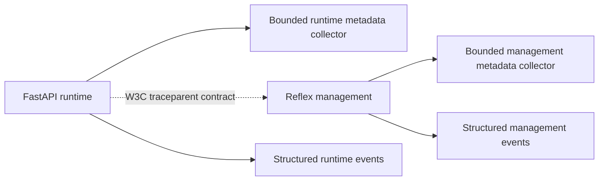
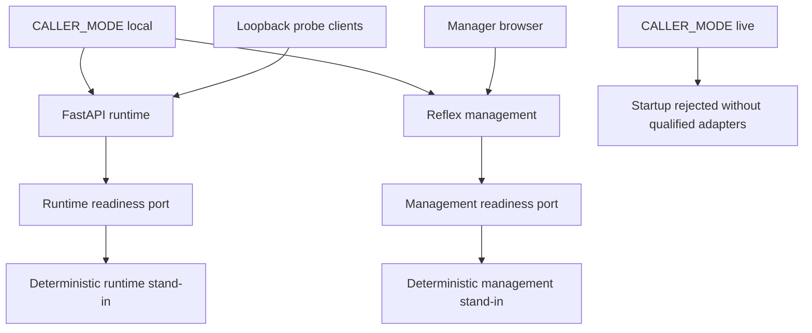

# Foundation Architecture

The runtime and management service are independently packaged Python applications with
separate locks, settings and telemetry ownership. This foundation has no live phone/model,
Cosmos, identity or business-tool connection. Later configuration storage remains management
owned, not a shared private database.

## Current Local Components

The foundation notes below are historical context. Local management, community/capability,
revision, scaling and now provider-neutral media/cleanup/audit components are implemented,
but no live adapter, default business-route enablement or external qualification is implied.
See the [runbook index](runbooks/README.md), [local call evidence](acceptance/us1.md),
[revision evidence](acceptance/us4.md), [scaling evidence](acceptance/us6.md),
[requirement matrix](acceptance/requirements.md) and [release gates](acceptance/release-gates.md).

The earlier complete local runner passes 384 runtime, 407 management and 149 tooling cases.
Preview startup now eagerly initializes the SSR bundle before timed page requests, using the
supported Reflex compile hook; cold module loading remains in the unchanged build budget.
See [preview initialization](setup.md#preview-module-initialization). Earlier successful
[run 40549068375](https://github.com/marvinbuss/caller-ai/actions/runs/40549068375) on 57b4e1d
passes full native Windows/Ubuntu suites (384/407/165 each) and the Linux image job, completing
T031 at that snapshot. Later run 40552023091 on 78c54ba passes Windows/images but fails one
Ubuntu keyboard-journey persistence assertion; T031 is reopened and the save-boundary probe
is locally blocked by compiler timeout. See [current foundation evidence](acceptance/foundation.md).
Diagnostic run 40590188047 on 6b7f03a subsequently passes full Windows/Ubuntu/image gates
and the stronger keyboard assertions. No application behavior changed or root cause was
reproduced; T031 stays open. Granian's installed default is one worker, which does not support
the proposed split-store explanation from an omitted worker setting.
Earlier failures remain recorded. Live metric delivery, qualified phone/model/storage
access and real cluster enforcement remain pending. A typed injected port is not a deployed
authorization mechanism, and green components cannot mint release readiness.

The dotted edge shows the foundation propagation contract. US4 now also implements an
explicit injected revision client and management-owned API; default startup creates neither
that client nor its refresh worker. See [configuration updates](runbooks/configuration-updates.md).
There are no cloud exporters in local mode. Each collector
retains at most 512 completed metadata spans and 512 events; shutdown clears local capture.
OpenTelemetry providers are service-owned rather than installed as a global shared provider.

T097 adds separately owned bounded aggregate meters, actual HTTP/controller producers and
private disabled both-service alert definitions. Default metric collection is in memory;
cloud export, ingestion mapping, query execution and notification delivery remain unimplemented
or unverified. See [both-service monitoring](runbooks/monitoring.md) for signal semantics,
required owners/thresholds/runbooks and the live evidence gate. Reservation counts and transfer
control timing are not active physical-call or resumed-audio measurements.

Only fixed operation names and enumerated HTTP method/route/outcome attributes are accepted.
HTTP status codes are bounded numeric metadata. Arbitrary attributes are rejected before a
span starts. Sensitive names, credentials, prompts, audio, transcripts, tool arguments/results
and raw exception messages are never recorded. Trace contexts propagate only `traceparent`,
not baggage or arbitrary tracestate. Correlation IDs are bounded opaque identifiers; invalid
values and recognized credential-like prefixes are replaced.

Structured events contain UTC timestamp, severity, service, environment, event, outcome,
correlation ID and available trace/span IDs. Event names/outcomes are allowlisted. SDK tracing
is separately disabled by default; its explicit in-memory opt-in records fixed operation
metadata without inspecting SDK payloads. Provider realtime tracing remains unavailable
because its metadata-only destination/content controls are not established. See
[setup.md](setup.md) for configuration, installation and evidence limits.

The runtime lifespan validates local mode before creating telemetry or configuring the SDK.
`GET /healthz` is process liveness; `GET /readyz` reflects lifespan readiness and returns both
business capability flags false. Shutdown clears readiness and bounded local capture. HTTP
middleware emits only approved route categories and sanitized correlation IDs; unexpected
exceptions return a stable `internal_error`, never their raw message.

Each service owns an asynchronous `ReadinessPort` and deterministic `LocalDependencies`
stand-in. Factories accept injected ports for tests; importing either port module imports
no agent, identity or storage client. Liveness never calls the port. Readiness gives an
injected check 250 ms and returns only `dependency_unavailable` on false, timeout or error;
lifespan-not-ready still returns `configuration_invalid`. Local stand-ins are selected only
in local mode, and live startup remains unavailable rather than falling back to them.

Only local mode registers `/v1/dev/transport`. It accepts text JSON probes with exactly
`type=probe` and a 1-64 character ASCII identifier, then acknowledges that identifier and
protocol version 1. Processing is sequential with a 64 KiB encoded-message limit; there are
no per-message background tasks or unbounded queues. Normal disconnect is 1000, invalid or
binary input closes with 1008, oversize closes with 1009, and synthetic internal failure
closes with 1011 without exception details. Cleanup decrements the local active-probe count.
Use loopback-only native development binding and loopback Docker host publishing. This route
does not answer calls, process audio, create agent sessions, or expose management data.

Management passes its FastAPI health API through Reflex's documented `api_transformer`,
leaving framework ping/event/upload routes mounted. A public Reflex lifespan task applies
mode validation, readiness and cleanup; mounted sub-application lifespans are not assumed.
The shell shows only local status and unavailable business capabilities. Its refresh event
changes server-owned state through Reflex, not a client-only simulation. Development uses
ports 3000/8001 with loopback backend binding, disabled framework telemetry and memory state.

Both native Windows and Ubuntu application suites, actual Linux image browser smoke and
strict package/three-image advisory gates have passed on the recorded source. Monitoring
qualification remains pending. This design does not claim live capacity, alert delivery,
production persistence, deployed authenticated editing or real call handling.

The local stand-ins are separate service-owned objects, not shared state or production
persistence. Startup validation precedes live-client construction. Recovery tests interrupt
actual startup processes, reject occupied ports without replacing listeners, reject invalid
or unconfigured live mode, and reject missing/stale locks without environment creation.

Windows Granian can report occupied ports as OS error 10013 rather than 10048; tests verify
the original listener still accepts connections. Owned process trees are terminated on every
outcome. See [failure-gate evidence](acceptance/ci-failure-gate.md) and
[foundation evidence](acceptance/foundation.md) for verified versus pending acceptance.

## Historical Phase 3 Transport Contracts

The user authorized local Phase 3 work before full foundation acceptance. At that snapshot the
call-transport suite had 25 cases: 12 callback cases passed and 13 media cases remained red until
the production media router is implemented. No pending test is skipped or excluded
from normal pytest discovery. The current complete runtime suite passes as recorded above;
these earlier foundation results alone did not establish that expanded-suite success.

The tests compose real FastAPI/Starlette routes with separate phone-adapter and conditional
admission doubles. Callbacks carry opaque fixture bytes, and the codec name is deliberately
fictional. `/v1/provider/callbacks` is the fixture's proposed router surface, not qualification
of a real provider callback protocol. Actual provider wire formats, identity verification,
codecs, licensing, Azure eligibility and live access remain gated by T035/T099.

Assertions require delegated provider identity checks before admission, at-most-once answer
after duplicate callbacks, admitted-call/media binding, and HTTP 403 denial before WebSocket
upgrade. Query-string credentials cannot authenticate media. Unsupported codecs are rejected
before decoding. Post-upgrade cases cover 1008 policy, 1009 encoded oversize and 1011 safe
internal failure. Exactly 64 KiB is accepted; larger binary and UTF-8 text frames are rejected
before adapter decoding. Normal 1000 closure requires an explicit provider hangup acknowledgment;
a failed acknowledgment is not reported as normal phone termination.

These doubles test orchestration boundaries, not JWT cryptography, actual telephony, durable
deduplication, model latency or business-tool authorization. No live route has been registered
in the foundation app. T033/T034 were authored red-first before the implementations below.

The lifecycle suite began with 17 red asyncio contracts and now has 37 passing lifecycle/model
cases after implementation and race regressions. A synthetic monotonic clock checks one deadline across stages rather
than wall-clock sleeps. Concurrent admission/closure and duplicate disconnects must create
one pinned session and one terminal outcome. Protected roles run Welcome, Routing and the
ordinary entry, with Goodbye last for normal closure. The five-second hangup budget starts
after Goodbye finishes; disconnects during work require cancellation, not spoken Goodbye.
Interruption must stop the blocked agent and clear playback within one real second in this
fixture, while preserving the call for the next caller turn. Ended calls cannot restart speech
or tools. Retained volatile-context references and audio buffers must be cleared by the
300-second cleanup deadline without entering repository metadata. These assertions specify
local behavior and do not demonstrate live provider/model timing or secure physical memory erasure.

The SDK lifecycle suite began with nine collected cases and now has 17 passing cases. A scripted `RealtimeModel` implements the
installed SDK's actual connect/listener/send/close interface and passes a real
`RealtimeAgent` -> `RealtimeRunner` -> `RealtimeSession` control test without credentials.
Privacy-rejection and production-adapter contracts now pass locally after implementing
`AgentsSdkAdapter`; no tests are skipped.

Adapter contracts require fresh destination sessions with empty SDK history, explicit approved
transfer fields and no replay of source context/audio/tool payloads. Failed destination
preparation must leave the source model usable. Close/error paths remove listeners and close
the owned model. SQLite/file persistence entry points are forbidden in the disposal fixture.
SDK global tracing opt-ins run in fresh processes and are asserted separately from mandatory
application traces. The unsupported provider realtime tracing opt-in still fails closed.

## Session Metadata and Volatile Context

`CallSession` is an immutable validated metadata snapshot with the accepted lifecycle graph,
pinned revision, physical owner/epochs, active agent/community, lease, UTC timestamps,
terminal reason and server ETag. Unknown fields are rejected, terminal metadata is required
only for Ended, and transitions out of Ended are prohibited. `to_document()` emits only
allowlisted metadata with `id=sessionId`; server ETags are concurrency inputs, not document
write properties. Eighteen focused model/state/privacy cases and strict typing pass locally.

`VolatileCallContext` is a separate slotted object, excluded from metadata and JSON encoding.
Its representation does not print content. Purge releases owned conversation/tool references,
clears summaries/reasons and overwrites retained mutable audio buffers. This is logical disposal,
not a guarantee of physical erasure of immutable Python values or external copies. Session
owners must still bound input buffers and meet the terminal cleanup deadline; no live model,
database or telephony client is constructed by these domain types.

`LocalSessionRepository` provides conditional in-memory create/read/replace behavior for
deterministic tests. `CosmosSessionRepository` takes an explicitly supplied async runtime
container: reads use the exact session partition key, duplicate creates are harmless, and
replacements require the server ETag with `IfNotModified`. No identity/client construction,
management-container access or production-to-local fallback exists in this adapter.

Both repositories validate metadata before writing, fence physical owner/connection changes,
preserve call/revision/start identity, reject regressing agent epochs and illegal state changes,
and protect terminal records. Returned snapshots are detached. Storage failures return stable
categories without raw exception text. Twenty-three local/container-double cases cover
conflicts including a server-side race after pre-read. These results do not establish actual
Cosmos consistency, durability, lease recovery or production media-owner migration.

The local `CallLifecycle` composes injected metadata/agent/phone ports and a copied,
prevalidated graph. It selects protected roles, preserves admission identity/revision/owner,
and denies tools until the later authorized capability boundary exists. Per-call locks and
started/ending fences prevent duplicate starts, terminal speech and stale-input context
resurrection. Per-task cancellation state prevents a new turn from resetting older work's
cancellation fence. Thirty-seven lifecycle/model cases pass, including yielding-store races.

Operations share a ten-second monotonic deadline with a bounded wall-time guard and cleanup
reserve. Interruption cancels owned agent work and clears playback; termination coalesces
duplicate requests, obtains provider hangup acknowledgment and purges owned context. This
is a local coordinator, not qualified live call handling. Full provider failure explanations,
lease-loss fencing, measured cancellation/latency and real storage outages still need their
later integration/qualification tasks; no live route is mounted by this class.

`AgentsSdkAdapter` now creates actual SDK agents/runners/sessions from allowlisted trusted
projections and a required explicit model factory. There is no default public model transport.
Raw tools, handoffs and capability assignments are denied pending the later authorized gateway.
Role/community/identity shape and bounded transfer fields are checked before model creation.
Every call gets a fresh SDK session; only approved summary/reason text is sent to a destination.

The adapter keeps application `sdk.session` spans independent of SDK global tracing, forces
provider tracing off, closes failed preparations and leaves the source session usable on
destination failure. Seventeen real-SDK/scripted-model integration cases pass, including
default/safe opt-in tracing and rejected unapproved projections. No live provider, Azure
token acquisition or model connection has been qualified or enabled by this implementation.

`AzureRealtimeModel` supplies only the documented GA Azure URL and explicit bearer header
over injected credential/transport ports. It rejects public OpenAI, preview paths, caller
header/URL overrides and existing-call attachment. Connection attempts share one budget
of at most ten seconds with cleanup reserve and at most two attempts; credentials are
requested again per attempt and expired tokens are not sent. URL/transport failures expose
stable categories rather than raw endpoint/token data. Sixteen protocol/real-SDK-double
cases and strict typing pass without network calls.

Refresh here means a credential request for an explicit connection attempt, not silent
conversation replay or in-place replacement of an active socket's headers. Actual deployment
token scope, renewal/reconnection semantics, privacy, quotas and latency remain pending T099.
See [telephony qualification](telephony-qualification.md); no live route is enabled.

The provider callback router is explicitly composed from provider-verification and conditional
admission ports. It bounds bodies to 64 KiB and verification/admission/answer work to a shared
ten-second budget including reserved failure cleanup. It delegates identity verification before
state mutation, validates normalized call binding and codec, conditionally admits before answer,
and returns safe failures. Duplicate events do not answer twice; failed answers trigger bounded
admission cleanup. Twelve real-ASGI/double cases pass. The router is not registered in the
foundation app; this is not proof of a real provider's signature validation or callback wire format.

T042 remains blocked on a qualified bidirectional provider/control protocol. No provider-specific
media adapter or media router is invented, and no live caller/model traffic is enabled. The
remaining 13 media contracts stay discoverable and red rather than skipped or hidden.
