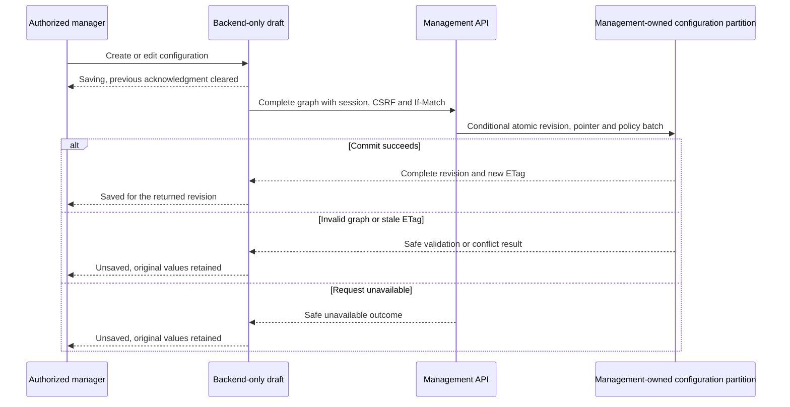

# Configuration Guide

## Scope and Entry

Management owns one organization, `default`. Authorized managers share its complete active
configuration; there is no customer/tenant selector, organization-creation workflow, draft
approval, scheduling, explicit rollback screen or agent playground. Runtime reads management
APIs, never its private Cosmos containers. Relationships configure handover permissions, not
which same-community peers an ordinary agent can discover.

Default local startup remains the credential-free foundation shell. The configuration editor
is an explicit composition using `create_app(editor=EditorServices(...))` and
`editor_asgi(application)`. Those services require the configured identity, same-origin
session guard, management API and reviewed capability registry; none is inferred from a
browser header. Live mode still fails closed pending the separate qualification gates.

For synthetic local editing from the repository root:

```powershell
uv run --directory code/tools --locked --no-sync python scripts/smoke.py --editor
```

Open the emitted loopback HTTPS URL. The self-signed certificate and `/_test/login/manager-one`
route belong only to the excluded test host, not the management wheel or a real Entra flow.
Only declared synthetic managers exist. The host rejects live identity injection before work.
All data is volatile; Ctrl+C stops owned processes and disposes the temporary profile.

Dependency preparation uses the Microsoft Python/npm proxies described in
[setup](setup.md) and [repository layout](repository-layout.md), with ordinary TLS validation.
Normal SSR export, isolated generated directories, a 180-second build budget and a 120-second
readiness budget are retained. A healthy foundation probe is not proof of live editor or call
readiness. See [US2 evidence](acceptance/us2.md) for measured results and remaining limits.

## Identity and Permissions

HTTP configuration routes and Reflex events require an authorized configuration manager.
Entra verification pins tenant, issuer, distinct web/API audiences, time validity, role and
delegated scope; OIDC browser login additionally uses one-use state, PKCE and nonce. Runtime
roles cannot manage configuration. There is no actor-header or environment-variable bypass.

Browser cookies contain opaque handles, not OAuth tokens. They are Secure/HttpOnly,
SameSite=Strict, host-only and expire at the earlier of token expiry or 15 minutes. Writes
require matching Origin and CSRF; never mix bearer and cookie identities. Reflex binds the
server-owned socket/state token to an actor and checks session validity before enqueue and
execution. Do not put OAuth tokens in browser storage or public Reflex state.

Sessions and editor drafts are process-local. Restart requires reauthentication; deployment
must not claim shared-session scale-out without separately reviewed routing/storage. A fresh
state token is required when switching actors. Test fixture login does not qualify live Entra.

## Graph Contract

The authoritative structural contract is [configuration.schema.json](../contracts/configuration.schema.json),
with matching strict Pydantic models and a schema-parity test. Extra fields/coercion are not
accepted. IDs are opaque, nonempty identifiers of at most 128 characters. Names are trimmed,
nonempty and at most 128 characters; agent-name uniqueness is case-sensitive.

| Entity | Fields and meaning |
|---|---|
| Complete graph | `schemaVersion=1.0.0`, `agents`, `communities`, `relationships`, `tools`, `mcpConnections`; all references resolve within this graph |
| Published revision | Graph plus server-owned `id`, `organizationId=default`, increasing `revisionNumber`, UTC `createdAt`, verified opaque `createdBy`, canonical SHA-256 `graphHash`; immutable after publication |
| Active pointer | `id=active`, `organizationId`, `revisionId`, `revisionNumber`, UTC `publishedAt`, server `_etag`; conditional publication base, not an editable graph field |
| Agent | `agentId`, unique `name`, `prompt`, `enabled`, `role`, nullable `communityId`, `capabilityAssignments`; nonempty prompt when enabled |
| Community | `communityId`, `name`, `routingDescription`, `enabled`, `entryAgentId`; entry is an ordinary member, and an enabled community requires an enabled entry |
| Relationship | `relationshipId`, `sourceAgentId`, `targetAgentId`, `allowedContextFields`; only `request_summary` and `transfer_reason` are allowed context names |
| Tool | `toolId`, `name`, `description`, `schemaVersion`, `inputSchema`, `outputAllowlist`, `enabled`, `approvedDestinationRef`, optional `mcpConnectionId`, fixed `effect=read_only`, fixed `classification=public` |
| MCP connection | `connectionId`, `name`, `approvedEndpointRef`, `enabled`, opaque `credentialRef`, `reviewedCapabilityCatalog` |
| Reviewed action | `actionName`, `inputSchema`, `outputAllowlist`, fixed `effect=read_only`, fixed `classification=public` |
| Assignment | `agentId`, `toolId`, exact `permittedActionNames`, JSON-object `allowedInputConstraints`; owner matches the enclosing ordinary agent, with no classification override |

Input schemas use JSON Schema 2020-12 and cannot fetch external references. Output allowlists
are nonempty. Approved destinations are administrator-owned HTTPS references, not arbitrary
URLs entered by managers. Input constraints configure a desired restriction object; the later
capability gateway must interpret/enforce them before live attempts. Catalog editing alone
does not execute a tool or grant permission to private/mutating data.

Serialized revisions, including server metadata, are limited to 512 KiB. Permission authority
is capped at 128 KiB; revision/pointer/policy publication plus reserved envelope space stays
below 768 KiB. Untrusted document depth is capped at 64. Reduce a rejected graph rather than
splitting it into partial writes.

## Communities and Protected Roles

Exactly one enabled Welcome, Routing and Goodbye exists, with no community membership.
They may receive name/prompt edits, but cannot be deleted, disabled, duplicated, repurposed or
assigned business tools. Ordinary agents belong to exactly one community. Prompt text cannot
change visibility, role or capability authorization.

Creating a community creates its ordinary entry and required paths. Add another ordinary
agent to a selected community with a name/prompt. Enable controls and entry choices obey the
validator; the client controls are not the security boundary. Replace an entry before deleting
that individual agent. Confirmed community deletion removes its ordinary members and related
paths, never protected roles. These operations remain draft changes until Save succeeds.

Required paths are Welcome-to-Routing, Routing-to-Goodbye, each enabled ordinary agent's
Routing/Goodbye paths and Routing-to-entry for enabled communities. They cannot be removed.
Optional same-community paths may be added/removed. Goodbye is not a source; Welcome is not
a destination; Routing cannot target an ordinary non-entry. A foreign transfer is explicitly
ordinary-to-Routing, then Routing-to-destination-entry. Cross-community direct ordinary edges
are rejected, including raw forged PUTs.

Context checkboxes select approved field names, not actual call text. Narrowing a field set
does not remove the required path. There is no control for raw history, audio or tool-result
transfer. Runtime discovery/handover implementation and actual phone behavior have separate
US1/US3 qualification gates.

## Catalogs and Secret References

An administrator supplies immutable `ApprovedCapabilities` separately to the validator and
editor services. An empty registry denies every submitted tool/connection/action. Never build
approvals from the submitted or stored graph, model output or server-advertised annotations.
The registry is bounded to 256 tools, 128 connections and 512 KiB of review metadata.

Add reviewed connections before their linked tools. New entries begin disabled. Managers can
edit names/descriptions, enable states and approved credential-reference choices, not reviewed
schemas, effects, classification, destination or MCP association. A submitted MCP action set
may narrow the reviewed set but cannot expand or alter it. Direct tools need a separate exact
approved action list. Assignments appear only for ordinary agents and list only reviewed
actions. Input-constraint JSON is applied explicitly and is limited to a 4 KiB object in the
editor. Removing a tool cleans its assignments; remove linked tools before a connection.

Credentials are approved `secret://<alias>` references with alias pattern
`^[a-z][a-z0-9-]{2,62}$`, never credential values or arbitrary vault URLs. Versioned detection
policy scans all text/nested values before persistence. It recognizes PEM private keys, URI
userinfo, credential-bearing assignments, SAS-style signatures and bearer candidates, but
does not promise universal secret detection. Unrecognized literal credentials remain
prohibited. Errors contain field paths/codes/rule/policy IDs, not submitted secret candidates.

Existing stores with capabilities require independently reviewed approvals before exposure.
Missing/mismatched approval must fail closed, not auto-approve, delete or silently fall back.
Revocations conservatively accumulate disabled/removed capabilities and removed/changed exact
assignment actions; re-enabling a definition does not silently clear current-policy denial.
Reauthorization belongs to later explicit permission administration.

## Save, Conflict and Recovery

Text fields buffer typing locally and flush on blur, preventing server round trips from
dropping keystrokes. Save replaces any previous success message with Saving before emitting
its busy/disabled state and publishing the complete graph with its original exact strong ETag.
Saved or Saved; audit pending acknowledges only the current returned revision. A request
failure returns to Unsaved and retains the draft, rather than leaving an earlier success
visible. Publication atomically creates a revision, advances `active` and orders permission
changes. It never writes a partial configuration.



GET returns the complete revision and ETag. PUT requires one exact If-Match: missing is 428,
stale/weak/wildcard is 412, oversized is 413, invalid is 422, unauthorized is 401/403 and
unavailable dependencies are 503. No query parameter may select another organization. Errors
use safe `application/problem+json` and correlation IDs. Unknown property names are not echoed.

On 412, both managers' local edits remain distinct; no silent merge or overwrite occurs.
Cancel a reload to keep the draft, or explicitly confirm discard/reload to fetch the latest
saved revision. On 422, fix only the reported fields; other draft values remain intact.
Never bypass validation by changing a prompt, raw role flag, ETag or database item.

Successful publication returns 200 with `X-Audit-Status: recorded` or `pending`. Pending means
the graph is already committed: retain its returned revision ID and recover metadata audit,
not the graph write. See the [configuration runbook](runbooks/configuration.md).

## Restart and Acceptance

The local repository is volatile. A reconstructed SDK-double repository proves adapter
behavior only, not actual process restart/Cosmos durability. Live composition requires a
management-owned `/organizationId` container, one `default` partition, Strong account
consistency, reviewed workload identity/private networking and separately authorized data
access. It is not created by startup, and outages cannot fall back to a local substitute.

The declared `us2-real-cosmos-v1` profile is opt-in, not executed: T099 environment evidence,
T112/T117 release prerequisites and T118 activation are mandatory. It requires dedicated empty
non-production targets and synthetic data; no automatic provisioning or cleanup is authorized.
It must prove management/runtime restart and zero activation of rejected/partial revisions
through the authenticated management API. Missing evidence means blocked, never passed.

The local evidence matrix distinguishes SC-006/SC-009/SC-018 from pending SC-012; SC-008's
participant study is deferred, not passed. Native Linux, remote CI, refreshed images, actual
Cosmos/live services, the pending tooling advisory and foundation/release gates remain open.
