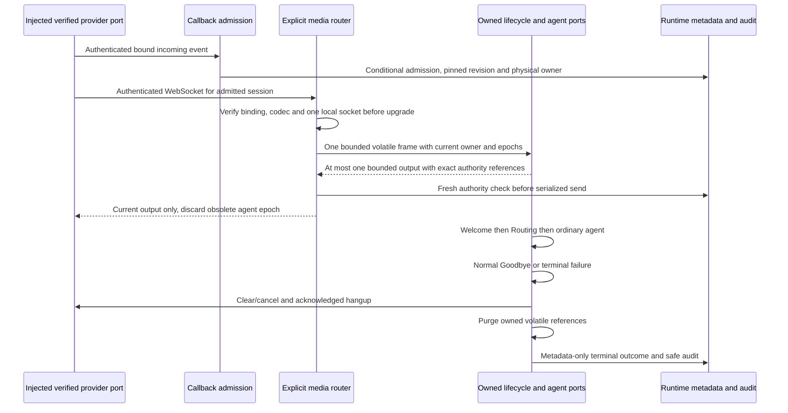

# Local Call Lifecycle and Media

## Qualification Boundary

The user authorized provider-neutral local implementations with injected doubles on
2026-10-26. No phone provider/scenario, tenant eligibility, region, license, real codec or
bidirectional wire protocol is approved by that exception. T042 remains pending, as do
T099/live acceptance. Default application startup does not mount provider/media routes and
unconfigured live mode still fails closed. See [telephony qualification](../telephony-qualification.md).



## Interfaces and Bounds

The explicit callback router delegates real provider identity and event verification before
admission/answer. Its events have fixed fields, duplicate events cannot answer twice, unsupported
codecs reject, and a failed answer is unavailable rather than success. This is not JWT/provider
qualification; the injected port is trusted and must enforce actual issuer/audience/signature/
expiry/call binding when a real adapter is separately approved.

The explicit media router authenticates before upgrade and checks exact admitted session,
provider-call reference, supported codec, nonterminal state and local connection capacity.
Query credentials are rejected. Untrusted identity/binding/codec produces HTTP 403 before
upgrade, not a fictional WebSocket close code. Default transport-only composition is for
contract validation, **not** audio agent processing. A working call requires a separately
reviewed AudioPort and provider translation; no default live implementation exists.

There is one reader and an inline serialized writer per accepted connection, no queued frame
tasks. Encoded/decoded/output frames are bounded to 64 KiB, and the audio path requires a finite
declared duration in (0, 200] ms. At most one output frame is returned per dispatch. A qualified
codec adapter must prove duration/decoded-size semantics; a supplied duration alone is not
proof of actual PCM timing. These bounds are not live speech latency or capacity measurements.

Physical binding/connection epochs are checked before dispatch and again before output.
Output with an obsolete agent epoch is dropped; it does not migrate a socket or replay old
history. The injected audio owner must validate leases/current authority and dispose its owned
SDK/content scope. Local socket exclusion is not distributed owner consensus; use the existing
[owner controls](scaling.md) and real conditional metadata authority before live composition.

Post-upgrade policy errors close 1008, oversized encoded frames 1009 and safe internal failures
1011. Normal 1000 requires confirmed audio disposal, provider hangup acknowledgment and
terminal metadata confirmation. A socket close or Ended metadata alone is not phone closure.
Disconnect cancels processing and attempts bounded cleanup; no normal spoken Goodbye is
required after caller disconnect or speech-channel loss.

## Cleanup and Failure

Normal lifecycle starts Welcome, invokes Routing and selects an eligible ordinary entry.
Goodbye is last on normal closure; phone hangup follows its completion within the remaining
original budget, capped at five seconds. Interruption shares one one-second cancel/clear
budget. Operations use cooperative async deadlines up to ten seconds; a small terminal reserve
prevents a blocked frame/hangup from receiving an unrelated fresh cleanup budget.

Owned context is purged in terminal finally paths, including cancellation/provider/storage
failure. Retained mutable audio is overwritten, conversation/tool container references are
cleared, and summaries/reasons are removed. Tests prove immediate logical disposal, stronger
than a delayed 300-second owner cleanup target. This does not erase immutable Python copies,
provider retention, backups, crash dumps or memory outside the owner's control. No content
may be written to a spill/cache/audit/trace or durable SDK session as a workaround.

The terminal helper reports `terminal_confirmed` and `hangup_acknowledged` separately. Unknown
storage or failed disposal is not successful recovery; preserve conservative reservations and
deletion guards. An unreachable provider may remain unconfirmed. Ports must honor cancellation;
the code does not forcibly kill uncooperative execution. Use safe fixed failure categories,
never exception payloads, caller text, prompts, raw frames or tool data in diagnosis.

Runtime audit records allow only bounded opaque references, UTC timestamp/day bucket, fixed
event/outcome/reason categories and revision/correlation metadata. Repositories revalidate
records before persistence, including model-copy updates. Local stores are detached test
adapters; injected Cosmos uses the owned container and day partition. Duplicate identity with
different metadata is a conflict, not a blind overwrite. Effective live roles/durability still
need T099/T118; no management private container is accessed.

## Operator Recovery

Authenticate operators using their separate internal role. Do not retry an uncertain answer,
hangup, terminal write or retirement as if no side effect occurred. Reconcile exact event,
session, owner/connection epoch and safe operation references. Fence obsolete output before
attempting bounded explanation/closure. Do not attach a competing worker or restore a lost
socket by resetting a lease. Existing calls keep their pinned ordinary revision and current
capability revocations remain immediate. See [configuration updates](configuration-updates.md),
[capability policy](capabilities.md), [scaling](scaling.md) and [monitoring](monitoring.md).

## Local Verification

```powershell
uv run --directory code/backend --locked --no-sync pytest tests/contract/test_call_transport.py tests/unit/test_cleanup.py tests/unit/test_call_lifecycle.py tests/unit/test_audit.py tests/integration/test_call_journey.py tests/integration/test_content_privacy.py -q
```

The local journey exercises 200 synthetic lifecycle/admission/closure/audit sequences using
real local repositories and injected agents/phone ports. It is not 200 eligible real calls,
speech intelligibility, supported telephony, live 99% availability or measured SC-001 evidence.
The real SDK transfer/isolation tests are separate. Actual provider connection and live journeys
remain explicitly gated; no default route or CLI command in this guide enables them.
