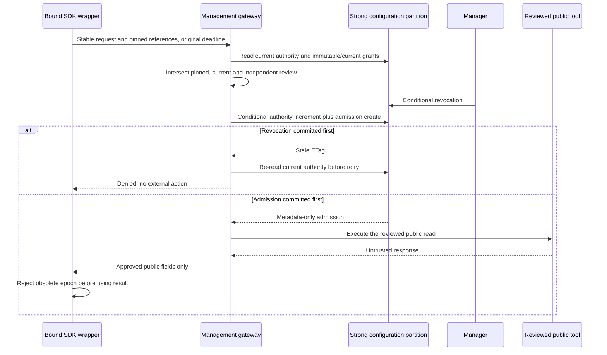

# Public Capability Admission and Recovery

## Qualification Boundary

This is the operator guide for the locally qualified US5 implementation. T087/T088 local
evidence and the unresolved intermittent editor export risk are recorded in
[US5 evidence](../acceptance/us5.md).
It is not permission to mount live routes, supply credentials, provision resources or call tools.
Caller identity-verification, customer-data lookups and business-change confirmation workflows
remain out of scope. A capability is public/read-only or is denied, even when assigned.

## Service and Identity Boundaries

Management owns configuration, current permission authority, admission metadata and external
execution. Runtime uses only authenticated contracts and never opens management's private
Cosmos container. Explicit API composition supplies the gateway, repository, runtime identity,
manager identity and metadata telemetry; the foundation mounts neither endpoint by default.

`POST /v1/runtime/capabilities/execute` requires the distinct runtime audience, the configured
application role, `idtyp=app`, no delegated scope, and an administrator-approved `azp` client ID.
Tenant/issuer/RS256/key/time validation is shared with the existing verifier. Browser cookies,
manager tokens, wrong clients and alternate audiences cannot authorize execution. Runtime's
explicit credential port requests `api://<runtime-audience>/.default`; there is no credential
discovery or fallback in the client. Qualify actual Azure-issued claims before live deployment.

`PUT /v1/security/revocations` uses existing manager authentication and browser CSRF protections,
not runtime permissions. `If-Match` must name the current authority ETag. No tenant selector or
permission-grant endpoint was added. Revocations are conservative unions; re-enablement is not
an implicit removal of previous security decisions.

## Request and Result Contracts

Execution JSON contains `requestId`, `sessionId`, `agentId`, `agentEpoch`, `pinnedRevisionId`,
`toolId`, `actionId`, `inputs` and aware UTC `deadlineAt`. Body limit is 64 KiB. Unknown/duplicate
fields, invalid references and invalid JSON fail safely without reflecting submitted content.
The effective action deadline is at most ten seconds and never later than the submitted one.

The SDK wrapper binds session/agent/epoch/revision/action in trusted closures, not model arguments.
It validates the physical-owner epoch before dispatch and after the gateway response. A stale
or foreign response is discarded. The managed-identity client uses one fixed HTTPS origin,
normal TLS verification, no environment proxy, no redirects and bounded response bytes.

A successful response contains matching request/session/agent/epoch references and `result`.
Management returns only independently approved, intersected top-level scalar fields, at most
64 KiB, after recognized-secret scanning. Nested unrestricted objects and raw server errors
are not returned. Approved field names alone are not evidence that arbitrary content is public;
the reviewed server implementation remains an explicit trust assumption.

Errors use fixed `application/problem+json` fields, never inputs or exception text: 401 missing
identity, 403 denied authority/grant, 412 stale policy ETag, 413 oversized body, 422 invalid input,
428 missing precondition, 503 dependency/unknown authority and 504 expired deadline. SDK tools
return a fixed unavailable result rather than exposing credential or provider exceptions.

## Ordering and Persistence

The authority has fixed ID `security-authority`, organization `default`, policy version,
disabled tools/connections, revoked exact assignments, admission sequence, UTC actor/time and
server ETag. It is capped at 128 KiB. Admission increments its sequence, not the policy version;
revocation advances policy version. Neither changes the active configuration pointer.

Cosmos uses an explicitly injected management container, organization partition `default` and
Strong point reads. One transactional batch conditionally replaces authority and creates safe
admission metadata. Publication already changes revision/pointer/permission data atomically in
this partition. SDK write retries are disabled. Failed or ambiguous admission never authorizes
external execution; do not infer success from a timed-out write. Local locks and Cosmos doubles
do not establish live durability. Metadata retention requires approved environment policy.

Admission records contain opaque IDs, agent epoch, sequence, policy version, actor and UTC time,
never arguments, results, credentials, prompts or transcripts. Current authority cannot be served
from the ordinary configuration cache. An already admitted in-flight public read may finish
after revocation; every new attempt, including retry, needs a fresh conditional admission.
Gateway attempts are bounded to three, retain the request ID/deadline, and reauthorize each time.
No new grant can expand an active call's pinned assignments.

## Reviewed Onboarding and Network Controls

Supply `ApprovedCapabilities` from an independently reviewed server-side registry, never from
manager JSON, model output, discovery results or server annotations. Review exact tool/action,
public/read-only implementation, bounded input schemas, scalar public output fields, endpoint
references, credential aliases and operating owner. Reject invalid/external schema references.
Pinned and current constraints must both accept inputs. Welcome/Routing/Goodbye have no tools.

Destination references resolve through explicit administrator-owned HTTPS URLs. Caller inputs
cannot select URLs. User-info, fragments, non-443 ports, non-HTTPS and nonpublic literal IPs are
rejected; runtime tool HTTP resolves all addresses, rejects any non-global answer, pins a public
IP and retains the approved hostname for Host and TLS verification. Redirects are rejected before
any follow-up request. Proxy inheritance and HTTP transport retries are disabled. Private MCP
destinations are not supported by this conservative initial transport.

Public direct adapters send a reviewed action/input envelope. MCP uses the maintained locked
Python SDK over the same pinned HTTP boundary, explicit protected credential-reference resolution,
bounded bodies and at most four catalog pages. Discovery confirms one already-approved action;
extra tools, read-only hints and server-selected schemas never extend grants. Remote logging
notifications are discarded. No arbitrary MCP server is attached directly to an SDK agent.

## Failure Recovery

- For 403, check pinned assignment, current enabled tool/connection, exact revocation and independent
  review using opaque references only. Do not alter prompts to bypass a denial.
- For 412, reload current authority. A manager must review before resubmitting; the gateway may
  retry admission only after fresh authorization, within the original deadline.
- For 422, check the approved input/constraint schema. Do not log submitted arguments.
- For 503/504, report uncertainty. Do not retry with a renewed deadline or bypass management using
  a cached grant/direct client. An unavailable authority denies new actions.
- For unexpected redirects, DNS answers, oversized bodies, missing reviewed MCP tools or malformed
  results, deny and investigate the approved endpoint out of band using safe metadata.
- For stale runtime epoch, drop the result. Never redirect it to another call or a replacement agent.

Use only fixed error codes, policy/sequence/epoch and opaque correlation/request/session/revision
references for investigation. Application spans/events exclude arguments/results and exception
details. Live identities, TLS/network policy, production server behavior, audit retention and
residency require separately approved qualification. Tests do not certify compliance or legal scope.

The editor's normal production export has intermittently timed out during root prerender.
The final uninstrumented complete management suite passed, but no permanent export fix is
claimed. If the timeout recurs, retain the failed result and safe build log, fail the regression
gate and investigate. Do not silently retry inside the test, increase bounds, switch rendering
profiles or use isolated browser success as a substitute for a complete regression run.
