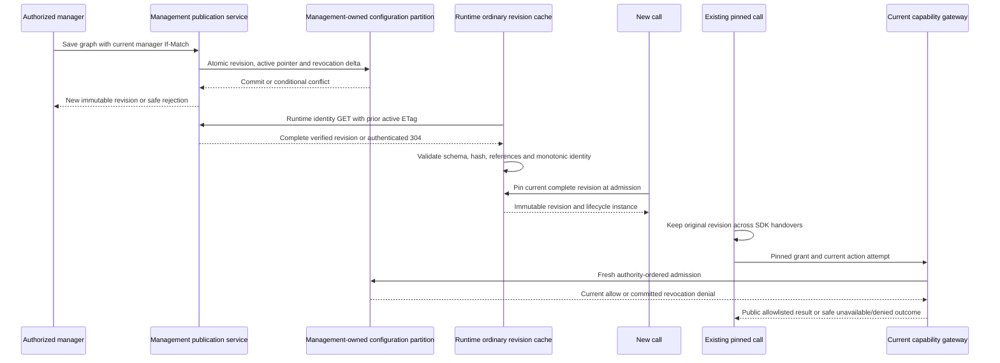

# Runtime Configuration Updates

## Scope and Ownership

US4's local snapshot, refresh and revision-pinning components are implemented. They do not
enable live calling, give runtime direct access to management's Cosmos containers, qualify
real persistence or clear the existing full-suite failures. See [local US4 evidence](../acceptance/us4.md)
and [live environment status](../acceptance/live-environment.md). T043 media, T097 live metric
delivery and T099 environment qualification remain open. No deployment/authentication occurred.

Management owns immutable configuration revisions, the active pointer, permission authority
and publication audit. Runtime retrieves snapshots only through authenticated management HTTP.
Ordinary configuration cache entries never authorize a capability attempt. Both services
remain independently packaged; no shared database or runtime import of management code exists.



## Snapshot API

The explicitly composed router provides `GET /v1/runtime/configuration`. Default management
startup does **not** mount it. Supply the management-owned repository, an actual runtime service
identity implementation and metadata-only telemetry. The existing identity boundary requires
the correct tenant/issuer/signature/time/audience, application identity and reviewed runtime
role/client, not a manager session, browser/model assertion or synthetic test header.

Authentication occurs before request-body/condition checks and private repository reads. Query
parameters and GET bodies are rejected. `If-None-Match` is restricted to one bounded, quoted
strong ETag; wildcard, weak/list or duplicate header forms are not part of this local contract.
This is not a general public caching interface.

| Result | Contract |
|--------|----------|
| 200 | Complete verified immutable revision: ID, organization `default`, schema version, number/time/creator, graph hash and all graph collections |
| 304 | No body, only after authentication and a fresh successful read/verification of the current pointer/revision with matching ETag |
| 401/403 | Safe identity failure before storage; no-store problem response |
| 422 | Unsupported body/query/condition without input reflection or storage read |
| 503 | Missing or malformed revision/pointer/hash/schema or unavailable storage; never stale 304 |
| 504 | Bounded operation deadline, not a fresh budget for each step |

Successful 200/304 responses carry `ETag`, `Cache-Control: private, no-cache`,
`Vary: Authorization` and a sanitized correlation ID. Errors use `application/problem+json`,
fixed codes and `Cache-Control: no-store`. Revision prompts, credentials and dependency
exceptions are not recorded in events/spans. An authorized response contains declarative
configuration, not caller conversation or executable SDK objects.

## Runtime Validation and Refresh

`RevisionSnapshot` stores canonical detached bytes behind a frozen value; it preserves revision
ID/number/hash/schema/ETag and hides content from its representation. Strict envelope/agent/
community/relationship/public-read-only catalog shapes, metadata and assignment/connection
references are checked, along with the canonical SHA-256 graph hash and 512 KiB bound.
A consistently recomputed hash does not legalize unknown tool fields, write classification or
unresolved grants. Management's publication validator and independent capability review remain
authoritative; runtime shape/reference checking is not a replacement for those reviews.

The hash uses UTF-8 JSON, sorted keys, compact separators, non-ASCII preserved and non-finite
numbers rejected, over the six graph fields only. Metadata remains in the full immutable
envelope. `for_runtime()` returns a detached **trusted orchestration graph**, never an agent
prompt. `view_for()` uses the existing community visibility boundary: same-community directory
metadata, Routing's community entries and no foreign prompts/catalogs. Tool execution is still
denied by default in these discovery projections; explicit SDK tools require the separate
trusted binding/reviewed catalog/current-gateway boundary.

`RevisionCache.install` validates a whole candidate before one current-pointer assignment.
Rejected or partial responses leave the last complete snapshot intact. Revision-number
regression, changed content under a reused ID or different identity at the same number is
rejected. A call retains its immutable pin when the current cache pointer advances. There is
no persistent cache or silent file/local-database fallback: a restarted empty cache cannot
admit a new call until it obtains a valid revision.

`ConfigurationClient` accepts an explicitly reviewed fixed HTTPS management origin, exact UUID
audience, injected credential, transport, cache and optional metadata meter. It requests only
`api://<audience>/.default`, requires a current token and uses normal TLS with environment proxy
trust and redirects disabled. No caller/model/response can select a different endpoint or
credential scope. Origins with user-info, path overrides, query/fragment or unsafe characters
are rejected. This constructor is a trusted composition boundary, not a manager-editable URL.

Refresh attempts have one original ten-second budget including lock, credential and HTTP work.
A single lock coalesces due attempts; cadence is 30 seconds from the previous attempt, including
failures. The body is bounded to 512 KiB and duplicate/malformed JSON keys, incompatible
snapshots, wrong ETags and HTTP errors are rejected. An unsolicited 304 without a cached pin or
a mismatched 304 ETag cannot establish configuration. A later valid ordinary revision can be
selected without deployment, while current permission checks remain uncached.

Imports/constructors create no worker or live credential/client discovery. An explicit
`ConfigurationActivation.running()` scope warms the cache, owns the stop/cancel task and cleans
it before telemetry shutdown. The runtime app factory accepts optional activation injection;
default startup constructs none, and unconfigured live mode is rejected **before** entering
that scope. Work must honor async cancellation; noncooperative transports are not qualified.

## Admission, Handovers and Current Authority

`ConfigurationActivation.admit` pins once before conditional metadata creation and builds a
per-call `CallLifecycle` from that same revision. Its returned immutable admission value keeps
both snapshot and lifecycle; later cache updates cannot mutate the graph or stored revision.
Duplicate admission does not return a new owned lifecycle. No valid enabled business community
means decline new admission, not a substitute protected-agent-only call.

Use the same pin's trusted graph to construct community visibility and the fresh-session SDK
handover coordinator. The actual SDK/container-double test preserves the original physical
owner and stored configuration revision after a newer pointer is installed. No live route,
provider protocol, cross-pod socket migration or automatic existing-call refresh is introduced.
Integrated media composition still depends on T043; local admission is not a phone call.

Publication policy now has its own service module, with repository exports retained for
compatibility. The repository still atomically creates the immutable revision, replaces the
active pointer conditional on manager ETag and replaces current authority conditional on its
ETag, in the same `default` partition. Conservative revocation unions and admission sequence
are preserved. An admission-only authority conflict retries with fresh authority inside the
existing budget; stale manager-pointer conflict returns rejection without overwriting edits.
A failed authority batch does not partially publish a revision or pointer.

Each capability attempt intersects pinned grants with fresh current authority at management.
A save that removes/restricts an assignment or disables a tool/connection updates that authority
in the publication transaction. The next affected action can be denied even though the call
keeps its older revision; later grants do not expand that pin. Neither 304 responses nor cache
fallback changes this rule. Previously admitted public reads may finish; retries/new attempts
still require current admission. Keep the [capability runbook](capabilities.md) controls.

## Failure and Recovery

On refresh failure, retain only the last complete validated in-memory revision for eligible
new calls. If there is no pin, decline new admission. Keep existing calls pinned; do not replay
their content, switch owners, force a new SDK session using current prompts or broaden grants
to repair an outage. A corrupt dependency result produces a safe fixed category and optional
metadata-only configuration failure metric, not a payload/trace dump.

Investigate safe schema/hash/ETag, revision-order, credential audience/expiry and private
dependency categories. Do not enable public/key storage, alternate feeds, redirects, arbitrary
destinations or stale-permission caching to make a failed refresh pass. A manager corrects an
invalid edit through the normal validated save using current ETag; rejected edits do not advance
the pointer. A failed or stale save preserves unsaved UI work under the existing conflict flow.

This feature adds no draft approval, scheduling, playground, configuration rollback product or
undrain API. A reviewed later save can publish corrected values as a new revision, not mutate
history or revoke already pinned ordinary state. Image/infrastructure rollback is separate and
must preserve active owners and current security revocations. See [scaling](scaling.md).

## Verification and Open Gates

```powershell
uv run --directory code/backend --locked --no-sync pytest tests/unit/test_configuration_cache.py tests/integration/test_revision_activation.py -q
uv run --directory code/management --locked --no-sync pytest tests/contract/test_runtime_configuration.py tests/integration/test_configuration_publication.py tests/unit/test_permission_ordering.py -q
```

Local tests prove twenty virtual revision changes become available to new calls on the next
30-second due refresh, immutable existing pins, actual lifecycle/SDK metadata binding, real
FunctionTool gateway dispatch, current revocation denial and local/Cosmos-double atomic policy.
They do not establish wall-clock SC-007 under deployed load, real Cosmos restart/durability,
token/private network propagation, live handover timing or working alerts. The 60-second target
remains a live observation obligation, not a claim from the virtual clock.

The full backend still has deferred media errors; full management has editor export setup
errors. No failed test is excluded, assertion weakened or timeout increased. T099/T118 and
all existing advisory/native-Linux/remote-CI/release obligations remain open. Review exact
environment/identity/privacy inputs before any live configuration or provider activation.
