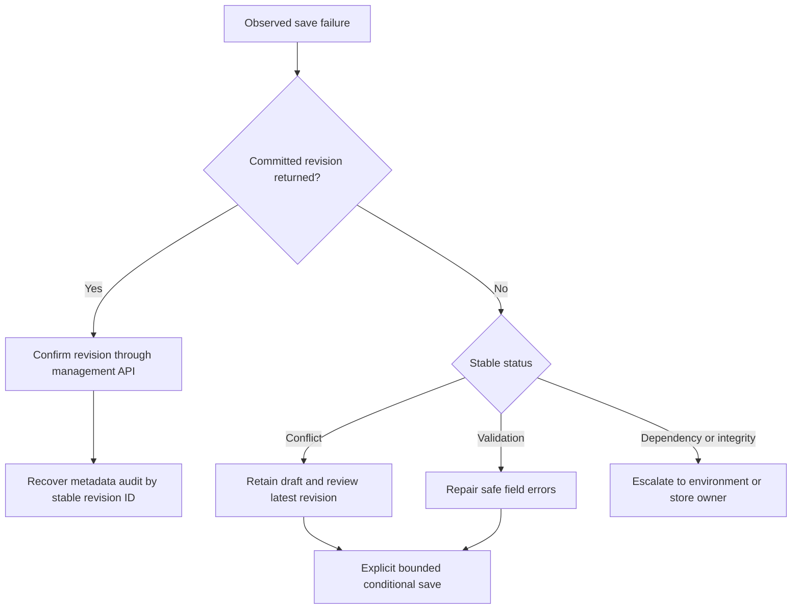

# Configuration Recovery Runbook

## Boundaries and Safe Evidence

Owner: management service. Configuration, active pointer, permission authority and audit
stores are management-owned; runtime must use management APIs, never private-container reads.
Use the [configuration guide](../configuration-guide.md) for fields, roles, permissions,
catalog approval and editor operations, and [US2 evidence](../acceptance/us2.md) for qualification.

Do not provision, deploy, rotate credentials, change tenant/account consistency, grant roles,
delete data or bypass a network boundary as an automatic recovery step. Live work requires
T099 authorization and later release gates. Do not route secrets through the assistant.

Record only UTC time, service/mode, opaque actor/revision references, correlation ID, status,
ETag outcome, policy version and stable reason code. Do not copy prompts, graph bodies,
credential candidates, token/cookie headers or unrestricted tool results into tickets/logs.
Access to a graph in the manager UI does not authorize reproducing its content in diagnostics.

## Triage

1. Check service health, mode and process ownership. Default local `/readyz` describes the
   foundation and is not proof that editor identity/storage/live calls are qualified.
2. Identify whether Save returned a committed revision ID/ETag. A completed graph commit
   cannot be undone by an audit outage; preserve that ID before retrying anything.
3. Classify the stable status/reason below. Use the existing revision as authority, not an
   exception's prose or a model's assertion that a change succeeded.
4. Preserve the manager's draft unless they explicitly confirm discard/reload. Do not alter
   an ETag to force a save or manually edit the active pointer/permission authority.
5. Escalate missing live qualification, unavailable dependencies and unexpected invariants
   to the owning environment/security operator with metadata-only evidence.

| Observation | Action and exit condition |
|---|---|
| 401, expired session, socket refused | Reauthenticate through configured OIDC, with a fresh Reflex state token if switching actor. Check exact tenant/issuer/distinct audiences and clock without printing tokens. Exit when API and events agree on the authorized manager. |
| 403 or CSRF denial | Check manager role/scope and exact same-origin HTTPS/CSRF flow. Do not trust an actor header, put a bearer in browser storage or grant a runtime role manager access. Exit only after the intended authorized identity succeeds. |
| 428 | Start from a fresh authorized GET and retain its exact strong ETag. The editor normally does this; do not fabricate a wildcard precondition. |
| 412 | Preserve unsaved values. Another manager may have committed. Compare through the authorized UI, then explicitly discard/reload or manually reapply the intended edits against the fresh revision. No silent overwrite/merge. |
| 422 | Use field path/code/rule metadata. Repair missing references, protected-role/path violations, unreviewed capabilities, malformed secret references or recognized literal credentials. Never include the rejected candidate in an incident. Exit when a valid complete graph commits once. |
| 413 | Reduce the complete graph/review/authority footprint. Snapshot includes metadata and is limited to 512 KiB; authority 128 KiB; publication stays below 768 KiB. Never split a graph into partial writes to evade the limit. |
| 503 or `configuration_store_unavailable` | Stop new mutation retries; retain draft and last committed ID. Check authorized identity, private networking, Strong account consistency and storage availability. No local fallback or weakened reads. Reread current revision before a bounded retry. |
| 200 with `X-Audit-Status: pending` | The graph committed. Retain returned ID/ETag, confirm current graph through the API, and retry idempotent metadata audit recovery. Never replay the graph mutation to repair audit. |
| Invalid snapshot/hash/reference after read | Fail closed. Preserve safe metadata and immutable revision identity; escalate storage integrity/ownership. Do not accept a partial record, recompute a hash to bless tampering, or substitute a local graph. |
| Tool enabled but denied | Review exact pinned assignment, current authority/revocation and approved registry. Re-enabling does not erase denial or expand an old call's permissions. Do not patch raw authority records; explicit later reauthorization is a separate controlled workflow. |
| Session/draft disappears after restart | Process-local session/draft state is expected to be lost; reauthenticate and fetch the committed revision. Local storage is volatile. Do not call a double reconstruction real durability evidence. |
| Build/readiness timeout | Keep the 180/120-second bounds and retain owned-process diagnostics. Stop only owned process trees. Do not repeatedly retry to hide a failure, disable certificate checks, change feeds or patch framework code without a reviewed fix. |

## Conditional Store Recovery

The Cosmos adapter requests Strong reads in the exact organization partition. The owner must
have configured `/organizationId`, organization `default`, and an actually Strong account.
It never constructs a client or identity automatically. A stale configuration-pointer ETag
returns conflict; an admission-only authority conflict may retry at most three times inside
the original five-second operation budget. Non-idempotent SDK write retries are disabled.

If a publication batch fails, confirm that its revision/pointer/policy did not partially
advance before any operator-approved retry. The API's normal response is a safe error, not
permission to perform three separate writes. Never remove fencing or move items across
organization partitions. Do not let runtime identities read the private configuration store.



Audit recovery uses `AuditService.recover_publication(committed_revision)` with a trusted
management-owned revision and an explicitly injected audit repository. The stable record ID
makes repeat recovery idempotent. Only publication metadata is extracted. There is not yet a
scheduled backlog enumerator or audit-completeness certification. Do not invent a nonexistent
repair endpoint or give runtime unrestricted database permissions for this operation.

## Privacy and Credential Incidents

If a literal credential was merely rejected, keep only field/rule/policy metadata and verify
the active revision ID did not change. Remove the candidate from the unsaved field. If there
is reason to believe a real credential reached any store, log, screenshot or unauthorized
party, stop the workflow and escalate to the security owner for approved containment/rotation.
Deleting UI text, TTL expiry or a new revision does not prove removal from backups/copies.

Registry mismatch is an approval/configuration incident, not a reason to approve the active
graph automatically. Validate trusted review artifacts independently, including exact schemas,
read-only/public classification, destinations, MCP actions and approved aliases. Do not resolve
or print credential values to prove a reference exists.

## Restart Qualification and Live Gate

SC-012 remains pending until `us2-real-cosmos-v1` runs in an explicitly authorized environment.
Its declaration lives with the persistence acceptance tests; it is not a live executor.
T099 evidence must validate deployed images, workload identity, private networking, Strong
storage access and the broader required environment. T112/T117/T118 then own explicit
promotion/execution; missing prerequisite evidence remains blocked, not skipped or passed.

The target must be dedicated, approved, empty and non-production, with synthetic data and
least-privileged management ownership. No automatic container creation, reset or cleanup is
permitted. Retain reviewed cleanup disposition and restart evidence without content payloads.
Verify committed revisions/ETags/hash/policy survive management restart; runtime restart must
retrieve through the authenticated management API and use zero rejected/partial revisions.
Do not claim this from the local store, SDK double or mock-server restart.

## Verification and Handoff

From the repository root:

```powershell
uv run --directory code/management --locked --no-sync pytest tests/integration/test_configuration_persistence.py -q
uv run --directory code/management --locked --no-sync pytest tests -q
uv run --directory code/tools --locked --no-sync python scripts/verify_docs.py
```

SC-006 local rejection/atomicity, SC-009 responsive keyboard operation and SC-018 shared
manager scope are mapped in the acceptance record. SC-012 live durability is pending and
SC-008's participant study is deferred. Native Linux/remote CI, refreshed images, actual live
services, unresolved security advisories and foundation/release approval remain separate gates.
Handoff metadata includes observed results, affected revision/policy, remaining gate/owner and
the next safe action; never convert a missing environment into successful qualification.
