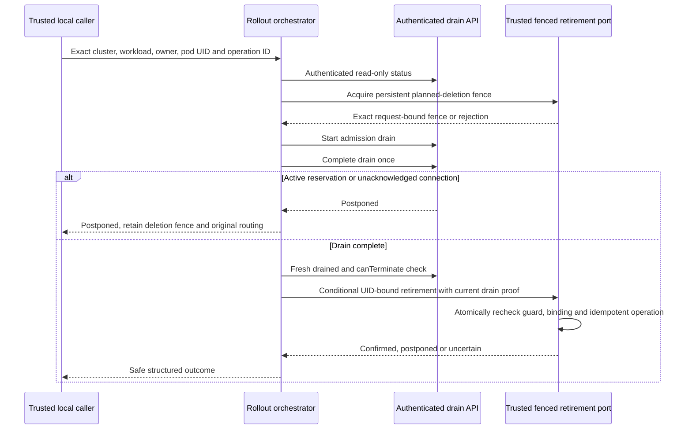

# Local Drain Rollout Controls

## Scope and Authorization

On 2026-10-26 the user selected **Continue local T098 controls**, authorizing an isolated
orchestrator with injected operator/cluster doubles while T097 remains unchecked. Monitoring,
media and live gates are unchanged. This is local T098 completion, not permission to contact
Azure, authenticate a real cluster, enable alerts, provision, deploy, evict pods or scale nodes.

[drain_rollout.py](../../tools/scripts/drain_rollout.py) implements one bounded planned-removal
attempt. Its CLI only validates a nonsecret plan. No live cluster/identity/HTTP execution
adapter is provided, no workload manifest is changed, and no cloud package is added. A fake
port's assertion of protection is not evidence that Kubernetes or Azure prevents deletion.
Read [monitoring](monitoring.md) and [platform security](platform-security.md) for other gates.

## Workflow and Safety Boundary



The request is immutable and binds `cluster_ref`, namespace, workload, runtime owner, pod name
and **pod UID**, with one stable `operation_id` and intent `rollout` or `scale_in`. A name alone
cannot authorize removal of a replacement pod. IDs are bounded, and Kubernetes target names
use a conservative lowercase-label subset. No credentials, endpoints, scripts or arbitrary
execution fields are accepted.

`OperationsPort` must authenticate a least-privileged internal operator for every call. Its
status/begin/complete responses must match the existing API's exact bounded fields and owner;
string booleans, foreign owners and unexpected fields are rejected. The runtime still owns
admission fencing, callback/media routing and verified physical closure. The orchestrator never
decrements reservations, changes owners/epochs, detaches connections or invokes hangup.

`ClusterPort.fence` must establish persistent protection against **independent planned removal**
by rollout, autoscaler and maintenance actors. The typed `RemovalFence` is a trusted in-process
port result, not a user-supplied approval, credential or Kubernetes enforcement mechanism.
Protection must remain in force while calls drain, after postponed/blocked/uncertain outcomes,
on cancellation, and across orchestrator failure/restart. There is deliberately no automatic
unfence-on-exit operation that could expose still-active calls to another actor.

`ClusterPort.retire` must atomically enforce the still-current guard, exact cluster/workload/
owner/pod UID binding and fresh authoritative drain proof at its side-effect boundary. It must
deduplicate the operation ID against the **same full request**, reject conflicting reuse, and
reconcile prior ambiguous submissions rather than deleting again. A Python pre-check followed
by an unconditional Kubernetes delete is not a valid implementation of this contract. UID
preconditions alone do not enforce the independent-deletion/drain conditions.

The local orchestrator checks these port results but cannot supply the missing server-side
enforcement. The live adapter must use reviewed RBAC/admission/control ownership and durable
fencing/reconciliation. Grace periods, PodDisruptionBudgets, readiness, preStop hooks, fixed
node counts, a successful health request or a `canTerminate` value alone are not call-preservation
guarantees. This mechanism does not prevent power loss, hard node failure, manual break-glass
actions or provider outages; those remain separate owner-loss/failure obligations.

## Budgets, Outcomes and Recovery

Each invocation has one absolute asyncio deadline, finite and positive up to ten seconds,
shared with all injected calls. There is no wait loop, sleep, unbounded retry, background
retirement or maximum-call-age timer. Async ports must honor cancellation and the original
deadline without blocking the event loop; a noncooperative implementation is not qualified.
When a call remains active, return promptly and let an authorized external scheduler decide
when to attempt the same bound operation again. Do not restart admission or reroute established
callbacks merely because deployment progress is slow.

| Outcome | Meaning | Operator response |
|---------|---------|-------------------|
| `postponed` | Drain is incomplete, or the atomic cluster guard/binding changed | Keep protection and established routing; retry only under the same reviewed operation binding |
| `blocked` | No confirmed retirement submission; authorization, fence, response or control/deadline check failed | Preserve fencing/drain state, investigate safe category; do not infer zero side effects in a failed begin/fence call |
| `uncertain` | Retirement was submitted but its outcome is unknown or unrecognized | Reconcile exact UID/operation/ledger before another action; do not claim removal or blindly retry |
| `retired` | Trusted cluster port confirms the guarded removal | Continue only with qualified controller evidence and the intended replacement/scale-in plan |
| `already_retired` | Trusted port confirms the same bound operation was already applied | Do not repeat the removal |

Cancellation propagates after a safe failure event and does not release a fence. An ambiguous
retirement may already have succeeded; a timeout cannot be labeled a confirmed non-removal.
Unknown/invalid drain data always blocks before removal. Failures do not dump raw exception
messages, submitted plans, IDs, credentials, prompts or caller content. Structured local
events carry UTC timestamp, severity, fixed service/environment/event/outcome/reason codes and
an opaque per-attempt correlation ID. The tool is not a public runtime endpoint or an agent tool.

## Validation-Only CLI

A plan has exactly this shape; values below are synthetic, not environment approval:

```json
{
  "operation_id": "operation-fixture",
  "intent": "rollout",
  "target": {
    "cluster_ref": "cluster-fixture",
    "namespace": "runtime",
    "workload": "calls",
    "owner_id": "owner-fixture",
    "pod_name": "call-worker",
    "pod_uid": "pod-uid-one"
  }
}
```

```powershell
uv run --project code/tools --locked --no-sync python code/tools/scripts/drain_rollout.py --check-plan PATH_TO_REVIEWED_NONSECRET_PLAN
```

The input is at most 4096 bytes; duplicate keys, unknown/missing fields, unsafe targets and
unsupported intents fail. Success exits 0 with `rollout_plan_validated` and
`mode=validation_only`; rejection exits 2 with a fixed category and no input reflection. The
CLI has no execute mode, credential argument, automatic kubectl/Azure fallback or live effect.
Plan validity proves neither target existence, operator authorization, current ownership nor
a deletion fence. Calling `orchestrate` requires explicitly supplied trusted ports.

## Executed Local Evidence

All **28 rollout tooling cases** pass, and the full tooling suite passes **59 cases**. All
**18 planned-drain/API integration cases** pass, including a new actual FastAPI/HTTPX journey
through status/start/complete. It proves active reservations postpone, terminal metadata with
an unacknowledged connection still postpones, and only acknowledgment permits the guarded
retirement double. The orchestrator invokes no hangup. Tests also cover rejected operator
authority before cluster controls, exact fence binding, missing protection, reused pod UID or
lost guard at commit, repeated stable operations, malformed/stale status, original deadlines,
cancellation, ambiguous results and non-reflective CLI failures. Strict mypy passes the new
orchestrator and repository lint passes. The normal CI tooling command discovers these tests.

```powershell
uv run --project code/tools --locked --no-sync pytest code/tools/tests -q
uv run --directory code/backend --locked --no-sync pytest tests/integration/test_planned_drain.py -q
uv run --project code/tools --locked --no-sync mypy --strict code/tools/scripts/drain_rollout.py
```

These are local port and actual drain-API tests, not real pod removal, provider hangup, deployed
identity, controller HA, cluster-wide reconciliation or live zero-disconnect evidence. Earlier
full-suite Azure deadline/media/browser export failures remain open; no tests are excluded or
assertions/timeouts weakened. T097 cloud mapping/query/delivery and T043 integrated media are
still pending. T099 authorization/qualification and later live T100/T118 evidence must precede
any claim that a deployed rollout or scale-in preserves active calls. No environment request
is satisfied by this guide or its test doubles.
