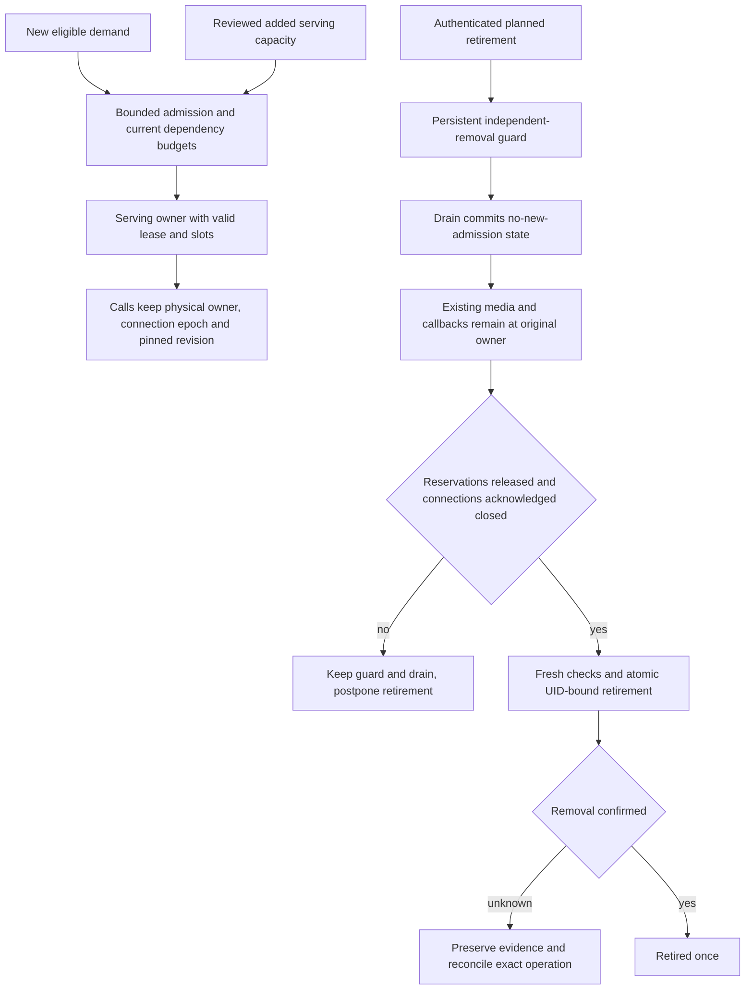

# Scaling and Safe Retirement

## Scope and Qualification State

This consolidates the isolated local US6 checkpoint, not a qualified live call platform. On
2026-10-26 the user selected **Continue isolated local T100/T101**, permitting deterministic
acceptance and this runbook before unfinished T046/T097. That exception does not complete
integrated media, enable alerts, authorize an environment or waive any failed merge/release gate.

See [local acceptance](../acceptance/us6.md), [live environment status](../acceptance/live-environment.md),
[monitoring](monitoring.md), [rollout controls](drain-rollout.md) and
[private platform boundaries](platform-security.md). T097 and T099 remain unchecked; all ten
alert definitions are disabled. There is no live cluster removal adapter, deployed independent-
deletion guard, integrated T043 media path, measured model/phone capacity or working production
monitoring claim. The default apps do not mount capacity/drain business controls or allow calls.



## Signals, Limits and Cost Inputs

Decide new capacity using confirmed demand, conservative session reservations, model quotas,
transient handover overlap and routing/connection limits, not CPU alone. `active_count()` and
`caller.active.reservations` are local reservations, possibly including ambiguous creates, not
verified active phone calls. T123 now shares atomic call/model reservation accounting when
controllers explicitly use the same `LocalSessionRepository` authority object. Fixed limits
must agree; current model-quota updates affect every controller using that object. This is
not cross-process quota consensus, persistent Cosmos authority or restart ownership. An
explicitly injected `CosmosCapacityRepository` now provides a separate persistent-authority
adapter, contract-tested with independent adapters and an ETag-capable container double;
its deployment/storage/clock guarantees are not yet live-qualified. The
same local authority now also holds owner serving/draining/drained phase: it atomically denies
new reservations after drain and postpones completion while any shared call/model reservation
remains. Owner expiry/renewal now uses the same local authority's explicit UTC clock and
validates every owned session before atomically updating owner/session leases. Controller
heartbeat caches are not authority; expired owners cannot be revived by re-registration.
Physical connections and existing reservation metrics remain controller-local; this does not
prove persistent cross-process fencing, cluster-wide safe deletion or durable recovery.

| Input or signal | Required handling |
|-----------------|-------------------|
| Slots per owner and aggregate maximum | Explicit reviewed limits; admit only to serving, healthy owners with remaining slots |
| Shared local authority | Use the same repository object for all tested controllers; mismatched fixed limits deny admission. Unsupported repositories have no unsafe local-accounting fallback. |
| Shared local owner drain phase | Registration cannot reset draining/drained; state-read or transition uncertainty must not return cached success. A different controller's call or undisposed model still postpones completion. |
| Shared local owner lease | Use one trusted authority UTC clock and fixed bounded period. Re-registration cannot extend expiry; invalid/backward time denies capacity. Heartbeat validates all held session bindings/leases before any renewal. |
| Model quota | Charge baseline sessions plus receiver overlap; reserve before preparation and release only after confirmed disposal |
| Quota reduction or zero quota | Block new allocations rather than disconnect established calls; zero reports saturated |
| Pending admission | Default 256, configurable within 1-4096; reject excess before the repository lock instead of accumulating work |
| Owner registry | Local bound 1024; do not infer cluster size or live capacity from this safety cap |
| Lease and operation budgets | Heartbeats cannot revive an expired persisted lease; operations use finite original budgets up to ten seconds |
| Capacity-backed session lease | New session expiry cannot outlive its shared owner expiry. A stale local heartbeat cache cannot override the current authoritative serving-owner selection. |
| Response uncertainty | Retain conservative reservations after an ambiguous create; denied admission is not proof no metadata was committed |
| Reservation reply lost or metadata already terminal | Keep the authority reservation charged. Ended metadata or lease expiry alone does not authorize reclaiming it; verified closure/disposal and the matching owner binding are required. |
| Model/phone/connection/RU limits | Obtain actual approved quotas, throttling behavior, headroom and provider eligibility before deployment |
| Cost | Model cost per call, transient overlap, Cosmos RU, AKS nodes, firewall/egress and telemetry ingestion are unmeasured; require accountable limits |
| Telemetry retention/caps | Explicit reviewed Terraform inputs; a declared ingestion cap is not a complete billing or privacy guarantee |

The 100-to-200 test schedule is virtual control evidence, not approved production sizing.
Do not fill missing per-call prices, RU demand or regional/model availability with defaults.
The model-overlap primitive is tested locally but not wired into a qualified live SDK/media
composition. Real callers, quotas and costs remain T099/live T100/T116 obligations.

## Admission and Scale-Out

### Explicit Persistent Authority

Use the adapter only with an explicitly supplied runtime-owned container and trusted UTC
clock. It constructs no identity/client and is not mounted by either default app. Its reserved
`runtime-capacity-authority-v1` item uses that same value for `id` and partition `sessionId`.
Strong-consistency account/client behavior must be qualified before live use. Central state is
bounded to 512 KiB and 1024 owners; four ETag-conflict attempts share the original operation
budget of at most ten seconds. These bounds are not measured RU/throughput capacity.

`initialize_capacity_authority` is a trusted one-time empty-installation/bootstrap operation,
not an outage repair. It accepts explicit fixed limits and an initial model quota. Existing
authority cannot be reset by reconstruction or repeated initialization, and current quota
changes remain shared. Normal admission/heartbeat/drain operations never initialize missing
state. The item has `ttl=-1`; do not manually delete it, clear reservations or change retention
to reclaim capacity. A missing/malformed item requires reviewed recovery, not a local fallback.

Owner registration cannot renew expiry or reset drain phase. Heartbeat validates every held
session binding before atomically renewing central owner/call leases. Session lifecycle and
handover rows remain per-call; their copied lease does not extend central authority. Consumers
of capacity-backed sessions must use this adapter's effective lease, not a raw repository
lease or controller cache. Unknown closure/disposal remains charged across adapter restart.
Reconcile actual physical/provider/model closure under qualified authority before trusted
release; this adapter supplies no connection reattachment or automatic uncertain-work cleanup.

### Trusted Cleanup After Reconstruction

T123's shared admission/physical-owner/recovery engineering is complete; real environment,
provider observation, live performance and protected rollout qualification remain separate.
See the requirement-by-requirement [T123 completion evidence](../acceptance/us6.md).

The stable authority item now requires document schema 2 with shared connection claims.
Schema 1 or absent connection state fails closed. Never delete/reset old authority or infer
zero physical work from a legacy document; reviewed inventory/migration and deployment remain
separate authorized operations. No migration, cloud client or production activation occurs here.

Use the shared `OwnerRouting` repository contract, not `CosmosSessionRepository` alone. Exact
session/owner/epoch/opaque claims prevent duplicate attachment across routers. Shared open
claims postpone drain even after terminal metadata/call-budget release. Output requires a
fresh claim and lease; uncertain attachment remains fenced/occupied rather than reassigned.

`recover_owner(owner_id, observer=...)` is the composed recovery entry point. Register the
original owner without extending its lease, then inject a trusted qualified observer. One
pass reads retained bindings and connection claims and gives each observation the original
at-most-ten-second deadline. A closed observation must echo the exact binding and contain a
UTC time between pass start and the current clock. Physical claims are reconciled first;
baseline work cannot be released while its connection is open. Only after confirmed physical/
baseline closure may the pass conditionally mark terminal and release the original charge.
Exact transient-model disposal may be reconciled independently. Invalid, stale, future,
foreign, open, unknown or failed observations remain pending; cancellation propagates.

The observer is an injected trust boundary, not a self-submitted boolean or release credential.
No default provider implementation is enabled. Missing metadata stays pending, uncertain
releases are idempotently reconciled, and no socket/lease is adopted. A recovery report counts
confirmed/pending metadata work, not measured live calls or qualified real-world durability.

`CapacityService.recovery_bindings(owner_id)` lets a trusted caller inspect one registered
owner's retained charges after controller restart loses local maps or tokens. It returns an
immutable tuple of `CapacityRecoveryBinding` values with session ID, physical owner, connection
epoch and optional model token. Cosmos uses one Strong authority point read, not a session
scan or cross-partition transaction; the local stand-in uses its existing lock. Service
validation rejects mutable/untyped, foreign, malformed, duplicate or >20,000-record replies.
Only known bounded metadata is projected, never provider payloads or call content.

Inspection does not populate active/model caches, change authority/ETags/phase, renew leases
or free charges. Expired-owner bindings, reservations whose session row is missing and
model-only charges remain visible for investigation, not automatically safe to release.
An unavailable authority or invalid clock fails closed without a cached ownership fallback.
Each returned binding still requires independent physical/provider/model verification;
this method is not authentication, a cleanup approval or an observation of actual connections.

`CapacityService.reconcile_closed_session` accepts the original session ID, registered
physical owner and connection epoch after a trusted lifecycle/recovery caller independently
verifies physical call and baseline-model closure. It also requires existing Ended metadata;
it never marks an unconfirmed live call terminal or treats expiry/Ended as physical proof.
`reconcile_disposed_model` additionally requires the exact known reservation token after
independent disposal confirmation. Model disposal can be reconciled while its call remains
active; it cannot free another session's token. These are internal trusted interfaces, not
authentication, an approval credential, public routes or a physical-status probe.

Both methods use the existing bounded operation/lock, reread durable session identity and
owner/epoch, and delegate conditional release to the shared repository. Unknown/missing
authority, foreign bindings and conflicting local caches fail without clearing local state.
After an uncertain reply, retain bookkeeping and reconcile the same exact verified cleanup;
only a confirmed idempotent release clears it. Cancellation does not infer a cleanup outcome.
An expired owner may finish verified one-way cleanup, not renew/revive its lease or reattach
a socket. Ordinary cache-based release methods keep their conservative existing behavior.

No automatic scan, physical-work discovery, synthesized missing session, forced reclaim or
provider/cluster client is added. Owner-scoped metadata discovery has 15 new offline cases;
the earlier explicit cleanup methods have 27. Real outcome verification and production
recovery wiring still need separate production implementation/qualification; those earlier
checkpoints alone did not complete T123 or authorize operating a live environment.

Those earlier 34 storage-contract cases were not real Cosmos/process-crash evidence. Current
T123 completion adds shared connection fencing, observation-gated recovery and independent-
process contention tests; actual live qualification remains pending. No new cloud access,
provider choice, deployment, route or call is enabled.

Observed run 40669135195 on 2239345 subsequently verifies 448 runtime/413 management/165
tooling passes and assertion/cleanup on Windows and Ubuntu, with Ubuntu diagrams/audits and
actual Linux image smoke/three-image audits passing. Windows fails the required actual
Mermaid render at the unchanged 300-second limit; its later dependency audit does not run.
At that checkpoint the investigation was parked under the user's move-on direction, not
certified repaired. The failed gate was retained without retries, sandbox/budget changes
or waived assertions. These checks do not qualify actual Cosmos, physical recovery or calls.

Observed run 40686000514 on deb9c8a now passes every Windows/Ubuntu/image step, with
448 runtime/413 management/175 tooling cases per native platform, assertion/cleanup,
Mermaid CLI preparation and all 28 actual diagram indices, plus package/image audits and
actual image smoke. The direct-Node Windows path is hosted-verified; historical causes
remain uncertified. This removes that current verification blocker, not the physical
coordination/reconciliation, actual Cosmos/environment or live/release gates. T123 stays
partial and 113/129 tasks are checked; no live action is authorized by the successful CI.

Before any live action, obtain separate environment/deployment authorization and actual T099
qualification, reviewed image/infra/resource ownership, privacy inputs, provider support and
working operator monitoring. No command in this guide provisions or deploys anything.

For an authorized scale-out, use the reviewed controller to add serving capacity without
retiring existing owners. Verify actual ready capacity, valid owner leases, network/provider
access and remaining aggregate/dependency quotas before assigning new demand. Preserve each
existing call's physical owner, connection/agent epochs and pinned revision. Required callbacks
continue to resolve to that owner; scale-out must not rebalance an established WebSocket.

If there are no safe slots or authority/storage is unknown, return the bounded unavailable
outcome. Do not revive expired leases, exceed quota, free uncertain reservations, redirect a
call to a replacement owner or enable public/key access to compensate. Scale-out is not a
remedy for unresolved policy, network or provider eligibility. Keep any new capacity out of
admission if its authority or readiness is uncertain; do not change pinned calls to make it ready.

## Owner Loss and Dependency Failure

Immediately fence obsolete output at the original physical owner. Dispatch requires the current
physical owner, connection epoch, agent epoch, valid lease and nonterminal state. A replacement
worker never acquires an old socket merely because a lease expired. Callback lookup fails
closed if ownership cannot be established.

Use the remaining original budget for a safe unavailable explanation, conditional terminal
metadata and provider hangup attempt. Preserve the separate `terminal_confirmed` and
`hangup_acknowledged` results. Ended metadata, a closed local socket or a timeout is not a
provider closure acknowledgment. Do not silently reclaim a session/model budget whose disposal
is unknown. Reconcile authority and actual provider/model closure under the same trusted
controller; the current local components do not implement distributed HA reconciliation.

An outage that prevents these confirmations stays unresolved. Do not log caller content,
credentials, prompts, tool arguments/results or raw exception bodies while investigating.
Break-glass or destructive recovery requires separate accountable authorization; this runbook
does not promise recovery from hardware loss without disconnects or automatic socket migration.

## Planned Drain and Removal

1. Authenticate a least-privileged internal operator before any mutation. Confirm exact cluster,
   workload, namespace, owner, pod name, **pod UID** and stable operation ID, plus actual server-
   side protection against independent rollout/autoscaler/maintenance removal.
2. Keep that protection persistent across postponement, controller failure and cancellation.
   A typed `RemovalFence` from a test port, PodDisruptionBudget, preStop hook, readiness change,
   fixed node count or longer grace timer is not deployed enforcement.
3. Start drain through `POST /v1/operations/drain/{owner_id}`. This fences new assignments but
   leaves established media, callbacks and required owner heartbeats on the same owner.
   In controlled local tests, all controllers must use the same explicit repository authority;
   committed drain phase is checked atomically with call-slot reservation. This is not a
   persistent cluster fence or permission to operate a real environment.
4. Use `POST /v1/operations/drain/{owner_id}/complete` and fresh authenticated
   `GET /v1/operations/drain/{owner_id}` status. Require exact owner, `state=drained` and a
   boolean `canTerminate=true`. Reservations **and** unacknowledged physical connections block
   completion even when session metadata is terminal. Health endpoints cannot authorize drain.
5. If postponed, retain the guard and original routing. There is no maximum call duration or
   force-on-grace-expiry path. The local orchestrator returns after one bounded attempt rather
   than polling; an authorized scheduler may retry the same exact bound operation later.
6. Only the trusted retirement adapter may conditionally remove the exact UID, atomically
   rechecking current guard, ownership and authoritative drain proof and deduplicating the full
   operation binding. A pre-check followed by unconditional delete does not satisfy the contract.
7. If submission times out or its acknowledgment is unknown, classify it `uncertain`, not
   removed or safely absent. Reconcile the exact UID and durable operation ledger before further
   action. Never release the protection automatically on error or blindly delete a replacement.

The actual drain API is tested locally. The CLI in the [rollout module](../../tools/scripts/drain_rollout.py)
validates plans only; no live execution flag or adapter is enabled. The qualified environment
must enforce removal restrictions against *other actors*, including node removal, not just
against a cooperative caller of this Python function.

## Pause and Rollback

If a release or scale-in becomes unsafe, pause further admission to unqualified new capacity
and stop further planned removals. Preserve existing owners, callbacks, leases and committed
deletion guards. Do not treat redeploying an old image as restoration of a lost socket.

There is no shipped draining-to-serving reset/undrain API. Do not manually flip state, renew an
expired lease, swap UID/owner bindings or clear a guard to accelerate rollback. Keep draining
instances protected until their calls close normally. Add fresh reviewed capacity only under
the approved deployment/control procedure; rollback must not independently delete active pods.

Calls keep their pinned ordinary configuration and agent epochs. Current security revocations
still apply on the next affected capability attempt; rolling back an image/configuration does
not restore revoked permissions. Unknown policy remains deny. A rollback requiring Terraform,
image deployment, break-glass grants or provider changes needs separate review/authorization.
Record safe reason/operation metadata and reconcile uncertain effects before resuming work.

## Both-Service Alerts and Diagnosis

Use the [monitoring runbook](monitoring.md) for exact thresholds, owner/runbook/action-group
inputs, fixed source filters and collection contracts. Both services define errors, weighted
mean HTTP latency, dependency failures, bounded saturation and missing-telemetry rules.
Runtime additionally records local admissions/reservations and ordinary transfer outcomes.
Management saturation is latest capability deadline consumption, not CPU or fleet utilization.
HTTP/transfer-control timing is not first-resumed-audio latency or a live p95 measurement.

All ten rules are currently disabled. Treat absent collection or missing notifications as
**unqualified monitoring**, never a healthy service. A future deployment needs actual firing,
on-call acknowledgment, recovery and runbook access evidence for both services before relying
on it. Do not enable arbitrary exporters, automatic content tracing or public ingestion/query
as a workaround. SDK/provider tracing privacy guards and metadata-only label limits remain.

In an incident, use safe fixed categories to distinguish quota saturation, admission overload,
expired/lost ownership, configuration/current-authority failure, private dependency outage,
incomplete drain, ambiguous retirement and absent metric delivery. Do not infer effective Azure
denial from additive role definitions or substitute a liveness response for operational readiness.
Any monitoring exception must be accountable and time-limited, not an implicit release waiver.

## Verification and Remaining Gates

```powershell
uv run --directory code/backend --locked --no-sync pytest tests/load/test_capacity.py tests/integration/test_owner_failure.py tests/integration/test_planned_drain.py tests/unit/test_metrics.py -q
uv run --directory code/management --locked --no-sync pytest tests/unit/test_metrics.py -q
uv run --project code/tools --locked --no-sync pytest code/tools/tests/test_drain_rollout.py code/tools/tests/test_qualify_environment.py -q
```

The isolated checkpoint passes **80 backend cases**, **32 management metric cases** and **66
operational-tool cases**. Full backend discovery has **313 passes and 13 missing-media errors**;
it is not green. The earlier Azure deadline failure did not recur in that run, but is not
proved repaired. Management browser failures and other prior release gates were not waived.

Those counts describe the earlier checkpoint. The current T123 local increment passes all
30 capacity/profile cases, including ten cross-controller/authority boundary cases; see
[current scoped results](../acceptance/us6.md#t123-shared-local-authority-increment-2026-10-28).
Its complete backend run passes 394 cases; repository/type/Terraform/secret/publication checks
and all 165 tooling cases pass. The changed admission sequence actually renders locally.
It does not complete persistent quota/owner authority, cluster removal or live qualification.

The increment's run 40606716532 on 6d859af passes native Ubuntu (394/413/165), all diagram/
assertion/package gates and actual Linux image smoke/audits. Windows passes tooling but
reports 392 backend passes/two handover failures before management discovery; both exact
cases pass in one unchanged local check. The unproven host-only investigation is parked for
now, not repaired or waived; current required CI remains blocked. See the acceptance record
for exact test names, results and scope. No timeout or assertion was changed to obtain a pass.

The subsequent shared-local-drain increment adds nine cases: 39 capacity/profile and 18
planned-drain cases pass, and the complete backend passes 403 cases locally. Persistent
owner/lease authority and actual physical/cluster removal qualification remain open.
Repository/type/Terraform/secret/publication gates and all 165 tooling cases pass, and the
updated shared-drain sequence renders locally without changing browser or timeout controls.

The shared-local-lease increment adds eleven cases: all 50 capacity/profile and 18 planned-
drain cases pass, and the complete backend passes 414 cases locally. These deterministic UTC
clock/renewal checks are not persistent Cosmos, cross-process fencing or live recovery proof.
All repository/type/Terraform/secret/publication gates and 165 tooling cases pass; the changed
lease sequence actually renders locally without changing browser or timeout controls.

Observed run 40656926575 on 271bc49 subsequently passes every native Windows/Ubuntu and
Linux image step: 414/413/165 tests per native platform, all assertion/render/package gates
and actual image smoke/three-image audits. These results verify the local lease increment
only; persistent authority, cross-process fencing, physical coordination and durable recovery
remain unqualified. Existing failure history and parked investigations are preserved.

Observed run 40652020707 on 1ea0e7c subsequently passes every native Windows/Ubuntu and
Linux image step: 403/413/165 tests per native platform, all assertion/render/package gates
and actual image smoke/three-image audits. These results qualify the local increment's
regression checks only; persistent authority, shared leases/recovery and live qualification
remain open. Earlier failed checks and parked investigations are preserved in the evidence.

Local numeric measurement fixtures test acceptance boundaries, including strict integer zero
disconnect evidence; they do not supply live samples. The opt-in wall-clock profile still
requires T099/T112/T117/T118 and actual approved 100-to-200 load, admission/greeting/speech/
handover targets, zero planned-removal disconnects and operator diagnosis evidence. Native
Linux/remote CI, provider/Cosmos durability, media, real cluster guards, cost/quotas, alert
delivery and advisory/release obligations remain open. No cloud action was performed here.
