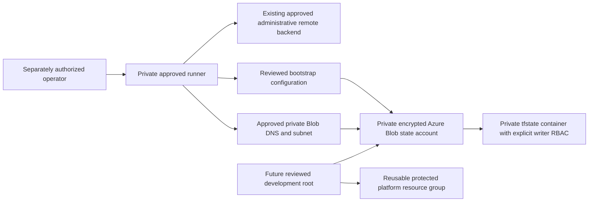

# Terraform State Foundation

## Status and Authorization

T094 is locally implemented and validated. It provided a protected remote-state bootstrap
and reusable platform resource-group foundation. T095 now extends the module with the
[development composition](platform.md); T096's [security definitions](platform-security.md)
are now locally validated, with effective live behavior still pending qualification.
No Azure login, backend connection, real plan, apply, provisioning or deployment was performed.
Default application startup and all prior security/foundation/live gates are unchanged.

The authored resources describe a future reviewed environment. Names, region, principal IDs,
existing network references and retention must be explicitly supplied; none is approved by a
test fixture or an example. Backend/provider validation and mocked plans do not establish
actual subscription permissions, regional support, network access, state locking or durability.

## Pinned Toolchain

[The version pin](../../infra/terraform/.terraform-version) selects Terraform **1.17.0**.
The bootstrap requires that exact CLI and AzureRM **5.11.0**. The reusable module allows
compatible AzureRM 5.x beginning at 5.11.0; a consuming root must own its final selection/lock.
Each validation root has a checked-in `.terraform.lock.hcl` recording 5.11.0 with signed
provider checksums for `windows_amd64` and `linux_amd64`. A child-module lock is used for its
standalone tests, not as a substitute for the development root's own lock.

The local installed Terraform 1.9.1 was not adopted as the project pin. Terraform 1.17.0 was
downloaded from HashiCorp over normal verified HTTPS, and its Windows archive SHA256 matched
the official HTTPS checksum manifest:

```text
2948dd7f77dec0f562ec29000103e0441d915be5e5f1a02c1ce23681951cfb19
```

This is HTTPS checksum verification, not an independent CLI PGP-signature attestation.
Terraform reported the installed AzureRM provider as signed by HashiCorp. No TLS bypass,
alternate Python/npm feed, machine-wide installer, elevation or system-tool replacement was
used. The portable CLI lives under ignored `code/tools/test-results/terraform/`.

## State and Platform Ownership



The [bootstrap](../../infra/terraform/bootstrap/main.tf) declares a dedicated state resource
group and ZRS StorageV2 account with Azure storage encryption and infrastructure encryption,
HTTPS-only transport, TLS 1.2 minimum, public network access disabled, shared-key access disabled,
OAuth default authentication, private containers and deny-by-default network rules. Cross-tenant
replication and nested public objects are disabled. A Blob private endpoint uses approved existing
subnet/DNS-zone references; there is no temporary public-access bootstrap exception.

Explicit Entra object IDs receive `Storage Blob Data Contributor` scoped to the state container,
not the subscription/resource group. This is the documented backend role for reading/writing
and leasing state; no application service receives state access. Terraform `prevent_destroy`
guards protect the state resource group, account and container, and an Azure `CanNotDelete`
management lock protects the account. These are safeguards, not irrevocable protection against
an authorized administrator changing locks or configuration. RBAC propagation remains a live check.

Blob versioning and blob/container soft delete use an explicitly supplied recovery interval of
7-365 integral days. This input is a technical recovery setting, not an invented legal retention
policy. Versioning alone does not expire old versions or certify backup deletion; approved
version lifecycle, backup retention, residency and recovery drills remain environment obligations.
The future apply must verify ZRS and the selected storage features in the approved region.

The [reusable platform foundation](../../infra/terraform/modules/platform/main.tf) retains
its dedicated protected resource group with explicit region, name and owner tags. T095's
adjacent module resources are described in the [platform runbook](platform.md). They do not
establish live call capacity, grant cross-service access or imply a ready cluster.

## Avoiding Circular Bootstrap and Local-State Fallback

The bootstrap's own `azurerm` backend is intentionally partial. It requests Entra authentication
and OIDC and disables Azure CLI fallback. Its approved backend account/container/key and federation
context must be supplied separately by the authorized administrator. It cannot initialize itself
against the new account before that account exists.

Use an **already approved administrative remote backend** for any separately authorized initial
provisioning. If none exists, stop and obtain the approved landing-zone/bootstrap procedure;
do not silently create local plaintext state, temporarily expose storage or use access keys/SAS.
The existing subnet, private DNS linkage and private runner access are also prerequisites.
No such provisioning or migration is executed by this increment.

Provider and backend credentials are distinct. Provisioning needs reviewed management-plane
and role-assignment authority; backend writing needs only the approved state-container data role.
The provider requests OIDC, disables Azure CLI use and disables automatic resource-provider
registration. The authorized provisioning environment must supply the approved federation and
must not introduce secret/key/SAS authentication fallbacks. Resource providers must already be
registered through the reviewed administrative process.

Backend coordinates are nonsecret references. Tokens/secrets must never be supplied through
committed variables, backend files, command-line values, outputs or plan artifacts. Environment
or protected workload-identity token delivery belongs to a separately approved operation.
Terraform state can still contain provider-computed sensitive attributes even when no secret
variables/outputs are declared; `sensitive` only controls display, not encryption. Treat state,
plans, cached backend metadata and old versions as protected administrative data.

## Credential-Free Verification

After preparing the locked Python tooling environment, run from repository root:

```powershell
uv run --project code/tools --locked --no-sync python code/tools/scripts/verify_terraform.py prepare
uv run --project code/tools --locked --no-sync python code/tools/scripts/verify_terraform.py check
uv run --project code/tools --locked --no-sync pytest code/tools/tests -q
```

`prepare` explicitly downloads the pinned CLI if absent, verifies the official HTTPS checksum,
and initializes each validation root using `-backend=false -input=false -lockfile=readonly`.
It may download provider dependencies from their official registry, but never configures Azure
state or credentials. Existing installation feeds for Python/npm remain the required Microsoft
proxies; Terraform/vendor downloads are separate tooling dependencies.

`check` requires the prepared exact CLI and fails if it is missing or mismatched. It performs
recursive format checking, `terraform validate`, and native `terraform test` in all three roots.
All test runs are explicit `command = plan` with `mock_provider "azurerm"`; these are mocked
plans, not authorized real Azure plans. Inherited Azure/ARM variables, Terraform variable/CLI
argument overrides and CI identity tokens are stripped, and an empty temporary Azure CLI
configuration location is supplied. No default cloud credential chain is intentionally used.

The verifier's dispatcher has no real `plan`, `apply`, `destroy` or `force-unlock` command path.
Failures propagate without a success fallback or hidden retry. The check-only path rejects
missing, empty, failed or skipped native test evidence: a zero exit code alone is not proof
that any required test ran. The existing CI `prepare` helper prepares these dependencies;
the Terraform pre-commit hook runs the check-only path.
PR jobs gain no new cloud identity, permissions or deployment step. Remote CI results are not
claimed merely because those helpers are wired.

## Executed Evidence

Native Windows with Terraform 1.17.0 and signed AzureRM 5.11.0 passed backend-disabled schema
validation and **seven original T094 native mocked cases**: private encrypted/keyless storage, explicit
writers/private link/deletion lock, empty writers, invalid retention, malformed UUID, explicit
platform ownership and missing owner/region rejection. The malformed-UUID regression first
failed against the loose guard, then passed after canonical UUID validation was added.
The T095 verifier covered three roots and 16 passing native cases. T096 expands the current
gate to 24; see [platform security evidence](platform-security.md) for the identity/network assertions.

All **31 tooling tests** pass, including six new verifier cases for cloud/argument injection,
checksum mismatch, child failure, allowed check commands, absent-tool fail-closed behavior and
rejection of a successful but empty native test suite.
Strict mypy passes the two changed Python scripts. Actual backend authentication, Blob leases,
restore, locking under contention and Windows/Linux deployed behavior are not tested by mocks.
Linux package hashes are prepared, but native Linux execution and remote CI remain unobserved.

No application behavior or dependencies changed. The existing backend Azure-deadline assertion,
deferred media failures, tooling advisory, frontend intermittent export risk and foundation/live
release obligations remain as documented; they are not waived by T094.

## Recovery Rules

Retain state locking. Never use `-lock=false` as a workaround, force-unlock an active writer,
remove deletion protection or migrate state without a separately reviewed procedure and proof
that no writer is active. Resolve lock ownership using administrative metadata, not state dumps.

For backend 403/network/DNS errors, check federated identity, exact container role, RBAC propagation,
private runner routing and private DNS. Do not enable public networking, supply shared keys or
grant subscription-wide data roles to get past a failed check. Reconcile and verify recovered
state serial/lineage before any approved resume. Version restoration and deletion-lock changes
require an accountable operator and reviewed backups; no recovery command is run automatically.

Official references: [AzureRM backend locking/authentication](https://developer.hashicorp.com/terraform/language/backend/azurerm),
[Terraform release](https://releases.hashicorp.com/terraform/1.17.0/), and
[AzureRM 5.11.0 provider](https://registry.terraform.io/providers/hashicorp/azurerm/5.11.0/docs).
