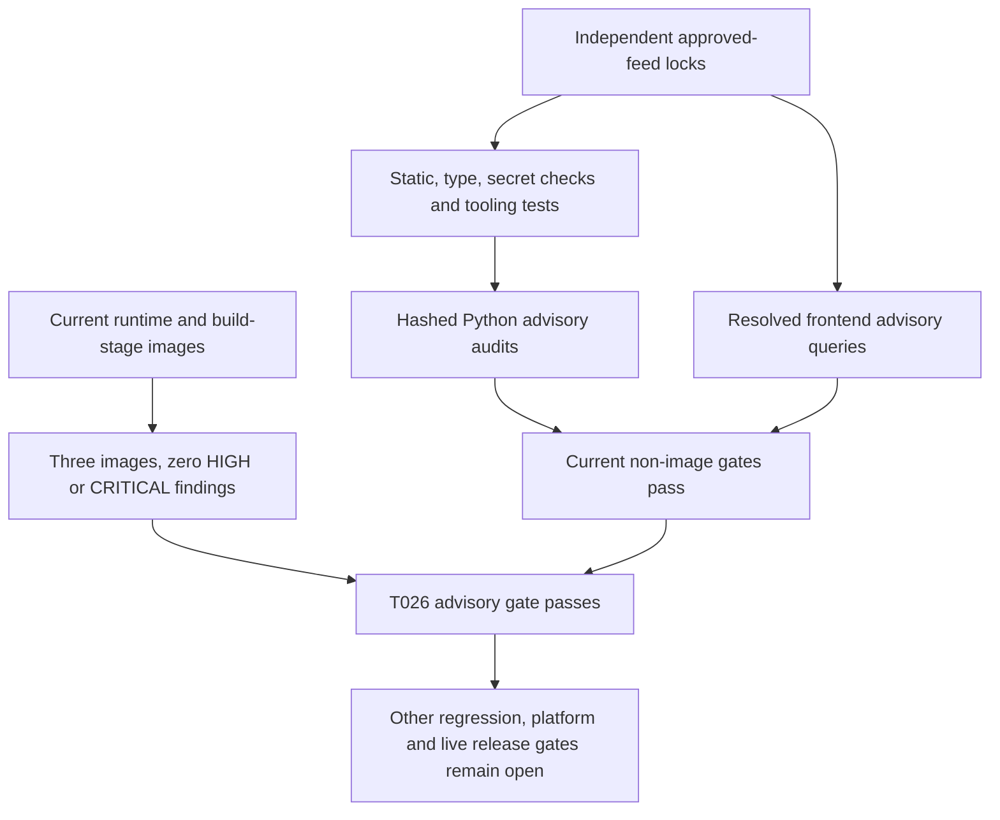

# Foundation Security Gates

Local startup constructs no live identity, Cosmos, phone, model or business-tool clients.
Live mode is unavailable rather than falling back to local adapters. Both applications reject
sensitive telemetry attributes and content capture; SDK tracing is off by default. Its explicit
opt-in emits only fixed-operation in-memory metadata. Provider realtime tracing is rejected
until approved metadata-only controls exist. No production privacy/legal approval is implied.

## Dependency Audits

```text
uv run --project code/tools --locked python code/tools/scripts/audit_dependencies.py
uv run --project code/tools --locked python code/tools/scripts/audit_dependencies.py --images
```

On 2026-10-26 the approved Microsoft Python proxy supplies the previously unavailable fix.
The baseline strict audit found **13 findings in two development packages**: seven affecting
`virtualenv` 21.14.7 (including `CVE-2026-113722`, fixed at 21.14.9) and six affecting `filelock`
4.2.0 (fixed at 4.2.1). The tools manifest now retains security floors `virtualenv>=21.14.9`
and `filelock>=4.2.1`; targeted approved-feed resolution changed only those lock entries to
**virtualenv 21.14.11** and **filelock 4.2.4**. Application locks are unchanged. No alternate
feed, TLS bypass, advisory ignore, mitigation or vulnerability exception was used.

The subsequent actual strict hashed audits pass with **69 backend**, **92 management** and
**59 tools** Python packages and **294 frontend coordinates**, all reporting zero known
findings. This is current advisory evidence, not a guarantee that no vulnerability exists.
The existing audit's static/type/offline-secret/Terraform checks and all **97 then-existing
tooling tests** also passed after installing the two locked patches. Two added offline
regressions verify that the floors exclude vulnerable versions, accept the reported fixes,
cover the selected lock versions and retain the approved registry.
After the user restarted Docker, the engine reports Linux-container mode. The first full image
retry found HIGH `CVE-2026-92392` in actual management build-stage `curl` and `libcurl` 8.22.0-r0,
with 8.23.0-r0 reported fixed. The build now requires both APK packages `>=8.23.0-r0`; digest-
pinned bases, Python/npm feeds, TLS and scanner policy are unchanged. A red-first regression
guards those requirements. The complete unchanged `--images` gate then passes: all **three
actual runtime/build-stage images** have **zero HIGH/CRITICAL findings**, alongside the clean
Python/frontend audits. No ignored/unfixed finding or alternative scanner result is substituted.

**T026 is locally complete.** The final complete tooling suite passes **103 cases**, including
security-floor and image-browser ownership regressions. Real image smoke also passes non-root/
offline startup, health/readiness and Chromium shell/event checks at **360/768/1440** widths.
Owned image/container/cache artifacts are cleaned. This does not complete foundation, native
Linux host/remote CI, native editor-export, media, live-environment or release acceptance.

The initial extra image smoke attempt timed out because its browser-directory selector also
invoked native editor-export fixtures unrelated to the foundation image. The image profile now
selects the unchanged `test_shell.py` assertions against the published container URL and cleans
its owned subprocess tree on success, failure and timeout. The timeout remains 180 seconds.
Full management discovery still runs all editor tests and its earlier failure gate remains open;
the passing image shell is not a claim that native editor export was fixed.



The earlier independent-work authorization was not a waiver. T026 closure uses current executed
image evidence, not the older Scout snapshot. CI still runs strict audits after functional, failure-gate
and documentation checks. Failed Python audits print only public package/version/advisory/fix
identifiers before temporary reports are deleted; no candidate secrets are retained.

The helper first runs locked static/type checks and metadata-only offline secret detection.
It exports hashed exact Python requirements from each independent lock, excluding only the
local project itself, and runs strict pip-audit without dependency resolution. Missing package
advisories or failed collection are not clean results. Temporary requirements/reports are
deleted, and no secret candidate values are written into reports.

The Bun lock is parsed as JSON5. Resolved coordinates, not requested version ranges, are queried
against the public OSV npm advisory API. Every batch must return a complete response. HTTP,
schema, unknown-coordinate and advisory failures fail the gate. Findings expose only public
package/version/advisory identifiers. This does not change the approved package registries.

Image mode builds both real runtime images and management's real frontend build stage. An
official digest-pinned Trivy 0.76.1 container scans their OS/Python/npm contents with current
advisory data, without ignoring unfixed vulnerabilities or suppressing base findings. High or
critical findings block acceptance. The scanner uses the local Docker API socket and an owned
temporary cache volume; this is a trusted CI tooling operation, not an application privilege.
Owned audit image tags/cache are removed. A failed database fetch is failure, not zero findings.
The portable pinned Trivy path has now completed the current three-image gate. Historical
runtime/build-stage scans below used Docker Scout; they were not substituted for this result.

## Feed Publication Update: 2026-10-27

The user requires private mirror URLs to remain local-only. Shared config and build defaults
are now public; Python artifact relocation verifies public filenames/SHA-256/sizes, and Bun
retains registry-relative integrity-pinned coordinates. Private settings/backups are ignored.
The always-on publication guard checks worktree/index/local history without printing matching
URLs. A local compile regenerated private lock URLs and was correctly blocked until relocation.
The previous image/advisory passes above do not certify these changed Docker inputs: fresh
public download/build/scanner evidence remains pending. TLS failures are not bypassed. Full
management again has 24 root-prerender errors, so merge/release remains blocked despite the
passing source/private-URL guard and tools tests. Draft source review is separately authorized.

## CI Browser Sandbox Boundary

The user explicitly approved selecting installed Google Chrome only for native Ubuntu GitHub
diagram rendering after the prepared browser failed with `browser_sandbox_unavailable` in
run 40491123126 on 381e38d. The fixed runner path and reported version are validated; absence
fails closed, without falling back or disabling the sandbox. Local/Windows rendering keeps
the prepared browser. No host sandbox policy, sysctl, sudo or setuid permissions are changed.
Puppeteer's [Ubuntu AppArmor guidance](https://pptr.dev/troubleshooting) documents this boundary;
its mostly obsolete setuid workaround is not adopted. The CI-only browser is runner-provided,
not an application dependency pin. Future observed CI results must prove the selected path
works; approval alone does not count as a successful render or qualify Windows editor builds.

## Temporary Synthetic Compiler Diagnostic

The user explicitly approved retaining only the failed synthetic Windows editor compiler
log as a GitHub Actions artifact for **one day** to diagnose the hosted-runner failure.
The collector requires GitHub Actions/Windows, a regular file no larger than 256 KiB and
the failed-production-build marker. Offline secret detection and private-origin checks must
pass before the fixed single output file is created; failed scans prevent upload. No fixture
JSON, keys, environment dump, screenshots, runtime logs or real caller data are collected.
Workflow repository permissions remain read-only, with an official full-SHA Node-24 upload
action, one exact nonhidden path and failure-only successful-collector conditions.

Artifacts are readable to people with repository access, not an unrestricted public log
channel. This approval is limited to this credential-free synthetic build diagnostic and
does not authorize conversation-content collection or general debug logging. The temporary
upload steps must be removed after the failure is diagnosed; retention expiry is not evidence
that arbitrary data may be uploaded. Production/logging privacy requirements remain unchanged.

After the approved log identified the Windows short-path mismatch, both temporary upload
steps were removed from the workflow and remote artifact 12749685420 was deleted early.
The compiler copy remains ignored locally; no default compiler-log upload remains enabled.
The canonical-path repair and no-upload regression do not relax any production boundary.

## Call and Configuration Trust Boundaries

Callers, model output, remote tool/MCP discovery, submitted configuration and dependency
responses are untrusted. One organization `default` is not a tenant-management feature;
communities enforce discovery/context boundaries, not independent customer isolation.
Management owns configuration/current permission/audit data; runtime owns session/handover/
call-audit metadata and never reads management's private container. Actual Azure permissions
are additive and require effective negative-access review, not merely allowed-role definitions.

Models cannot authorize tools, choose endpoints/credentials, grant operator identity or mutate
configuration. Every attempt intersects pinned grants, current authority and independent
public/read-only review. Remote annotations do not confer permission. Runtime service,
manager/browser and internal operator identities have distinct audience/role/session controls;
test headers and typed grants exist only in explicit local fixtures/ports, never default auth.

Provider-neutral media is explicitly mounted only by a trusted composer, with identity before
upgrade, exact admission/codec binding, one local socket, bounded frames/audio and fresh output
epochs. Provider identity/codec/lease semantics and distributed authority still need actual
qualification. No real telephony wire protocol or provider/scenario was invented to clear T042.
Local cleanup purges owned context even on cancellation/error; it does not prove secure erasure
of immutable/external copies, provider retention, dumps or backups. TTL is safe metadata policy,
not permission to persist prohibited conversation content. Runtime audit rejects free text,
unknown fields and invalid model-copy values before any owned persistence call.

SDK tracing is off by default. Existing explicit metadata-only opt-in is separate from required
application traces and rejects content/destination combinations that cannot meet privacy rules;
provider realtime tracing remains unavailable. Trace context excludes baggage, arbitrary labels
and raw exceptions. No recording/transcript/prompt/tool payload dump, durable SDK history,
unreviewed exporter, public/key fallback, redirect or alternate feed is a repair path.

Before live use, accountable owners must approve applicable caller disclosure/consent,
jurisdiction/residency, retention/deletion/backups, provider/model handling, secret-reference
registry, network/identity grants, test data and on-call access. No legal jurisdiction or
compliance certification is claimed. Release threat review must also cover trusted tooling's
Docker socket, delegated plan/publisher authority, immutable artifact binding, uncertain effects
and persistent independent-removal guards. Read [release gates](acceptance/release-gates.md),
[call lifecycle](runbooks/call-lifecycle.md) and [capacity](capacity.md).

## Historical Remediation Context

Debian zlib `CVE-2026-85091` prompted a move to the same Python release on a scanned Alpine
base. Vite `CVE-2026-112942` is fixed through an 8.3.3 lock override. The standalone unzip
package flagged by `CVE-2008-0888` was removed in favor of the base's BusyBox applet. Actual
runtime/build-stage Docker Scout scans passed after these changes. Unused npm files in the
Node source image are not copied into the actual builder; its complete contents were scanned.

No mitigation or vulnerability exception is approved. Rerun advisory gates because findings
change over time. These foundation checks do not certify live networking, identities, residency,
disclosure, retention, alert delivery or production capacity.
