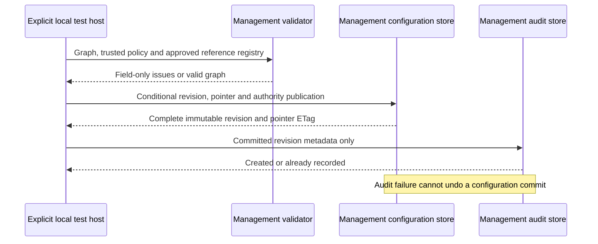
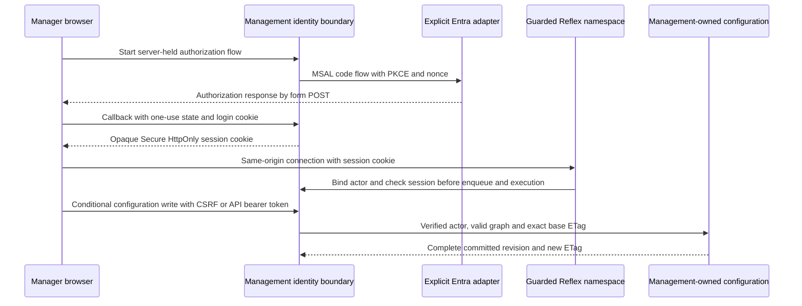
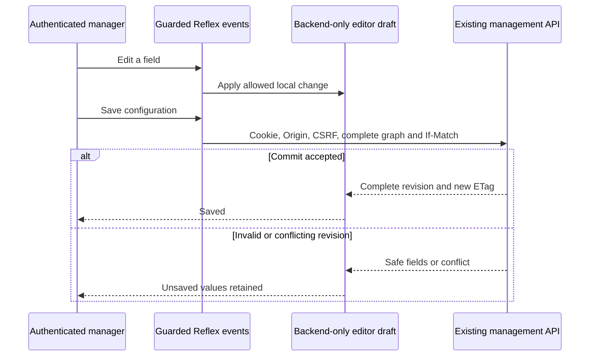
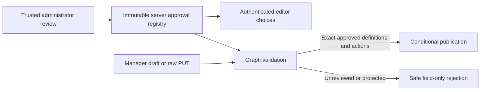
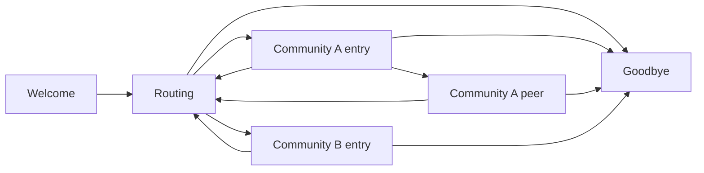

# US2 Local Configuration Increment

## Scope and Gates

The user explicitly authorized deferring telephony and continuing independent local work.
T042-T047 remain pending. This authorization does not accept the foundation, waive the
virtualenv advisory, authorize provisioning, or permit live calls or live management editing.

T048-T050 define test-first API, graph-validation and actual-browser editor contracts.
T051-T056 provide local models, validation, conditional publication, explicit bootstrap and
metadata-only audit recovery. The foundation app is unchanged: `/v1/configuration` is not
mounted, management configuration capability remains false, and live mode remains rejected.
T057-T058 now provide explicit authentication and API composition for local qualification.
They are not mounted in the foundation app. T059 now provides explicitly composed local
community/agent editing. T060 catalogs, T061 relationships and T062's authenticated
cross-view editor state are now locally qualified. T063's consolidated local evidence and
deferred live-profile definition, and T064's configuration/operator documentation are complete.
SC-012 actual durability and every unmet live/foundation/release gate remain pending.

## Ownership and Flow



Both stores belong to management. Runtime has no private-container access. No application
creates a Cosmos client, discovers credentials or initializes a live store in this increment.
The pure local repositories are volatile test/development implementations, not durable stores
or an outage fallback for Cosmos.

## Models and Policy

[The revision schema](../../code/contracts/configuration.schema.json) is checked against the actual
Pydantic model. Version `1.0.0` contains agents, communities, relationships, tools and MCP
connections plus server-owned revision metadata. Extra fields and type coercion are rejected.
Names are trimmed, nonempty and at most 128 characters; agent-name uniqueness is case-sensitive.
Enabled agents require nonempty prompts. Protected roles retain their IDs and cannot be
disabled, assigned a community or given business tools. Foreign ordinary-agent paths must go
through Routing, which can target a community's entry, not an arbitrary member.

Capabilities are declarative `public`/`read_only` definitions. Assignments cannot override those
properties; their owner, tool, reviewed actions and references must resolve. Input schemas use
JSON Schema 2020-12 and cannot fetch external references. A trusted administrator supplies
approved HTTPS destination identifiers and secret aliases. Actual endpoint, egress and
per-attempt authorization enforcement remain required in the later capability gateway;
these models do not grant permission to call a tool.

[Detection policy version 1](../../code/contracts/secret-detection-policy.json) scans all text,
including nested values and unrecognized keys, before persistence. It recognizes private-key
PEM headers, URI user-info, Password/Pwd/AccountKey/SharedAccessKey assignments, URI `sig`
parameters and bearer candidates of at least 16 token characters. The explicit bearer threshold
avoids ordinary phrases such as "a bearer instrument"; it is not a completeness claim.
Literal credentials remain prohibited even when their format is not recognized automatically.
Provider-key rules must be approved and versioned separately.

Credential fields accept only approved `secret://<alias>` references matching
`^[a-z][a-z0-9-]{2,62}$`. Arbitrary vault URLs, unknown aliases and malformed references fail.
Validation issues contain only `path`, `code`, `rule_id` and `policy_version`, never matched
values, exception details or the rejected graph. Untrusted document depth is capped at 64.

## Local Usage

Use the locked management environment. For explicit local composition, construct
`ConfigurationValidator` with the canonical policy document and administrator-owned approved
reference sets, pass it to `LocalConfigurationRepository`, and `await bootstrap(repository)`.
There is no default network client, credential resolution or registry discovery.

Bootstrap conditionally creates stable Welcome/Routing/Goodbye identities and required paths.
It preserves an existing graph. Its `configuration_ready` result is false until a validated
enabled business community exists; a true result is not permission to enable live calls.

`read_active()` returns a detached `(complete_revision, strong_pointer_etag)` tuple, or `None`
when uninitialized. `publish(graph, if_match=etag, actor_id=trusted_actor)` returns the new
tuple or `None` for a stale base. The actor must eventually come from T057's verified identity,
never a submitted request field. Invalid graphs raise `ConfigurationRejected` with safe issues.

## Atomicity and Recovery

The Cosmos adapter requires an explicitly injected async container in organization partition
`default`, with `/organizationId` configured by the owner. It requests Strong reads; the Azure
account must actually support Strong consistency. No weaker-consistency fallback is provided.
Publication creates the immutable revision and conditionally replaces both `active` and
`security-authority` in one batch. SDK non-idempotent write retries are disabled. A concurrent
permission admission can cause at most three retries inside the original five-second operation
bound; a stale configuration ETag never overwrites another manager's change.

Snapshot size includes server metadata and must not exceed 512 KiB. Authority is limited to
128 KiB. The serialized publication plus reserved envelope space stays below 768 KiB.
Conditional errors, invalid data, failed batches and oversized publications do not partially
commit. Reads check DTO shape and canonical graph hash; malformed storage fails closed with
`configuration_store_unavailable`, not a local substitute.

Revocations conservatively retain disabled/removed tools and connections and exact removed or
changed assignment actions. Re-adding a grant does not erase earlier current-policy revocations.
Later permission administration must explicitly handle reauthorization; old pinned calls must
not silently gain permissions. Admission sequence and authority ETag are preserved during save.

`AuditService.recover_publication(committed_revision)` derives only stable publication ID,
timestamp, verified actor and revision references. Repeating recovery is idempotent. Generic
security audit records accept fixed action/outcome/reason categories and no content-bearing
fields. An unavailable audit store returns `audit_store_unavailable`; the already committed
revision remains authoritative. Retain its ID, reread it from the management store and retry
metadata recovery. Scheduling/enumerating an audit recovery backlog and API delivery semantics
remain part of later service composition; no audit-completeness acceptance is claimed here.

## Identity and API Increment

T057 verifies actual RS256 signatures using PyJWT with explicit tenant, issuer and distinct web
client/API audiences. It validates expiry/not-before/issued-at, version, opaque actor ID,
manager role, delegated scope and browser nonce. Runtime/service identities need their own
later audience/permission boundary; they cannot use a runtime role to manage configuration.
There is no test-identity environment variable, trusted actor header or implicit credential
discovery. `IdentityService` rejects mismatched component policies at construction.

`EntraSigningKeys` uses an explicitly injected async HTTPX client and the fixed tenant's
Microsoft signing-key endpoint. Responses are bounded to 64 KiB, 32 keys and two seconds,
cached for at most five minutes, and never followed through redirects. Token-specified key
URLs and embedded keys are rejected. Unknown signing keys fail closed until an approved key
refresh; live rollover behavior still requires qualification. Construct the HTTPX client with
normal TLS validation and `trust_env=False`.



`MsalCodeFlow` wraps the actual installed MSAL authorization-code APIs with PKCE and nonce
checks, `form_post`, a fixed callback and at most four outstanding offloaded SDK operations.
Inject a factory for `ConfidentialClientApplication`, configured for the exact tenant with
`instance_discovery=False`, `exclude_scopes=["offline_access"]` and `BoundedEntraHttp(policy=...)`.
The factory must obtain any confidential-client credential from an approved protected provider,
not a literal, browser state or log. The adapter does not discover it. The bounded transport
permits only that tenant's HTTPS Microsoft endpoint paths, refuses redirects/proxy overrides,
retains ordinary certificate validation, and bounds response bodies to 128 KiB. SDK work stays
off the event loop; timed-out workers retain their capacity reservation until completion and
their eventual exceptions are consumed without printing provider content.

`create_auth_router(identity=..., oidc=...)` holds one-use flows server-side for at most five
minutes, reserving its 100-flow capacity before awaiting a provider. Callback body, exchange
and verification share one five-second budget; the form body is capped at 16 KiB. Wrong,
expired or replayed state cannot create a session. Callback redirects only to `/configuration`,
never a supplied return URL. The short-lived login cookie is Secure/HttpOnly/SameSite=None so
Entra's cross-site form POST works; state and nonce bind it to the initiating browser.

Authenticated cookies use `__Host-caller-session`, Secure/HttpOnly/SameSite=Strict, no Domain,
and Path `/`. They contain random opaque handles, never OAuth tokens or claims. Server records
are indexed by a digest and expire at the earlier of token expiry or 15 minutes. Capacity is
1,000 sessions by default. Expired/revoked sessions fail on every use. CSRF is stable across
tabs, derived server-side per session and compared in constant time. `/auth/session` returns
only the opaque actor reference and CSRF value with `no-store`; keep CSRF in page memory,
never OAuth tokens in local storage or Reflex state. Cookie-authenticated HTTP writes and
logout require exact Origin and CSRF; bearer and cookie credentials cannot be mixed.

Sessions, login flows and Reflex owner bindings are currently process-local. Restart requires
reauthentication. Do not claim multi-worker session continuity or deploy this as a shared store;
a reviewed shared-session/state ownership implementation or qualified routing is required before
scale-out. Actor-to-state-token bindings are retained for the guard's lifetime to prevent another
manager from claiming old state, with a 5,000-binding/2,000-connection fail-closed cap. UI logout
and account switching must acquire a fresh Reflex state token rather than reusing another actor's.

For authenticated editor composition, pass explicit `EditorServices(api=..., guard=...)` to
`create_app(editor=...)`, then serve `editor_asgi(application)`. The composer attaches the
application's registration context before constructing the framework event processor and
installs the namespace guard plus outer HTTP boundary. Merely mounting a page in a forked
factory does not bind background event processing to that application.
The wrapper delegates to the actual pinned Reflex namespace, strips credential headers before
they become router state, and checks the server-owned socket/state-token binding on connect,
enqueue and queued execution. Malformed bootstrap events are rejected before SDK logging.
Same-origin connection authentication protects browser event dispatch. Wrap the resulting ASGI
app in `ProtectedReflexBoundary` as well: unreviewed mutating ingress, including file-upload
dispatch, is denied. Upload-based business features are not supported by this boundary.

Reflex's internally generated page-load events do not always carry router bindings. The
authorization middleware uses the trusted server-owned state session only for absent fields;
explicit foreign socket/token bindings are never replaced with a fallback. Every path still
checks the same actor/state ownership and session expiry/revocation. Browser regressions and
targeted foreign-binding/revocation tests cover this distinction.

T058's `create_router(repository=..., identity=..., validator=..., audit=...)` requires all four
ports explicitly. Authorization precedes body parsing or private reads. GET returns a complete
validated revision and strong ETag; PUT requires a single exact If-Match, rejects duplicate JSON
keys and query-selected organization parameters, and bounds streamed bodies to 512 KiB. Main
work is bounded to eight seconds, followed by at most two seconds of audit delivery. Errors are
`application/problem+json` with safe correlation and allowlisted field/policy metadata. Unknown
submitted property names are rendered as `unknown`, not echoed as error paths.

Publication success returns 200, the complete revision/new ETag and `X-Audit-Status: recorded`.
If audit delivery fails after commit, it still returns 200 with `X-Audit-Status: pending`: retain
the returned revision ID and retry metadata audit recovery, not the graph write. Rejected or
conflicting writes have no publication audit. Anonymous/permission-denied checks attempt a
content-free security audit without replacing the original denial on audit failure. Recovery
backlog scheduling and durable audit completeness remain later integration obligations.

## Community and Agent Editor

T059 adds a responsive authenticated configuration screen with ordinary-agent and community
creation, names/prompts, routing descriptions, enabled states and entry-agent selection.
Welcome/Routing/Goodbye have editable names/prompts but cannot be deleted, disabled, repurposed
or assigned to a community. The server-side draft enforces those rules independently of
disabled browser controls. There is no agent playground or live-call action.

Creating a community also creates its ordinary entry agent and required lifecycle paths.
Creating another ordinary agent adds its Routing/Goodbye paths. Entry choices include only
enabled ordinary members of that community. Select a replacement entry before deleting an
entry agent. Deleting a community requires confirmation and removes that community's ordinary
members and related paths, never the protected roles. All these changes remain unsaved until
the conditional API publication succeeds.

Each browser session owns a detached backend-only `EditorDraft`; session handles, service
objects and the draft are not public Reflex fields. The UI receives only authorized rendering
projections and safe validation metadata. `EditorServices` retrieves request headers from the
verified server socket binding and calls the existing API through a bounded ASGI client.
It supplies real cookie authentication, Origin, CSRF and If-Match; it does not inject an actor
header or bypass HTTP validation, publication or audit.



Save exposes a disabled busy state while awaiting the API. Validation identifies fields using
labels, `aria-invalid`, linked descriptions and an alert, without echoing rejected values into
error text. Agent group names remain stable while an edited name is temporarily blank. A 412
retains the entire draft and its original base ETag; no automatic merge or overwrite occurs.
Reload requires an explicit discard confirmation. Cancel preserves the unsaved values; Reload
fetches the latest saved revision. Audit-pending commits remain saved and visibly identified.

### Local Preview

From the repository root, run the owned synthetic profile:

```powershell
uv run --directory code/tools --locked --no-sync python scripts/smoke.py --editor
```

The command emits a loopback HTTPS URL ending in `/_test/login/manager-one`. That route exists
only in the excluded test host, accepts only its explicitly declared fixture managers, and
issues the same real Secure/HttpOnly/SameSite=Strict session cookie. It is not an Entra login
or a shipped authentication bypass. The host rejects live identity injection before any
process or fixture file is created. All data is synthetic and volatile; stopping/restarting
the process discards edits. Stop the owned preview with Ctrl+C.

The browser sees a self-signed local certificate. Test browser contexts accept that certificate
only for this profile; readiness and API-reset clients validate the generated certificate.
Dependency downloads retain normal TLS verification and approved Microsoft proxy settings.
The direct loopback IP avoids the framework's intentional production `localhost` HTTPS port
rewrite. The qualified profile uses normal Reflex SSR export and explicitly sets
`REFLEX_SSR=true`; anonymous SSR HTML is tested not to contain graph prompts, approved
catalog names or credential-reference values.

The host owns build/server process trees and a temporary TLS/session/generated-frontend
directory, with 180-second build and 120-second readiness bounds. Each host sets
`REFLEX_WEB_WORKDIR` to its own temporary directory so a preview, editor test and foundation
build cannot overwrite each other's generated assets. Browser cases share one module-owned
host and reset each case through the real manager API with CSRF and If-Match, not a database
or identity bypass. The management wheel includes only `management_app`, not this test host.

### Editor Evidence

- Full native Windows management suite: **222 passed**, including all 12 browser cases, with
    no skips or deselection. The new editor module has **9 passing browser journeys**; the
    original foundation shell's three browser cases pass in the same run.
- **11 focused draft/component/API-bridge tests pass**. Production mypy checks **20 files**;
    management and touched-harness Ruff checks pass. No typing suppression was added.
- Playwright screenshots at **360/768/1440** were generated and inspected. Controls fit without
    horizontal overflow; real saves, two-manager conflicts, retained field edits, reload
    confirmation, creation/entry replacement/deletion, anonymous denial and secure fixture
    sessions are exercised. Screenshots are generated under management `test-results`.
- Shared tooling: **25 tests pass**. An extra standalone `mypy scripts` attempt remains red on
    existing missing psutil/jsonschema stubs and an unchanged documentation-link typing issue.
    This is not the configured tooling CI gate and was not suppressed or repaired out of scope.
- Earlier browser attempts exposed the registration-context/internal-event bugs above and a
    shared-frontend prerender timeout. An initial combined run also exposed Playwright's sync
    greenlet interfering with later `asyncio.run` checks. The test collection now stably runs
    browser-marked cases last, without excluding any case. The final 222-pass run includes all
    those paths; failed-attempt history is not replaced by synthetic acceptance.

T060-T062 are locally qualified as described below. T063/T064 end-to-end qualification and operator guides
remain pending. No actual Cosmos durability, live Entra/phone/model, native Linux, updated
images, remote CI or foundation/release acceptance is claimed by this local increment.

## Catalog Qualification

T060 is complete for the local scope: independent approval validation, draft operations,
catalog components and responsive browser journeys are qualified. At that checkpoint the complete
management suite was **240 passed**, with no skipped or deselected tests. This superseded
the earlier partial checkpoint without erasing its failed-attempt history.

### Server Review Boundary

The earlier validator accepted review metadata from the submitted graph when checking assigned
actions. A new regression reproduced a manager adding its own action to that graph's MCP
catalog. Validation now requires a separately injected `ApprovedCapabilities` registry. The
default registry is empty and fails closed for every submitted tool, MCP connection or action.
The synthetic test profile supplies fixed fixture approvals separately from its editable graph.

Create the registry only from an administrator-reviewed trusted source using
`ApprovedCapabilities.from_reviewed(reviewed_document, direct_actions=..., credential_refs=...)`.
Never construct it from a PUT body, active stored graph, server-advertised annotations or model
output. The constructor rejects non-public/mutating definitions through the strict DTOs,
duplicate identities, unknown MCP references, malformed secret references and oversized review
sets. It stores serialized immutable copies and returns detached data. Review is limited to
256 tools, 128 connections and 512 KiB of serialized definitions/action metadata.

Pass that object to both `ConfigurationValidator(reviewed=...)` and
`EditorServices(reviewed=...)` during explicit editor composition. Approved destination and
secret-alias registries are still required independently. Existing stores containing
capabilities must be configured with separately verified approvals before being exposed: a
missing or mismatched review causes safe validation/readiness failure, not automatic trust,
deletion, fallback or approval of their old stored metadata.



Tool schemas, destination references, MCP association, effect and classification must match the
server review. Names/descriptions and enablement remain editable. A connection's submitted
reviewed-action catalog may narrow the approved set but cannot add or alter an action/schema.
Direct tools require a separate explicit reviewed action list; no action is inferred from a
name or a prompt. Every assignment is intersected with both the pinned submitted catalog and
the server-approved action set. Later live execution still requires current permission and
egress checks in the capability gateway; this increment makes no external capability call.

### Implemented Draft and UI

The catalog page offers only reviewed tool/connection choices, fixed `public`/`read_only`
metadata, read-only schemas/output fields and approved opaque `secret://` reference selectors.
New definitions begin disabled. Only ordinary agents have assignment controls; the server-side
draft rejects protected-role, unknown-action and review-metadata edits even if events are
forged. Review fields cannot be entered through free text or overridden by assignments.

Per-agent actions are exact checkboxes. Optional JSON input constraints use an explicit Apply
command, are bounded to a 4 KiB object and cannot grant a different action/classification.
Invalid JSON yields a stable error, not a reflected parser exception. The existing secret
policy scans constraints and all other text before publication. Conflicting saves preserve
the draft and its constraints. Removing a tool removes its assignments; a connection cannot
be removed until its linked tools are removed. Publication still orders resulting revocations
atomically and never silently clears earlier current-policy revocations.

### Qualification and Failure History

- Final complete management run: **240 passed**, including all **16 browser cases** with
    no skips or deselection. The editor browser module passes **13 journeys**, covering
    360/768/1440 catalog creation/enablement, opaque reference selectors, exact ordinary-agent
    assignments, constraint application, save/reload, removal cleanup and raw API forgery denial.
- Anonymous access checks inspect the actual SSR response body as well as the rendered
    controls and API. Fixture prompts, catalog names and credential-reference values do not
    appear in anonymous SSR HTML. Real secure cookies, CSRF and If-Match checks remain active.
- Catalog screenshots at **360/768/1440** were generated and inspected. Content fits without
    horizontal overflow. The old preview was stopped and a fresh isolated synthetic preview
    was started with the qualified profile; no real external capability was invoked.
- Earlier non-browser checkpoint: **224 passed, 16 browser cases explicitly deselected**.
    That was not a green complete suite; the complete run above now supersedes it.
- Focused draft tests cover independent review, detachment, exact direct/MCP actions,
    protected-role denial, fixed metadata, credential references, cleanup and conflict retention.
- Strict application mypy: **21 source files pass**. Management/touched-harness Ruff passes.
    Shared tooling: **25 tests pass**. The earlier extra tooling-typecheck limitations remain.
- One real HTTPS attempt reached the catalog: the forged self-review PUT was rejected with
    422, no submitted action reflection and no revision mutation. All three UI journeys then
    stopped at controlled-checkbox immediate-state assertions. Tests were corrected to click
    and await the real server-owned state; that correction now passes at all three widths.
- Other attempts failed before browser interaction: the pinned Vite/React Router private SPA
    prerender of `/` timed out, including an attempt exceeding the unchanged 180-second build
    deadline. Isolated generated directories and explicit CSR policy were already in place.
    Owned processes were cleaned up; no test, TLS validation or deadline was waived.
- Direct retained-renderer requests return 200 under both prepared Node and Bun in production
    mode, including the root `onAllReady` path. A basic real React stream also succeeds. The
    failing boundary was the frontend build's SPA prerender worker, not a demonstrated
    ordinary route-rendering or HTTP-adapter failure.

The supported normal SSR export policy (`REFLEX_SSR=true`, `ssr=True`) qualifies the private
profile, unlike the earlier client-only SPA export. The normal framework export callback,
dependency preparation, executor preference, pinned lock and original 180-second build /
120-second readiness bounds remain in use. No timeout increase, test exclusion, manual
dependency patch, TLS bypass or release waiver was used. Raw SSR privacy and authenticated
hydration are verified together. This is a qualified profile choice, not a claim to have
fixed the underlying client-only Vite worker behavior on every platform.

An IPv4-first DNS probe did not fix the SPA path and was removed. An experimental npm/Node
build executor did not qualify it and was reverted. Temporary lifecycle tracing was removed;
it produced no useful build markers. Those probes are not shipping behavior or success
fallbacks. The final successful runs use the uninstrumented standard framework path.

On build failure, the synthetic host retains its diagnostic log and generated renderer under
ignored test/generated output locations. These are build artifacts, not committed source or
live data. The previous T059 preview was stopped so it does not keep serving pre-hardening
validation. Qualified local preview and screenshot evidence are recorded above.

The relationship/editor integration checkpoint below supersedes the remaining T061/T062
status from this earlier catalog delivery. T063-T064, native Linux/remote CI, image refresh, real Cosmos and
live Entra/telephony/model/capability execution remain pending; no acceptance waiver is implied.

## Relationship and Editor Integration

T061-T062 are complete for the local scope. `relationship_rule` and
`required_relationship_pairs` are shared by the management validator and editor draft;
browser choices and draft commands do not maintain a separate permissive policy.
The final native Windows management run has **259 passed**, including all **25 browser cases**
without skips or deselection. The editor browser module has **22 passing journeys**.

### Relationship Rules

Relationship controls select a source and offer only unconfigured valid destinations. Goodbye
cannot initiate a transfer; Welcome cannot target a business agent; no path targets Welcome or
itself. Ordinary agents can target ordinary peers only within their own community. Routing
can target an ordinary agent only when it is that community's configured entry. A guessed
foreign ID cannot create a direct foreign-community relationship through a draft command or
the raw API. Relationship changes constrain handover, not peer discovery; runtime projection
and handover-isolation acceptance remain later US3 work.



Required paths are computed from the current draft: Welcome-to-Routing, Routing-to-Goodbye,
each enabled ordinary agent's Routing/Goodbye paths, and Routing-to-entry for each enabled
community. They have a visible Required marker and disabled removal control. The server draft
also rejects deleting them, and API validation independently rejects a missing required path.
Required status follows community/agent enabled states; final publication still validates the
complete graph. The optional Welcome-to-Goodbye path may be removed without removing the
required Welcome-to-Routing path.

Optional relationships can be added and removed with a confirmation. Source/destination
changes use removal and creation rather than silently retargeting a required path. Duplicate
paths and invalid endpoints fail before mutation. Source options reset on reload or when the
selected agent is removed; choices remain usable while another field has an invalid unsaved
value, such as an empty name. Persisted IDs, not editable names, identify the endpoints.

Every relationship has exactly two possible transfer-field controls: `request_summary` and
`transfer_reason`. Either may be disabled; raw history, conversation, audio and tool-result
fields cannot be added. These selectors configure field names, never actual call content.
The draft rejects unknown field names/non-boolean values and the DTO/API rejects forged
unrestricted fields. Required paths remain present when their allowed-field set is narrowed.

### Safe Editor State

All community, agent, catalog, assignment and relationship views now compose through the same
explicit authenticated shell and backend-only `EditorDraft`/`EditorServices`. The default
foundation app remains unchanged and does not expose these routes or test identities.
Existing server socket binding, session expiry/revocation, Origin, CSRF, If-Match, review,
validation, atomic publication and audit boundaries are not bypassed by the new controls.

A verified two-manager browser journey edits agent prompts and relationship context together:
the first manager commits, the second receives 412, and both kinds of unsaved values remain
in the second draft. The server's committed revision is unchanged by that rejected save.
Explicit discard/reload restores the latest saved values across both views. No automatic
overwrite, merge, draft-approval, scheduling or rollback product workflow was added.

A browser submits a generated credential-format fixture in an agent prompt. The visible
alert contains only `agents[3].prompt` and `credential_literal_prohibited`, the field is marked
invalid, the candidate is absent from error text and the committed graph, and the revision ID
does not advance. This verifies safe error handling without resolving or reflecting a stored
credential. Previously entered draft text remains local to that authenticated editing session;
it is never persisted by a rejected save.

### Evidence and Limits

- Focused draft and graph-validation tests: **128 passed**; the new cases cover required paths,
    foreign/protected endpoints, duplicates, context restrictions and invalid unsaved field states.
- New T061 browser/API cases: **7 passed**. Responsive 360/768/1440 journeys create a same-community
    path, narrow context, save/reload and confirm/cancel deletion. Four forged PUT cases reject a
    foreign direct edge, raw context, missing required route or Routing-to-nonentry with no commit.
- New T062 cross-view conflict/safe-error cases: **2 passed**. The final full run contains all
    these cases and the original shell, catalog, security, persistence and recovery checks.
- Final full management suite: **259 passed, no skips/deselection**. Production strict mypy:
    **22 files pass**. Shared tooling: **25 tests pass**. No type or security suppression was added.
- Relationship screenshots at **360/768/1440** were generated and inspected, with no horizontal
    overflow or overlapping relationship controls. Actual save and deletion states are checked.
- An early new-browser attempt hit the existing root prerender timeout before interaction.
    Temporary content-free lifecycle tracing was used and removed; an instrumented passing run
    is not the acceptance result. The final seven-case and complete 259-case runs use the original
    uninstrumented export path, dependency lock and 180-second build / 120-second readiness bounds.
    No claim is made that the intermittent framework failure is fixed globally.

The T063/T064 checkpoint below supersedes the remaining local delivery status from this earlier
editor integration. Actual Cosmos durability, Entra/phone/model/capability
execution, native Linux, refreshed images, remote CI, advisory resolution and foundation/live
release acceptance remain pending. No participant study or live calls were performed.

## Consolidated Local Acceptance

T063-T064 are complete for local delivery. The final native Windows management run has
**278 passed**, including all **29 browser cases**, without skips or deselection. The existing
persistence module now has **31 passing cases**, including consolidated real-JWT manager/API/
validation/publication/audit journeys against both volatile and SDK-double repositories.
None of those repositories is represented as actual Cosmos durability.

| Criterion | Local evidence | Status and limit |
|---|---|---|
| SC-006 | `test_us2_invalid_manager_edits_never_change_the_active_revision` rejects protected-role delete/disable/duplicate/bypass, invalid references and tenant selection; `test_us2_two_managers_share_one_revision_and_conflicts_never_overwrite` rejects stale saves; API/browser policy-forgery cases remain enabled | Passed for tested local management scenarios, with unchanged revision/ETag and no publication audit for rejected edits; not phone/runtime activation acceptance |
| SC-009 | `test_keyboard_only_create_edit_assign_and_save` completes create/edit/assignment/save using real Tab/Shift+Tab, text keys, native select keys, Space and Enter at 360/768/1440; existing mouse/keyboard/field-error/viewport cases also pass | Passed locally at all three widths; focused-control visible-intersection checks and an occlusion regression verify actions are not covered; no participant study |
| SC-018 | Consolidated signed-identity API journey lets both managers commit using fresh ETags, verifies one shared `default` graph/two communities/one protected-role set, and rejects anonymous/runtime-role callers; existing two-browser-manager conflict cases pass | Passed for the local synthetic identity/storage profile; no independent organization workflow is exposed or accepted |
| SC-012 | Existing reconstruction, batch-failure and tamper tests plus the guarded profile definition below | Actual management/runtime restart against real Cosmos remains pending T099/T118; local/double results do not qualify it |
| SC-008 | No recruitment, time study or participant-success assessment was performed | Deferred, not passed and not required for this current release |

### Acceptance-Driven Fix and Dependencies

The first real keyboard-only run exposed dropped characters in server-controlled prompt
typing, despite prior mouse-fill tests passing. The shared text-field wrapper now uses the
installed framework's local `DebounceInput`, with a 200 ms buffer and blur flush; selects and
uncontrolled creation forms are unchanged. All three keyboard journeys now verify the exact
complete prompt and assigned action from the committed API result. The full 278-case run
checks the buffering change against existing save/conflict/validation workflows.

The focus helper traverses actual Tab order rather than injecting JavaScript focus/clicks.
It tests an unobscured point in the visible viewport intersection, not an off-screen center
of a partly visible large control. Its separate real-browser regression exercises both
directions and deliberately covers a control, requiring failure. These checks are not a
replacement for a formal accessibility certification or the deferred participant study.

The added framework control resolves `react-debounce-input@3.3.0`. It is explicitly pinned in
`rxconfig.py` and the canonical frontend lock so the foundation build cannot drop an
editor-only dependency. The package declares an older React peer range; Bun reported that
warning. The exact pinned React 19.3.0/frontend combination nevertheless passed all current
application/browser tests; no upstream peer-support certification is inferred.

The resolved-lock advisory scan found `postcss-selector-parser@6.0.10` from Tailwind
Typography, affected by [GHSA-rj75-hqrm-r3gf](https://github.com/advisories/GHSA-rj75-hqrm-r3gf)
(`CVE-2026-104844`, moderate). The advisory describes CPU exhaustion when parsing untrusted
selectors and notes trusted build-only sources are not affected. It was still remediated,
not ignored: the canonical override now pins the fixed `7.1.6` available from the required
Microsoft npm proxy. The Vite `8.3.3` override remains intact.

Bun regenerated its lock with lifecycle scripts disabled and ordinary TLS verification.
The actual fixed tarball is on the proxy's Microsoft Azure Artifacts backing feed. The
resolved-lock scan then reported **294 package coordinates, zero vulnerabilities**, followed
by the complete passing application/browser suite against that lock. This does not clear the
separately pending tools virtualenv advisory, images or full release audit.

One earlier full-run attempt had editor setup errors when the existing 180-second build
budget expired; no editing assertion ran in those cases. The failed attempt is retained.
The final passing run uses the unchanged uninstrumented SSR profile, isolated generated
directory, build/readiness bounds, secure sessions and test identities. No retry loop, skipped
case, alternative registry, certificate bypass or increased limit was added to the harness.

After qualification, refreshing the interactive preview failed with
`editor_frontend_build_failed`; the owned terminal was cleaned up and the earlier preview
had already been stopped. There is no current preview URL to claim. This additional failed
attempt does not replace the successful automated run or prove global build stability; use
the retained synthetic host diagnostics when investigating preview startup.

### Deferred Real-Cosmos Profile

`US2_REAL_COSMOS_PROFILE` in the persistence acceptance module declares
`profileId=us2-real-cosmos-v1`, `status=defined_not_executed`, `defaultEnabled=false` and
explicit opt-in name `us2-real-cosmos`. A normal test verifies its structure without creating
any cloud client, discovering credentials, opening sockets or executing live work.

Promotion requires T099's independently authorized environment and
`code/docs/acceptance/live-environment.md`, T112's eventual `verify_release.py` runner, T117's
release prerequisites and T118's explicit execution. Neither that future runner nor live
environment qualification is claimed implemented by this definition. There is no currently
enabled live CLI switch, skipped test or inferred success from an environment variable.

Target conditions are dedicated approved **empty non-production** containers, management
ownership, `/organizationId` with organization `default`, actual Strong account consistency,
workload identity, private networking and synthetic data only. There is no automatic
provisioning, data reset, deletion or cleanup. Review cleanup disposition explicitly; never
target a shared or production configuration container.

The declared scenarios must prove atomic revision/pointer/policy publication, rejection with
no partial commit, management restart, runtime restart retrieving through management APIs,
zero activation of rejected/partial revisions and idempotent metadata-only audit recovery.
Evidence must identify approved environment/image references, observed consistency/network
access, stable revision/number/hash/authority across restart, actual ETag outcomes, runtime
snapshot selection and redacted results/cleanup disposition. Missing evidence is **blocked**,
not passed. SC-008 is explicitly excluded. SC-012 remains pending until this is executed.

### Commands and Operator Handoff

```powershell
uv run --directory code/management --locked --no-sync pytest tests/integration/test_configuration_persistence.py -q
uv run --directory code/management --locked --no-sync pytest tests/browser/test_configuration_editor.py -q -k keyboard_only
uv run --directory code/management --locked --no-sync pytest tests -q
```

The [configuration guide](../configuration-guide.md) covers every graph field, protected roles,
permissions, ordinary editing, catalogs/references, conflicts and restart limits. The
[configuration recovery runbook](../runbooks/configuration.md) covers safe triage, conditional
store recovery, committed-but-audit-pending saves, privacy escalation and live-profile gates.
No undocumented repair endpoint, database bypass or automatic provisioning procedure is added.

Phase 4's local tasks are complete. US1 remains provider-gated as previously authorized;
US3's local isolation work is next. Foundation acceptance, native Linux/remote CI, image
refresh, actual Cosmos/Entra/phone/model/tool execution, unresolved advisories and live release
approval remain open. No real phone call or participant assessment was performed.

## Earlier Identity/API Evidence

- Native Windows expanded non-browser management suite: **199 passed, 10 browser cases deselected**.
- Authentication module: **38 tests**, including actual generated RSA signatures, real MSAL
    PKCE/wrong-nonce behavior, real Reflex enqueue/middleware, capacity/timeout probes and a real
    identity-to-validation/publication/audit round trip. No Entra discovery or login was executed.
- Configuration API contracts: **19 passed**, replacing the previous 16 missing-router errors.
- Strict mypy: **17 production source files pass**. No ignored type diagnostics were added.
- The first expanded run had **195 passed and 4 recovery failures**: changed editable metadata
    required uncached `hatchling` in deliberately offline children. An explicit approved-proxy
    `uv sync --locked` prepared it. All six unchanged recovery tests then passed offline, followed
    by the 199-pass expanded run. This was not a test exclusion or a network exception for tests.
- At that earlier checkpoint, browser editor implementation and seven red contracts remained pending T059-T062. Existing
    foundation browser cases, live Entra/JWKS rotation, actual Cosmos, images, native Linux and
    remote CI were not rerun/qualified by this increment. No live credentials were requested.

## Earlier Evidence

Observed on native Windows in this increment:

- Focused domain/storage/bootstrap/audit command below: **114 passed**.
- Expanded non-browser management run: **141 passed, 16 errors, 10 browser cases deselected**.
    All 16 errors are the absent `management_app.api.configuration` router. Existing foundation
    checks pass; the new API contracts are not satisfied yet.
- New actual-browser contract module: **1 failed, 6 errors**, all at the absent owned
    `running_configuration_editor` helper. The three existing foundation browser cases were not
    rerun in this increment. No editor screenshots or responsive-editor acceptance are claimed.
- Strict mypy: **14 source files pass**. Management Ruff lint passes. The offline secret
    gate passes all 20 touched files without exclusions.
- Documentation: **10 documents checked and 3 Mermaid diagrams rendered**.

Run the focused local domain/storage checks from the repository root:

```powershell
uv run --directory code/management --locked --no-sync pytest tests/unit/test_configuration_validation.py tests/unit/test_configuration_bootstrap_audit.py tests/integration/test_configuration_persistence.py -q
```

These checks cover two communities, protected roles, validation safety, capability limits,
concurrent saves, atomic failure, reference/hash integrity, bootstrap and audit recovery.
The Cosmos double uses real SDK exception types and its actual batch/header option shapes.
Reconstructing a repository over that double is not actual process restart or Cosmos durability.

The earlier API and browser red baselines are superseded by the passing contracts/journeys
recorded above. No test is skipped to manufacture a green complete suite.
SC-006/SC-009/SC-018 end-to-end evidence remains pending T063; SC-012 real Cosmos durability
requires the explicit T099/T118 environment profile. T064 operator guide/runbook completion,
native Linux execution, remote CI and the foundation's outstanding gates remain pending.
