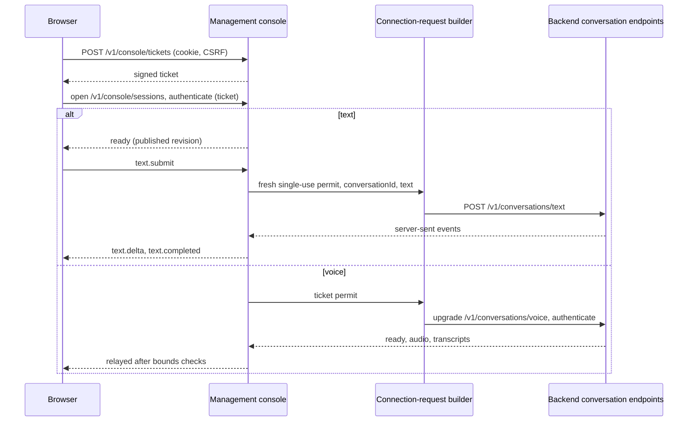
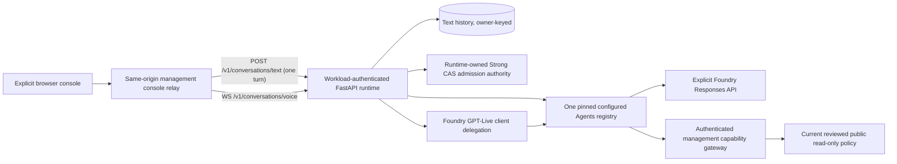
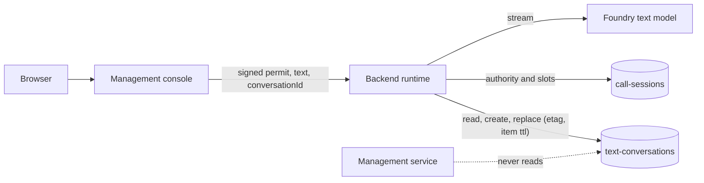
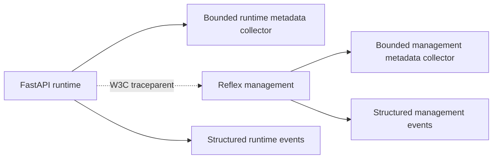
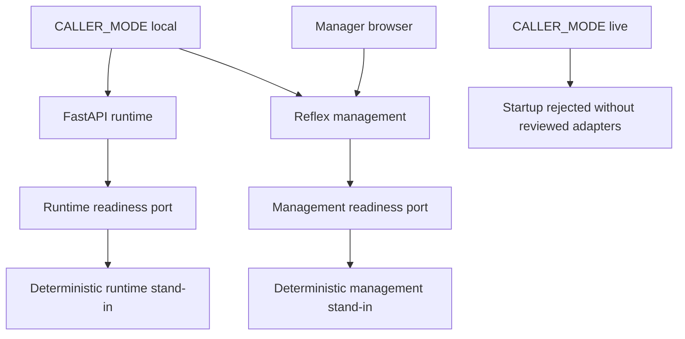

# Architecture

The runtime and management service are independently packaged Python applications with
separate locks, settings and telemetry ownership. The runtime serves two conversation endpoints
(text and voice); management owns configuration, publication, capability authorization and the
browser console. Management data is never a shared private database.

## Management Console Connection

The management console is a peer of any future client: it reaches the backend only through
`POST /v1/conversations/text` and `WS /v1/conversations/voice`, and the browser never connects to
the backend. One function (`adapters/backend_connection.py`) composes every backend request: the
workload token in `Authorization`, one signed start permit and an optional empty `settings` object.
The browser-facing socket is the console's own leg (`/v1/console/tickets` and
`/v1/console/sessions`, subprotocol `caller.console.v1`) and carries no backend-only semantics.

For text the console keeps only the `conversationId` of the open test, mints a new permit on the
server for every turn and never shows it to the browser; the backend stores the history and the
console never reads it. Backend errors surface with their public code and reason unchanged.

## Feature 002 Shared Test Runtime

The browser-test runtime, management console, ticket signer and same-origin relay are
implemented locally behind explicit reviewed composition. Default runtime startup still registers
no conversation socket, discovers no credentials and rejects the existing unqualified live
mode. Supplying reviewed `RuntimeOptions`, factories, workload identity and RSA verification
keys to `ConversationRuntime`, then passing it to `create_app(runtime=...)`, is the only
composition path; it registers the text and voice endpoints described in
[conversation endpoints](conversation-endpoints.md). A reference or constructor is not actual
environment qualification.

Management remains the owner of publication and capability authorization. Runtime refreshes
`GET /v2/runtime/configuration` through authenticated HTTPS, verifies the projected policy
hash and retains management's verified full graph hash. Each new browser admission explicitly
revalidates current publication inside its startup deadline, even within the ordinary thirty-
second refresh window. Existing sessions keep their exact immutable admission snapshot;
current grant/review/revocation intersection is checked by management before each capability.
No runtime path reads management's private container.

Text and speech share the configured Welcome, Routing, ordinary and Goodbye definitions,
one active owner and directed policy. Text opens no Live connection. Speech uses the OpenAI SDK
`live.connect()` client with `gpt-live-1` client delegation (bounded frames, no proxy, no
cross-origin redirect; every event is validated locally) and the same application-owned
reasoning backend, not Responses delegation. There is no public-provider, legacy realtime or
alternate speech fallback. Capability calls use management's reviewed gateway, original
work deadline, zero retries and confirmed owner/generation-bound allocation intent.

Initial readiness performs a no-tool call through the pinned Welcome Agent; generated
readiness output is discarded, not fabricated as a browser reply. Speech additionally verifies
its Live startup. Timed input fragments are not complete ASR turns: only server-verified
accepted-audio fragments enter a bounded correlator, followed by a no-tool structured clarity
check through that same configured backend. Ambiguous context asks for clarification; a
positive result executes the exact unrewritten text under the same accepted work budget.
Shared model storage is disabled and SDK-hosted trace upload is disabled.

The signed admission deadline is fixed at ticket-request receipt and lasts ten seconds;
permit lifetime cannot extend it. After initial ready it is historical, not a cutoff for
later work/media. Every accepted bounded-queue work item has one immutable ten-second budget,
including queueing, at most eight model/tool steps and segment changes, capped by current
authentication, original lifetime and idle limits. At most one item executes with one pending;
duplicates never replay or renew budgets. Continuous media uses current authority/session/
generation/credit checks rather than an artificial ten-second whole-stream timer.

Authority is a separate fixed runtime-owned item, `browser-test-authority-v1`, in the existing
runtime container: Strong reads, conditional replacement, no automatic initialization/reset,
five occupied actor slots including uncertain cleanup, stable tenant/actor hashing independent
of cookies/mode, up to 100 unexpired consumed nonce digests and 128 KiB total metadata. History
records model/capability/Live intent before I/O, exact owner/epoch and bounded attempted/settled
watermarks. It never contains audio, transcripts, prompts or capability payloads.

Stop and control loss synchronously fence business/output before awaited close or store work.
An explicit voice interrupt/handover retires the actual old socket generation, confirms its
authenticated close and local disposal, then permits one original-budget continuation. Late
frames retain their actual old generation and cannot be relabelled; faults do not reconnect.
The application protocol enforces PCM16LE mono 24 kHz, target 960-byte frames, input maximum
1920 bytes, capture/playback windows 12000/24000 bytes, generation-bound sent/played ACKs,
8-KiB controls and one serialized sixty-four-message writer queue.

Cleanup is a separate one-way operation of at most ten seconds, allowed after session/login
expiry and never a delay to startup failure reporting. A trusted observation source records
actual adapter completion/closure separately from an owned-resource disposal probe; an
independent verifier compares exact authority history and evidence. Zero-attempt starts may
release after verified disposal; text requires settled/disposed non-Live work; attempted Live
requires its authenticated exact closure plus settled non-Live work. Cancellation, timeout,
empty local state, lease expiry or TCP close alone never release capacity. Lost proof after
restart remains unknown; there is no force-clear, orphan socket adoption or work replay.

Volatile context includes queue/history and is bounded to 256 KiB/session, with transcript at
64 KiB and separate configured model/prompt token bounds. Overflow fails and purges rather
than trimming security context. Owned state clears on termination within the five-minute
ceiling; this is logical disposal, not physical Python-memory erasure or provider-retention
qualification. Only accepted text and verified input speech refresh the 120-second user-idle
timer; silence, heartbeat and agent output do not extend it or the 600-second lifetime.

The suites run against controlled doubles (see [testing](testing.md)). Owned TLS tests use
generated certificates with required CA/hostname verification; controlled model, management and
store ports are not real Foundry/Cosmos/billing evidence. Separate native CI, actual
deployment/version/quota/identity/residency/retention, supported physical browsers/devices,
audible timing and real-duration capacity gates remain pending. The qualification driver defaults
to pending and cannot turn a manifest into live approval.

## Text Conversation History

Text conversations are stored by the backend runtime so a follow-up turn can continue on any
instance; this is the only conversation content that is persisted (feature 003). The runtime is the
only reader and writer. The management service and the browser never read the container: the
console relays turns and conversation ids, and a stored conversation is addressed by the owner
key inside the signed start permit.

Each item is keyed by owner (partition `/ownerKey`) and conversation id, holds only user and
assistant text plus the agent position, and carries a 30-day `ttl` rewritten on every update.
Voice sessions write nothing. See [conversation endpoints](conversation-endpoints.md), the
[text history runbook](runbooks/text-history.md) and the
[threat assessment](security.md#stored-text-conversation-history).

## Observability, Readiness and Local Mode

Each service owns its telemetry, metrics and readiness port. There are no cloud exporters in local
mode; each collector keeps at most 512 completed metadata spans and 512 events and clears them on
shutdown. OpenTelemetry providers are service-owned rather than a shared global provider.

Only fixed operation names and enumerated HTTP method, route and outcome attributes are accepted;
arbitrary attributes are rejected before a span starts. Credentials, prompts, audio, transcripts,
tool arguments and results, conversation text and raw exception messages are never recorded. Trace
context propagates only `traceparent`, never baggage or arbitrary tracestate. Correlation ids are
bounded opaque identifiers; invalid or credential-like values are replaced. Structured events carry
a UTC timestamp, severity, service, environment, allowlisted event and outcome, a correlation id and
available trace and span ids. Agents SDK tracing is off by default; its explicit in-memory opt-in
records fixed operation metadata without inspecting SDK payloads. Provider realtime tracing is
unavailable because no metadata-only destination exists. See [setup.md](setup.md) and
[monitoring](runbooks/monitoring.md).

The runtime lifespan validates settings before creating telemetry or configuring the SDK.
`GET /healthz` is process liveness. `GET /readyz` returns 200 only when startup finished, the
injected readiness check answers within 250 ms and, when a conversation runtime is composed, the
text history store probe is fresh; otherwise it returns 503 with one fixed reason (`configuration_invalid`,
`dependency_unavailable` or `history_store_unavailable`). Shutdown clears readiness first. HTTP
middleware records only approved route categories and sanitized correlation ids; an unexpected
exception becomes a stable `internal_error`.

Local mode uses deterministic stand-ins behind the readiness port; live mode without reviewed
adapters is rejected at startup rather than falling back to them. Management passes its health API
through Reflex's `api_transformer` and applies mode validation and readiness in a public lifespan
task. Development uses ports 3000 and 8001 with loopback binding and disabled framework telemetry.

Windows Granian can report an occupied port as OS error 10013 instead of 10048; the recovery tests
verify the original listener still accepts connections. See [testing](testing.md) for the suites
and [failure-gate evidence](acceptance/ci-failure-gate.md) for the recorded history.

## Removed Call-Era Components

Feature 003 removed the call lifecycle, per-call session repositories, capacity and owner-routing
services, provider callback and media routers, the development probe route and the Realtime model
adapter. Their design and evidence remain in the historical records under
[acceptance](acceptance/foundation.md) and `specs/`, which carry supersession notes.
