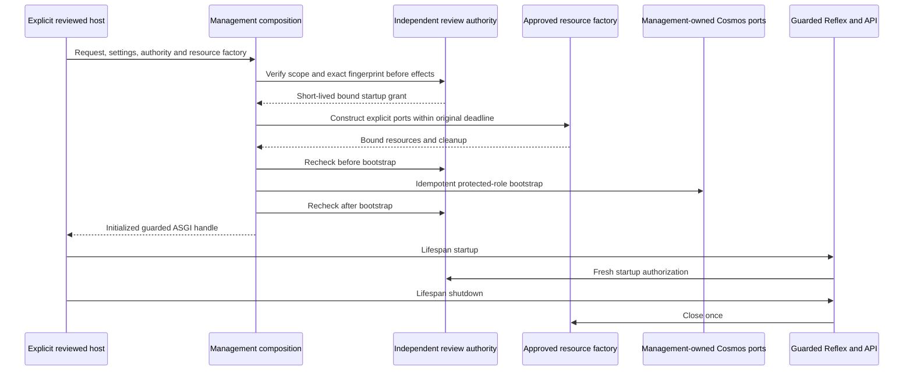
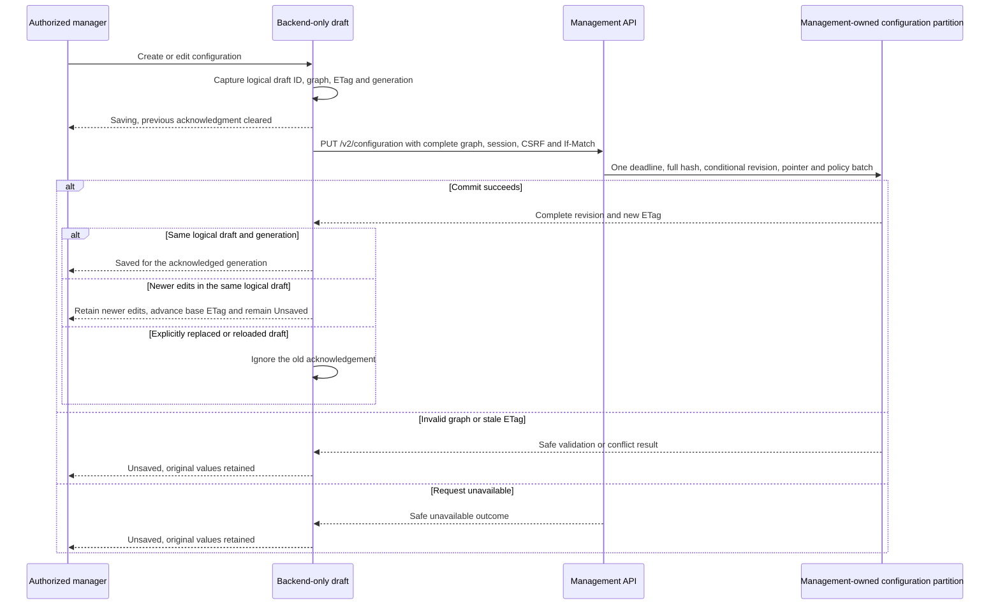

# Configuration Guide

## Scope and Entry

Management owns one organization, `default`. Authorized managers share its complete active
configuration; there is no customer/tenant selector, organization-creation workflow, draft
approval, scheduling, explicit rollback screen or agent playground. Runtime reads management
APIs, never its private Cosmos containers. Relationships configure handover permissions, not
which same-community peers an ordinary agent can discover.

Feature 002 now uses fresh-start configuration schema/HTTP v2. The shared foundation includes
publication, runtime policy projection, cache freshness and protected-role admission controls.
The editable community overview and selected-community agent graph are implemented locally.
The shared text/speech runtime, signed-ticket gateway, same-origin relay and browser console
are implemented behind explicit reviewed composition. Controlled graph/runtime/browser tests
do not qualify actual providers or physical devices. Feature-001 evidence below remains historical.

Default local startup remains the credential-free foundation shell. The configuration editor
has an explicit guarded non-test factory, `create_managed_app`, separate from the default
module application. It requires reviewed resources and independent authorization; neither a
browser header nor an environment flag supplies that authorization. The lower-level
`create_app(editor=EditorServices(...))` and `editor_asgi(application)` remain available for
explicit assembly and the synthetic test host. Actual live composition remains unconfigured
and blocked by the separate qualification gates.

For synthetic local editing from the repository root:

```powershell
uv run --directory code/tools --locked --no-sync python scripts/smoke.py --editor
```

Open the emitted loopback HTTPS URL. The self-signed certificate and `/_test/login/manager-one`
route belong only to the excluded test host, not the management wheel or a real Entra flow.
Only declared synthetic managers exist. The host rejects live identity injection before work.
All data is volatile; Ctrl+C stops owned processes and disposes the temporary profile.

Dependency preparation uses the Microsoft Python/npm proxies described in
[setup](setup.md) and [repository layout](repository-layout.md), with ordinary TLS validation.
Normal SSR export, isolated generated directories, a 180-second build budget and a 120-second
readiness budget are retained. A healthy foundation probe is not proof of live editor or call
readiness. See [US2 evidence](acceptance/us2.md) for measured results and remaining limits.

## Guarded Management Composition

The non-test entry is implemented in
[management_app.py](../code/management/management_app/management_app.py) and
[composition.py](../code/management/management_app/composition.py). It returns a `ManagedApplication`
that is directly callable as ASGI, with the Reflex event guard and ingress boundary already
installed. Its `reflex_app` and `api` attributes support explicit host integration; do not
serve an unwrapped underlying app instead. No default startup, environment toggle or test
login route selects this factory.

Prepare the frontend separately, then use Reflex's normal backend-host configuration
(`__REFLEX_SKIP_COMPILE=true`, also used by the local smoke host) to avoid package installation
and frontend compilation during backend construction. This framework control does not grant
composition authority or disable any identity, review or storage checks. Controlled backend
tests reject frontend-install attempts; the separate browser suite retains its normal build.

A deployment-owned `ManagementRequest` binds opaque environment, configuration-container,
audit-container and review references to the Entra policy and distinct runtime audience,
role and permitted workload clients. Settings and request form a canonical SHA-256
fingerprint, excluding the transient process instance ID. A trusted `ManagementAuthority`
must independently verify actual resource/review scope and return an exact-bound UTC grant
valid for at most five minutes. Supplying reference strings or constructing a grant in
application code is not independent environment qualification.

Authorization precedes resource construction and is rechecked before protected-role
bootstrap, after bootstrap and at ASGI lifespan startup. Construction shares one ten-second
deadline; teardown has a separate bounded ten-second budget. Denial, expiry, binding changes,
construction failures and cancellation cannot fall back to local storage or fixture login.
Once returned, resources close exactly once on failed startup or normal shutdown. A caller
that abandons an unstarted handle must explicitly close its supplied resources. A resource
factory owns cleanup of partial allocations if it fails before returning them. Provider
exception details are replaced with fixed composition errors.

The trusted `ManagementResourcesFactory` supplies management-owned Cosmos configuration and
audit ports, `EntraSigningKeys` and `MsalCodeFlow` from the existing Entra adapter, immutable
reviewed capabilities, secret-detection policy, approved destination/credential references,
explicit readiness and resource cleanup. It is responsible for independently qualified
identity, container ownership, consistency, network and TLS configuration; the composition
does not discover credentials, provision resources or certify these facts itself.
The factory reuses the actual Cosmos repositories, bootstrap/audit services, authenticated
configuration/runtime/capability routers and session-bound `EditorServices`. Only approved
`secret://` aliases reach the credential resolver. Direct public-read and maintained MCP
transports retain pinned public DNS/TLS, reviewed schemas/actions, output allowlists and
current-policy revocation checks. The extra write ingress is limited to the existing
authenticated capability and revocation endpoints, not arbitrary business paths.



The focused local contracts use the existing Entra/MSAL and MCP adapters with controlled
HTTP transports, real signed test JWTs and a Cosmos SDK double. They check authenticated
HTTP and session-bound Reflex draft editing, complete publication, conflict preservation,
runtime consumption, public-read execution, revocation and cleanup. They are not actual
Entra login, cloud resource validation, physical process restart or real-Cosmos durability.
The default health shell remains credential-free, with management configuration and live
calls false. A successfully authorized composed lifespan may report management configuration
true after its supplied readiness probe succeeds; `live_calls` remains false.

The following T122 paragraph records feature-001 verification of its earlier source revision;
its counts and qualification boundaries are preserved, not reasserted for schema 2.

T122 local verification: all 17 focused composition cases and all 430 management tests,
including the existing real-browser editor regressions, pass on Windows. The required local
repository gates pass, including strict management/runtime typing, credential-free Terraform
validation, secret/publication guards and all 203 tooling tests. All 33 documents validate
and all 30 Mermaid diagrams render with the unchanged sandboxed validator. The final focused
run also verifies isolated backend work directories and rejects frontend-install attempts;
the tracked frontend lock and private-feed configuration are unchanged. These are local
results, not new hosted CI, image publication or live-environment acceptance.

## Explicit Browser-Test Runtime

The non-default runtime entry is [composition.py](../code/backend/src/caller_runtime/composition.py)
and `create_app(test_runtime=...)` in [main.py](../code/backend/src/caller_runtime/main.py).
It requires reviewed exact management/Azure model hosts, distinct management audience,
reasoning deployment, `gpt-live-1` model/version/region, available Live quota of at least five,
identity/private-store/lifecycle/retention review, model limits and explicit existing resource/
credential factories. Reasoning review covers streaming, function tools, disabled storage
and structured output used by fragment clarity. No default credential, resource discovery,
container initialization or environment-toggle activation is provided.

The existing runtime authority must already be initialized explicitly and independently
reviewed. Missing/corrupt authority fails before acquiring credentials. New admission reads
the latest authenticated management publication; old sessions keep their exact pin and both
hashes. The shared configured Welcome model is checked without tools before initial ready;
speech additionally validates its Live session. Text never allocates Live to start or clean up.
The pending management console cannot select a revision, agent, provider URL or identity.

One test per stable tenant/actor applies across cookies, modes, tabs and devices; uncertain
cleanup occupies one of five slots. Startup has the original signed ten-second deadline,
then new accepted work has its own immutable ten seconds including queue/model/tool/transfer
time, at most eight steps and no retries. Initial startup expiry is not a later-session timer.
Only accepted user text or verified input speech resets 120-second idle; lifetime stays 600
seconds and earlier login/security expiry wins. Stop requires no surviving business/login
permission and uses the separate bounded cleanup path.

Voice handover/interrupt confirms old-segment closure and disposal before continuation,
retaining logical actor/revision/deadlines. Unknown closure ends the test with capacity still
occupied, not reconnect or success. Closure evidence is resource-specific: verified no-attempt
disposal, definitively settled/disposed text work, or exact authenticated Live close plus
settled work. Never use time, restart, a missing provider ID, cancelled coroutine or TCP close
as evidence that capacity is free. Reviewed recovery uses the same verifier, not direct store
editing, force-clear, socket adoption or replay.

Runtime context is volatile and bounded to 256 KiB, transcript to 64 KiB; user text is at most
4 KiB and complete text reply at most 64 KiB. Invalid/busy/duplicate text, heartbeat and output
cannot refresh idle. Timed transcript fragments are not authoritative turns or consent.
Ambiguous correlated speech requests clarification before capability execution. Only directed
published paths and current reviewed management grants can authorize actions; provider/model
claims and append acknowledgements cannot establish action success or audible playback.

For offline qualification-scope validation only:

```powershell
uv run --directory code/tools --locked --no-sync python scripts/verify_multimodal.py --check-manifest scope.json
```

The scope document contains reviewed existing environment/identity/deployment/model/region/
lifecycle/residency/retention/quota and cost/time references, never credentials or content.
The CLI always reports pending and exits 2, including for a valid scope. Actual observation
requires separately approved programmatic authorization and probe ports bound to the exact
scope fingerprint; there is no CLI execute switch. Checks enforce prerequisite review before
model/Live probes, one time boundary and only remaining cost scope. Missing or unknown proof
stays pending; a fully observed harness result is not browser/device/endurance acceptance.

Current local verification passes 845 backend and 246 tools cases, including real local TLS,
signed permits, twenty publications/new starts, retained pins and current-grant revocation
with controlled external ports. Native CI and actual Foundry identity/deployment/features/
quota/region/lifecycle/retention, supported physical devices and real-duration five-manager
capacity remain separate evidence gates. No actual provider call, deployment or excluded
phone/hosting integration is implied, and the management browser console is not yet implemented.

## Identity and Permissions

HTTP configuration routes and Reflex events require an authorized configuration manager.
Entra verification pins tenant, issuer, distinct web/API audiences, time validity, role and
delegated scope; OIDC browser login additionally uses one-use state, PKCE and nonce. Runtime
roles cannot manage configuration. There is no actor-header or environment-variable bypass.

Browser cookies contain opaque handles, not OAuth tokens. They are Secure/HttpOnly,
SameSite=Strict, host-only and expire at the earlier of token expiry or 15 minutes. Writes
require matching Origin and CSRF; never mix bearer and cookie identities. Reflex binds the
server-owned socket/state token to an actor and checks session validity before enqueue and
execution. Do not put OAuth tokens in browser storage or public Reflex state.

Sessions and editor drafts are process-local. Restart requires reauthentication; deployment
must not claim shared-session scale-out without separately reviewed routing/storage. A fresh
state token is required when switching actors. Test fixture login does not qualify live Entra.

## Graph Contract

The authoritative structural contract is [configuration.schema.json](../code/contracts/configuration.schema.json),
with matching strict Pydantic models and a schema-parity test. Extra fields/coercion are not
accepted. IDs are opaque, nonempty identifiers of at most 128 characters. Names are trimmed,
nonempty and at most 128 characters; agent-name uniqueness is case-sensitive.

| Entity | Fields and meaning |
|---|---|
| Complete graph | `schemaVersion=2.0.0`, `agents`, `communities`, `relationships`, `communityConnections`, `layout`, `tools`, `mcpConnections`; all references resolve within this graph |
| Published revision | Graph plus server-owned `id`, `organizationId=default`, increasing `revisionNumber`, UTC `createdAt`, verified opaque `createdBy`, canonical SHA-256 `graphHash`; immutable after publication |
| Active pointer | `id=active`, `organizationId`, `revisionId`, `revisionNumber`, UTC `publishedAt`, server `_etag`; conditional publication base, not an editable graph field |
| Agent | `agentId`, unique `name`, `prompt`, `enabled`, `role`, nullable `communityId`, `capabilityAssignments`; nonempty prompt when enabled |
| Community | `communityId`, `name`, `routingDescription`, `enabled`, `entryAgentId`; entry is an ordinary member, and an enabled community requires an enabled entry |
| Relationship | `relationshipId`, `sourceAgentId`, `targetAgentId`, `allowedContextFields`; distinct ordinary endpoints in one community, unique ordered pair, only `request_summary` and `transfer_reason` context names |
| Community connection | `connectionId`, `sourceCommunityId`, `targetCommunityId`, `allowedContextFields`; distinct existing communities and a unique ordered pair, never an implied reverse path |
| Layout | `communities` positions and `agentsByCommunity`; each position has `nodeId`, finite `x`/`y` within -100000 through 100000, belongs to that view and grants no permission |
| Tool | `toolId`, `name`, `description`, `schemaVersion`, `inputSchema`, `outputAllowlist`, `enabled`, `approvedDestinationRef`, optional `mcpConnectionId`, fixed `effect=read_only`, fixed `classification=public` |
| MCP connection | `connectionId`, `name`, `approvedEndpointRef`, `enabled`, opaque `credentialRef`, `reviewedCapabilityCatalog` |
| Reviewed action | `actionName`, `inputSchema`, `outputAllowlist`, fixed `effect=read_only`, fixed `classification=public` |
| Assignment | `agentId`, `toolId`, exact `permittedActionNames`, JSON-object `allowedInputConstraints`; owner matches the enclosing ordinary agent, with no classification override |

Input schemas use JSON Schema 2020-12 and cannot fetch external references. Output allowlists
are nonempty. Approved destinations are administrator-owned HTTPS references, not arbitrary
URLs entered by managers. Input constraints configure a desired restriction object; the later
capability gateway must interpret/enforce them before live attempts. Catalog editing alone
does not execute a tool or grant permission to private/mutating data.

Serialized revisions, including server metadata, are limited to 512 KiB. Permission authority
is capped at 128 KiB; revision/pointer/policy publication plus reserved envelope space stays
below 768 KiB. Untrusted document depth is capped at 64. Reduce a rejected graph rather than
splitting it into partial writes.

There are at most 50 communities, 200 agents and 1000 total directed connections. Prompt and
routing-description limits are 16 KiB and 4 KiB of UTF-8 respectively; each agent has at most
128 effective reviewed tools/actions. Existing stricter catalog/review restrictions remain.
Schema 1 is rejected rather than translated. No old publications exist for this fresh-start
change; no compatibility endpoint, data migration, reset or direct store edit is provided.

Managers use `GET/PUT /v2/configuration`. Runtime uses the distinct workload-only
`GET /v2/runtime/configuration`, with immutable revision provenance and two hashes. Management
first verifies full `graphHash`, which includes layout. It removes layout and MCP credential
references, then calculates canonical `policyHash` over the projected policy. Runtime verifies
that policy hash and retains the management-verified full hash without falsely recalculating
it from missing fields. Neither browser data nor the model chooses revision/security identity.

New runtime admission needs a valid publication less than 30 seconds old and an enabled
eligible business community. A matching authenticated ETag/304 revalidates the exact current
snapshot from request acceptance time; authentication/transport time does not extend the
window. Outages, invalid replies, absent data, backward time or stale publications deny new
admission. Existing holders retain their immutable pin; last-good content is not new-session
authority. A fresh protected-only bootstrap remains editable but cannot admit a conversation.

## Community Overview and Routes

`/configuration` opens the community graph, directed connection forms and community editor.
Drag feedback stays local; one bounded final-position command updates layout only. X/Y inputs
provide the keyboard equivalent. Fit View and zoom controls frame the canvas. Missing saved
positions use deterministic local spacing; formatting coordinates for display does not round
their stored values. Long names wrap and do not require changing the 128-character limit.

Use Source community/Destination community and Add connection, or connect node handles, for
one explicit direction. Its inverse is a separate command. Connection deletion has a
Cancel/Delete dialog; confirmed deletion remains an unsaved draft until Save. Creating a
community seeds its ordinary entry. Protected-only configuration displays No communities,
keeps community creation available and disables impossible connection creation.

Community links and graph selections open `/configuration/communities/[community_id]` by stable
ID, showing its ordinary editor shell. Communities returns to the overview. Link, back and
forward navigation reauthorize without reloading/replacing the organization-wide draft;
missing IDs display Community unavailable, never another community. Anonymous navigation
exposes no saved prompts or Save action. Global settings on the overview retains access to
protected roles and reviewed catalogs; these remain organization-wide, not graph members.

Unsaved overview/child edits install a browser departure/reload warning. Cancel keeps the
draft; the Reload configuration dialog separately requires explicit discard. Saved child
routes can reload directly from the publication. Visiting or editing any route neither starts
a model session nor captures media. See the [community runbook](runbooks/communities.md) for
conflict, missing-ID and draft recovery; runtime conversation qualification remains separate.

US1 local checkpoint on 2026-10-30: all 534 management tests passed, including every compiled
editor/shell browser case, with no skipped/deselected required tests. The eight US1 browser
cases cover 360/768/1440 layouts, actual node dragging and keyboard/forms, directed publication,
stable links/history/shared dirty drafts, reload/discard, safe missing/anonymous links,
maximum-length names, protected-only emptiness and confirmed connection removal. Full Ruff,
strict typing and diagnostics passed; overview screenshots were inspected. All 33 maintained
documents and 31 pinned sandboxed Mermaid renders passed, along with publication/whitespace
guards. These are local Windows/synthetic-identity results, not native Linux/remote CI,
real Cosmos, Foundry, microphone/headset, alert delivery or the complete multimodal feature.

## Agents Within One Community

Open a community by its stable link to edit its ordinary agents, prompt/enabled state, entry
and directed handovers. The child canvas and forms show only that community's ordinary
members; protected Welcome/Routing/Goodbye remain global. The New agent form is scoped to
the selected community. Its entry selector contains enabled eligible members; disabling the
current entry cannot publish until repaired. Review the field error rather than assuming a
client checkbox or selection is authority.

Connect handles or use Source agent/Destination agent for one directed handover. Eligible
same-community peers remain discoverable even without an edge, but only the explicit source
direction permits handover. Missing/reversed/foreign/protected/disabled targets cannot grant
execution. X/Y inputs and dragging edit only `layout.agentsByCommunity`; neither creates a
handover, capability grant or membership change. Node selection focuses its inspector.

An agent used as entry must be replaced before deletion or movement. Moving another agent
requires repairing its semantic edges first; it cannot leave a cross-community relationship.
Explicit deletion confirms the action and cleans related positions/edges. Removing a tool
cleans assignments as before. Reviewed capability controls on the child scope assignment
rows to that community; Global settings remains the one protected-role/catalog access point.
All changes share the same organization-wide draft, validation, ETag and Save controls.

The schema-2 runtime policy distinguishes three pure operations: an ordinary same-community
handover, initial Routing selection, and a later source-preserving community transfer. The
last uses the trusted ordinary source community, its explicit directed community edge,
Routing and the destination's eligible entry. Calling Routing with no ordinary source does
not turn a transfer into initial selection. These predicates reject schema 1 rather than
falling back to old lifecycle relationships. They neither allocate a model nor qualify an
actual text/speech transition; that remains the shared conversation executor's later work.

US2 local checkpoint on 2026-10-30: the complete backend and management suites passed 602
and 547 tests, with no skipped/deselected required cases. The three-agent compiled journey
passed at 360/768/1440, including entry, directed handover, foreign-view exclusion, layout-only
drag/reload and invalid-entry rejection without partial publication. Pure policy coverage
passed 27 cases; current model/draft coverage passed 207. Screenshots exposed a misleading
default edge crossing behind an unrelated node; only missing-position defaults were staggered,
then an actual SVG-path geometry assertion and all three browser widths passed. Mobile/desktop
screenshots were inspected. Full Ruff/mypy, diagnostics and publication/whitespace guards pass.

One initial broad backend run failed an unchanged legacy realtime timeout assertion (601
passed). That exact test and the unchanged complete rerun passed; no excluded integration,
assertion or timeout was altered. After final presentation-only layout changes, all three
agent browser journeys and 207 model/draft tests passed again. These results remain local
Windows/synthetic evidence, not native Linux/remote CI, live model handover, actual Cosmos,
headset/audio, endurance or alert delivery. No telephone/hosting scope was added or qualified.

## Communities and Protected Roles

Exactly one enabled Welcome, Routing and Goodbye exists, with no community membership.
They may receive name/prompt edits, but cannot be deleted, disabled, duplicated, repurposed or
assigned business tools. Ordinary agents belong to exactly one community. Prompt text cannot
change visibility, role or capability authorization.

Creating a community creates its ordinary entry, not implicit editable lifecycle edges. Add another ordinary
agent to a selected community with a name/prompt. Enable controls and entry choices obey the
validator; the client controls are not the security boundary. Replace an entry before deleting
that individual agent. Confirmed community deletion removes its ordinary members and related
paths, never protected roles. These operations remain draft changes until Save succeeds.

Welcome/Routing/Goodbye transitions are application lifecycle policy, never editable graph
relationships. All configured agent paths join distinct ordinary members of one community;
protected, self, dangling, duplicate and foreign direct edges reject, including forged PUTs.
Community transfers require their explicit directed community connection and Routing-mediated
destination entry. Initial Routing selection is not a community edge, and direction never
grants its inverse. Entry/enabled edits or dragging do not create or alter path permission.
Referenced nodes/connections must be repaired together before complete publication.

Context checkboxes select approved field names, not actual call text. Narrowing a field set
does not change edge direction. There is no control for raw history, audio or tool-result
transfer. The application-owned browser conversation executor and directed transfer use have
separate later-story verification. No phone research/integration or hosting work is authorized
by this change, and no existing deferred telephone/hosting qualification is reopened.

## Catalogs and Secret References

An administrator supplies immutable `ApprovedCapabilities` separately to the validator and
editor services. An empty registry denies every submitted tool/connection/action. Never build
approvals from the submitted or stored graph, model output or server-advertised annotations.
The registry is bounded to 256 tools, 128 connections and 512 KiB of review metadata.

Add reviewed connections before their linked tools. New entries begin disabled. Managers can
edit names/descriptions, enable states and approved credential-reference choices, not reviewed
schemas, effects, classification, destination or MCP association. A submitted MCP action set
may narrow the reviewed set but cannot expand or alter it. Direct tools need a separate exact
approved action list. Assignments appear only for ordinary agents and list only reviewed
actions. Input-constraint JSON is applied explicitly and is limited to a 4 KiB object in the
editor. Removing a tool cleans its assignments; remove linked tools before a connection.

Credentials are approved `secret://<alias>` references with alias pattern
`^[a-z][a-z0-9-]{2,62}$`, never credential values or arbitrary vault URLs. Versioned detection
policy scans all text/nested values before persistence. It recognizes PEM private keys, URI
userinfo, credential-bearing assignments, SAS-style signatures and bearer candidates, but
does not promise universal secret detection. Unrecognized literal credentials remain
prohibited. Errors contain field paths/codes/rule/policy IDs, not submitted secret candidates.

Existing stores with capabilities require independently reviewed approvals before exposure.
Missing/mismatched approval must fail closed, not auto-approve, delete or silently fall back.
Revocations conservatively accumulate disabled/removed capabilities and removed/changed exact
assignment actions; re-enabling a definition does not silently clear current-policy denial.
Reauthorization belongs to later explicit permission administration.

## Save, Conflict and Recovery

Text fields buffer typing locally and flush on blur, preventing server round trips from
dropping keystrokes. Save replaces any previous success message with Saving before emitting
its busy/disabled state and publishing the complete graph with its original exact strong ETag.
Saved or Saved; audit pending acknowledges only the current returned revision. A request
failure returns to Unsaved and retains the draft, rather than leaving an earlier success
visible. Publication atomically creates a revision, advances `active` and orders permission
changes. It never writes a partial configuration.



GET returns the complete revision and ETag. PUT requires one exact If-Match: missing is 428,
stale is 409, weak/wildcard/malformed is 422, oversized is 413, invalid is 422, unauthorized
is 401/403, unavailable dependencies are 503 and expired request budget is 504. Authentication,
validation, publication and bounded audit/denial work share the original ten-second deadline.
No query parameter may select another organization. Errors use safe `application/problem+json`
and correlation IDs; rejected values and unsafe property names are not echoed.

On 409, both managers' local edits remain distinct; no silent merge or overwrite occurs.
Cancel a reload to keep the draft, or explicitly confirm discard/reload to fetch the latest
saved revision. On 422, fix only the reported fields; other draft values remain intact.
Never bypass validation by changing a prompt, raw role flag, ETag or database item.

Successful publication returns 200 with `X-Audit-Status: recorded` or `pending`. Pending means
the graph is already committed: retain its returned revision ID and recover metadata audit,
not the graph write. See the [configuration runbook](runbooks/configuration.md).

## Published Browser Console

Open `/configuration/test` from the configuration header. Entry and reload create no ticket,
microphone or model connection and never resume an old test. The selected editor community and
unsaved draft are not routing authority: every new test refreshes the current publication,
starts its global Welcome/Routing flow and displays the runtime's pinned revision and agent.
Use Text or Speech explicitly. Text shares the configured backend without microphone or Live.

Speech requests microphone access and resumes a native AudioContext only from Start. Permission
is acquired before the ticket POST; denied or unanswered permission creates no runtime session.
The browser requests and verifies 24 kHz, uses native browser conversion into mono PCM16LE and
does not record a container or run a custom resampler. Unsupported context rates or playback
fail visibly. Device controls use feature detection; absent output-selection support means
system-default routing, not a claim that the UI has selected physical headset hardware.

Input credits cover every reserved/unacknowledged frame within 250ms/12000 PCM bytes; playback
is at most 500ms/24000 PCM bytes, with acknowledgements only after worklet consumption. Frames
carry the actual generation and sequence. Mute flushes capture immediately; interrupt clears
output and fences the retired generation. Stop clears local audio, media tracks and volatile
messages without waiting for a round trip. Navigation, hidden documents, device loss and socket
failure also fence locally. None proves an external action succeeded or a provider closed.

Capture grants and worklet flush acknowledgements carry a bounded local capture identity.
Mute/unmute and interruption invalidate older queued capture and grants; fresh grants wait
for the matching flush acknowledgement. These local identifiers never replace the runtime's
wire generation or create credit. Socket callbacks are bound to their actual socket/epoch,
so a delayed close/error from a completed test cannot stop a later explicit start. The current
stopping socket can still deliver its confirmed cleanup outcome. Post-ready AudioContext
suspension, interruption or closure stops owned media and reports playback unavailable;
teardown detaches its listener so late old-context events cannot affect a later test.

The browser keeps permits and content out of URLs, browser storage and Reflex state. The
server-backed console holds a closed metadata DTO only; replies/transcript fragments remain
bounded volatile browser data. Input is at most 4 KiB, reply at most 64 KiB, JSON at most 8 KiB
and at most 64 controls may queue. Overflow terminates rather than accumulating a recording.
Reply limits are independent from the 256-KiB aggregate display context; speech transcript
content remains within 64 KiB. At most 128 rows and two active reply counters bound structural
overhead. Adjacent same-speaker fragments may share a display row but never become proof of
a completed ASR turn. Unfinished owned relay disposal also counts toward its five-resource cap.

### Explicit Test Composition

The existing authorized factory remains the entry point:

```python
from management_app.composition import ManagementRequest
from management_app.management_app import create_managed_app

request = ManagementRequest.model_validate(reviewed_request_document)
managed = await create_managed_app(
    settings,
    request=request,
    resources=existing_resources_factory,
    authority=independent_management_authority,
)
```

The operator supplies all named objects; this snippet discovers no resource or credential.
The reviewed request's optional `tests` object must bind `runtime_endpoint`, distinct workload
`runtime_audience`, fixed permit `issuer`/`permit_audience`, distinct `test_role`, permission/
signing/runtime review references, `capacity=5`, `retention_seconds=300` and a declared finite
clock-coherence tolerance from zero through one second. The resource factory must return the
matching `ManagementTestResources` with explicit RSA private key, bounded public-key allowlist,
key ID and asynchronous workload credential. Missing or unexpected test ports reject before
bootstrap; ordinary manager permission alone does not grant test permission. Keep the private
key in the approved credential boundary, never the document or browser.

The runtime separately requires its already-initialized owned authority, reviewed Foundry text
and GPT-Live deployments/region/quota/retention, workload verifier and the corresponding public
permit keys. Management owns one signed ten-second POST-to-ready boundary; the 30-second permit
does not extend it. Cookie, exact Origin, CSRF, current manager/test roles and single-use permit
binding are checked independently of Reflex Socket.IO. The WSS relay owns no policy executor.

Only one test may occupy a verified tenant/actor across tabs, cookies, devices and modes; five
occupied slots include uncertain cleanup. A failed or pending cleanup is not permission to
restart. Complete restart requires resource-specific trusted settlement/disposal evidence and,
for attempted speech, the authenticated exact Live closure receipt. Do not clear the authority,
replay work, adopt an old socket or infer release from a lease, timeout, cancellation or TCP close.

Optional test alerts can bind an already reviewed observer through the runtime factory's
`create_app(..., test_alert_sink=...)` argument and the management resource factory's
`ManagementResources.test_alert_sink`. Both default to `None`, discover no endpoint or
credential and receive only detached allowlisted alert metadata. The synchronous callback
must be a bounded, nonblocking enqueue operation, never blocking I/O or an async callback.
Its provider owns the queue, delivery worker and cleanup; management resources already expose
their lifecycle `close` port. Queue-full/sink exceptions are contained without retries or raw
details, so local event emission is not a delivery acknowledgement. Existing actual-sink
approval, recipient acknowledgement and recovery evidence remain required under T113.

Actual Foundry/device/endurance acceptance remains separately authorized T062/T086/T087.
The local two-app synthetic fixture uses generated test trust and controlled providers, not
real inference, hardware routing, audible cutoff, residency or available subscription quota.

## Restart and Acceptance

The feature-001 profile/evidence references below are historical and remain unexecuted where
stated. They do not qualify feature 002, authorize a cloud call or waive its PR exclusions.
Feature-002 source-specific results are recorded in its
[implementation tasks](../specs/002-multimodal-agent-management/tasks.md); actual Foundry,
physical-browser/headset and full-duration endurance checks require separate authorization.

Feature-002 foundation checkpoint on 2026-10-30: the full runtime suite passed 590 tests;
management passed 478 non-browser tests, with 29 browser tests still pending their compiled
story gates. Both applications passed full Ruff and strict mypy (34 runtime/32 management
source modules). All 33 maintained documents validated and all 31 Mermaid diagrams actually
rendered with pinned CLI 12.0.0 and prepared sandboxed Chromium. The secret/public-origin and
whitespace guards passed. Runtime recovery's initial offline-build failures passed when rerun
through the existing prepared CI environment; no test assertions or budgets were weakened.
This checkpoint is local Windows evidence, not native Linux/remote CI, a graph/browser-console
journey, Cosmos durability, Foundry/device behavior, endurance or alert-delivery qualification.

The local repository is volatile. A reconstructed SDK-double repository proves adapter
behavior only, not actual process restart/Cosmos durability. Live composition requires a
management-owned `/organizationId` container, one `default` partition, Strong account
consistency, reviewed workload identity/private networking and separately authorized data
access. It is not created by startup, and outages cannot fall back to a local substitute.

The declared `us2-real-cosmos-v1` profile is opt-in, not executed: T099 environment evidence,
T112/T117 release prerequisites and T118 activation are mandatory. It requires dedicated empty
non-production targets and synthetic data; no automatic provisioning or cleanup is authorized.
It must prove management/runtime restart and zero activation of rejected/partial revisions
through the authenticated management API. Missing evidence means blocked, never passed.

The local evidence matrix distinguishes SC-006/SC-009/SC-018 from pending SC-012; SC-008's
participant study is deferred, not passed. Native Linux, remote CI, refreshed images, actual
Cosmos/live services, the pending tooling advisory and foundation/release gates remain open.
