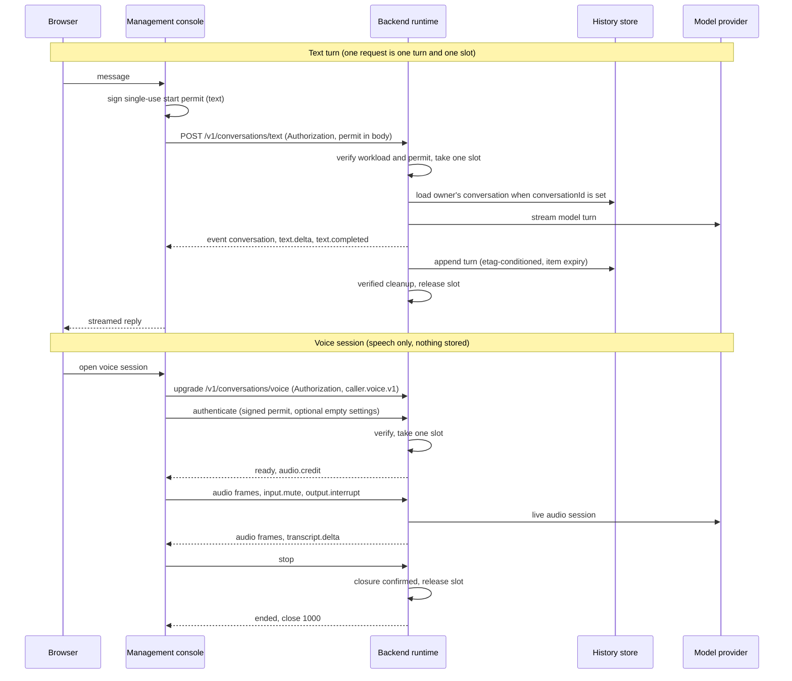
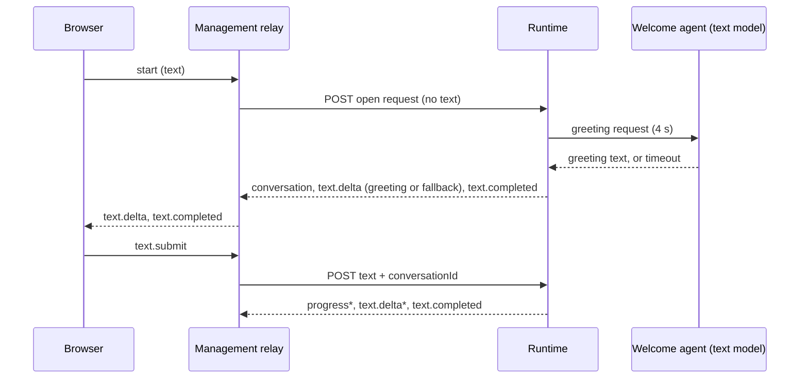
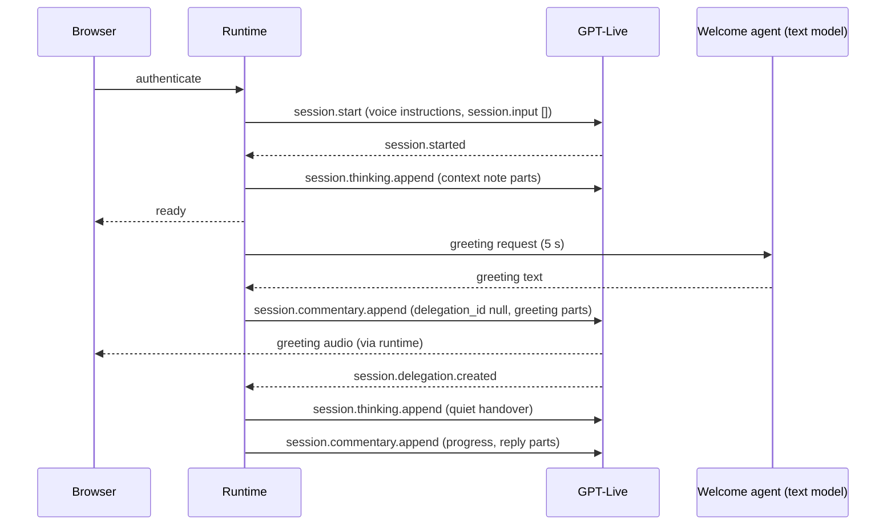

# Conversation endpoints

The backend runtime serves two public conversation endpoints, a status endpoint for management and
two operational probes. The conversation endpoints
share one connection contract, so a caller handles errors, limits and settings the same way for
text and voice. Everything else a caller might try (the retired call, provider-callback, drain and
development routes, and the earlier `/v1/internal/test-sessions` WebSocket) is not found.

| Purpose | Method and path | Transport |
|---------|-----------------|-----------|
| Text turn | `POST /v1/conversations/text` | HTTP request, `text/event-stream` response |
| Voice session | `GET /v1/conversations/voice` (upgrade) | WebSocket, subprotocol `caller.voice.v1` |
| Service status | `GET /v1/status` | HTTP JSON, management workload only |
| Liveness and readiness | `GET /healthz`, `GET /readyz` | HTTP, operational only |

Both conversation endpoints require TLS, accept no query string and are reached by the
management console, which relays the browser session; browsers never hold the workload credential
or call the backend directly.



## Shared connection contract

- **Workload credential.** The caller sends its Entra workload token in `Authorization: Bearer
  ...`. The backend verifies it before reading the body or accepting a WebSocket.
- **Start permit.** The management console signs a short-lived, single-use RS256 permit per turn
  or per voice session. It carries the manager identity, the mode (`text` or `speech`) and the
  admission deadline, and is valid for at most 30 seconds. A text request carries it in the JSON
  body; a voice session sends it in the first WebSocket message. A permit of the other mode is
  refused with `forbidden` and reason `mode_mismatch`.
- **Slots.** Each text request and each voice session takes one admission slot, and a manager has
  at most one in flight. The slot is released only after cleanup has been verified, so a refused
  or failed request never leaves capacity occupied. When all slots are in use the next request
  fails with `capacity_unavailable` and active sessions are untouched.
- **Settings.** The optional `settings` field must be absent, `null` or `{}`. Any other value is
  refused with `settings_not_supported` before a slot is taken. No setting exists today; the field
  reserves the extension point for both endpoints.
- **Limits.** Control messages and the text request body are bounded (8 KiB control frames, a
  16 KiB text request, 4 KiB of user text), a reply is at most 64 KiB, and a conversation's
  retained context is at most 256 KiB. Voice audio frames are at most 1,920 bytes of PCM and flow
  under credits. Violations fail with `limit_exceeded`.
- **Errors.** One vocabulary of eight public codes, each with a fixed `reason` from a closed list.
  Details (store errors, provider bodies, verification details) are never returned.

| Code | HTTP | WebSocket close | Reasons |
|------|------|-----------------|---------|
| `unauthorized` | 401 | 4401 | `permit_invalid`, `permit_expired`, `permit_replayed`, `session_expired` |
| `forbidden` | 403 | 4403 | `mode_mismatch`, `insecure_transport`, `session_terminal`, `session_stale`, `handover_not_allowed` |
| `settings_not_supported` | 422 | 4422 | none |
| `limit_exceeded` | 413 | 4413 | `control_limit`, `frame_limit`, `text_reply_limit`, `conversation_context_limit`, `transcript_limit`, `audio_credit_exhausted`, `sequence_exhausted`, `work_deadline_exceeded`, `work_limit` |
| `capacity_unavailable` | 503 | 4503 | `capacity_unavailable`, `manager_busy`, `work_busy` |
| `invalid_request` | 400 | 4400 | `invalid_message`, `invalid_audio`, `conversation_not_found`, `not_ready` |
| `upstream_unavailable` | 502 | 4502 | `authority_unavailable`, `configuration_unavailable`, `clock_unavailable`, `model_unavailable`, `capability_unavailable`, `history_unavailable`, `runtime_unavailable` |
| `internal_error` | 500 | 4500 | none |

HTTP errors are `{"error": {"code": "...", "reason": "..."}}` (`reason` is omitted when the code
has none). Authentication failures expose only the four `unauthorized` reasons, so a caller
cannot learn why a credential or permit was rejected. The mapping from the backend's internal
codes to these public values is one table in `code/backend/src/caller_runtime/api/connection.py`;
an internal code missing from the table becomes `internal_error` with no reason, and a test fails
when a live code is unmapped.

## Text endpoint

```json
{
  "permit": "<signed start permit>",
  "requestId": "request-1",
  "conversationId": "optional id returned by an earlier turn",
  "text": "user message",
  "settings": {}
}
```

The caller never sends history. A request with a `history` field or any other unknown field fails
with `invalid_request`. `text` must be non-blank and at most 4,096 bytes.

**Open request (greeting).** A request without `text` and without `conversationId` starts a new
conversation whose first reply is the Welcome agent's greeting. The greeting has 4 seconds; if it
is not ready by then, the fixed fallback "Hello and welcome! How can I help you today?" is sent
instead. The greeting is stored as the conversation's first assistant turn, so a follow-up with
the returned `conversationId` continues after it. A `conversationId` without `text` is
`invalid_request`. A request with `text` and no `conversationId` still starts a conversation
without a greeting, for backward compatibility. The management relay sends the open request
first, so a message typed before the greeting appears is answered right after it.



A failure before the first event is a plain JSON error with the HTTP status above. Otherwise the
response is `200` with `Content-Type: text/event-stream` and `Cache-Control: no-store`:

```text
event: conversation
data: {"conversationId": "c1"}

event: text.delta
data: {"messageId": "m1", "text": "partial reply"}

event: text.completed
data: {"messageId": "m1", "text": ""}
```

`text.delta` events carry the reply in order; `text.completed` ends the turn and carries an empty
`text`. A failure after the stream has started is one final `event: error` with
`data: {"code": "...", "reason": "..."}`, then the stream ends. One request is one turn.

During a turn the stream may also carry progress updates that the agent reports with its
`report_progress` tool:

```text
event: progress
data: {"messageId": "m3", "state": "still_working", "text": "Checking the order status."}
```

`state` is one of `still_working`, `waiting_for_input`, `completed`, `failed` and
`cancellation_confirmed`; `text` is 1 to 200 characters of plain text. Updates are rate-limited
(one per state change, and a repeated `still_working` at most every 10 seconds) and an update for
work that is no longer current is dropped. The final and waiting states are stored in history as
`Status (<state>): <message>`. Progress never replaces `text.completed`: a turn still ends with
`text.completed` or `error`, and clients that do not know `progress` must ignore it.

The management relay also sends the browser a `text.formatted` message after `text.completed`
when the reply contains Markdown structure: an allowlisted node tree (paragraphs, headings,
lists, quotes, code, tables, emphasis, line breaks, links and images) that the Test page renders
with `createElement` and `textContent` only. Links and images keep their URL only when it is
`https:`; anything else keeps the plain-text row.

### Stored history

The backend stores each text conversation under the manager's owner key (see
[text history](runbooks/text-history.md)). Without `conversationId` a new conversation starts and
its id is the first event; with it the turn continues from the stored conversation.

- An unknown, expired or another manager's `conversationId` fails identically with
  `invalid_request` and reason `conversation_not_found`.
- Only user and assistant text is stored. A completed turn appends both messages with an
  etag-conditioned update; a failed turn leaves the stored conversation unchanged. A concurrent
  update fails with `capacity_unavailable` and reason `work_busy`.
- If the stored conversation or the new text would exceed the 256 KiB context limit, the request
  fails with `limit_exceeded` and reason `conversation_context_limit`.
- If the history store cannot be read, the request fails closed with `upstream_unavailable` and
  reason `history_unavailable` and no reply is generated. If it cannot be written after the reply
  streamed, nothing is stored and the stream ends with the same error as its final event.
- Each stored conversation expires 30 days after its last turn; expiry is the only deletion path.
- `/readyz` reports `not_ready` with the reason `history_store_unavailable` when the background
  check of the store (about every 10 seconds) is failing or older than 30 seconds.

## Voice endpoint

The client connects with the subprotocol `caller.voice.v1` (exactly once) and the workload
credential. A refusal before the upgrade is an HTTP denial. After the upgrade, the first message
must arrive within 3 seconds:

```json
{ "type": "authenticate", "permit": "<signed start permit>", "requestId": "request-1", "settings": {} }
```

Admission then has at most 10 seconds. The server answers `ready` (revision, agent, expiry,
bounds and the audio format `pcm16le`, 24 kHz, mono) and starts sending `audio.credit` messages.

| Direction | Messages |
|-----------|----------|
| Client to server (text frames, each with `sequence` and `sessionId`) | `input.mute`, `output.interrupt`, `audio.played`, `ping`, `pong`, `stop` |
| Client to server (binary frames) | 9-byte header (version, generation, sequence) plus up to 1,920 bytes of PCM |
| Server to client (text frames) | `ready`, `audio.credit`, `transcript.delta`, `generation.changed`, `agent.changed`, `progress`, `command.ack`, `ping`, `pong`, `error`, `ended` |
| Server to client (binary frames) | the same 9-byte header plus up to 960 bytes of PCM |

Text submission is not part of the voice protocol. Any failure sends one `error` message
(`{"type": "error", "code": "...", "reason": "..."}`) and closes with the matching 4xxx code. A
normal `stop` ends with `ended` (`cleanupStatus` is `complete` once the slot is released) and
close code 1000. Voice sessions store nothing; audio, transcripts and provider bodies stay
volatile and are disposed when the session closes.

### Speaking model and working agents

The model that speaks with the caller (GPT-Live) gets the **voice conversation instructions**
(`conversationSettings.voiceInstructions`, or the shipped default) plus a fixed delegation
suffix. It never receives an agent's prompt, platform rules, global prompt or addition; the
working agents get those (see [configuration guide](configuration-guide.md#settings-page)).

- **Greeting.** After `ready` the Welcome agent writes the greeting text (low reasoning effort,
  at most 256 output tokens, no tools). The runtime sends it as `session.commentary.append` with
  `delegation_id: null`, in parts of at most 500 bytes. If no text arrives within 5 seconds the
  request is cancelled and nothing is spoken late; `session.input` stays empty. If the caller
  speaks or a delegation arrives first, the greeting is skipped.
- **Context note.** After every `session.started` (session start and every agent change) the
  runtime sends a quiet `session.thinking.append` with `delegation_id: null`: the active agent as
  `<name> (<role>)` and `Communities you can route to:` with one `<name>: <description>` line per
  reachable community (descriptions cut to 160 characters). The note is at most 2,000 bytes, in
  parts of at most 500 bytes, and ends with `…and N more communities` when it runs over.
- **Quiet handover.** On each `session.delegation.created` the runtime sends
  `Request received; the application is working on it.` as `session.thinking.append` with that
  delegation id, before backend work starts. `conversationSettings.quietHandover: false`
  switches it off; a missing value means on.
- **Spoken parts.** A spoken reply is sent in parts of at most 500 bytes, each after the
  previous part's `.appended` acknowledgement or 2 seconds. When the caller speaks or a new
  delegation arrives, the parts not yet sent are dropped and summarized in one quiet note (at
  most 1,500 bytes, at most three parts).
- **Progress.** An agent's `report_progress` update is sent as `session.commentary.append` with
  the delegation id (parts of at most 500 bytes) and to the client as a `progress` control event
  (`state`, `text`). The fixed line "I could not finish that, please try again." is spoken only
  when the work fails without a reported final state.



## Status endpoint

`GET /v1/status` tells management which Foundry service and model deployments the runtime uses,
whether each is reachable, and which voices and limits the Settings page may offer. It requires the
same workload credential as the conversation endpoints and TLS; failures answer `401`/`403` with
the existing codes, or `503 status_unavailable`. The full body is in the
[status contract](../specs/005-management-frontend-redesign/contracts/status.md).

- `text` and `voice` name the model host (never a URL, key or token), the text deployment, the
  voice region and the voice model (`gpt-live-1`), with `reachable`, `checkedAt` and the outcome
  and time of the last real model call.
- Reachability means a token for the Foundry scope was obtained and a TLS connection to the host
  succeeded within 2 seconds; no model request is sent. Results are reused for 60 seconds and at
  most one check per model runs at a time. Each check emits `status.probe`.
- `supportedVoices` is the reviewed voice catalog (`domain/voices.py`), `defaults` the environment
  values (`CALLER_LIVE_VOICE`, `CALLER_MAX_OUTPUT_TOKENS`, 120 seconds idle) and `limits` the
  ranges a revision's `conversationSettings` may use.

## Conversation settings

A published revision may carry `conversationSettings` (schema 2.1.0): `voice`, `maxOutputTokens`
and `idleTimeoutSeconds`. The runtime applies them when a session is admitted and keeps them for
that session's life, so a later publication changes only new sessions. An absent value means the
environment default; `maxOutputTokens` is capped at `CALLER_MAX_OUTPUT_TOKENS`. A revision with a
voice outside the catalog or a value outside the limits is refused when the runtime installs it.

## Observability

Both endpoints emit the same event names with a `kind` attribute (`text` or `voice`). Events carry
outcome, fixed reason and bounded measurements only: never content, credentials or provider
bodies. The history store emits `history.store` with outcome and `store_seconds`. Each model call
logs `test.usage` with `input_tokens`, `output_tokens` and `reasoning_tokens`, and each work item
logs `test.latency` with `backend_first_text_seconds` and `work_seconds`.

## Model settings

Speech delegations and the clarity check of speech fragments ask the text deployment for low
reasoning effort, because the caller waits in silence; text turns keep the deployment default. A
speech delegation has 30 seconds of work budget (text turns and admission keep 10 seconds).

## Provider constraints

Voice uses the GPT-Live client delegation only: no Azure Voice Live, no Responses delegation and
no public-OpenAI or legacy-realtime fallback. Text uses the approved Foundry deployment.
