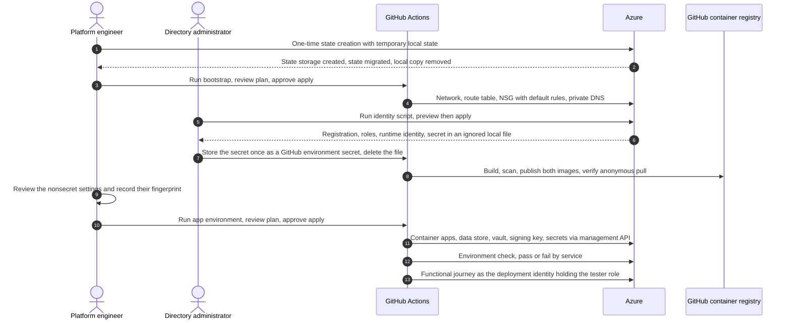
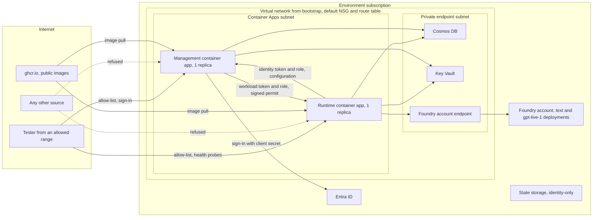
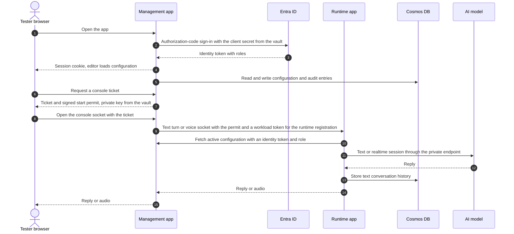

# Environments

Caller AI runs in named environments. The first one is `int`, an internal test environment on Azure
Container Apps. This guide explains how an environment is described, deployed and checked, what it
deliberately does not do, and which parts the project operates by hand. Step-by-step operation is in the
[environment bring-up runbook](runbooks/environment-bring-up.md).

## What an environment is

An environment is one Azure subscription that holds the state storage, the network, the two container
apps, the data store, the secret store, monitoring and a Microsoft Foundry account with a text and a realtime
model deployment. Terraform builds everything except the sign-in registration and the runtime
identity. The identity script creates those directory-side objects.

| Part | Where it lives | Built by |
|------|----------------|----------|
| State storage and saved plans | One storage account per environment, identity-only access | The one-time `state-create` run, then the `state` root |
| Network, route table, network security group, private DNS | `bootstrap` root | Protected GitHub workflow |
| Runtime and management apps, data store, vault, signing key, monitoring | `app_environment` root | Protected GitHub workflow |
| Sign-in registration, roles, runtime identity, tester role of the deployment identity | Directory and one resource group | The identity script, run by a directory administrator |
| Container images | GitHub container registry, public packages | The `images` workflow |

## Convention

Each environment has its own folder under `code/infra/environments/`. The
folder name is one of `int`, `dev`, `tst` or `prd`, and it holds exactly four files:

| File | Content |
|------|---------|
| `<env>.tfvars.json` | The reviewed, nonsecret values of the four objects `environment`, `state`, `bootstrap` and `app_environment` |
| `state.azurerm.tfbackend.json` | The state location of the `state` root |
| `bootstrap.azurerm.tfbackend.json` | The state location of the `bootstrap` root |
| `app_environment.azurerm.tfbackend.json` | The state location of the `app_environment` root |

No file holds a secret. The validator `validate_environment.py` stops on a secret-like key or value, on
names that collide with another environment, and on a missing or unknown file. The delivery script gives each
root only the `environment` object and its own object, written to a temporary file outside the repository.
A second environment is a copy of the folder with different names and a different subscription; no
module, script or workflow changes.

## Deployments

Three Terraform roots deliver an environment. Each root keeps one file per service and one module call per
service file. Thirteen reusable modules hold the resources; each has a README and automated tests.

Network and service boundaries in `int` while public access is enabled:

Test console journey:

The pipeline checks the deployed environment after every `app_environment` apply. The
[check tool](../code/tools/scripts/check_environment.py) reports one result per check and fails the job
when any check fails. The first deployment is expected to fail once at `signin-redirect-matches`, because
the management callback address exists only after the apps exist; the identity script's redirect phase
registers it and a rerun passes.

## Limitations

| Limitation | Meaning |
|------------|---------|
| One replica per app | Each app runs exactly one replica and does not scale out. A restart or a revision change interrupts active sessions. The test console is a test tool, not a call-handling feature, so no capacity target is claimed. |
| Public exposure | With `environment.public_access.enabled` true, both apps have external ingress. The allow-list decides who may connect. `int` uses the explicit open range `0.0.0.0/0`, so sign-in, roles and permits are the only access control; the health endpoints and the sign-in page are reachable by anyone. |
| Default network rules | The network has only the platform's default security rules and no routes, NAT gateway or firewall. Outbound policy belongs to the network owner, not to this deployment. |
| Open tenant sign-in | Anyone in the tenant can reach the sign-in; only members of the configured group receive the editor and tester roles. |
| No capacity target | `int` has no throughput or availability goal. See [capacity](capacity.md). |
| Public images | The application images are public packages so the apps pull without a credential. Nothing environment-specific is built into an image. |

## Components the project operates by hand

| Component | Why it is self-operated | Justification |
|-----------|-------------------------|---------------|
| Identity script | Directory objects and the sign-in secret cannot be created by a deployment identity without granting it directory rights | A directory administrator runs it once per environment, with a preview first; it writes the secret only to an ignored local file (Constitution Principle VIII) |
| GitHub's container registry | The apps pull public images; no registry resource is deployed | Only public, scanned images are published; tags are never overwritten or deleted (Constitution Principle I) |
| One-time local-state creation | The state storage cannot hold its own first state | `state-create` is the only operation allowed to use local state; it migrates the state and removes the local copy |
| Model quota | Quota for each model and deployment type belongs to the subscription and cannot be created by a deployment | The owner requests quota before the first apply; a missing quota fails the apply with the provider's reason |

## Related guides

- [Environment bring-up](runbooks/environment-bring-up.md)
- [Public access](runbooks/public-access.md)
- [Image publishing](runbooks/image-publishing.md)
- [Application live mode](runbooks/application-live-mode.md)
- [Terraform state](runbooks/terraform-state.md) and [Terraform delivery](runbooks/terraform-delivery.md)
- [Security](security.md)
