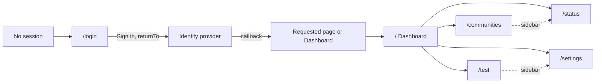
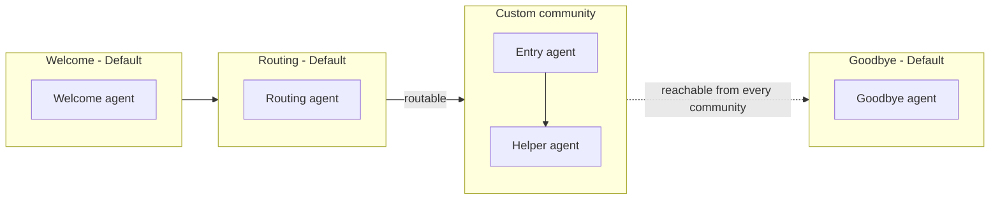

# Management Frontend

The management app is a Reflex single-page app behind one authenticated frame: a top bar, a sidebar
and the page content. This page describes its pages, roles, shared conventions and where its state
lives. Configuration tasks are in the [configuration guide](configuration-guide.md); the runtime
calls behind the Status and Settings pages are in [conversation endpoints](conversation-endpoints.md).

## Pages, Routes and Roles

| Page | Route | Editor | Tester | Purpose |
|------|-------|--------|--------|---------|
| Login | `/login` | yes | yes | Logo and one **Sign in** button; shows retry and session-ended messages |
| Dashboard | `/` | yes | yes | Welcome text and one card per page the user may open |
| Community and Agent | `/communities` | yes | no | Community and agent graph, settings panels, Tools section |
| Test | `/test` | with tester | yes, when tester-only tests are enabled | Text and voice test console |
| Status | `/status` | yes | yes | Foundry service, model deployments, reachability and check times |
| Settings | `/settings` | yes | no | Voice, reply length limit and idle timeout, plus read-only service values |

The editor role is `Configuration.Manager`; the tester role is the configured test role. The Test
page needs both roles unless the reviewed `TESTER_ONLY_TESTS` switch is on. A user with neither
role sees **No access** and a sign-out button; a page outside the user's roles shows **Role
required**. The server checks the same roles on every data call, so the sidebar is a convenience,
not the boundary. The old `/configuration` routes redirect to `/communities`, and
`/configuration/test` redirects to `/test`.

## Frame and Session

- The frame asks `GET /auth/session?page=<id>` before it renders, which also records `ui.page_view`.
  Without a session every route shows the login view; the sign-in link carries `returnTo` with
  the current page, and only exact page routes are accepted as return targets.
- The top bar holds the logo (`assets/caller-ai-logo.svg`, mark `assets/caller-ai-mark.svg`),
  **User Profile** (name, account and roles, read-only), **User Settings** ("Coming soon") and
  **Sign out**. Sign-out ends the server session and clears the tab's session storage.
- Five minutes before the session ends a warning offers **Stay signed in**. It extends the
  session while the sign-in token allows; when the token itself is about to end, it signs in
  again and returns to the same page. Open drafts live in the server-side state of this tab,
  which is bound to the signed-in user, so they come back for that user only. When the session
  has ended, the tab's state is dropped and the login page says unpublished changes were
  discarded.
- Leaving the Test page during a running test stops it like an explicit stop; the next page
  shows a notice.
- Below 768 px the sidebar collapses behind a **Menu** button. Every interactive element has a
  visible focus outline.
- Data areas share one wrapper: a loading indicator after 1 second, or an error with **Retry**.

## Design Tokens

Colors, node styles and font live in `management_app/theme.py`. Every text pair meets WCAG 2.1 AA
(4.5:1) and every graphic pair 3:1; `tests/unit/test_theme.py` checks both. The brand color is
`#197767`, the focus outline `#1f5fbf`, warnings `#8a4b00` on `#fff4e5` and errors `#a12622` on
`#fdecea`.

## Graph Conventions

Default and custom nodes differ in fill, border style, icon and label, so the difference never
depends on color alone:

| Kind | Fill | Border | Icon | Label |
|------|------|--------|------|-------|
| Default community or pre-defined agent | grey-blue | dashed | lock | Default |
| Custom community or agent | white | solid brand | pencil | Custom |
| Entry agent | as its kind | as its kind | flag | Entry |
| Community nothing routes to | warning fill | as its kind | warning | Unreachable |
| Community without an enabled entry | error fill | as its kind | warning | Invalid |

Welcome always hands over to Routing, and Goodbye is reachable from every community; those links
are fixed. A link from Routing to a custom community makes it routable. Handovers join two agents
of the same custom community.

Node positions and collapsed communities are kept in this browser's local storage under
`caller-graph-view:<origin>:<user>`, at most 400 entries with the oldest removed first. They are
never sent to the server and are not part of a revision. The outline under the graph lists every
node in graph order and is the keyboard and screen-reader way to select one.

## Settings Page

The voice drop-down is built from the runtime's catalog in the status response, grouped by
language and labeled "Name — Language (accent), presentation", with the environment default
marked. The idle timeout accepts 30 to 120 seconds and the reply length limit 1 to the runtime's
limit; the reply length applies to text replies and delegated work, not to spoken output. The page
has its own draft and publishes only `conversationSettings` on top of the active revision. When
the runtime cannot be reached the settings are read-only with an explanation.

## Tests

The browser suites under `code/management/tests/browser/` cover the frame (`test_frame.py`), the
Community and Agent page (`test_configuration_editor.py`), the Test page (`test_test_page.py`),
the Status page (`test_status_page.py`) and the Settings page (`test_settings_page.py`). They run
against the owned fixture host in `tests/editor_app.py`, which provides role-switchable sessions,
a runtime status double and delayed or failing responses. See [testing](testing.md).
