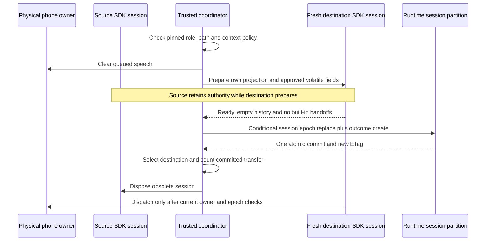
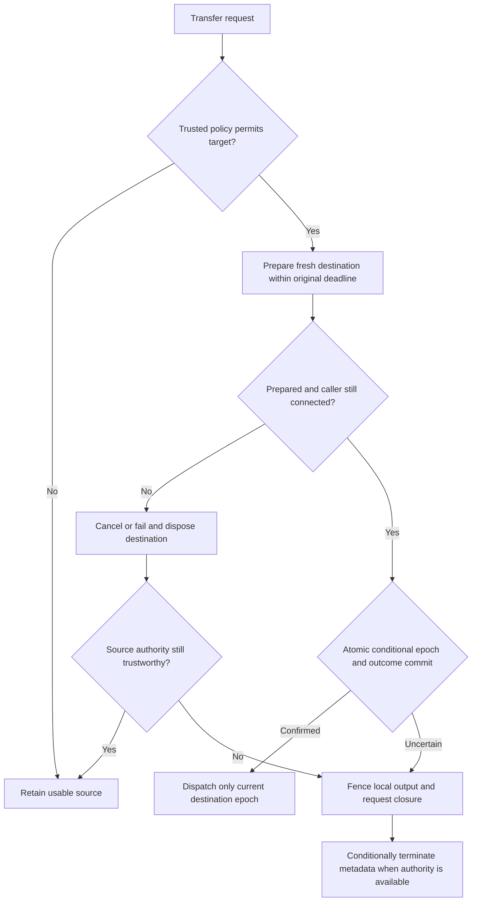

# Community Discovery and Handover

## Feature 002 Community Editor

The community MVP is an authenticated management workflow, not a model/provider or telephone
qualification. Start at **Community and Agent** (`/communities`); the old `/configuration`
routes redirect there. The graph and the Tools section share one organization-wide draft and
Publish action. See the current [configuration guide](../configuration-guide.md#community-and-agent-page).

1. Draw a link from the source to the destination to add one directed connection. Reverse
    permission needs a separate link. Moving nodes changes this browser's view only.
2. Publish the complete draft after reading the confirmation. The returned revision/ETag
    acknowledges its submitted generation; edits made during the request remain Unsaved. No
    stale success message confirms newer work.
3. On 409, keep the draft and coordinate with the other manager. **Reload** is the explicit
    choice to fetch the newer revision. Never replay a publication to recover pending audit.
4. On 422, repair the reported field/reference. For referenced deletion, cancel or explicitly
    confirm the removal; changes stay draft-only until publication. Do not edit the database
    or raw role fields to bypass validation.
5. Authentication expiry requires normal reauthentication; "Stay signed in" keeps the open
    draft for the same user. Do not share fixture cookies, inspect another actor's draft or
    put credentials in URLs or browser storage.

Sidebar navigation keeps unsaved edits. A newer publication by another manager shows a notice
with Reload; the draft is never replaced silently. Empty protected-only publication is editable
but cannot admit a runtime conversation. Model/test-ticket/voice resources are not part of
this editor-only fixture, and no UI status certifies real Cosmos durability or live behavior.
Record only source/revision, fixed outcome/correlation, counts and timing for failures, never
prompts, tool payloads, transcripts, audio or raw provider/browser exception bodies.

## Historical Feature 001 Runtime Scope

The remaining runbook is preserved feature-001 controlled-runtime guidance and evidence. It
does not define the new browser conversation executor, reopen deferred phone/hosting work or
authorize provider calls. Its transfer-content and physical-owner contracts are historical,
not newly qualified or silently applied to feature 002.

## Status and Ownership

This runbook covers explicitly composed local US3 services. It does not enable live calls,
provision infrastructure or qualify a provider. See [US3 acceptance](../acceptance/us3.md)
for measured evidence and pending gates. The runtime owns session and handover metadata;
management owns configuration. Runtime never opens management's private Cosmos containers.

A call pins one immutable, detached configuration revision. The phone connection remains at
one physical owner with the same session ID and connection epoch throughout agent handovers.
Moving between agents is not WebSocket migration, processing-owner recovery or tenant isolation.

## Discovery and Authorization

Every enabled ordinary agent receives its own instructions and every other enabled ordinary
peer's ID, name and community ID within its community, regardless of relationship availability.
Peer prompts and tool objects are absent. Disabled agents and communities cannot be targets.
Routing receives only enabled community IDs, names, routing descriptions and eligible entry
references. Welcome and Goodbye have no discovery directories. Shared lifecycle identities
are resolved by trusted code, not by unrestricted model discovery.

Directory information is included as JSON metadata in the receiving SDK instructions. Routing's
instructions end with the communities `route_community` accepts at that moment (ID, name and
routing description cut to 1,000 characters): every enabled, routable community with an enabled
entry, or only the pending destination during a cross-community transfer. It is
not authority: trusted code rechecks role, enabled state, community membership, entry identity
and the pinned source-to-target relationship before preparing a receiver. Guessed foreign IDs
fail before any model connection. Ordinary agents cannot directly target foreign ordinary
agents. Cross-community selection commits Routing first, then the selected enabled entry.

## Transfer Content

Only `request_summary` and `transfer_reason` are candidates, further restricted by that pinned
relationship's `allowedContextFields`. Each value must be text at most 4096 UTF-8 bytes; empty
values are omitted. Raw history, audio, prompts, tool results and unknown supplied fields are
not replayed. Transfer selection does not mutate the source. Selected values are volatile and
are cleared after the attempt; Python reference release is not a physical memory-erasure claim.

Composition explicitly injects [canonical detection policy](../../code/contracts/secret-detection-policy.json)
version 1. Recognized credential patterns and secret-reference URIs are rejected with fixed,
content-free errors. Detection is not complete and cannot judge whether arbitrary prose is an
appropriate minimal summary. The trusted producer remains responsible for content minimization.
Never use these fields to send credentials, whole transcripts or unrelated private facts.

## Preparation and Commit

SDK agents have no tools or built-in handoffs. Each receiving session is fresh, with only
session/revision IDs in SDK application context. The SDK preparation span ends in its creating
task before yielding the long-lived scope; closing from another task cannot detach that span.
Default SDK/provider sensitive tracing remains disabled.

The Cosmos adapter requires an explicitly injected runtime container partitioned by `/sessionId`.
One transactional batch conditionally replaces session metadata and creates the immutable final
handover record. Its ETag checks physical owner, connection epoch, pinned revision and source
agent epoch. Automatic write retries are disabled. The local repository models this under one
lock; neither local state nor SDK doubles prove real Cosmos durability or consistency.

Final records contain opaque handover/session/revision/owner/source/destination references,
connection/source/destination epochs, UTC timestamps, a fixed outcome and fixed reason code.
They never contain transferred summary/reason text, prompts, audio or result payloads. A
`requested` record is the immutable in-memory attempt; only final outcomes are written by
this coordinator. A request rejected before preparation is a safe result, not a durable payload.

## Failure and Terminal Semantics

| Condition | Local behavior and metadata |
|-----------|-----------------------------|
| Policy rejection or disabled entry | No receiver preparation; source stays active |
| Another attempt is preparing | `transfer_in_progress`; no second receiver |
| Receiver connection/preparation fails | Close receiver, persist failed outcome without changing source epoch, retain usable source |
| Original deadline expires | Same failed-transfer behavior within the remaining original budget, not a new retry budget |
| Caller disconnects before commit | Cancel preparation, atomically retain source epoch with canceled outcome and terminal `caller_disconnected`; dispose sessions once |
| Caller disconnects after commit | Keep committed outcome, terminate destination epoch; never rewrite commit as cancellation |
| Store authority is unavailable/ambiguous | Fence all local output, request phone hangup, conditionally mark same-owner metadata terminal if authority recovers; preserve any committed outcome |
| Unknown destination | Clarify once; next unresolved selection uses protected Goodbye then hangup and terminal metadata |
| Rolling transfer limit reached | Stop ordinary transfers, clarify once, then protected Goodbye if another blocked transfer is required |

Successful handovers use one absolute operation budget, at most ten seconds including failure
resolution and cleanup. Routing's two hops share an absolute deadline. Preparation reserves
cleanup time; failed SDK setup cleanup is also bounded by the existing deadline. A successful
Goodbye selects the protected closing agent, invokes the explicit output callback, requests
hangup, then records terminal `completed`. Callback or provider failures use `operation_failed`.
The actual speech/provider adapters and acknowledgment qualification remain deferred.

The default rolling limit is ten committed nonterminal transfers in 60 seconds, configurable
at composition. Failures and rejections do not consume it; timestamps exactly 60 seconds old
expire. Protected terminal closing remains possible at the limit. No fresh business epoch is
allowed merely because a caller or model supplies a new request. Windows are call-local;
they are not evidence of cross-pod state migration or crash recovery.

## Operator Recovery

Use only opaque session/revision/owner IDs, epochs, fixed outcomes/reasons and timestamps.
For a failed destination, verify unchanged source epoch and one failed record. For a disconnect,
verify terminal metadata and that late source/destination frames are dropped. For an uncertain
write, inspect current metadata and the immutable outcome together; never retry blindly with
a new handover ID or overwrite an already committed outcome.

If storage remains unreachable or the provider does not acknowledge closure, do not report
durable termination or successful phone hangup. Local dispatch remains fenced. Escalate with
safe metadata and reconcile under the current owner/ETag when available; never attach a second
pod to the old socket. Actual processing-owner recovery belongs to the later qualified scale
and provider work. Never export prompts, transfer text or exception payloads for diagnosis.
