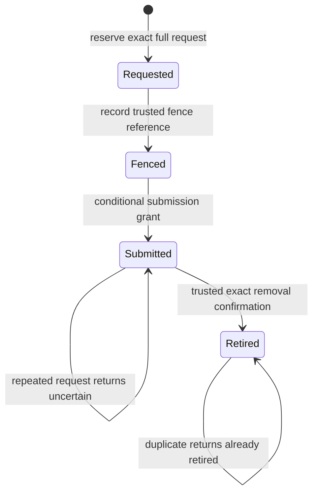
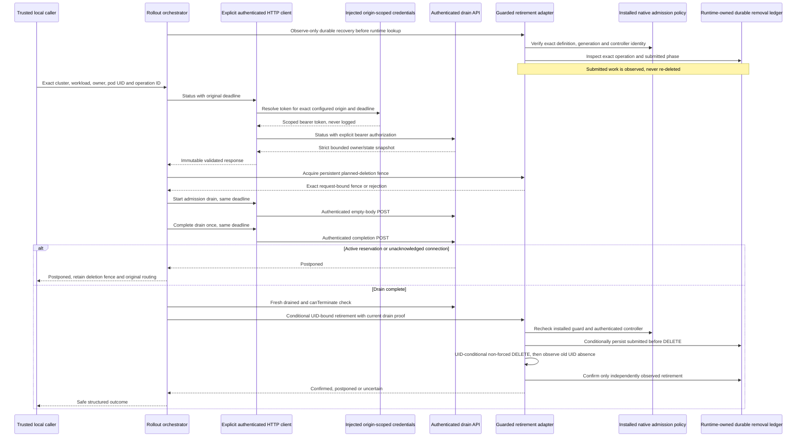

# Local Drain Rollout Controls

## T124 Reopened Local Enforcement Increment

The user explicitly reopened T124-T129 and selected local opt-in Kubernetes admission-guard
implementation. This does not authorize cluster access, Terraform deployment, actual pod
deletion, provider/model calls, image publication or live acceptance. Existing hosted results
below remain historical and do not qualify this new code.

[kubernetes_rollout.py](../../code/tools/scripts/kubernetes_rollout.py) now composes explicit
enforcement, pod and durable-ledger ports through `GuardedCluster`. The concrete
`KubernetesRetirementClient` uses only supplied origin-scoped credentials and an HTTPX client;
its TLS/identity/network configuration remains a separately reviewed trust boundary. It reads
the exact installed policy/binding, generation and completed type-check status, and verifies
the current dedicated controller subject through Kubernetes SelfSubjectReview. It never installs
a policy, discovers credentials or turns on CLI execution.

The single Terraform-owned [policy template](../../code/infra/terraform/modules/platform/templates/retirement-guard.json.tftpl)
is consumed by both the client and the [review-only Terraform output](../../code/infra/terraform/modules/platform/retirement.tf).
The output is null by default and is not an installation resource. A matching installed policy
must use failurePolicy Fail and a Deny binding, cover the exact namespace without editable pod
selectors, and permit only the dedicated controller's UID-precondition DELETE. Independent
actors, eviction, force deletion and collection deletion are denied by the tested CEL rule.
Namespace/service-account ownership, prevention of controller impersonation or unauthorized
service-account use, API-server enforcement support and authority to modify the policy require
independent RBAC/environment review. A supplied HTTP response is not proof of those live facts.

Submission is durably recorded before DELETE. Kubernetes acceptance is not removal; only a
fresh authoritative GET showing the old UID absent can confirm retirement. Lost/canceled
submission replies remain submitted, and reconstruction observes rather than replaying DELETE.
Reconciliation precedes runtime lookup so a removed owner need not answer its old endpoint.
Every step retains the original at-most-ten-second orchestration deadline; no force, polling,
fence expiry or automatic uncertain-record eviction is added.

Local verification passes 73 rollout cases, including evaluation by the pinned maintained CEL
engine rather than a hand-written policy simulator, plus three real Cosmos-ledger composition
cases on the existing SDK double. Strict typing passes for both tooling modules. Credential-free
Terraform validation passes all three roots and 32 native tests. Actual admission installation,
RBAC/identity qualification, a reviewed execution host and real cluster/Cosmos verification
remain outstanding; T124 is still partial, not live-qualified or checked complete.

The final local checkpoint passes the full 552-case backend and 220-case tooling suites,
all eight repository gates, the strict 68-package tooling audit with zero known findings,
and all 33 documents/30 actual sandboxed diagram renders. These are local results only.

## Scope and Authorization

On 2026-10-26 the user selected **Continue local T098 controls**, authorizing an isolated
orchestrator with injected operator/cluster doubles while T097 remains unchecked. Monitoring,
media and live gates are unchanged. This is local T098 completion, not permission to contact
Azure, authenticate a real cluster, enable alerts, provision, deploy, evict pods or scale nodes.

[drain_rollout.py](../../code/tools/scripts/drain_rollout.py) implements one bounded planned-removal
attempt. Its CLI only validates a nonsecret plan. No live cluster/identity adapter or CLI
execution path is enabled, no workload manifest is changed, and no cloud package is added. A fake
port's assertion of protection is not evidence that Kubernetes or Azure prevents deletion.
Read [monitoring](monitoring.md) and [platform security](platform-security.md) for other gates.

## Current Hosted Ledger Verification

Observed [run 40733054020](https://github.com/marvinbuss/caller-ai/actions/runs/40733054020)
on `cec715c2a39e725bd3bd5337a6a4d929538a6aea` passes every native Windows, native Ubuntu
and Linux image step, with no failed or skipped steps. Both native platforms report
545 runtime/413 management/203 tooling passes, zero test failures/errors/skips, exact
baseline 0/broken 1/restored 0 and fixture cleanup. Both prepare CLI 12.0.0 and pass all
29 diagram indices across 33 documents. Sandboxed Chrome versions are Windows 156.0.8078.48
and Ubuntu 156.0.8078.47. Python audits cover Windows 69/92/60 and Linux 68/90/59 packages;
both frontend 294-package audits have zero findings. Actual image smoke passes offline/
non-root startup and 360/768/1440 browser checks; three image audits report zero HIGH/CRITICAL.

This closes the current ledger increment's native/image verification checkpoint, not T124's
missing independent-deletion enforcement, controller/cluster wiring or actual environment/live
qualification. T124 remains unchecked and completion stays 114/129; T123 and all fifteen
open markers are unchanged. The earlier preparation failure below remains historical, not
certified explained by this success. No job retry, deadline/sandbox change, waived assertion
or live action is used. Results apply to the exact source above, not automatically to later edits.

### Earlier Ubuntu Preparation Failure

Observed [run 40718864989](https://github.com/marvinbuss/caller-ai/actions/runs/40718864989)
on `1b157b935f44ac7954ae8b9b0a2314e88289c0c5` passes native Windows and Linux images.
Windows and Ubuntu each report 545 runtime/413 management/203 tooling passes with zero test
failures/errors/skips, exact baseline 0/broken 1/restored 0 and fixture cleanup. Windows
prepares CLI 12.0.0, renders all 29 diagram indices across 33 documents with sandboxed Chrome
156.0.8078.48 and passes Python 69/92/60-package plus frontend 294-package audits with zero
findings. Actual image smoke passes offline/non-root startup and 360/768/1440 browser checks;
three actual image audits report zero HIGH/CRITICAL findings.

Ubuntu fails the required documentation step with
`diagram_renderer_timeout:launcher_or_package` during CLI preparation, before any diagram
starts; its later dependency audit does not run. This is not a ledger/application test
failure or Mermaid diagram render. The exact preparation root cause is not reproduced by
this run's fixed diagnostics, so no ledger repair, CI rerun, deadline/sandbox change or
assertion waiver is invented. Implementation stops at this verification checkpoint; the
failed gate and merge/release block stay visible. T124 remains partial and completion stays
114/129; T123's earlier completed/hosted checkpoint and all fifteen open markers are preserved.
These are regression results for the exact source above, not actual cluster enforcement,
Cosmos/environment/live qualification or authorization to perform any live action.

## Workflow and Safety Boundary

### Durable Operation Metadata

`CosmosRemovalLedger` in the runtime's [rollout repository](../../code/backend/src/caller_runtime/adapters/rollout_repository.py)
persists exact operation/target/fence/phase metadata over an explicitly injected runtime-owned
container. Its reserved item has `id=sessionId=runtime-removal-ledger-v1`, schema 1 and
`ttl=-1`; no container, identity/client, default route or CLI execution path is created.
It is a ledger, not RBAC, an admission controller, a deletion fence or a pod-removal adapter.
The current rollout CLI/orchestrator does not automatically wire or execute it.



One operation ID binds intent plus cluster, namespace, workload, physical owner, pod name
and pod UID. Reuse for any changed field fails; a fence reference cannot be swapped after
recording. `begin_retirement` returns `submit` only for the first confirmed fenced-to-submitted
transition. A reconstructed adapter sees `submitted` and returns `uncertain`, never another
submission grant. Only an independently verified exact guarded outcome may be passed to
`confirm_retired`; duplicate confirmed results are idempotent. Persisting `submitted` is
not proof that removal occurred, and persisting `fenced` is not actual deletion enforcement.

Strong point reads and `IfNotModified` replacements serialize independent adapters. Automatic
write retries are off; at most four 412 conflicts share one existing budget up to ten seconds.
HTTP/cancellation replies lost after commit leave the committed phase intact. The ledger is
bounded to 1,024 entries/512 KiB and never evicts uncertain or retired entries automatically.
Saturation blocks new work; any archival or migration requires separately reviewed authority.

Explicit `initialize` is trusted empty-installation bootstrap, not outage repair. Normal
operations never recreate missing state or reset phases. Missing/corrupt state, absent ETags,
expired retention configuration, invalid/backward UTC clocks and unavailable storage fail
closed with fixed errors. The caller must separately authenticate authorization and enforce
the real cluster guard, exact UID and fresh drain proof at its side-effect boundary.

All 33 new ledger contracts and the full 545-case backend pass; strict typing covers 34
runtime sources. These are storage-double tests, including forced ETag contention and restart
reconstruction, not real Cosmos/cluster crash or independent-deletion evidence. Production
ledger/controller wiring, the enforcement definitions and qualified cluster adapters remain
missing. T124 stays partial; no environment or live operation is authorized.
All eight repository/type/Terraform/secret/publication gates and 203 tooling cases pass.
All 33 documents/29 diagram sources validate, and the ledger state diagram actually renders
through the unchanged pinned direct/offline/sandbox path and nonempty SVG checks.



The request is immutable and binds `cluster_ref`, namespace, workload, runtime owner, pod name
and **pod UID**, with one stable `operation_id` and intent `rollout` or `scale_in`. A name alone
cannot authorize removal of a replacement pod. IDs are bounded, and Kubernetes target names
use a conservative lowercase-label subset. No credentials, endpoints, scripts or arbitrary
execution fields are accepted.

### Authenticated Operations HTTP Boundary

`HttpOperationsClient` implements `OperationsPort` using an explicitly supplied HTTPX async
client, canonical HTTPS origin and `OperationsCredentials.bearer_token(origin, deadline)`
provider. The constructor accepts only a host root on port 443, with no userinfo, query,
fragment or path override. Neither the CLI nor default apps construct or invoke this client.
The trusted caller supplies the approved TLS-verifying transport and qualified credential
provider; this adapter is not issuer/audience/RBAC verification or environment approval.

Every status/begin/complete call resolves credentials again for the exact origin and original
deadline. Requests are built directly, excluding ambient client auth, cookies, default headers
and query parameters. Methods/paths match the existing drain API and contain no request body.
Redirects, HTTP retries and credential-discovery fallbacks are disabled. The original finite
deadline is at most ten seconds and covers credential resolution, send, streamed read and
closure; no request receives a fresh budget.

Only HTTP 200 `application/json` responses are accepted. Streamed decoded content is bounded
to 4096 bytes; duplicate/unknown fields, foreign owners and nonboolean termination flags fail.
Results reuse the existing strict immutable drain snapshot. Authorization, transport and
response failures expose fixed categories, never tokens, response bodies or raw HTTP errors.
Cancellation propagates. No endpoint, token or execution option is added to the plan/CLI.

The local increment adds 28 cases: all 56 rollout/client tests, strict module typing and all
203 tooling cases pass, along with all eight repository gates. The existing actual FastAPI/
HTTPX integration now uses this client rather than a test-only request wrapper; all 18 drain/
API cases pass with the original no-forced-hangup, postponed-drain and UID assertions intact.
No live request or cluster action occurs. T124 remains unchecked: durable independent-deletion
enforcement, authenticated cluster adapters and restart reconciliation are still unimplemented.
The response-cleanup deadline regression also passes without a production workaround.
All 33 documents/28 diagram sources validate, and the changed HTTP operations sequence
actually renders through the unchanged sandboxed direct/offline path and SVG checks.

`OperationsPort` must authenticate a least-privileged internal operator for every call. Its
status/begin/complete responses must match the existing API's exact bounded fields and owner;
string booleans, foreign owners and unexpected fields are rejected. The runtime still owns
admission fencing, callback/media routing and verified physical closure. The orchestrator never
decrements reservations, changes owners/epochs, detaches connections or invokes hangup.

`ClusterPort.fence` must establish persistent protection against **independent planned removal**
by rollout, autoscaler and maintenance actors. The typed `RemovalFence` is a trusted in-process
port result, not a user-supplied approval, credential or Kubernetes enforcement mechanism.
Protection must remain in force while calls drain, after postponed/blocked/uncertain outcomes,
on cancellation, and across orchestrator failure/restart. There is deliberately no automatic
unfence-on-exit operation that could expose still-active calls to another actor.

`ClusterPort.retire` must atomically enforce the still-current guard, exact cluster/workload/
owner/pod UID binding and fresh authoritative drain proof at its side-effect boundary. It must
deduplicate the operation ID against the **same full request**, reject conflicting reuse, and
reconcile prior ambiguous submissions rather than deleting again. A Python pre-check followed
by an unconditional Kubernetes delete is not a valid implementation of this contract. UID
preconditions alone do not enforce the independent-deletion/drain conditions.

The local orchestrator checks these port results but cannot supply the missing server-side
enforcement. The live adapter must use reviewed RBAC/admission/control ownership and durable
fencing/reconciliation. Grace periods, PodDisruptionBudgets, readiness, preStop hooks, fixed
node counts, a successful health request or a `canTerminate` value alone are not call-preservation
guarantees. This mechanism does not prevent power loss, hard node failure, manual break-glass
actions or provider outages; those remain separate owner-loss/failure obligations.

## Budgets, Outcomes and Recovery

Each invocation has one absolute asyncio deadline, finite and positive up to ten seconds,
shared with all injected calls. There is no wait loop, sleep, unbounded retry, background
retirement or maximum-call-age timer. Async ports must honor cancellation and the original
deadline without blocking the event loop; a noncooperative implementation is not qualified.
When a call remains active, return promptly and let an authorized external scheduler decide
when to attempt the same bound operation again. Do not restart admission or reroute established
callbacks merely because deployment progress is slow.

| Outcome | Meaning | Operator response |
|---------|---------|-------------------|
| `postponed` | Drain is incomplete, or the atomic cluster guard/binding changed | Keep protection and established routing; retry only under the same reviewed operation binding |
| `blocked` | No confirmed retirement submission; authorization, fence, response or control/deadline check failed | Preserve fencing/drain state, investigate safe category; do not infer zero side effects in a failed begin/fence call |
| `uncertain` | Retirement was submitted but its outcome is unknown or unrecognized | Reconcile exact UID/operation/ledger before another action; do not claim removal or blindly retry |
| `retired` | Trusted cluster port confirms the guarded removal | Continue only with qualified controller evidence and the intended replacement/scale-in plan |
| `already_retired` | Trusted port confirms the same bound operation was already applied | Do not repeat the removal |

Cancellation propagates after a safe failure event and does not release a fence. An ambiguous
retirement may already have succeeded; a timeout cannot be labeled a confirmed non-removal.
Unknown/invalid drain data always blocks before removal. Failures do not dump raw exception
messages, submitted plans, IDs, credentials, prompts or caller content. Structured local
events carry UTC timestamp, severity, fixed service/environment/event/outcome/reason codes and
an opaque per-attempt correlation ID. The tool is not a public runtime endpoint or an agent tool.

## Validation-Only CLI

A plan has exactly this shape; values below are synthetic, not environment approval:

```json
{
  "operation_id": "operation-fixture",
  "intent": "rollout",
  "target": {
    "cluster_ref": "cluster-fixture",
    "namespace": "runtime",
    "workload": "calls",
    "owner_id": "owner-fixture",
    "pod_name": "call-worker",
    "pod_uid": "pod-uid-one"
  }
}
```

```powershell
uv run --project code/tools --locked --no-sync python code/tools/scripts/drain_rollout.py --check-plan PATH_TO_REVIEWED_NONSECRET_PLAN
```

The input is at most 4096 bytes; duplicate keys, unknown/missing fields, unsafe targets and
unsupported intents fail. Success exits 0 with `rollout_plan_validated` and
`mode=validation_only`; rejection exits 2 with a fixed category and no input reflection. The
CLI has no execute mode, credential argument, automatic kubectl/Azure fallback or live effect.
Plan validity proves neither target existence, operator authorization, current ownership nor
a deletion fence. Calling `orchestrate` requires explicitly supplied trusted ports.

## Earlier Executed Local Evidence

All **28 rollout tooling cases** pass, and the full tooling suite passes **59 cases**. All
**18 planned-drain/API integration cases** pass, including a new actual FastAPI/HTTPX journey
through status/start/complete. It proves active reservations postpone, terminal metadata with
an unacknowledged connection still postpones, and only acknowledgment permits the guarded
retirement double. The orchestrator invokes no hangup. Tests also cover rejected operator
authority before cluster controls, exact fence binding, missing protection, reused pod UID or
lost guard at commit, repeated stable operations, malformed/stale status, original deadlines,
cancellation, ambiguous results and non-reflective CLI failures. Strict mypy passes the new
orchestrator and repository lint passes. The normal CI tooling command discovers these tests.

```powershell
uv run --project code/tools --locked --no-sync pytest code/tools/tests -q
uv run --directory code/backend --locked --no-sync pytest tests/integration/test_planned_drain.py -q
uv run --project code/tools --locked --no-sync mypy --strict code/tools/scripts/drain_rollout.py
```

These are local port and actual drain-API tests, not real pod removal, provider hangup, deployed
identity, controller HA, cluster-wide reconciliation or live zero-disconnect evidence. Earlier
full-suite Azure deadline/media/browser export failures remain open; no tests are excluded or
assertions/timeouts weakened. T097 cloud mapping/query/delivery and T043 integrated media are
still pending. T099 authorization/qualification and later live T100/T118 evidence must precede
any claim that a deployed rollout or scale-in preserves active calls. No environment request
is satisfied by this guide or its test doubles.
