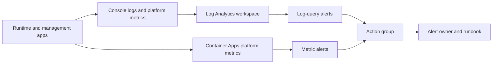

# Both-Service Monitoring

## Feature 002 Application Alerts

Both services classify bounded metadata-only `test.alert` events locally. This is separate
from the environment alerts below, which the deployment configures in the workspace.

| Fixed Reason | Trigger | Accountable Response |
|--------------|---------|----------------------|
| `cleanup_uncertain` | Unconfirmed cleanup strictly beyond ten seconds, using the earliest observed cleanup start | Repository runtime maintainer and reviewed environment owner inspect Strong authority/attempt watermarks and exact resource-specific proof; keep the slot occupied. |
| `dependency_failures` | Three consecutive dependency-unavailable observations within sixty seconds; a success resets the streak | Owning service maintainer checks the reviewed dependency/identity/configuration boundary; do not retry an uncertain business attempt. |
| `latency_high` | Backend first-text p95 exceeds two seconds with at least twenty samples within five minutes | Runtime maintainer reviews bounded timing counts and declared action waits; backend timing is not physical audible latency. |

Each event retains the closed service/environment/outcome/UTC/correlation/trace fields, mode
and fixed reason, never session/actor labels, prompts, payloads, audio, transcript or credentials.
Cleanup lifecycle/latency/proof observations share one generated correlation. Five pending
cleanup records/timers, three failure timestamps per mode and 512 timing samples per mode
bound memory. Known elapsed cleanup time cannot renew the alert timer; confirmed cleanup
cancels its tracker. Lifecycle shutdown cancels owned timers and no late observation recreates
them. Threshold/correlation/privacy/reset/eviction tests use controlled clocks, not long waits.

The repository maintainers own application triage; the reviewed environment owner must name
the actual on-call recipient and approved delivery route before live acceptance. Follow
[configuration recovery](configuration.md), [published-test cleanup](../configuration-guide.md#published-browser-console)
and [device/endurance prerequisites](../setup.md#device-and-endurance-scope-validation).
Recovery requires independently verified settlement/disposal and applicable authenticated
Live closure evidence. Never force-clear, adopt, replay or treat a timeout/lease/TCP close as
release. Alert metadata cannot grant business authority.

An explicitly supplied nonblocking telemetry sink receives only a detached copy of the
allowlisted event; sink errors do not echo private details or change application ownership.
Default sinks are absent and local logs alone do not prove delivery. Tests with controlled
sinks prove classification and explicit local lifecycle binding only. Actual approved-sink
delivery, accountable recipient/response and affected T062/T086/T087 acceptance remain
unverified; do not label them passed.

The runtime composition accepts `create_app(alert_sink=...)`; reviewed management
resources accept `ManagementResources.test_alert_sink`. Supply only an already reviewed
synchronous bounded nonblocking enqueue callback. No callback may perform blocking network
I/O on the event path; an async function is not this callback contract. The resource provider
owns any external delivery worker/queue and its disposal. A full queue may reject an enqueue;
the app contains the error, retains its bounded local event and neither retries nor claims
notification delivery. Local tests use one-item queues and verify correlation, detached
metadata, queue-full containment and no post-shutdown invocation in both service lifecycles.
These ports create no collector, endpoint, credential discovery or default worker, and their
presence does not complete the actual delivery/recipient/recovery gate.

## Environment alerts

Each environment deploys its monitoring with the `monitoring` module (see [Platform](platform.md)): a Log Analytics
workspace that receives the container app logs and metrics, a workspace-based Application Insights component,
one action group and the alerts below. Every alert carries an owner and an HTTPS runbook link in its description;
the module rejects an alert without both. The environment file sets the thresholds, the retention, the daily cap
and the action group's e-mail receivers.



| Alert | Source | Fires when | First response |
|-------|--------|------------|----------------|
| `5xx` per app | Platform metric `Requests`, status category 5xx | The total exceeds `alerts.http_5xx_count` | Read the app's recent console logs for the failing route; check the dependency named by the event; do not restart before preserving the evidence |
| `restarts` per app | Platform metric `RestartCount` | The total exceeds `alerts.restart_count` | Read the start reason code in the logs ([Application live mode](application-live-mode.md)); a loop of `settings_*` codes means a bad deployment, roll back |
| `replicas` per app | Platform metric `Replicas` | The minimum drops below 1 | The app is not running; the revision is unhealthy or the environment is failing; run the environment check and roll back if needed |
| `cpu` and `memory` per app | Platform metrics `CpuPercentage`, `MemoryPercentage` | The average exceeds `alerts.cpu_percent` or `alerts.memory_percent` | Check for a stuck session; the apps have one replica, so a sustained value means the container size needs review |
| `dependency failures` | Log query over the apps' structured events | More than `alerts.dependency_count` events with a failure outcome and the dependency category | Check the named dependency (data store, vault, model account) and the private endpoint state |
| `latency` | Log query over `latency_ms` in the structured events | More than five events slower than `alerts.latency_ms` | Compare with model latency; the deployment has no measured capacity target ([capacity](../capacity.md)) |

The log-query alerts match the structured event fields the applications write. A change to those fields needs
a change to the queries.

Alerts evaluate on the platform. Nothing here proves that a notification reached a person: after the first
deployment the owner fires the check's `alert-test` (`check_environment.py --test-alert`), confirms receipt and
records it in the [acceptance record](../acceptance/int-environment.md). Until then the alerts are configured, not
shown to deliver.

## Metric Contract

| Signal | Meaning and actual producer |
|--------|-----------------------------|
| `caller.requests` | Completed HTTP middleware responses, with fixed route/method/status-class dimensions |
| `caller.errors` | Subset of completed HTTP responses with status 500-599, not every rejected input |
| `caller.request.duration` | HTTP middleware response time in seconds; not streamed-body completion, WebSocket duration or speech latency |
| `caller.dependency.failures` | Generic readiness failures in both services; management gateway configuration/public-tool/MCP failure or deadline category at the failed stage |
| `caller.saturation` runtime | Bounded 0-1 ratio for `session_slots`, `model_sessions` or `admission_queue`; defined but no producer is wired in the current runtime |
| `caller.saturation` management | Latest completed capability operation's original deadline budget consumed, not CPU, request concurrency or a fleet percentile |
| `caller.admissions` | Runtime admission outcomes (admitted, duplicate, unavailable); defined but no producer is wired in the current runtime |

Request routes are `health`, `readiness`, `text`, `voice` and `unmatched`. HTTP middleware does not
see WebSocket traffic, so voice sessions are not counted. Admission and cleanup behavior is observed through the
`test.alert` events above and the `test.*` telemetry events instead of metrics.

Request route/method/status-class, dependency/reason, saturation resource and outcome labels
come from closed enumerations. Unknown HTTP paths collapse to `unmatched`; raw paths, query
strings, identities, session/provider/agent/revision IDs, hostnames, correlations and exception
messages never become dimensions. Resource attributes contain only fixed service/environment
identity. Durations must be finite and within 0-3600 seconds, counts are bounded, and ratios
are finite 0-1 values. Exemplars are disabled, so trace identifiers do not enter metric points.
Audio, prompts, transcripts, transferred summaries/reasons, credentials and tool data are
excluded. These restrictions bound series cardinality without recording content to diagnose it.

## Explicit SDK Delta Collection

Each service owns a `DeltaExportReader` in its existing metrics module. It wraps the maintained
OpenTelemetry `PeriodicExportingMetricReader` with periodic collection disabled, accepting one
explicitly supplied, trusted `MetricExporter`. Pass the reader through the existing meter's
`reader` argument. No application setting constructs an exporter, selects a URL, discovers a
credential, or starts a collection worker. The default meter remains in-memory only, and there
is no public metrics endpoint or cloud activation through this interface.

Counters and histograms use SDK delta aggregation; scalar gauges retain latest-value semantics.
Tests inspect actual batches from successive collections and an idle collection, proving that
previous request counts and histogram observations are not added again. This proves local OTel
temporality, not how an Azure exporter maps points into AppMetrics. A new process starts new
SDK aggregation state; fleet/reset and source-attribution behavior still require qualification.

The trusted caller invokes `reader.force_flush()` outside realtime execution. True requires a
batch successfully accepted by the injected exporter, a successful exporter flush and no prior
failed export/flush. An empty initial collection returns false without marking data loss. The
installed SDK's periodic reader always returns true from its own flush method, so this wrapper
explicitly checks exporter state rather than mistaking that return value for delivery evidence.

Export exceptions, unsuccessful results and flush exceptions/failures set a sticky `reader.failed`
flag. Later successes do not erase the loss. The wrapper does not log exception text, queue,
persist, retry or replay failed deltas. A trusted caller must surface a fixed failure category
and preserve the incident; do not clear evidence by silently replacing the reader. Closing the
owning meter collects the final interval and disposes the exporter once. Shutdown exceptions
are contained but retain the same failure flag, which remains inspectable after closure.

Each delegated operation receives a finite positive timeout capped at 1000 ms. Exporters must
cooperatively honor it; this is not a hard thread-kill guarantee or one shared end-to-end budget.
Synchronous flush/shutdown must not run on the request or audio path. The reader creates no worker,
but a future cloud exporter could create its own threads, enrichment, logs, retries or disk
storage. Its actual identity, destination, privacy, timeout and cleanup behavior must be reviewed
and tested separately. Local synthetic exporter acceptance is not authenticated ingestion,
durable receipt, an action-group acknowledgment or a live monitoring acceptance result.

## Operating the alerts

1. Keep the owner and runbook link of every alert current in the environment file. The action group's receivers
   are the only notification path; an unmonitored mailbox defeats every alert.
2. Raise a threshold only with a recorded reason and a review of the plan. Never disable an alert to silence it
   without an incident record and replacement monitoring.
3. After a deployment, run the environment check with `--test-alert` and record the receipt.
4. Application-level events (`cleanup_uncertain`, `dependency_failures`, `latency_high`) are classified inside the
   services as described at the top of this guide; they reach the workspace through the console logs and the log
   queries above.

## Local Verification

```powershell
uv run --directory code/backend --locked --no-sync pytest tests/unit/test_metrics.py tests/contract/test_health.py -q
uv run --directory code/management --locked --no-sync pytest tests/unit/test_metrics.py tests/contract/test_health.py tests/contract/test_capability_gateway.py -q
uv run --project code/tools --locked --no-sync python code/tools/scripts/verify_terraform.py check
uv run --project code/tools --locked --no-sync python code/tools/scripts/verify_docs.py
```

The metric and reader tests inspect recorded points, label rejection, finite values, delta intervals, exporter
errors, sticky loss and final cleanup. The module's native Terraform tests mock the provider and assert the
workspace, the action group, the alert set, the owner and runbook requirement and the rejection of incomplete
input. They do not connect to Azure or show that a notification is delivered.
