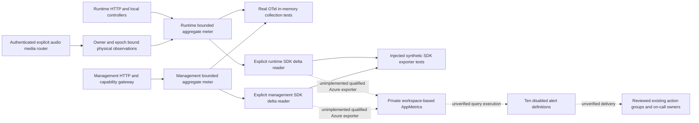

# Both-Service Monitoring

## Feature 002 Application Alerts

Both services classify bounded metadata-only `test.alert` events locally. This is separate
from the historical feature-001 platform metrics and disabled alert definitions below.
No cloud collector, hosting rule, action group or default network delivery was added.

| Fixed Reason | Trigger | Accountable Response |
|--------------|---------|----------------------|
| `cleanup_uncertain` | Unconfirmed cleanup strictly beyond ten seconds, using the earliest observed cleanup start | Repository runtime maintainer and reviewed environment owner inspect Strong authority/attempt watermarks and exact resource-specific proof; keep the slot occupied. |
| `dependency_failures` | Three consecutive dependency-unavailable observations within sixty seconds; a success resets the streak | Owning service maintainer checks the reviewed dependency/identity/configuration boundary; do not retry an uncertain business attempt. |
| `latency_high` | Backend first-text p95 exceeds two seconds with at least twenty samples within five minutes | Runtime maintainer reviews bounded timing counts and declared action waits; backend timing is not physical audible latency. |

Each event retains the closed service/environment/outcome/UTC/correlation/trace fields, mode
and fixed reason, never session/actor labels, prompts, payloads, audio, transcript or credentials.
Cleanup lifecycle/latency/proof observations share one generated correlation. Five pending
cleanup records/timers, three failure timestamps per mode and 512 timing samples per mode
bound memory. Known elapsed cleanup time cannot renew the alert timer; confirmed cleanup
cancels its tracker. Lifecycle shutdown cancels owned timers and no late observation recreates
them. Threshold/correlation/privacy/reset/eviction tests use controlled clocks, not long waits.

The repository maintainers own application triage; the reviewed environment owner must name
the actual on-call recipient and approved delivery route before live acceptance. Follow
[configuration recovery](configuration.md), [published-test cleanup](../configuration-guide.md#published-browser-console)
and [device/endurance prerequisites](../setup.md#device-and-endurance-scope-validation).
Recovery requires independently verified settlement/disposal and applicable authenticated
Live closure evidence. Never force-clear, adopt, replay or treat a timeout/lease/TCP close as
release. Alert metadata cannot grant business authority.

An explicitly supplied nonblocking telemetry sink receives only a detached copy of the
allowlisted event; sink errors do not echo private details or change application ownership.
Default sinks are absent and local logs alone do not prove delivery. Tests with controlled
sinks prove classification and explicit local lifecycle binding only. Actual approved-sink
delivery, accountable recipient/response and affected T062/T086/T087 acceptance remain
unverified; do not label them passed.

The runtime composition accepts `create_app(test_alert_sink=...)`; reviewed management
resources accept `ManagementResources.test_alert_sink`. Supply only an already reviewed
synchronous bounded nonblocking enqueue callback. No callback may perform blocking network
I/O on the event path; an async function is not this callback contract. The resource provider
owns any external delivery worker/queue and its disposal. A full queue may reject an enqueue;
the app contains the error, retains its bounded local event and neither retries nor claims
notification delivery. Local tests use one-item queues and verify correlation, detached
metadata, queue-full containment and no post-shutdown invocation in both service lifecycles.
These ports create no collector, endpoint, credential discovery or default worker, and their
presence does not complete the actual delivery/recipient/recovery gate.

## Historical Feature 001 Status and Boundaries

T097 has local service-owned OpenTelemetry meters, explicitly injected SDK delta readers,
actual producer/collection tests and source-pinned mocked Terraform alert contracts.
It is **not complete**: there is no configured cloud metric
exporter/collector, verified ingestion mapping, executed Azure query or live notification
delivery evidence. All ten Terraform alert definitions are deliberately disabled, with query
validation retained. No environment authentication, real plan/apply, deployment, provider
connection or notification has been attempted. Do not treat disabled rules as protection.

Each lifespan owns its meter provider and shuts it down. Default collection is in memory,
with no global provider or implicit network exporter. Explicit reader injection is a trusted
composition boundary, not an untrusted URL setting. Application live startup remains closed.
Metrics do not authorize capabilities, allocate ownership, renew leases or acknowledge calls.



## Metric Contract

| Signal | Meaning and actual producer |
|--------|-----------------------------|
| `caller.requests` | Completed HTTP middleware responses, with fixed route/method/status-class dimensions |
| `caller.errors` | Subset of completed HTTP responses with status 500-599, not every rejected input |
| `caller.request.duration` | HTTP middleware response time in seconds; not streamed-body completion, WebSocket duration or speech latency |
| `caller.dependency.failures` | Generic readiness failures in both services; management gateway configuration/public-tool/MCP failure or deadline category at the failed stage |
| `caller.saturation` runtime | Current local session reservations/maximum sessions, model reservations/quota and pending admissions/pending limit |
| `caller.saturation` management | Latest completed capability operation's original deadline budget consumed, not CPU, request concurrency or a fleet percentile |
| `caller.active.reservations` | Conservative local capacity reservations, including ambiguous session creation; not verified active physical calls |
| `caller.admissions` | Actual local admission outcomes: admitted, duplicate or unavailable |
| `caller.handovers`, `caller.handover.duration` | Actual ordinary transfer control outcomes and elapsed decision time; not first resumed audio or all protected terminal transitions |
| `caller.active.calls` | Explicit audio-media router's verified connection observations, retained until acknowledged provider closure; process-local and not a reservation or fleet measurement |
| `caller.speech.delay` | Validated port only; no verified input-turn-end/playback-start producer exists while provider/runtime composition remains missing |

## T125 Physical Observation Increment

The reopened local increment adds `PhysicalCallObservations` in the runtime
[metrics module](../../code/backend/src/caller_runtime/metrics.py), supplied explicitly through the
[media router](../../code/backend/src/caller_runtime/api/media.py). Default/foundation mode does not
construct it, and transport-validation-only mode cannot request physical observations without
an audio port. Use one shared observer for a process's media routers rather than separate
observers overwriting one gauge. Collection performs no exporter I/O in media execution.

An authenticated accepted audio connection records its exact session/physical-owner/connection
epoch once. Repeating the same observation is idempotent; another owner/epoch cannot adopt it.
Only the provider port's acknowledged hangup removes the observation. Disconnect, disposal,
terminal metadata or an unacknowledged provider response cannot imply physical closure.
Uncertainty remains conservatively counted and bounded; saturation rejects new observation
bindings instead of evicting unknown calls. A separately trusted physical recovery observer
may report a verified exact closure through the same bound interface.

Bindings are volatile bounded control metadata, never metric dimensions. The gauge is distinct
from reservation counts, and does not reconstruct across process restart or establish fleet
accuracy. Two unit contracts and two actual authenticated WebSocket contracts verify exact
binding/counts, retained uncertain closure, no session labels and no speech-delay sample.
No input-turn-end or playback-start timestamp is invented: model/control timing and WebSocket
send completion do not establish resumed speech. T125 stays partial for that producer,
qualified both-service exporter/delivery and actual Azure ingestion/query/notification evidence.

Runtime ratios are capped at one after quota reductions; zero model quota reports saturation
even with no reservations. Ambiguous persistence keeps its conservative reservation. A
reservation is released only by the existing verified-closure caller. Metrics neither add
retries nor change those admission/closure contracts. This is one local coordinator, not
distributed quota accounting or live capacity measurement.

Request route/method/status-class, dependency/reason, saturation resource and outcome labels
come from closed enumerations. Unknown HTTP paths collapse to `unmatched`; raw paths, query
strings, identities, session/provider/agent/revision IDs, hostnames, correlations and exception
messages never become dimensions. Resource attributes contain only fixed service/environment
identity. Durations must be finite and within 0-3600 seconds, counts are bounded, and ratios
are finite 0-1 values. Exemplars are disabled, so trace identifiers do not enter metric points.
Audio, prompts, transcripts, transferred summaries/reasons, credentials and tool data are
excluded. These restrictions bound series cardinality without recording content to diagnose it.

## Explicit SDK Delta Collection

Each service owns a `DeltaExportReader` in its existing metrics module. It wraps the maintained
OpenTelemetry `PeriodicExportingMetricReader` with periodic collection disabled, accepting one
explicitly supplied, trusted `MetricExporter`. Pass the reader through the existing meter's
`reader` argument. No application setting constructs an exporter, selects a URL, discovers a
credential, or starts a collection worker. The default meter remains in-memory only, and there
is no public metrics endpoint or cloud activation through this interface.

Counters and histograms use SDK delta aggregation; scalar gauges retain latest-value semantics.
Tests inspect actual batches from successive collections and an idle collection, proving that
previous request counts and histogram observations are not added again. This proves local OTel
temporality, not how an Azure exporter maps points into AppMetrics. A new process starts new
SDK aggregation state; fleet/reset and source-attribution behavior still require qualification.

The trusted caller invokes `reader.force_flush()` outside realtime execution. True requires a
batch successfully accepted by the injected exporter, a successful exporter flush and no prior
failed export/flush. An empty initial collection returns false without marking data loss. The
installed SDK's periodic reader always returns true from its own flush method, so this wrapper
explicitly checks exporter state rather than mistaking that return value for delivery evidence.

Export exceptions, unsuccessful results and flush exceptions/failures set a sticky `reader.failed`
flag. Later successes do not erase the loss. The wrapper does not log exception text, queue,
persist, retry or replay failed deltas. A trusted caller must surface a fixed failure category
and preserve the incident; do not clear evidence by silently replacing the reader. Closing the
owning meter collects the final interval and disposes the exporter once. Shutdown exceptions
are contained but retain the same failure flag, which remains inspectable after closure.

Each delegated operation receives a finite positive timeout capped at 1000 ms. Exporters must
cooperatively honor it; this is not a hard thread-kill guarantee or one shared end-to-end budget.
Synchronous flush/shutdown must not run in a call's realtime loop. The reader creates no worker,
but a future cloud exporter could create its own threads, enrichment, logs, retries or disk
storage. Its actual identity, destination, privacy, timeout and cleanup behavior must be reviewed
and tested separately. Local synthetic exporter acceptance is not authenticated ingestion,
durable receipt, an action-group acknowledgment or a live monitoring acceptance result.

## Alert Definitions and Required Inputs

The required `monitoring` object has exactly `runtime` and `management` entries. Each requires
an opaque accountable `owner`, credential-free published HTTPS `runbook_url`, reviewed existing
`action_group_id`, error ratio, mean-latency seconds, dependency-failure count, saturation ratio
and minimum request sample count. `daily_cap_gb` is explicit and bounded per Application Insights
component. Supported retention is explicit through the existing service retention input.
No production thresholds, on-call targets, approval evidence or notification credentials are
invented. The shared JSON is synthetic native-test input only; `example.invalid` is not delivery.

Each service has a private, Entra-only, workspace-based Application Insights component linked
to the existing private-only Monitor scope, with public ingestion/query disabled and IP masking
enabled. No keys/connection strings are outputs. Existing private endpoint/DNS topology and
administrative permissions still require live qualification; broader grants can defeat isolation.
Do not enable public ingestion/query, key auth, blanket egress or automatic instrumentation
to bypass a failed check. The declared daily cap is not an absolute cost or privacy guarantee.

| Rule per service | Query statistic over five minutes | Threshold and response |
|------------------|-----------------------------------|------------------------|
| Errors | Sum of delta 5xx counts / delta request counts, after minimum samples | Above reviewed `error_ratio`; inspect safe route/status categories, preserve failure evidence |
| Latency | Sum of duration / total sample count, after minimum samples | Above reviewed `mean_latency_seconds`; inspect bounded dependency budgets, do not claim p95 |
| Dependencies | Sum of delta dependency-failure counts | Above reviewed `dependency_failures`; inspect fixed failure stage and deadline, do not broaden access |
| Saturation | Maximum reported bounded ratio | Above reviewed `saturation_ratio`; inspect actual reservations/quota or latest management deadline use, do not delete active pods |
| Missing | No request-metric rows, including expected health-probe traffic | Above zero; investigate collection failure or stopped service, never interpret silence as healthy |

Definitions evaluate every minute, require two failing evaluations and auto-mitigate. Missing
telemetry is severity 1; other signals severity 2. They project only numeric `Observed`, add no
alert dimensions, and carry fixed service/signal plus supplied owner/runbook properties to one
approved action-group reference. Action groups themselves, contacts, automatic remediation,
pod deletion and rollout orchestration are not created here. Preserve the existing
[verified-closure drain controls](../../code/backend/src/caller_runtime/services/drain.py) and
[private platform boundaries](platform-security.md).
The separately authorized [local rollout orchestrator](drain-rollout.md) retains these gates;
it supplies no live cluster adapter or notification delivery evidence.

Every query filters `_ResourceId` to its own declared Application Insights component as well
as the fixed service role. This includes missing-data alerts, so a different component with a
colliding service label cannot satisfy that signal. Native tests assert the actual resource
IDs across all ten rules; they do not execute KQL against Azure.

The proposed queries use the documented AppMetrics `AppRoleName`, `Name`, `Sum`, `ItemCount`
and `Max` columns. They require a reviewed Azure **delta** counter/histogram mapping and correct
gauge/sample semantics. Feeding cumulative counters into these queries would overcount.
AppMetrics sum/count supports a weighted mean, not a true histogram p95. Neither SDK collection
tests nor native HCL assertions execute KQL or establish Azure exporter fidelity. Before activation,
preserve and qualify the source-resource filters and prove multi-instance aggregation, process
resets, missing samples, collection lag and minimum-sample behavior. The current local
coordinator does not establish cluster-wide gauges or per-pod outage detection.

## Qualification and Operator Evidence

Under separately authorized T099/T118 work, the service owner and platform operator must:

1. Approve actual owners, deployed runbooks, thresholds, retention/cost budgets and action-group
   targets, including the expected probe/metric cadence. Review effective Monitor data/query
   permissions and shared private DNS ownership.
2. Select and review the actual Azure metrics-only exporter and collection schedule, composing
   the tested explicit reader using approved feeds,
   workload identity, private transport and the allowlisted schema. Exclude automatic traces,
   logs, content and host/user/session enrichment; test output before enabling network export.
3. Prove authenticated private ingestion and real AppMetrics names, roles, units, delta sums,
   sample counts and gauges. Execute each query on synthetic safe inputs and verify recovery,
   silence, restart and multi-instance behavior, without changing production call content.
4. Wire truthful active-call and first-resumed-audio producers after T043. Measure live speech
   and handover limits separately; do not substitute local fake-model or HTTP latency.
5. With explicit operator approval, enable reviewed rules through a code change and test
   firing, on-call receipt, runbook access and resolution for both services. Record UTC trigger,
   observed rule/action-group IDs, recipient acknowledgment/delivery latency, recovery and
   accountable reviewer in the live evidence artifact, without payloads or secrets.
6. Leave T097 and live/release qualification open for every absent mapping/query/delivery check.
   An operator may disable a noisy rule only with an accountable incident record and replacement
   monitoring; the local defaults confer no waiver or production monitoring coverage.

## Local Verification

```powershell
uv run --directory code/backend --locked --no-sync pytest tests/unit/test_metrics.py tests/contract/test_health.py tests/load/test_capacity.py -q
uv run --directory code/management --locked --no-sync pytest tests/unit/test_metrics.py tests/contract/test_health.py tests/contract/test_capability_gateway.py -q
uv run --project code/tools --locked --no-sync python code/tools/scripts/verify_terraform.py check
uv run --project code/tools --locked --no-sync python code/tools/scripts/verify_docs.py
```

Actual OTel reader tests inspect recorded points, label rejection, finite values, delta intervals,
empty collection, exporter errors, sticky loss, cooperative budgets, no worker and final cleanup.
Real ASGI request/error/readiness tests and injected capacity/handover/gateway
producer tests exercise the owning code. Native Terraform tests mock both providers; they
assert private components, both-service rule coverage, thresholds, owners/targets/runbooks,
disabled/query-validation policy and unsafe/incomplete input rejection. They do not connect
to a backend or qualify Azure delivery. Full-suite results remain separately reported rather
than being replaced by these focused commands.

### Observed 2026-10-26 Results

| Gate | Actual result |
|------|---------------|
| New metric modules/tests | Runtime 17 and management 18 cases pass, including actual HTTP and operational producers |
| Full runtime discovery | 294 passed, 1 failed, 13 errors; existing Azure connection-budget assertion and missing T043 media module remain red |
| Full management discovery | 338 passed, 24 browser setup errors from editor frontend export failure; no retry or timeout change |
| Strict typing | Runtime 25 modules and management 30 modules pass |
| Native Terraform | 29 mocked cases across three roots pass, no failed/skipped/empty summaries |
| Tooling | All 31 cases pass |
| Documentation | 21 documents validate and 19 actual Mermaid diagrams render |

The table above is the preceding full-suite snapshot, not a new full-suite pass. The subsequent
collection-only increment adds 28 passing reader cases: the complete metric modules now have
31 runtime and 32 management cases, and the full credential-free Terraform verifier passes
30 mocked cases across three roots. Focused regression runs pass all 65 runtime metric/health/
tracing/SDK-lifecycle cases and all 61 management metric/health/tracing/capability-API cases.
Both service type gates pass. The complete application/browser suites were not rerun for this
explicit-reader-only increment. No application dependency,
default HTTP route, frontend asset, live setting or provider activation changed. Historical
full-suite failures are not excluded, repaired or accepted by focused collection checks.

The editor helper removes its temporary build log, so this management run does not retain
the inner export error. Do not label it as the historical root prerender timeout without new
evidence. These full gates remain failed; the focused passes do not waive them. Previous
advisory, native Linux/remote CI, media/live environment and release obligations remain open.
No dependency lock, advisory disposition or live qualification changed in this increment.

References: [AppMetrics schema](https://learn.microsoft.com/en-us/azure/azure-monitor/reference/tables/appmetrics)
and [Azure Monitor Private Link](https://learn.microsoft.com/en-us/azure/azure-monitor/fundamentals/private-link-security).
