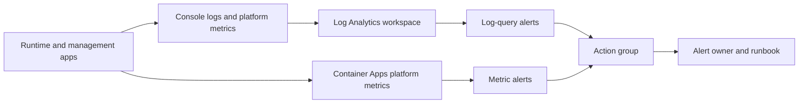

# Both-Service Monitoring

## Feature 002 Application Alerts

Both services classify bounded metadata-only `test.alert` events locally. This is separate
from the environment alerts below, which the deployment configures in the workspace.

| Fixed Reason | Trigger | Accountable Response |
|--------------|---------|----------------------|
| `cleanup_uncertain` | Unconfirmed cleanup strictly beyond ten seconds, using the earliest observed cleanup start | Repository runtime maintainer and reviewed environment owner inspect Strong authority/attempt watermarks and exact resource-specific proof; keep the slot occupied. |
| `dependency_failures` | Three consecutive dependency-unavailable observations within sixty seconds; a success resets the streak | Owning service maintainer checks the reviewed dependency/identity/configuration boundary; do not retry an uncertain business attempt. |
| `latency_high` | Backend first-text p95 exceeds two seconds with at least twenty samples within five minutes | Runtime maintainer reviews bounded timing counts and declared action waits; backend timing is not physical audible latency. |

Each event retains the closed service/environment/outcome/UTC/correlation/trace fields, mode
and fixed reason, never session/actor labels, prompts, payloads, audio, transcript or credentials.
Cleanup lifecycle/latency/proof observations share one generated correlation. Five pending
cleanup records/timers, three failure timestamps per mode and 512 timing samples per mode
bound memory. Known elapsed cleanup time cannot renew the alert timer; confirmed cleanup
cancels its tracker. Lifecycle shutdown cancels owned timers and no late observation recreates
them. Threshold/correlation/privacy/reset/eviction tests use controlled clocks, not long waits.

The repository maintainers own application triage; the reviewed environment owner must name
the actual on-call recipient and approved delivery route before live acceptance. Follow
[configuration recovery](configuration.md), [published-test cleanup](../configuration-guide.md#published-browser-console)
and [device/endurance prerequisites](../setup.md#device-and-endurance-scope-validation).
Recovery requires independently verified settlement/disposal and applicable authenticated
Live closure evidence. Never force-clear, adopt, replay or treat a timeout/lease/TCP close as
release. Alert metadata cannot grant business authority.

An explicitly supplied nonblocking telemetry sink receives only a detached copy of the
allowlisted event; sink errors do not echo private details or change application ownership.
Default sinks are absent and local logs alone do not prove delivery. Tests with controlled
sinks prove classification and explicit local lifecycle binding only. Actual approved-sink
delivery, accountable recipient/response and affected T062/T086/T087 acceptance remain
unverified; do not label them passed.

The runtime composition accepts `create_app(alert_sink=...)`; reviewed management
resources accept `ManagementResources.test_alert_sink`. Supply only an already reviewed
synchronous bounded nonblocking enqueue callback. No callback may perform blocking network
I/O on the event path; an async function is not this callback contract. The resource provider
owns any external delivery worker/queue and its disposal. A full queue may reject an enqueue;
the app contains the error, retains its bounded local event and neither retries nor claims
notification delivery. Local tests use one-item queues and verify correlation, detached
metadata, queue-full containment and no post-shutdown invocation in both service lifecycles.
These ports create no collector, endpoint, credential discovery or default worker, and their
presence does not complete the actual delivery/recipient/recovery gate.

## Diagnostic Events

Seven warning-level events name why a test session failed. They use the same structured schema as the other
events (UTC timestamp, severity `WARNING`, service, environment, event, outcome `failure`, correlation, trace and
span ids, mode) and add only a class name, a fixed code or bounded numbers. A class or code outside the closed
shape `[A-Za-z][A-Za-z0-9_]{0,63}` is dropped rather than logged. They never carry content, and they do not
feed the `test.alert` classification.

| Event | Service | Fields | Read it when |
|-------|---------|--------|--------------|
| `test.admission.failure` | Runtime | `error_class`, `error_code` | A session start failed: for example `authority_unavailable` names a stalled authority read. A refused start (`manager_busy`, `capacity_unavailable`) also logs `test.admission` with reason `denied`; repeated `manager_busy` for one manager after its test ended points at a held slot (see [scaling](scaling.md)) |
| `test.live.failure` | Runtime | `error_class`, `error_code` | A voice start failed before GPT-Live confirmed a session (`test.admission.failure` then says `live_unavailable`). `error_code` names the stage (`identity`, `connect`, `send_start`, `await_started`, `bind`), an HTTP status of the connect (`connect_http_429`), a rejected first event (`changed_live_configuration`) or the provider's error code (`provider_rate_limit_exceeded`). Such a start holds its slot until the runtime releases it, at most a minute after the [recovery](scaling.md#instance-loss-and-dependency-failure) grace; `test.cleanup` with reason `recovered` records the release |
| `test.model.failure` | Runtime | `error_class`, `error_code` | A model call failed (`test.work.failure` then usually says `model_unavailable`). `error_code` is the provider's HTTP status with its error code when it answered (`http_503`, `http_400_content_filter`), a fixed code of the runtime (`model_response_limit`), or else the stage that failed: `identity` (token), `admission` (recording or dispatching the attempt) or `request` (no answer, for example `APIConnectionError`). Without a provider answer the attempt settles 60 s after the request started (see [scaling](scaling.md)) |
| `test.work.failure` | Runtime | `error_class`, `error_code` | A text or speech work item failed: for example `model_unavailable` names a failed model call. `model_unavailable`, `work_deadline_exceeded` and `work_busy` end only that item; other codes end the session |
| `test.speech.unobserved` | Runtime | `end_ms`, `since_first_frame_ms`, `since_last_frame_ms` | Speech did not renew the idle limit: the first rejected transcript of a generation |
| `test.session.failure` | Runtime | `error_class`, `error_code`; for `playback_credit_exhausted` also `pending_bytes`, `since_played_ms`, `since_client_ms` | An error ended a running voice session, which the browser shows as "Unavailable": for example `live_unavailable` names a failed Live segment and `speech_transition_unavailable` a failed agent change. `playback_credit_exhausted` means the browser acknowledged no played audio for 8 s; a small `since_client_ms` with a large `since_played_ms` points at the browser's playback (for example a Bluetooth headset switching profile), both large at the network or relay |
| `test.relay.failure` | Management | `error_class`, `error_code`, `received_close`, `sent_close`, `browser_close` | The browser saw "Unavailable" or "cleanup pending" after an unexpected relay close; `browser_close` 1008 with a code such as `invalid_test_generation` names a frame the relay refused |

A management start that fails with `store_unavailable` also logs one `management.startup.failure` line at
`ERROR` with `error_codes`: the fixed codes along the failure, outermost first, for example
`["management_composition_unavailable", "configuration_store_unavailable", "invalid_snapshot"]`. Anything
that is not a fixed code (a message or value) is left out.

Library request logs (Azure SDK HTTP lines with headers, `httpx`, the runtime's access log) are kept at warning
level, so the container logs hold the structured application events and library warnings only.

## Frontend and Status Events

The management frontend and the status checks add these events (feature 005). Every field and value comes
from a closed set in the services' `observability.py`; a value outside it is refused, so no name, account,
prompt, setting value, host or token can reach the log. Failures are logged at `WARNING` (management) or
`ERROR` (runtime).

| Event | Service | Fields | Read it when |
|-------|---------|--------|--------------|
| `ui.page_view` | Management | `page`, `outcome` (`shown`, `login`, `no_access`, `role_required`) | Users report they cannot reach a page: `role_required` and `no_access` show a role gap |
| `auth.sign_in` | Management | `outcome`, `reason` (`none`, `invalid_response`, `unavailable`, `capacity`) | Sign-in failures rise: `invalid_response` points at the identity provider answer, `capacity` at the session store |
| `auth.session_extend` | Management | `outcome` | "Stay signed in" fails: the session or the sign-in token ended |
| `configuration.rule_refused` | Management | `outcome` (`refused`), `rule`, `item_kind` | Editors hit a graph rule repeatedly: the rule name shows which one |
| `status.check` | Management | `outcome`, `text`, `voice` (`reachable`, `unreachable`, `unknown`) | The Status page shows the runtime or a model unreachable |
| `status.probe` | Runtime | `outcome`, `measurement` (`text_probe_seconds` or `voice_probe_seconds`), `value` | A model is unreachable: a failure means the token or the TLS connection to the model host did not succeed within 2 seconds |

## Greeting, Spoken Parts and Progress Events

The modality-aware conversation (feature 006) adds three runtime events. They use the same
structured schema (`event`, `outcome`, `reason_code`, `kind` = `voice` or `text`, and for timings
`measurement` and `value`) and never carry greeting, answer, note or progress text.

| Event | Outcome | `reason_code` | `measurement` | Emitted when |
|-------|---------|---------------|---------------|--------------|
| `test.greeting` | success | `ready` | `greeting_seconds` | The first greeting output arrived within 5 s of ready (voice: first output audio; text: first text delta) |
| `test.greeting` | success | `fallback` | `greeting_seconds` | Text only: the fixed fallback greeting was sent |
| `test.greeting` | failure | `deadline` | `greeting_seconds` (time of first audio, or 5.0 if none) | Voice: no greeting audio within 5 s, the request was cancelled. Text: the greeting arrived late |
| `test.greeting` | success | `skipped` | none | Voice only: the caller spoke or a delegation arrived before the greeting |
| `test.speech_parts` | success | `ready` | `parts`, `dropped_parts` | A spoken reply needed more than one part, or parts were dropped |
| `test.progress` | success | `still_working`, `waiting_for_input`, `completed`, `failed`, `cancellation_confirmed` | none | A progress update was delivered |
| `test.progress` | failure | `rate_limited`, `stale` | none | An update was suppressed |
| `test.progress` | failure | `fallback_line` | none | The fixed failure line was spoken because no final state was reported |

**SC-001 (voice greeting on time).** At least 90 % of voice sessions where the caller stays silent
hear the greeting within 5 seconds. The events land in `ContainerAppConsoleLogs_CL` as one JSON
line in `Log_s`:

```kusto
ContainerAppConsoleLogs_CL
| where Log_s has "test.greeting"
| extend entry = parse_json(Log_s)
| where tostring(entry.event) == "test.greeting" and tostring(entry.kind) == "voice"
    and tostring(entry.reason_code) != "skipped"
| summarize total = count(),
    on_time = countif(tostring(entry.outcome) == "success" and todouble(entry.value) <= 5.0)
| extend rate = todouble(on_time) / total
```

It passes with `total >= 20` and `rate >= 0.9`. Many `deadline` failures point at Welcome-agent
latency (compare `test.latency`); many `fallback` events in text point at the same.

## Handover, Delegation and History Events

The shared conversation history (feature 007) adds `test.handover` and `test.history` and new
fields on `test.delegation` and `test.latency`. Every event carries the session's correlation id
(`correlation_id`) and, inside a traced request, its `trace_id`. None carries messages,
transcripts, tool arguments or results, instructions, descriptions or configuration; the fields
are closed sets.

| Event | Outcome | `reason_code` | Fields | Emitted when |
|-------|---------|---------------|--------|--------------|
| `test.handover` | success | `applied` | `source_role`, `destination_role`, `path` | A handover was applied, the Welcome → Routing move (`path` = `lifecycle`) included |
| `test.handover` | failure | `refused_graph`, `refused_stale`, `refused_budget`, `refused_step_limit` | `source_role`, `destination_role`, `path` | A handover was refused when it was applied; the active agent stayed |
| `test.delegation` | success / failure | `ready` / `invalid_input` | `first_role`, `handled_role`, `handed_on` (`true`/`false`), `untranscribed` (`true`/`false`) | A voice delegation's work item ended: `ready` when the caller's words passed the clarity check and the work ran, `invalid_input` when the voice assistant was told to ask the caller to clarify. `first_role` handled it first, `handled_role` last; `untranscribed` means the caller's speech was still not transcribed when the transcription wait ended |
| `test.history` | success | `ready` | `history_kib` | At every applied handover: the size of the history the destination continues with |
| `test.history` | success / failure | `condensed` / `limit` | `history_kib` | Condensing ran / the conversation ended at the limit |
| `test.latency` | success | `ready` | `path`; measurement `handover_seconds` | From the handoff to the destination's first output |
| `test.latency` | success | `ready` | measurement `transcription_wait_seconds` | The transcription wait of a voice delegation |

Roles are `welcome`, `routing`, `goodbye` and `ordinary`; `path` is `peer` (within a community),
`direct` (a community connection to the entry agent), `routing` (to or from Routing) or
`lifecycle`; `history_kib` is `<16`, `16-64`, `64-128`, `128-192` or `>=192`.

**Handover outcomes** by mode, outcome, reason and path, in 5-minute bins:

```kusto
ContainerAppConsoleLogs_CL
| where Log_s has "test.handover"
| extend entry = parse_json(Log_s)
| where tostring(entry["event"]) == "test.handover"
| summarize handovers = count() by bin(TimeGenerated, 5m), mode = tostring(entry["kind"]),
    outcome = tostring(entry["outcome"]), reason = tostring(entry["reason_code"]),
    path = tostring(entry["path"])
```

**SC-005 (answer after a handover).** The latency by path; record p50 and p90 in
[capacity](../capacity.md). There is no pass threshold for them:

```kusto
ContainerAppConsoleLogs_CL
| where Log_s has "handover_seconds"
| extend entry = parse_json(Log_s)
| where tostring(entry["measurement"]) == "handover_seconds"
| summarize p50 = percentile(todouble(entry["value"]), 50),
    p90 = percentile(todouble(entry["value"]), 90), n = count()
    by path = tostring(entry["path"]), mode = tostring(entry["kind"])
```

The target is met when no acceptance run ends with `work_deadline_exceeded` (shown on the Test page)
and no handover was refused for the budget:

```kusto
ContainerAppConsoleLogs_CL
| where Log_s has "test.handover"
| extend entry = parse_json(Log_s)
| where tostring(entry["event"]) == "test.handover" and tostring(entry["reason_code"]) == "refused_budget"
| summarize refused_budget = count()
```

**SC-009 (every handover and delegation observed).** After the acceptance runs, the counts match
the handovers and voice delegations recorded in the review checklist, and `max_delay_s` is at
most 300:

```kusto
ContainerAppConsoleLogs_CL
| where Log_s has "test.handover" or Log_s has "test.delegation"
| extend entry = parse_json(Log_s)
| where tostring(entry["event"]) in ("test.handover", "test.delegation")
| extend delay_s = datetime_diff("second", ingestion_time(), todatetime(entry["timestamp"]))
| summarize events = count(), max_delay_s = max(delay_s)
    by event = tostring(entry["event"]), mode = tostring(entry["kind"])
```

**P4 (transcription wait).** After the first deployment and at least 20 voice delegations:

```kusto
ContainerAppConsoleLogs_CL
| where Log_s has "test.delegation" or Log_s has "transcription_wait_seconds"
| extend entry = parse_json(Log_s)
| extend wait = iff(tostring(entry["measurement"]) == "transcription_wait_seconds",
    todouble(entry["value"]), real(null))
| summarize delegations = countif(tostring(entry["event"]) == "test.delegation"),
    untranscribed = countif(tostring(entry["event"]) == "test.delegation"
        and tostring(entry["untranscribed"]) == "true"),
    wait_p50 = percentile(wait, 50), wait_p90 = percentile(wait, 90)
| extend untranscribed_share = todouble(untranscribed) / delegations
```

If `untranscribed_share` is above 0.1, raise `CALLER_TRANSCRIPTION_WAIT_SECONDS` within 0–2 s.

### Handover failures

The `handover-failures` alert fires when more than 20 % of at least 10 handovers in the 15-minute
window were refused. Its owner is the runtime on-call.

1. Run the handover outcomes query above for the window and note the dominant `reason_code` and
   `path`.
2. `refused_graph`: agents ask for destinations the published graph does not allow. Compare the
   last publication with the one before, check that custom platform rules still contain the
   "Handover rules:" block (the Test page shows a notice when they do not), and that agent and
   routing descriptions are clear. Publish a correction or roll back to the earlier revision.
3. `refused_budget` or `refused_step_limit`: chains are too long for the work budget. Look for a
   loop between two agents (the same `path` repeating) and for slow model answers in
   `test.latency` (`handover_seconds`, `work_seconds`). Remove the loop in the graph or the
   prompts; do not raise the budget without a plan review.
4. `refused_stale`: two changes raced in one session. A few are expected; many point at a runtime
   defect. Preserve the logs and open an incident.
5. Record the cause and the action in the incident; close the alert only after the failure share
   is back below 20 %.

## Environment alerts

Each environment deploys its monitoring with the `monitoring` module (see [Platform](platform.md)): a Log Analytics
workspace that receives the container app logs and metrics, a workspace-based Application Insights component,
one action group and the alerts below. Every alert carries an owner and an HTTPS runbook link in its description;
the module rejects an alert without both. The environment file sets the thresholds, the retention, the daily cap
and the action group's e-mail receivers.



| Alert | Source | Fires when | First response |
|-------|--------|------------|----------------|
| `5xx` per app | Platform metric `Requests`, status category 5xx | The total exceeds `alerts.http_5xx_count` | Read the app's recent console logs for the failing route; check the dependency named by the event; do not restart before preserving the evidence |
| `restarts` per app | Platform metric `RestartCount` | The total exceeds `alerts.restart_count` | Read the start reason code in the logs ([Application live mode](application-live-mode.md)); a loop of `settings_*` codes means a bad deployment, roll back |
| `replicas` per app | Platform metric `Replicas` | The minimum drops below 1 | The app is not running; the revision is unhealthy or the environment is failing; run the environment check and roll back if needed |
| `cpu` and `memory` per app | Platform metrics `CpuPercentage`, `MemoryPercentage` | The average exceeds `alerts.cpu_percent` or `alerts.memory_percent` | Check for a stuck session; the apps have one replica, so a sustained value means the container size needs review |
| `dependency failures` | Log query over the apps' structured events | More than `alerts.dependency_count` events with a failure outcome and the dependency category | Check the named dependency (data store, vault, Foundry account) and the private endpoint state |
| `latency` | Log query over `latency_ms` in the structured events | More than five events slower than `alerts.latency_ms` | Compare with model latency; the deployment has no measured capacity target ([capacity](../capacity.md)) |
| `handover-failures` | Log query over `test.handover` | More than 20 % of at least 10 handovers refused | Follow [Handover failures](#handover-failures) |

The log-query alerts match the structured event fields the applications write. A change to those fields needs
a change to the queries.

Alerts evaluate on the platform. Nothing here proves that a notification reached a person: after the first
deployment the owner fires the check's `alert-test` (`check_environment.py --test-alert`), confirms receipt and
records it in the [acceptance record](../acceptance/int-environment.md). Until then the alerts are configured, not
shown to deliver.

## Metric Contract

| Signal | Meaning and actual producer |
|--------|-----------------------------|
| `caller.requests` | Completed HTTP middleware responses, with fixed route/method/status-class dimensions |
| `caller.errors` | Subset of completed HTTP responses with status 500-599, not every rejected input |
| `caller.request.duration` | HTTP middleware response time in seconds; not streamed-body completion, WebSocket duration or speech latency |
| `caller.dependency.failures` | Generic readiness failures in both services; management gateway configuration/public-tool/MCP failure or deadline category at the failed stage |
| `caller.saturation` runtime | Bounded 0-1 ratio for `session_slots`, `model_sessions` or `admission_queue`; defined but no producer is wired in the current runtime |
| `caller.saturation` management | Latest completed capability operation's original deadline budget consumed, not CPU, request concurrency or a fleet percentile |
| `caller.admissions` | Runtime admission outcomes (admitted, duplicate, unavailable); defined but no producer is wired in the current runtime |

Request routes are `health`, `readiness`, `text`, `voice` and `unmatched`. HTTP middleware does not
see WebSocket traffic, so voice sessions are not counted. Admission and cleanup behavior is observed through the
`test.alert` events above and the `test.*` telemetry events instead of metrics.

Request route/method/status-class, dependency/reason, saturation resource and outcome labels
come from closed enumerations. Unknown HTTP paths collapse to `unmatched`; raw paths, query
strings, identities, session/provider/agent/revision IDs, hostnames, correlations and exception
messages never become dimensions. Resource attributes contain only fixed service/environment
identity. Durations must be finite and within 0-3600 seconds, counts are bounded, and ratios
are finite 0-1 values. Exemplars are disabled, so trace identifiers do not enter metric points.
Audio, prompts, transcripts, transferred summaries/reasons, credentials and tool data are
excluded. These restrictions bound series cardinality without recording content to diagnose it.

## Explicit SDK Delta Collection

Each service owns a `DeltaExportReader` in its existing metrics module. It wraps the maintained
OpenTelemetry `PeriodicExportingMetricReader` with periodic collection disabled, accepting one
explicitly supplied, trusted `MetricExporter`. Pass the reader through the existing meter's
`reader` argument. No application setting constructs an exporter, selects a URL, discovers a
credential, or starts a collection worker. The default meter remains in-memory only, and there
is no public metrics endpoint or cloud activation through this interface.

Counters and histograms use SDK delta aggregation; scalar gauges retain latest-value semantics.
Tests inspect actual batches from successive collections and an idle collection, proving that
previous request counts and histogram observations are not added again. This proves local OTel
temporality, not how an Azure exporter maps points into AppMetrics. A new process starts new
SDK aggregation state; fleet/reset and source-attribution behavior still require qualification.

The trusted caller invokes `reader.force_flush()` outside realtime execution. True requires a
batch successfully accepted by the injected exporter, a successful exporter flush and no prior
failed export/flush. An empty initial collection returns false without marking data loss. The
installed SDK's periodic reader always returns true from its own flush method, so this wrapper
explicitly checks exporter state rather than mistaking that return value for delivery evidence.

Export exceptions, unsuccessful results and flush exceptions/failures set a sticky `reader.failed`
flag. Later successes do not erase the loss. The wrapper does not log exception text, queue,
persist, retry or replay failed deltas. A trusted caller must surface a fixed failure category
and preserve the incident; do not clear evidence by silently replacing the reader. Closing the
owning meter collects the final interval and disposes the exporter once. Shutdown exceptions
are contained but retain the same failure flag, which remains inspectable after closure.

Each delegated operation receives a finite positive timeout capped at 1000 ms. Exporters must
cooperatively honor it; this is not a hard thread-kill guarantee or one shared end-to-end budget.
Synchronous flush/shutdown must not run on the request or audio path. The reader creates no worker,
but a future cloud exporter could create its own threads, enrichment, logs, retries or disk
storage. Its actual identity, destination, privacy, timeout and cleanup behavior must be reviewed
and tested separately. Local synthetic exporter acceptance is not authenticated ingestion,
durable receipt, an action-group acknowledgment or a live monitoring acceptance result.

## Operating the alerts

1. Keep the owner and runbook link of every alert current in the environment file. The action group's receivers
   are the only notification path; an unmonitored mailbox defeats every alert.
2. Raise a threshold only with a recorded reason and a review of the plan. Never disable an alert to silence it
   without an incident record and replacement monitoring.
3. After a deployment, run the environment check with `--test-alert` and record the receipt.
4. Application-level events (`cleanup_uncertain`, `dependency_failures`, `latency_high`) are classified inside the
   services as described at the top of this guide; they reach the workspace through the console logs and the log
   queries above.

## Local Verification

```powershell
uv run --directory code/backend --locked --no-sync pytest tests/unit/test_metrics.py tests/contract/test_health.py -q
uv run --directory code/management --locked --no-sync pytest tests/unit/test_metrics.py tests/contract/test_health.py tests/contract/test_capability_gateway.py -q
uv run --project code/tools --locked --no-sync python code/tools/scripts/verify_terraform.py check
uv run --project code/tools --locked --no-sync python code/tools/scripts/verify_docs.py
```

The metric and reader tests inspect recorded points, label rejection, finite values, delta intervals, exporter
errors, sticky loss and final cleanup. The module's native Terraform tests mock the provider and assert the
workspace, the action group, the alert set, the owner and runbook requirement and the rejection of incomplete
input. They do not connect to Azure or show that a notification is delivered.
