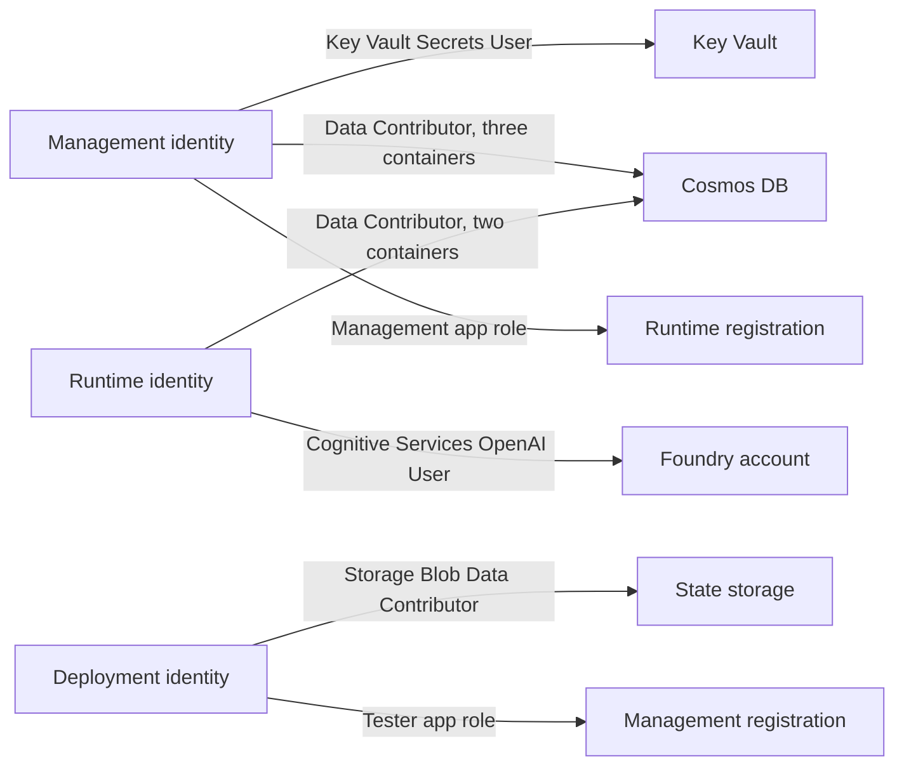

# Platform security

Identities, roles, network boundaries and secrets of one environment. The threats and the approvals behind them
are in [Security](../security.md).

## Identities

| Identity | Created by | Used for |
|----------|------------|----------|
| Deployment identity | The owner, federated to this repository's GitHub environments | Runs the Terraform workflows and the environment check through OIDC; holds the tester role on the management registration (FR-053) and the Graph permission `Application.Read.All` |
| Runtime identity | The identity script (a user-assigned identity) | Runs the runtime app |
| Management identity | The `workload-identity` module | Runs the management app |
| Management sign-in registration | The identity script | The management app's own Entra sign-in; a confidential client with a client secret valid for at most 90 days |

No other client secret, certificate or key exists. Federated credentials and managed identities are used
wherever the platform supports them.

## Roles

| Identity | Holds | Does not hold |
|----------|-------|----------------|
| Management | Read of the two vault secrets; data access to `configuration`, `configuration-audit` and `call-audit`; the `management` application role on the runtime registration | Any model role, any access to `text-conversations` |
| Runtime | Data access to `call-sessions` and `text-conversations`; the least model role on the account; the `runtime` application role on the management registration | Any vault access; any secret |

Data roles are scoped to single containers, and the data store has no key or connection string in use.

## Network

Both apps run in a Container Apps environment inside the virtual network from bootstrap. The data store, the vault
and the Foundry account are reached through private endpoints in the private endpoint subnet, resolved through the
bootstrap private DNS zones. Their public access is off, and the Foundry account also refuses key-based access.

The network has one network security group with only the platform's default rules and one route table without
routes. No NAT gateway or firewall exists; outbound policy belongs to the network owner. The environment check
(`no-custom-outbound`) fails if a custom rule, a route, a NAT gateway or a firewall appears, and the structure
check fails if the configuration declares one.

Ingress is governed by the [public access](public-access.md) setting.

## Secrets

| Secret | Holder | Notes |
|--------|--------|-------|
| Sign-in client secret | The vault (secret `management-signin-secret`), read by the management app through a Key Vault reference | Created by the identity script, stored once as `MANAGEMENT_SIGNIN_SECRET` in the protected GitHub environment and passed only to the `app_environment` root |
| Permit private key | The vault (secret `permit-private-key`), read only by the management app | Generated by Terraform; the remote state holds it, so the state is protected like a secret store |

Both are approved exceptions to the no-secret rule and are recorded in [Security](../security.md). Neither
appears in plan output, deployment outputs, logs, the environment files or an app setting value.

## Failure behavior

A missing runtime identity stops the plan with a message that names the setting. A pending private endpoint
connection is reported by the check. An app with an unusable setting refuses to start with one fixed reason code
(see [Application live mode](application-live-mode.md)).
