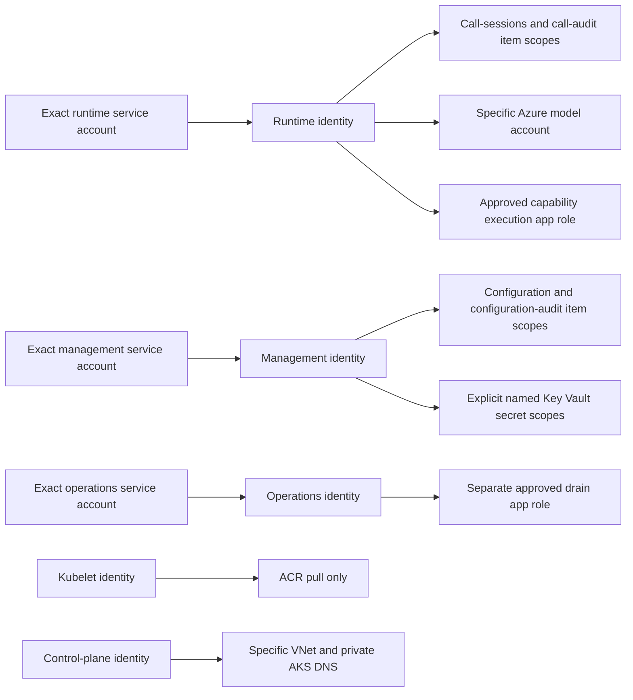
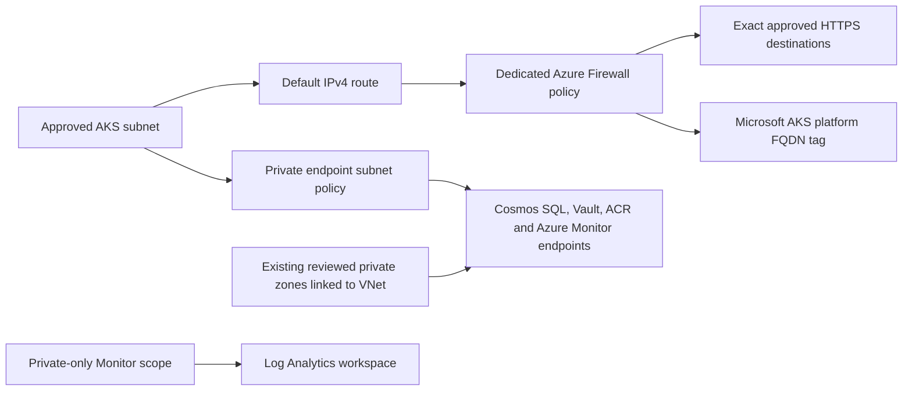

# Platform Identity and Private Networking

## Status and Scope

T096 is locally authored and validated. [The security module](../../code/infra/terraform/modules/platform/security.tf)
defines workload/control-plane identities, scoped data/API permissions, private service endpoints,
DNS links, subnet policy and reviewed firewall egress. No Azure/Graph authentication, real plan,
backend connection, apply, token exchange or deployment occurred. These definitions do not prove
effective live isolation or establish a usable/call-ready platform. T097-T101 and earlier gates remain open.

The development root adds signed AzureAD **3.10.0** alongside AzureRM **5.11.0** and Terraform
**1.17.0**. Its own lock and the module test lock contain Windows/Linux provider hashes. Both
providers are mocked in native tests. Production provider configuration requests OIDC and disables
Azure CLI fallback; no client secret, application password or tenant-wide workload directory role is
created. The future provisioning principal needs separately reviewed Azure/Graph administrative
authority. That is not an application permission grant.

## Required Reviewed Inputs

The required `security` object contains an approved existing `vnet_id`, `vnet_name`,
`network_resource_group_name`, exact node/private-endpoint/firewall subnet CIDRs, exact
`approved_external_fqdns`, private DNS zone IDs for Cosmos/Key Vault/ACR/Monitor, three named
workload namespace/service-account pairs, exact management secret names, a specific Azure model
account ID, and distinct gateway/operations service-principal IDs and app-role UUIDs.

No deployment default is provided. The shared JSON under `terraform/test-fixtures/` is synthetic
native-test input only, not environment approval. Namespace/subject collisions, wildcard or
numeric egress destinations, private-label external names and undersized firewall ranges fail
validation. The firewall subnet must be `/26` or larger within the bounded private IPv4 inputs.
Resource/tenant references still require real administrative review and existence checks.

Use a dedicated reviewed VNet. The module creates private-endpoint and `AzureFirewallSubnet`
subnets and associates a default route with the existing AKS subnet. Import/reconcile already-owned
subnets, DNS links or route associations before any approved apply; do not seize shared network
objects. Confirm the declared node CIDR matches Azure, all ranges are nonoverlapping and within
the VNet, and peering/DNS/runner routes are correct. Syntax validation is not address-space or
regional/network eligibility proof.

## Identity and Data Boundaries



Three user-assigned workload identities are separate from control-plane and kubelet identities.
Each workload has one exact federated subject `system:serviceaccount:<namespace>:<service-account>`,
the actual AKS OIDC issuer and only `api://AzureADTokenExchange` audience. No wildcard subject is
created. Future manifests must use the exact service account and workload-identity settings;
no workload manifests, application activation or automatic token delivery were added here.

| Principal | Declared permission | Scope |
|-----------|---------------------|-------|
| Runtime | Cosmos item read/create/replace | call-sessions and call-audit only |
| Management | Cosmos item read/create/replace | configuration and configuration-audit only |
| Runtime/management | Cosmos `readMetadata` only | Specific account; no item access from this grant |
| Runtime | Cognitive Services OpenAI User | Specific approved model account |
| Management | Key Vault Secrets User | Each explicitly named secret, not the whole vault |
| Runtime | Existing reviewed capability-execution app role | Exact gateway service principal/role UUID |
| Operations | Existing reviewed drain-control app role | Separate exact operations API service principal/role UUID |
| Kubelet | AcrPull | Specific platform registry |
| Control plane | Network Contributor | Specific existing VNet |
| Control plane | Private DNS Zone Contributor | Dedicated private AKS DNS zone |
| Control plane | Managed Identity Operator | Specific kubelet identity only |

Cosmos custom item roles have no wildcard, query, change-feed, delete, stored-procedure or
container-management action. Account metadata permission supports SDK discovery but is not
permission to read configuration/call items. SDK transactional-batch operation authorization
and metadata behavior still require real qualification; do not broaden grants merely to make a
failed check pass. Actual negative cross-service reads are a required live gate.

Operations receives no Cosmos, Key Vault, model, cluster-admin, Kubernetes deletion or Azure
resource-deletion grant. Management receives no runtime model grant; runtime receives no secret
or management-item grant. No caller verification/customer-data/business-changing tool workflow
is introduced. These are additive allow definitions, not Azure deny assignments. Out-of-band
roles, group membership or existing broad grants can invalidate isolation and must be reviewed.

The two app-role assignments refer to **existing approved** Entra API applications/roles.
Operators must verify their actual audience and role semantics: runtime capability execution
only, and operations drain control only. The application must still enforce tenant/issuer,
signature/time, app identity/audience/role and internal route authorization. Assignments do not
mount routes or replace `OperatorIdentityPort`/runtime JWT enforcement. Generic manager tokens,
header assertions or a model's requested action never become operator authority.

## Private Connectivity and Egress



The module declares four private endpoints: Cosmos `Sql`, Key Vault `vault`, ACR `registry`
and Monitor `azuremonitor`. Their reviewed private DNS zones are explicitly linked to the
approved VNet, with registration disabled. A dedicated AKS private DNS zone is also linked;
the cluster now uses its explicit user-assigned control-plane/kubelet identities rather than
the earlier System identity/System DNS defaults.

The private endpoint subnet enables network policies and associates an NSG allowing node-CIDR
TCP 443 before denying other inbound traffic. This targets the Python HTTPS/Gateway paths;
it does not assert support for unapproved Cosmos direct-mode ports or unrelated protocols.
Monitor ingestion/query modes are `PrivateOnly`, with the workspace linked to the scope.
Private DNS, effective NSG behavior, token access and actual ingestion remain live checks.

A dedicated Standard Firewall policy has threat intelligence in Deny mode, a new outbound SNAT
public IP, no DNAT/public application ingress, and no inherited broad base policy. The AKS subnet's
`0.0.0.0/0` route points to that firewall. Application rules permit HTTPS 443 from the declared
node subnet to exact reviewed external FQDNs and, separately, Microsoft's `AzureKubernetesService`
FQDN tag for platform dependencies. There is no arbitrary wildcard/any-destination business rule.

The platform tag is broader than the application destination set and may evolve; review its
effective destinations. Required bootstrap/time/private routes and DNS proxy behavior still need
environment qualification. The public IP is firewall egress, not an approval for public service
access. FQDN filtering is not application authorization, output classification or protection from
all DNS/covert channels. Workload/gateway allowlists, TLS checks and content controls remain
mandatory. Complete Kubernetes ingress/service/network policy, actual operator-route delivery,
image scheduling and protection against compromised administrative principals are not proved here.

## Verification and Remaining Gates

```powershell
uv run --project code/tools --locked --no-sync python code/tools/scripts/verify_terraform.py prepare
uv run --project code/tools --locked --no-sync python code/tools/scripts/verify_terraform.py check
uv run --project code/tools --locked --no-sync pytest code/tools/tests -q
```

Native Windows validation passes **24 mocked cases across three roots** (bootstrap 4, module
18, development 2) and **31 tooling tests**. Exact container/secret scopes and API principal
bindings use deterministic synthetic computed IDs; no effective Azure permission result is
fabricated. Tests also assert exact federation, no wildcard item actions, separate operators,
four private endpoints/eight service DNS links, reviewed egress, and rejection of wildcard,
numeric, shared-subject and undersized-firewall inputs. Backend-disabled validation, readonly
locks and strict nonempty/no-failed/no-skipped native summaries remain unchanged.

No application dependency or behavior changed, so application suites were not rerun for this
IaC-only increment. Native Linux/remote CI, real Graph assignments and propagation, effective
data-plane denial, private routing/DNS, approved app-role semantics and live token exchange
remain T099 qualification obligations. T097 observability/alerts and T098 controlled rollout
still precede integrated live acceptance; no pod/node deletion automation is added. Existing
Azure deadline/media failures, intermittent export risk and security/release gates remain open.

Before any real plan/apply, review the exact roles, existing network ownership, endpoint/DNS
IDs, FQDNs, public-IP purpose, Graph provisioning privileges, Azure costs/quotas and privacy
approvals. Use an authorized private runner/protected backend. Do not repair access failures
by enabling public services, keys, wildcard egress, broad roles or shared service identities.
