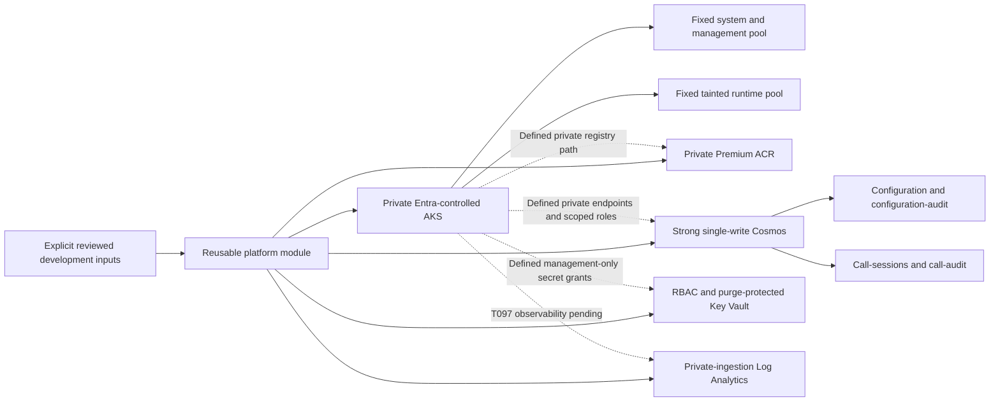

# Development Platform Composition

## Status and Authorization

T095 is locally authored and validated. The [shared environment root](../../code/infra/terraform/environments/main.tf)
composes the reusable platform module with required reviewed inputs. No Azure backend was
activated, credentials resolved, real plan created, resource provisioned or application deployed.
No production environment or deployment approval is implied. T097-T101 and the existing
application/foundation/security/live gates remain open.

This increment defines AKS, ACR, Cosmos, Key Vault and a Log Analytics workspace. Public access
is disabled where applicable. T096 now defines private endpoints, DNS/egress and scoped
identities/roles in the [platform security module](platform-security.md). Their effective
behavior and the T099 environment prerequisites remain unqualified; this is not a ready platform.

## Ownership and Definitions



All resource definitions remain under `code/infra/terraform`. The existing protected resource
group and nonsecret owner tags are retained. The shared root takes an explicit `environment`;
dev/prod differ by reviewed variables/backend files, not copied definitions or automatic promotion.
[Reusable Terraform delivery](terraform-delivery.md) includes separate bootstrap/platform callers
and protected saved-plan apply. [Remote state](terraform-state.md) remains
the separate private OIDC/Entra state foundation, not an application data store.

## Required Inputs

The root requires explicit `subscription_id`, `tenant_id`, `client_id`, `location`,
`resource_group_name`, `tags`, a typed `services` object and T096's required `security` object.
None has a deployment default. The [security runbook](platform-security.md) details those inputs.
IDs are nonsecret approved references; no secret/token/password field is declared. The
accountable `owner` tag must be supplied. Provider-computed sensitive fields can still enter
Terraform state, so the state-protection rules continue to apply.

`services` requires:

- Resource names: `aks_name`, `acr_name`, `cosmos_name`, `key_vault_name`, `monitor_name`.
- Cluster settings: an explicit `kubernetes_version` patch, approved `aks_subnet_id`,
  nonempty `admin_group_ids`, `system_vm_size`, `runtime_vm_size`, `system_node_count`,
  `runtime_node_count`, `service_cidr`, `pod_cidr` and `dns_service_ip`.
- Retention: `log_retention_days`, `vault_soft_delete_days`, `acr_retention_days`,
  `cosmos_backup_tier`, `configuration_audit_ttl`, `call_session_ttl` and `call_audit_ttl`.
- Capacity budget: `cosmos_max_throughput`, an explicit database autoscale RU ceiling.

Validation checks names/UUIDs, IPv4 range syntax and DNS placement, nonempty administrators,
bounded integral node counts and retention values, an explicit continuous-backup tier, and
a bounded RU ceiling. System nodes are 2-10; runtime nodes are 1-20. Log retention is 30-730
days; vault soft-delete recovery is 7-90 days; untagged registry retention is 7-365 days.
Metadata TTLs are integral seconds from 3600 through 2147483647. Cosmos backup tier is explicitly
`Continuous7Days` or `Continuous30Days`; RU ceilings are 1000-1000000 in 1000-RU increments.
These are validation bounds, not approved operational settings or measured capacity.

DNS must be service-range host 10. Complete VNet/pod/service-range nonoverlap, routing,
regional features, VM capacity, actual Kubernetes availability/support, quotas, resource-name
uniqueness and organizational approvals require later environment qualification. Synthetic
fixtures use `westus3`, Kubernetes `1.35.3`, two nodes per pool and short retention only to
exercise contracts. They are not an approved region, supported-version assertion, sizing
recommendation, legal retention policy or permission to provision.

## AKS and Lifecycle Boundaries

AKS is private with no public private-cluster FQDN, local accounts disabled, Entra Azure RBAC,
explicit admin groups, OIDC issuer and workload identity enabled. Node provisioning mode is
explicitly `Manual`. Both node pools have fixed counts and cluster autoscaling disabled;
node public IPs and automatic node-OS upgrading are disabled. No application autoscaler,
rollout automation, workload manifests or image deployment is added.

The runtime pool is tainted and labeled separately from the system/management pool. A later
approved runtime deployment must explicitly select/tolerate it; a node pool alone does not
establish application capacity, scheduling, isolation or safe drain. The cluster currently uses
explicit user-assigned control-plane/kubelet identities with T096's scoped network/registry
and workload grants. Do not infer effective service authorization from an enabled OIDC issuer.

Azure CNI overlay/Cilium and `userDefinedRouting` request explicit existing network setup.
The approved subnet must already have the required controlled outbound path, permissions,
DNS and address capacity. No default public egress route or temporary public exception is
created outside the dedicated T096 firewall path. Private DNS now uses the explicit AKS zone;
actual permissions/DNS reachability
must be proved before any apply. These mocked definitions do not prove a functioning cluster.

Fixed pools do not guarantee zero disconnects. Platform repair, mandatory upgrades, manual
node changes and Terraform replacement can still disrupt calls. T098 must enforce application
pre-drain before planned changes; grace periods, labels, fixed counts and disruption budgets
alone are not the call-preservation guarantee. No pod/node deletion action is implemented here.

## Service Data and Credential Boundaries

Cosmos uses SQL/NoSQL with Strong consistency, exactly one write location, multi-write and
automatic failover disabled, local keys and public networking disabled, TLS 1.2 and Azure-service
network bypass disabled. Zone redundancy and the explicit continuous backup tier are requested,
not qualified as available in the selected region. The single `caller-ai` SQL database has an
explicit shared autoscale RU ceiling; no RU/cost/performance result is claimed.

| Container | Owner | Partition | Default TTL |
|-----------|-------|-----------|-------------|
| configuration | Management | `/organizationId` | `-1`, no implicit revision/authority expiry |
| configuration-audit | Management | `/dayBucket` | Explicit configuration audit seconds |
| call-sessions | Runtime | `/sessionId` | Explicit session metadata seconds |
| call-audit | Runtime | `/dayBucket` | Explicit call audit seconds |

Partition-key version 2/Hash and container deletion guards are explicit. Ownership here is a
declared data contract with T096's exact owned-container role assignments. Effective denial
still requires qualification and review of other additive grants. Runtime consumes configuration/capabilities over
management's authenticated API, never through management's private containers. TTL affects safe
metadata, not physical backup deletion or caller-content cleanup. No call recordings, transcripts,
summaries, tool arguments/results or secret values may be stored in those containers.

ACR is Premium for later private connectivity, with anonymous/admin access, public networking
and trusted-service bypass disabled and explicit untagged-manifest retention. No images are
published or pulled; T096 defines only the scoped kubelet pull grant. Retention is not backup proof.

Key Vault uses Entra RBAC, public access/network bypass disabled, purge protection and explicit
soft-delete recovery. No secret value/access policy is created; T096 defines exact named
management-secret role grants. Account,
vault, workspace and protected-container lifecycle guards remain safeguards, not irrevocable
protection against authorized administrators changing or bypassing configuration.

Log Analytics disables local authentication and internet ingestion/query access, with explicit
retention. T096 defines private link/scope/DNS. Application exporters, metrics, alerts,
accountable thresholds and actual delivery remain T097/T099
obligations. A workspace resource alone is not evidence of working observability or redaction.

## Local Verification and Evidence

Terraform **1.17.0** and signed AzureRM **5.11.0** remain pinned. The development root owns its
lockfile, including Windows/Linux hashes and T096's signed AzureAD 3.10.0 provider;
the reusable module's standalone test lock
does not replace it. The credential-free verifier now checks bootstrap, platform module and
development root. All native test files use mock providers and plan commands; no real Azure
plan, state backend or credential chain is configured.

```powershell
uv run --project code/tools --locked --no-sync python code/tools/scripts/verify_terraform.py prepare
uv run --project code/tools --locked --no-sync python code/tools/scripts/verify_terraform.py check
uv run --project code/tools --locked --no-sync pytest code/tools/tests -q
```

The original T095 verifier reported **3 roots / 16 passing mocked cases** with no failed/skipped cases:
four state-bootstrap cases, ten original module governance/service cases and two development-root
composition/identity cases. Private resources, fixed/manual node controls, exact Cosmos
partitions/Strong consistency and explicit retention are asserted. Empty admin groups, unsafe
node counts, invalid metadata retention and inconsistent DNS fail. The development-root case
first failed when the verifier omitted that root; extending the explicit root registry fixed it.
T096 expands the current gate to 24 cases; [security evidence](platform-security.md) details them.

All **31 tooling tests** pass; strict typing covers the verifier/CI helper. Native Windows
validation is observed, not native Linux or remote CI. No application behavior/dependency
changed, so backend and management suites were not rerun for this infrastructure-only increment.
Prior Azure deadline/media failures, intermittent frontend export risk, tooling advisory and
all foundation/live/release gates remain open, not waived by mocked infrastructure checks.

## Before Any Provisioning

Qualify T096's defined identities/private connectivity/egress, complete T097 observability/alerts,
T098 controlled drain rollout and the separately authorized T099 environment qualification.
Review the real plan, costs, feature availability, privacy/residency/retention inputs and the
supported phone/model provider. Use only an approved private runner and protected remote
backend. Do not enable public access, local keys, wide roles or automatic node deletion merely
to make initial deployment succeed. If a prerequisite is unavailable, stop and record it as
pending rather than report a ready platform.
