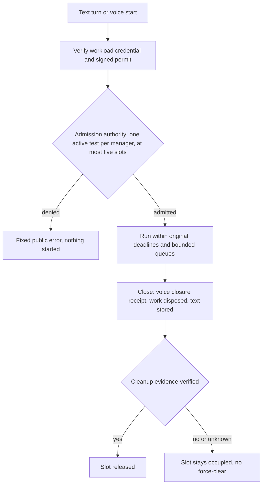

# Scaling, Limits and Recovery

## Scope and Qualification State

This runbook describes how the conversation runtime bounds admission, work and cleanup, and what an
operator does when an instance restarts or a dependency fails. It documents implemented local
behavior only. Real capacity, cost, Cosmos RU demand and provider limits are **pending live
measurement** (see [capacity](../capacity.md)); no default is invented. The call-era capacity,
owner-routing and planned-drain controls were removed with feature 003. See also
[conversation endpoints](../conversation-endpoints.md), [monitoring](monitoring.md),
[text history](text-history.md) and [private platform boundaries](platform-security.md).



## Limits

| Limit | Value | Behavior at the limit |
|-------|-------|-----------------------|
| Active tests per manager | 1 | A second start is refused with `manager_busy` |
| Occupied slots in the authority item | 5, including slots with uncertain cleanup | Further starts are refused with `capacity_unavailable` |
| Admission deadline | 10 s from the signed permit | A late start is refused; the permit cannot extend it |
| Work item budget | 10 s per accepted text item; 30 s per speech delegation (`RuntimeOptions.speech_work_seconds`, 10–60 s); at most one running and one pending | Excess work is refused, never queued without bound. After 5 s a speech caller hears "One moment, I'm checking that." A work item that fails on its own (`model_unavailable`, `work_deadline_exceeded`, `work_busy`) reports `work_unavailable`, the caller hears "I could not finish that, please try again.", and the session stays open |
| Model request past its budget | The caller stops waiting; the request finishes in the background for at most 60 s from its start | A completed, incomplete or failed response or a provider refusal settles the attempt and the late reply is discarded; past 60 s the request is cut and settles once its client is confirmed closed. New model work in that session gets `work_busy` until then. Cleanup that waited on it is retried when it finishes |
| Session lifetime and idle time | 600 s and 120 s since the last accepted user text or verified speech | The session ends; silence and agent output do not extend either |
| Cleanup | At most 10 s per cleanup operation; volatile context cleared within 300 s | Unconfirmed cleanup raises the `cleanup_uncertain` alert and keeps the slot |
| Conversation context | 256 KiB (text turn over the limit gets HTTP 413 before streaming) | The turn fails; context is never trimmed silently |
| Voice frames | Control 8 KiB, PCM 1,920 bytes, one 64-message writer queue, Live frames 256 KiB | The frame or session is refused with the shared close codes |
| Text history | 30 days after the last turn, owner-keyed | Expires through item `ttl`; see [text history](text-history.md) |

The limits are enforced per request or session from signed data and the single authority item;
they are not CPU or fleet measurements. Add instances only after measuring real demand: slots are
global in the authority item, so extra instances do not raise the five-slot ceiling.

## Replicas in an environment

Each deployed app runs exactly **one replica** (minimum and maximum are both one). The reason is the session
model above: a voice session is one WebSocket owned by one instance, an instance restart loses its sessions
anyway, and the five slots are global in the authority item, so extra replicas do not raise capacity. A single
replica also keeps the test environment cheap and its behavior easy to reason about. A restart, a revision change
or a failed replica ends active sessions; the `replicas` alert fires when the count drops below one (see
[monitoring](monitoring.md)). The test console that uses these limits is a test tool for configurations, not a
call-handling feature, so the environment states no capacity target (Constitution Principle VI; see
[capacity](../capacity.md)).

## Voice Session Behavior

A voice session is one WebSocket owned by one backend instance. Admission is checked before the
upgrade completes; every later step (audio, delegation, context) passes an admission gate that
refuses a fenced, expired or stale-generation session before any dispatch. Frames, queues and
credits are bounded in both directions. Timeouts end the session instead of waiting. Closing is
ordered: output is fenced first, the Live session closes and returns its closure receipt, owned
work is disposed, and only then does independent verification release the slot.

Shutdown fences new work and closes every session through the same ordered close, bounded to ten
seconds. There is
no reconnect: a dropped socket or a faulted provider session ends the test and the manager starts a
new one. A closed connection, empty local state, lease expiry or TCP close alone never releases a
slot.

## Instance Loss and Dependency Failure

| Situation | Behavior | Operator action |
|-----------|----------|-----------------|
| Instance restarts mid-session | The session and its volatile context are gone; its slot stays occupied because closure proof is lost | Inspect the authority item and the `cleanup_uncertain` alert; recover only through reviewed, evidence-based cleanup. Never delete the item, force-clear a slot or replay work. |
| Slot held by a model request that was never settled (before the background-drain fix) | The same manager gets `manager_busy` (`test.admission.failure` with `error_code` `manager_busy`) long after the session ended | With the owner's approval, run `python -m caller_runtime.recovery` inside the runtime container to preview, then `--apply`. It releases only fenced slots expired at least 5 minutes ago whose only unsettled attempt is a model request; Live and capability attempts must be settled. It never deletes the authority item or touches a live slot, and running it twice changes nothing. |
| Authority store unavailable or conflicting | Starts fail with `authority_unavailable` or `authority_conflict`; nothing is assumed released | Restore the store; do not bypass admission |
| History store unavailable | `/readyz` returns 503 `history_store_unavailable`; text requests fail with `history_unavailable` and answer nothing without context | Restore the store; voice is unaffected |
| Model, Live or management gateway unavailable | The turn or session fails with a fixed public code and cleanup runs | Check the dependency and identity; do not retry an uncertain business action |
| Configuration refresh fails | Existing sessions keep their pinned revision; new starts revalidate the current publication inside the admission deadline | See [configuration updates](configuration-updates.md) |

## Pause and Rollback

Remove the instance from the load balancer by failing readiness or scale it down after active
sessions end or their deadlines pass; a deployment that stops instances immediately leaves slots
occupied until reviewed cleanup, as above. Roll back by deploying the previous image; the authority
item, text history and configuration are versioned independently and are not rewritten by a rollout.

## Verification

```powershell
uv run --directory code/backend --locked --no-sync pytest tests/unit/test_admission.py tests/integration/test_conversation.py -q
uv run --project code/tools --locked --no-sync python code/tools/scripts/verify_terraform.py check
uv run --project code/tools --locked --no-sync python code/tools/scripts/verify_docs.py
```

These controlled-double tests prove the bounds and ordering above; they do not qualify real Cosmos
consistency, provider behavior, instance loss or measured capacity. Those remain gated by
[live environment status](../acceptance/live-environment.md) and [release gates](../acceptance/release-gates.md).
