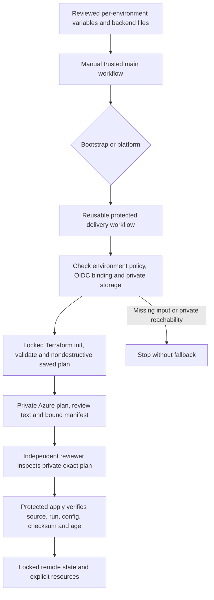

# Terraform Infrastructure Delivery

## Scope and Status

The owner requested reusable CI/CD for Terraform bootstrap and infrastructure, one consistent
definition across environments and separate environment variable/backend files. This is an
explicit infrastructure-code scope addition, not a cloud deployment, resource/role grant or
automatic reopening of feature-001 deferred work. No real Terraform plan or apply has run.
The application's model/device/alert acceptance remains separate from infrastructure creation.

Two roots are shared by every environment:

- [Bootstrap](../../code/infra/terraform/bootstrap/main.tf) creates the protected state account,
  private `tfstate` and separate plan containers, private connectivity and container-scoped writers.
- [Environment](../../code/infra/terraform/environments/main.tf) composes the existing platform
  module with explicit `environment` and reviewed inputs. There is no copied dev/prod Terraform
  implementation; resource addresses and pinned provider selections are retained.

The platform defines private AKS/ACR/Cosmos/Vault/Monitor resources and optional managed
Action Groups. It does not publish images, deploy applications, initialize missing application
authorities, create model deployments or certify model quotas/retention. Existing VNet/subnet/
DNS, model account and Entra API/role references remain explicit reviewed dependencies.
Managed Action Groups do not prove alert delivery: all ten service alert rules remain disabled
until actual collection/query/recipient/recovery evidence is qualified.

## Environment Files

Use the [platform variable example](../../code/infra/terraform/config/dev.platform.tfvars.json.example) and adjacent examples as a schema guide. They contain
synthetic IDs/names and intentionally unapproved Kubernetes/VM values, not deployable defaults.
For `dev`, supply these four reviewed files, without the `.example` suffix:

| File Under `code/infra/terraform/config/` | Purpose |
|---|---|
| `dev.bootstrap.azurerm.tfbackend.json` | Existing administrative seed account/container and `dev/bootstrap.tfstate`. |
| `dev.bootstrap.tfvars.json` | New state resource names, region, environment, retention, private-network references and approved provisioning identity/writer object IDs. |
| `dev.platform.azurerm.tfbackend.json` | Provisioned state account/container and `dev/platform.tfstate`. |
| `dev.platform.tfvars.json` | Same shared platform schema: explicit identities, resources, service sizes, private networking, security, monitoring/optional recipients and `environment="dev"`. |

For another environment, create only the corresponding files with that environment name and
distinct state keys/resource names/identities/approved settings. Do not copy root `.tf` files or
use Terraform workspaces as environment aliases. The helper uses only the default workspace.
JSON backend files are parsed structurally and passed as validated `-backend-config=key=value`
arguments. Allowed fields are account/group/container/key, OIDC/Entra/CLI switches and optional
identity IDs. `use_azuread_auth=true`, `use_oidc=true`, `use_cli=false` are mandatory. The exact
key convention is `<environment>/<bootstrap|platform>.tfstate`.

These are reviewed nonsecret inputs; secrets, keys, SAS, passwords and connection strings must
not appear in them. CI rejects known credential fields and inherited argument/authentication
overrides. Keep personal contact data out of public configuration; use an approved operational
team destination or the organization's protected configuration process. Review every proposed
region/SKU/version/name/role/retention and infrastructure cost before activation. The 100 USD
qualification-test cap is not an approval for recurring AKS/firewall/database infrastructure cost.

Offline input validation, after creating the real reviewed files:

```text
uv run --project code/tools --locked --no-sync python code/tools/scripts/terraform_delivery.py --operation check --environment dev --root bootstrap --plan-container tfplans
uv run --project code/tools --locked --no-sync python code/tools/scripts/terraform_delivery.py --operation check --environment dev --root platform --plan-container tfplans
```

Validation is not deployment authorization or proof of Azure access. Missing/invalid files fail
with fixed metadata; raw variables, provider output, plans and tokens are not printed.

## Bootstrap and Connectivity Prerequisites

The owner confirmed an existing seed AzureRM backend and will supply its coordinates. Bootstrap
cannot store its own state or first saved plan in an account/container it has not created yet.
The seed account therefore needs both its existing private state container and a separate existing
private plan container. Bootstrap then provisions state/plan containers for workload deployments.
No local-state, access-key/SAS, public-access, auto-migration or ad hoc resource-creation fallback
is implemented. See [state ownership and recovery](terraform-state.md).

Storage is checked before backend initialization: private-network-only account, shared keys and
public blobs disabled, HTTPS/TLS 1.2+, encryption enabled and private state/plan containers.
The runner identity needs appropriate management-plane read access for this check plus scoped
state/plan data access; provisioning also needs the separately approved resource/role operations.
The pipeline never registers resource providers or grants its own privileges automatically.

GitHub-hosted `ubuntu-24.04` is the current requested runner default. A standard hosted runner
does not automatically have private VNet/DNS access. If it cannot reach private state, planning
or apply stops. Do not expose storage or disable TLS to make it work. Supply an approved
GitHub-hosted private-network setup or later set repository variable `TF_RUNNER_LABELS` to a JSON
label list for a reachable trusted runner. Both stages use the same selected labels. This change
does not provision a runner, network tunnel, public exception or self-hosted machine.

## GitHub Environments and OIDC

Both callers are manual and main-branch-only:

- [Terraform Bootstrap](../../.github/workflows/terraform-bootstrap.yml)
- [Terraform Infrastructure](../../.github/workflows/terraform-infrastructure.yml)

They call [one reusable deployment workflow](../../.github/workflows/terraform-deploy.yml).
The existing credential-free native CI still validates all roots/mock tests on pull requests;
PR code receives no Terraform deployment identity. The old protected release-preflight workflow
is unchanged and does not become an application release or image-publication workflow.

Before enabling delivery, create these protected GitHub environments for each environment name:

| GitHub Environment | Protection and Identity |
|---|---|
| `<env>-terraform-bootstrap-plan` | Protected-branch policy; approved bootstrap OIDC identity and seed references. |
| `<env>-terraform-bootstrap-apply` | Same binding plus required independent reviewers and prevent self-review. |
| `<env>-terraform-platform-plan` | Protected-branch policy; approved platform OIDC identity and workload backend references. |
| `<env>-terraform-platform-apply` | Same binding plus required independent reviewers and prevent self-review. |

Protect `main`. The helper checks the existing environment policy through the GitHub API and
fails if it is missing, unprotected or unreadable; it does not configure or bypass reviewers.
Disable administrative bypass according to repository governance. Reviewers must inspect the
private saved plan before approving apply, not merely approve the existence of the job.

In each corresponding GitHub environment set secrets `AZURE_CLIENT_ID`, `AZURE_TENANT_ID` and
`AZURE_SUBSCRIPTION_ID`, matching its reviewed variable file, plus nonsecret variable
`TF_PLAN_CONTAINER` for the separate private plan container in its backend account. These
identity IDs are not client secrets. The current root binds one approved provisioning identity
per stack/environment; plan and apply settings must match that binding. Configure Entra GitHub
federation with audience `api://AzureADTokenExchange` and exact environment subject, for example
`repo:marvinbuss/caller-ai:environment:dev-terraform-bootstrap-plan`, and its apply counterpart.
Scope permissions to the intended resources/state/plan containers; do not reuse the Foundry
client secret or broad interactive CLI session. Account/container roles and directory-level
app-role administration must be reviewed separately, not inferred from a successful token.

## Plan, Review and Apply



1. Prepare/review the environment files, identities, private connectivity, recipient settings and
   cost. Provisioning is not authorized by synthetic examples or local tests.
2. Run the bootstrap caller with `apply_changes=false` first. The pinned Terraform CLI/providers
   prepare without cloud credentials, then exact inputs/environment protections are checked
   before Azure Login. OIDC is used; client-secret/key/CLI fallback is not accepted.
3. Planning uses state locking and read-only provider locks. Plans containing deletion or
   replacement actions are blocked and require a separately reviewed process; there is no
   destroy/force-unlock/lock-disable option. The helper does not print raw Terraform output.
4. The plan, human-readable `review.txt` and manifest are uploaded with no-overwrite conditions
   into the supplied backend account's private plan container. No plan is uploaded to GitHub
   artifacts. Locate the exact prefix `<env>/<stack>/<commit>/<run-id>-<run-attempt>/`; the files
   are `plan.tfplan`, `review.txt` and `manifest.json`. Only hashes/counts enter job outputs.
5. To request apply, start the manual workflow with `apply_changes=true`. It creates a fresh
   plan and pauses at the protected apply environment. Review that new private plan and its
   SHA-256/source/config binding before approval; an earlier plan-only run is not silently reused.
6. Apply downloads the exact plan/manifest for the same commit, workflow run/attempt, environment,
   backend, variable files, shared HCL and provider locks. It verifies the plan SHA-256 against
   the trusted plan-job output and rejects plans older than 24 hours, changed inputs or tampering.
   It passes only the saved plan to Terraform, with no replanning, variable override or auto-retry.
7. After bootstrap succeeds and its real storage/network/RBAC behavior is verified, supply the
   workload backend file and run the platform caller through the same review process. Application
   deployment and actual telemetry/model/device qualification remain separate.

Pinned checkout/uv/Azure Login actions, read-only repository permissions, short-lived OIDC,
non-cancelling per-environment/stack concurrency and exact source checkout protect the path.
Azure Login's normal post-job cleanup remains enabled. Temporary local plans/review files are
owner-only and removed after the operation; remote private plans require the owner's reviewed
retention/cleanup policy. The workflow never deletes review evidence or state to recover capacity.

## Failure and Recovery

Missing files, policy/identity mismatches, private DNS/network denial, Azure authorization,
incomplete planning, tampering, expiry or destructive changes fail closed. No failure is
converted to zero changes, a public backend, a clean audit or successful deployment.
Do not rerun an ambiguous apply automatically: inspect authoritative Azure resources and locked
remote state, then create/review a fresh plan. Never force-unlock, reset state or migrate backends
as a hidden retry. Preserve existing backend coordinates/resource addresses during adoption;
moving the root directory itself does not migrate state. A changed backend needs separate review.

Re-running only a failed job changes the run attempt and does not reuse an old plan transparently.
Re-run the full workflow for a fresh plan/review. Restore the original reviewed config if code
must be rolled back, then inspect the new plan; no automatic destroy or rollback apply is supplied.
Record metadata-only outcomes and source/run/digest references. Real plan/apply, private-runner
reachability, RBAC propagation, recovery drills and end-to-end alerts remain unqualified until
they are actually observed in the approved environment.

## Local Verification Evidence

The implementation passed 37 credential-free native Terraform tests across the three validation
roots, 17 offline delivery contracts, strict typing and all repository source/privacy gates.
The complete tooling suite passed 367 tests, and the dependency gate passed with the existing
explicit expiring MODERATE mirror-gap exception retained in its finding counts. All 54 documents
and 44 diagram sources validate; the new delivery diagram was actually rendered with pinned
Mermaid 12.0.0 and the existing sandbox. These results validate code/contracts, not a real
GitHub OIDC plan/apply, private-runner connection, Azure role propagation or recipient delivery.
