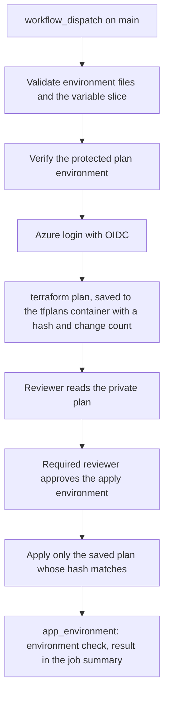

# Terraform delivery

How an environment's three deployments are planned, reviewed and applied. The pipeline never applies anything
it has not planned, and no run uses a stored credential.

## Roots

| Root | Workflow | Holds |
|------|----------|-------|
| `state` | `terraform-state.yml` | The state storage (created first by `state-create`, see [Terraform state](terraform-state.md)) |
| `bootstrap` | `terraform-bootstrap.yml` | Virtual network, default network security group, route table, private DNS zones |
| `app_environment` | `terraform-app-environment.yml` | Container Apps environment and both apps, data store, vault, permit key, secrets, monitoring, model access |

Each workflow is a manual `workflow_dispatch` caller of the reusable
[terraform-deploy.yml](../../.github/workflows/terraform-deploy.yml). Inputs: `environment`, `apply_changes`,
`expect_no_changes`, and for `bootstrap` and `app_environment` also `destroy`.

## What a run does



- **Variable slice.** Each root receives only the `environment` object and its own object (the app root also its
  state coordinates), written to a temporary file outside the repository and removed afterwards.
- **Plan.** The plan is stored privately in the `tfplans` container with a manifest that binds it to the commit,
  the run, the inputs and a one-day window. The workflow prints the hash and the number of changes, never the plan.
- **Apply.** The apply job downloads the stored plan, checks the hash, the manifest and the inputs, and applies
  that exact plan. Nothing is re-planned. A deletion in a plan is blocked unless the plan was created with
  `destroy`.
- **Check.** After an `app_environment` apply the job runs `check_environment.py` against the
  `environment_manifest` output and fails when a check fails.

## Protection

Two GitHub environments exist per root: `<env>-terraform-<root>-plan` and `<env>-terraform-<root>-apply`, where
`<root>` is `state`, `bootstrap` or `app-environment`. The apply environment requires reviewers who are not the
author of the run. The delivery script verifies that the environment exists and, for an apply, that review is
required and self-review is prevented; it also requires the `main` branch to be protected. Workflows run only
from `main`, only on manual dispatch, and use short-lived OIDC tokens (`id-token: write`, `contents: read`). No
long-lived secret authenticates to Azure.

The `MANAGEMENT_SIGNIN_SECRET` environment secret is passed only to the `app_environment` root, as a sensitive
variable through the environment, and is never printed.

## Repeat and drift checks

`expect_no_changes: true` fails the plan when it contains any change. Run it after an apply to prove that a second
run changes nothing, and periodically to find drift.

## Teardown

`destroy: true` plans the removal of `app_environment` or `bootstrap` and still needs the protected apply. It is
refused for `state`. Remove `app_environment` before `bootstrap`.

## Offline verification and cost

```powershell
uv run --project code/tools --locked python code/tools/scripts/verify_terraform.py check
```

formats, validates and tests every root and module with mocked providers and scans the configuration with the
pinned Trivy image. The CI workflow runs the same command. The environment is serverless where possible: one
replica per app, a serverless data store and a pay-as-you-go workspace, so an idle environment costs little.
Review the plan's change list before approving anything that creates a paid resource.
