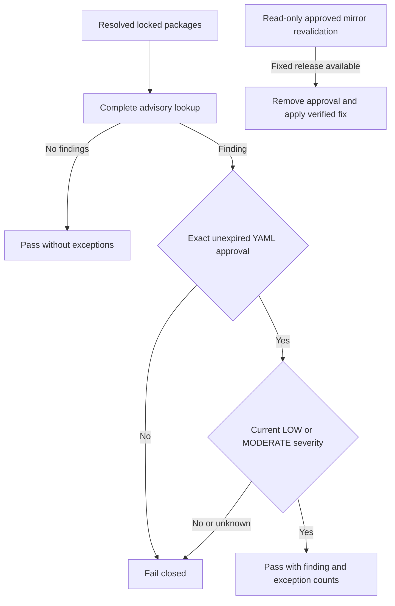
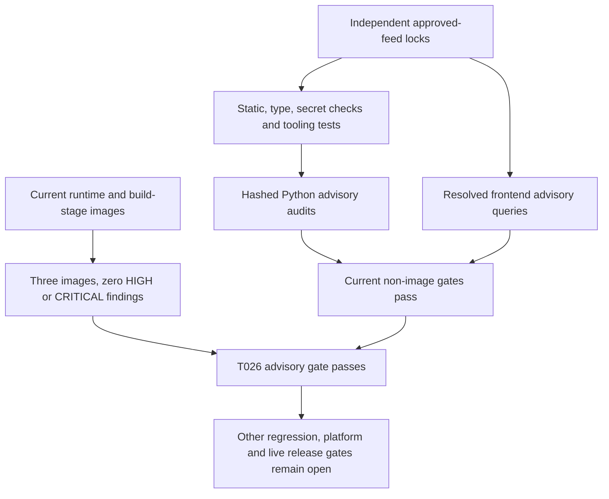

# Foundation Security Gates

## Feature 002 Current Advisory Blocker

On 2026-11-02 the current hashed Python advisory checks found no known vulnerabilities in
all three locked environments. The resolved frontend check **failed** for `minimatch` 10.2.6,
[GHSA-g3hv-75wg-m249](https://osv.dev/vulnerability/GHSA-g3hv-75wg-m249), alias
`CVE-2026-118764`. The reviewed advisory classifies it Moderate: attacker-controlled glob
patterns at optimization level >=2 can amplify preprocessing CPU/memory consumption.
It identifies 11.0.1 as fixed. Build-route tooling supplies the transitive 10.x dependency;
this feature introduces no user-authored glob API, but that is not an exploitability or
accepted-mitigation claim and does not waive the strict advisory gate.

The approved local registry's metadata did not contain 11.0.1; its version-specific endpoint
returned 404. One canonical public-registry check also failed with normal verified TLS.
No alternate unapproved feed, TLS bypass, fabricated artifact/integrity, advisory ignore,
cross-major override or package-pin change was applied. A security-only persisted Reflex
override is supported by the framework, but it requires an available verified fixed artifact
and actual router/build/browser compatibility checks before it can be accepted.

**T100 remains blocked** until the fixed artifact is available through an approved trusted
source (or a maintainer separately approves a constitutionally valid mitigation), followed
by exact targeted lock resolution, full compatibility checks and a clean advisory rerun.
That was the disposition before the owner's 2026-11-03 instruction below. Earlier clean
counts are historical and must not be copied as current frontend advisory evidence.

### Approved Mirror-Gap Exceptions

On 2026-11-03 the owner explicitly approved temporary allow-listing of unavailable fixed
library releases, with separate revalidatable YAML evidence. The policy lives in
[code/dependency-mirror-gaps.yaml](../code/dependency-mirror-gaps.yaml). This changes the
advisory gate's approved-risk disposition, not dependency versions or vulnerability status.
The current minimatch exception was checked against the configured approved mirror: fixed
11.0.1 is still absent. UTC verification/expiry values are recorded in the YAML; the initial
window ends **2026-11-09T23:42:34Z**. The host UTC date was still November 2 when checked.

Each entry must bind the exact ecosystem (`npm` or `PyPI`), package, installed version,
advisory, fixed version, accountable owner, reason and UTC verification/expiry. No wildcard
or version range is supported. Maximum approval duration is seven days; expired/future,
duplicate-key, aliased, malformed or oversized policies fail closed. An empty `exceptions`
list restores unconditional finding rejection. Python exceptions must also match a fix
version returned by the current audit. Missing/failed/skipped Python audit results still fail.

Every excepted finding requires a fresh OSV advisory response confirming LOW or MODERATE
severity. HIGH, CRITICAL, unknown severity and lookup errors remain blocking. Actual image
HIGH/CRITICAL scanning is unchanged and has no exception path. Findings remain printed and
counted: `vulnerabilities` never becomes zero because of an approval. Successful reports use
`dependency_audits_passed_with_exceptions` and per-project `approved_mirror_gaps` counts.

```text
uv run --project code/tools --locked --no-sync python code/tools/scripts/audit_dependencies.py --revalidate-mirror-gaps
uv run --project code/tools --locked --no-sync python code/tools/scripts/audit_dependencies.py --images
```

The first command performs bounded read-only metadata requests only against configured
approved mirrors, with normal TLS, no environment proxy/redirects and no public-registry
fallback. It can inspect expired entries without renewing them. A newly available fixed
release or lookup failure exits nonzero; only confirmed missing releases report
`gap_confirmed=true`. Private registry URLs and raw responses are never emitted. Revalidation
does not edit approvals. When a fix appears, verify its artifact/integrity, update only the
necessary resolution, remove the exception, then rerun the full compatibility and audit gates.
If the gap persists, the owner must review and explicitly update a new bounded window; there
is no automatic extension or silent suppression. The YAML is public metadata, never credentials.



The owner's current test authorization does not turn absent resources, physical measurements
or unexecuted qualification into evidence. Actual provider/device/endurance/sink acceptance
remains separate from this narrow library-risk exception and from automated regression tests.

## Historical Feature 001 Security Evidence

Local startup constructs no live identity, Cosmos, phone, model or business-tool clients.
Live mode is unavailable rather than falling back to local adapters. Both applications reject
sensitive telemetry attributes and content capture; SDK tracing is off by default. Its explicit
opt-in emits only fixed-operation in-memory metadata. Provider realtime tracing is rejected
until approved metadata-only controls exist. No production privacy/legal approval is implied.

## Dependency Audits

```text
uv run --project code/tools --locked python code/tools/scripts/audit_dependencies.py
uv run --project code/tools --locked python code/tools/scripts/audit_dependencies.py --images
```

On 2026-10-26 the approved Microsoft Python proxy supplies the previously unavailable fix.
The baseline strict audit found **13 findings in two development packages**: seven affecting
`virtualenv` 21.14.7 (including `CVE-2026-113722`, fixed at 21.14.9) and six affecting `filelock`
4.2.0 (fixed at 4.2.1). The tools manifest now retains security floors `virtualenv>=21.14.9`
and `filelock>=4.2.1`; targeted approved-feed resolution changed only those lock entries to
**virtualenv 21.14.11** and **filelock 4.2.4**. Application locks are unchanged. No alternate
feed, TLS bypass, advisory ignore, mitigation or vulnerability exception was used.

The subsequent actual strict hashed audits pass with **69 backend**, **92 management** and
**59 tools** Python packages and **294 frontend coordinates**, all reporting zero known
findings. This is current advisory evidence, not a guarantee that no vulnerability exists.
The existing audit's static/type/offline-secret/Terraform checks and all **97 then-existing
tooling tests** also passed after installing the two locked patches. Two added offline
regressions verify that the floors exclude vulnerable versions, accept the reported fixes,
cover the selected lock versions and retain the approved registry.
After the user restarted Docker, the engine reports Linux-container mode. The first full image
retry found HIGH `CVE-2026-92392` in actual management build-stage `curl` and `libcurl` 8.22.0-r0,
with 8.23.0-r0 reported fixed. The build now requires both APK packages `>=8.23.0-r0`; digest-
pinned bases, Python/npm feeds, TLS and scanner policy are unchanged. A red-first regression
guards those requirements. The complete unchanged `--images` gate then passes: all **three
actual runtime/build-stage images** have **zero HIGH/CRITICAL findings**, alongside the clean
Python/frontend audits. No ignored/unfixed finding or alternative scanner result is substituted.

**T026 is locally complete.** The final complete tooling suite passes **103 cases**, including
security-floor and image-browser ownership regressions. Real image smoke also passes non-root/
offline startup, health/readiness and Chromium shell/event checks at **360/768/1440** widths.
Owned image/container/cache artifacts are cleaned. This does not complete foundation, native
Linux host/remote CI, native editor-export, media, live-environment or release acceptance.

The initial extra image smoke attempt timed out because its browser-directory selector also
invoked native editor-export fixtures unrelated to the foundation image. The image profile now
selects the unchanged `test_shell.py` assertions against the published container URL and cleans
its owned subprocess tree on success, failure and timeout. The timeout remains 180 seconds.
Full management discovery still runs all editor tests and its earlier failure gate remains open;
the passing image shell is not a claim that native editor export was fixed.



The earlier independent-work authorization was not a waiver. T026 closure uses current executed
image evidence, not the older Scout snapshot. CI still runs strict audits after functional, failure-gate
and documentation checks. Failed Python audits print only public package/version/advisory/fix
identifiers before temporary reports are deleted; no candidate secrets are retained.

The helper first runs locked static/type checks and metadata-only offline secret detection.
It exports hashed exact Python requirements from each independent lock, excluding only the
local project itself, and runs strict pip-audit without dependency resolution. Missing package
advisories or failed collection are not clean results. Temporary requirements/reports are
deleted, and no secret candidate values are written into reports.

The Bun lock is parsed as JSON5. Resolved coordinates, not requested version ranges, are queried
against the public OSV npm advisory API. Every batch must return a complete response. HTTP,
schema, unknown-coordinate and advisory failures fail the gate. Findings expose only public
package/version/advisory identifiers. This does not change the approved package registries.

Image mode builds both real runtime images and management's real frontend build stage. An
official digest-pinned Trivy 0.76.1 container scans their OS/Python/npm contents with current
advisory data, without ignoring unfixed vulnerabilities or suppressing base findings. High or
critical findings block acceptance. The scanner uses the local Docker API socket and an owned
temporary cache volume; this is a trusted CI tooling operation, not an application privilege.
Owned audit image tags/cache are removed. A failed database fetch is failure, not zero findings.
The portable pinned Trivy path has now completed the current three-image gate. Historical
runtime/build-stage scans below used Docker Scout; they were not substituted for this result.

## Feed Publication Update: 2026-10-27

The user requires private mirror URLs to remain local-only. Shared config and build defaults
are now public; Python artifact relocation verifies public filenames/SHA-256/sizes, and Bun
retains registry-relative integrity-pinned coordinates. Private settings/backups are ignored.
The always-on publication guard checks worktree/index/local history without printing matching
URLs. A local compile regenerated private lock URLs and was correctly blocked until relocation.
The previous image/advisory passes above do not certify these changed Docker inputs: fresh
public download/build/scanner evidence remains pending. TLS failures are not bypassed. Full
management again has 24 root-prerender errors, so merge/release remains blocked despite the
passing source/private-URL guard and tools tests. Draft source review is separately authorized.

## CI Browser Sandbox Boundary

The user explicitly approved selecting installed Google Chrome only for native Ubuntu GitHub
diagram rendering after the prepared browser failed with `browser_sandbox_unavailable` in
run 40491123126 on 381e38d. The fixed runner path and reported version are validated; absence
fails closed, without falling back or disabling the sandbox. The user subsequently approved
the same CI-only installed-browser policy on Windows after its app/assertion gates passed
but prepared-browser Mermaid still failed. Windows uses the fixed installed Chrome path and
the existing Playwright dependency to verify a real launch with `chromium_sandbox=True` and
record its version. Missing/invalid versions fail closed. Local rendering retains prepared
Chromium. No host sandbox policy, ACL, sysctl, sudo or setuid permissions are changed.
After the Windows probe exceeded 10 seconds in run 40595697117, the user explicitly approved
a bounded 30-second startup/version probe on Windows CI only. Linux retains 10 seconds;
the 300-second render bound and all application/test limits are unchanged. This approval
does not disable a sandbox, skip a check or declare an unobserved render successful.
Puppeteer's [Ubuntu AppArmor guidance](https://pptr.dev/troubleshooting) documents this boundary;
its mostly obsolete setuid workaround is not adopted. The CI-only browser is runner-provided,
not an application dependency pin. Future observed CI results must prove the selected path
works; approval alone does not count as a successful render or qualify Windows editor builds.

## Temporary Synthetic Compiler Diagnostic

The user explicitly approved retaining only the failed synthetic Windows editor compiler
log as a GitHub Actions artifact for **one day** to diagnose the hosted-runner failure.
The collector requires GitHub Actions/Windows, a regular file no larger than 256 KiB and
the failed-production-build marker. Offline secret detection and private-origin checks must
pass before the fixed single output file is created; failed scans prevent upload. No fixture
JSON, keys, environment dump, screenshots, runtime logs or real caller data are collected.
Workflow repository permissions remain read-only, with an official full-SHA Node-24 upload
action, one exact nonhidden path and failure-only successful-collector conditions.

Artifacts are readable to people with repository access, not an unrestricted public log
channel. This approval is limited to this credential-free synthetic build diagnostic and
does not authorize conversation-content collection or general debug logging. The temporary
upload steps must be removed after the failure is diagnosed; retention expiry is not evidence
that arbitrary data may be uploaded. Production/logging privacy requirements remain unchanged.

After the approved log identified the Windows short-path mismatch, both temporary upload
steps were removed from the workflow and remote artifact 12749685420 was deleted early.
The compiler copy remains ignored locally; no default compiler-log upload remains enabled.
The canonical-path repair and no-upload regression do not relax any production boundary.

## First Internal Test Environment (`int`)

The deployed environment is described in [Environments](environments.md) and its identities, roles and network in
[Platform security](runbooks/platform-security.md). This section records the threats, the controls and the
approvals behind them.

### Threats and controls

| Threat | Control |
|--------|---------|
| The environment is reachable by anyone | The allow-list is required when public access is on. `int` sets the explicit open range `0.0.0.0/0` so GitHub-hosted runners, whose addresses change, can reach it; validation reports a warning. With an open range, **sign-in, roles and permits are the only access control**: the health endpoints and the sign-in page are reachable by anyone, and every data endpoint needs sign-in plus a role, or a signed permit. Health endpoints carry no conversation or dependency detail. See [Public access](runbooks/public-access.md) |
| Open tenant sign-in | Anyone in the tenant can reach the sign-in. Editing and testing need the editor or tester role, which the identity script assigns to the configured group only |
| Sign-in secret or permit private key exposed | Written to the vault through the management API, never printed or logged, read only by the management app through its identity, held in the protected remote state and never in files or logs. The sign-in secret is valid for at most 90 days |
| State storage on a public endpoint | Identity-only access, shared keys off, anonymous access off, versioning, soft delete, a delete lock, and writer roles scoped to two containers |
| Public images leak code or secrets | The Trivy scan for secrets and HIGH or CRITICAL vulnerabilities blocks publishing; tags are immutable. Publishing exposes the application code, which the owner accepts |
| Deployment identity abused | OIDC federation limited to this repository, protected environments for plan and apply with required reviewers, and least-privilege roles |
| The deployment identity holds the tester role | A compromised pipeline identity could use the test console and model sessions. Controls: protected environments, an OIDC subject limited to this repository, the runtime's admission limit on live sessions, and no directory write permission (it holds only the read permission `Application.Read.All`) |
| Model sessions abused | Allow-list, sign-in, the test-role check and the admission limit |
| An application token with the tester role | The management app accepts an app-only token (`idtyp=app`, no scope, audience the management registration, tenant, issuer and `ver` checked, the tester role held) only on `GET /v2/configuration` and the console ticket and socket. It never reaches publishing, capability admission or revocation, which stay editor-only. The permit binds a digest of the bearer token, a socket needs the same token and a cookie next to a token is refused. Decision S-14 (the owner chose a narrow tester path); tests in `code/management/tests/integration/test_live_tester_access.py` |
| Configuration drift or a manual change | `expect_no_changes` plans fail on any difference, and the environment check compares services and settings with the configuration |

### The two approved secret exceptions

The project rule is no secret where a federated credential or managed identity can do the job. Two exceptions are
approved by the owner:

| Secret | Why it is needed | Validity and renewal | Where it lives |
|--------|------------------|----------------------|----------------|
| Management sign-in client secret | The management app signs users in as a confidential client, which cannot use a federated credential | At most 90 days; renew as described in [Environment bring-up](runbooks/environment-bring-up.md) | The vault, read only by the management app; the protected GitHub environment secret `MANAGEMENT_SIGNIN_SECRET` and the remote state during a deployment |
| Permit private key | The management app signs start permits that the runtime verifies | No fixed expiry; rotate with an overlap as described in the bring-up runbook | The vault, read only by the management app, and the remote state |

### Remote state sensitivity

The remote state and saved plans hold both secrets. The state account is identity-only, so whoever holds a blob
data role holds the secrets: grant roles for a reason and a period, never copy a blob into a ticket or a log, and
rotate both secrets after any suspected exposure ([Terraform state](runbooks/terraform-state.md)).

### Approvals and ratifications

| Item | Status |
|------|--------|
| Principle I (Azure first): GitHub's container registry as the image source | The owner approved the exception for public, scanned images. The written assessment is this section and [Image publishing](runbooks/image-publishing.md): no registry resource is deployed, the images hold no secret or environment value, and a pull needs no credential. Recording the owner's approval for making the packages public in the [acceptance record](acceptance/int-environment.md) is part of the first publication |
| Principle VIII (Terraform infrastructure as code): the identity script administers directory objects | Ratified in constitution v2.2.0, which allows reviewed, idempotent, previewable and tested scripts for administrative tasks outside Terraform. Rationale: a deployment identity must not hold directory write permissions, so a short script run by a directory administrator creates the registration, the roles and the runtime identity. Recording the maintainers' approval of that amendment is part of merging it |
| Public exposure of `int` with an open range | Accepted by the owner for `int` only, with the limits above |

## Conversation and Configuration Trust Boundaries

Clients, model output, remote tool/MCP discovery, submitted configuration and dependency
responses are untrusted. One organization `default` is not a tenant-management feature;
communities enforce discovery/context boundaries, not independent customer isolation.
Management owns configuration/current permission/audit data; runtime owns the admission authority,
the text history and its audit metadata and never reads management's private container. Actual Azure permissions
are additive and require effective negative-access review, not merely allowed-role definitions.

Models cannot authorize tools, choose endpoints/credentials, grant operator identity or mutate
configuration. Every attempt intersects pinned grants, current authority and independent
public/read-only review. Remote annotations do not confer permission. Runtime service,
manager/browser and internal operator identities have distinct audience/role/session controls;
test headers and typed grants exist only in explicit local fixtures/ports, never default auth.

Both conversation endpoints are mounted only by the reviewed composition, with the workload
credential and signed permit verified before any resource is touched, one active test per manager,
bounded frames and audio, and fresh output generations. Provider identity and distributed
authority still need actual qualification; no telephony or provider scenario exists.
Local cleanup purges owned context even on cancellation/error; it does not prove secure erasure
of immutable/external copies, provider retention, dumps or backups. TTL is safe metadata policy,
not permission to persist prohibited conversation content. Runtime audit rejects free text,
unknown fields and invalid model-copy values before any owned persistence call.

SDK tracing is off by default. Existing explicit metadata-only opt-in is separate from required
application traces and rejects content/destination combinations that cannot meet privacy rules;
provider realtime tracing remains unavailable. Trace context excludes baggage, arbitrary labels
and raw exceptions. No recording/transcript/prompt/tool payload dump, durable SDK history,
unreviewed exporter, public/key fallback, redirect or alternate feed is a repair path.

Before live use, accountable owners must approve applicable caller disclosure/consent,
jurisdiction/residency, retention/deletion/backups, provider/model handling, secret-reference
registry, network/identity grants, test data and on-call access. No legal jurisdiction or
compliance certification is claimed. Release threat review must also cover trusted tooling's
Docker socket, delegated plan/publisher authority, immutable artifact binding, uncertain effects
and persistent independent-removal guards. Read [release gates](acceptance/release-gates.md),
[conversation endpoints](conversation-endpoints.md) and [capacity](capacity.md).

## Stored Text Conversation History

Feature 003 deliberately narrows the earlier guarantee that no conversation content is persisted:
text conversations (and only text) are stored so follow-up turns work on any backend instance.
Voice conversations remain volatile, and nothing else in this document relaxes. This section is
the threat assessment for that exception; the operational procedure is in the
[text history runbook](runbooks/text-history.md).

| Topic | Control |
|-------|---------|
| Data stored | User and assistant text of completed turns, the active agent position and timestamps, in one item per conversation. Never audio, transcripts, tool or transfer payloads, prompts, tokens or provider bodies |
| Access | Only the backend runtime identity, with item read, create and replace on the `text-conversations` container; no delete. Management never reads it. Items are addressed by the owner's key (partition) and conversation id, so a foreign, unknown or expired id is indistinguishable (`conversation_not_found`) |
| At rest | Cosmos encryption at rest with platform-managed keys, continuous backup; no local key authentication on the account |
| In transit | TLS 1.2 or later over a private endpoint; the account has no public network access |
| Identity | Workload identity (managed identity) on the runtime pod; no secret, key or connection string |
| Logs and telemetry | Text never appears in logs, metrics, traces, error bodies, alert payloads or the admission authority record. `history.store` events carry outcome and duration only. A test (`test_text_content_exists_only_in_the_history_container`) enforces this |
| Retention | 30 days after the last turn through the item `ttl`, rewritten on every update; expiry is the only deletion path. Emergency purge needs written approval and a temporary delete role |
| Replay of stored untrusted content | Stored turns are untrusted. They are sent back to the model only as conversation turns, never as system instructions; the 256 KiB context limit and the agent-change reset still apply; the agent position is revalidated against the pinned revision and falls back to the welcome agent when it is no longer allowed; tools remain subject to current authority. Only the owner's history is loaded. A poisoned conversation is abandoned by starting a new one, or expires |
| Residual risk | Backups keep expired text until their retention ends, and a compromised runtime identity can read stored text. Operators must approve disclosure, retention and jurisdiction for stored text before any live use, like the other items above |

## Historical Remediation Context

Debian zlib `CVE-2026-85091` prompted a move to the same Python release on a scanned Alpine
base. Vite `CVE-2026-112942` is fixed through an 8.3.3 lock override. The standalone unzip
package flagged by `CVE-2008-0888` was removed in favor of the base's BusyBox applet. Actual
runtime/build-stage Docker Scout scans passed after these changes. Unused npm files in the
Node source image are not copied into the actual builder; its complete contents were scanned.

No mitigation or vulnerability exception is approved. Rerun advisory gates because findings
change over time. These foundation checks do not certify live networking, identities, residency,
disclosure, retention, alert delivery or production capacity.
