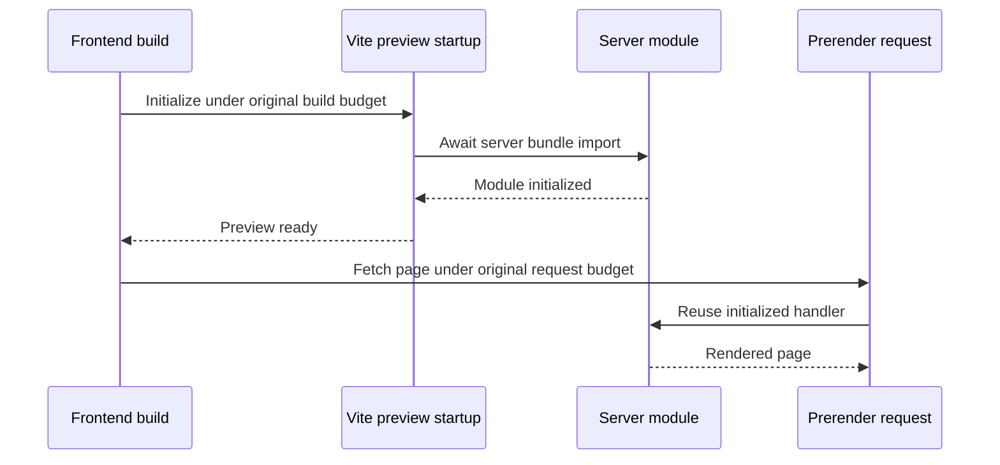

# Development Setup

## Scope and Prerequisites

Use native Windows PowerShell or a Linux shell, Git, uv 0.13.4, and Python 3.12.15.
Each application and the development tools have independent environments and committed locks.
Do not substitute a shared uv workspace or a WSL-only result for native Windows verification.
Docker with Linux containers is needed later for actual image verification, not for native tests.

Dependency and browser preparation may use the internet. Once prepared, local application
verification must require no Azure login, Cosmos emulator, phone number, model endpoint or
external-service credentials. Do not disable TLS verification to resolve download failures.

## Published Browser Test Setup

Maintained guidance lives at repository-root `docs/`; application contracts remain under
`code/contracts/` and feature specifications under `specs/`. The documentation verifier scans
all three, checks local links/images/assets/heading fragments and refuses a second maintained
`code/docs/` tree. Earlier path literals and acceptance counts below are historical evidence.

For the isolated generated-identity HTTPS/WSS editor and console fixture, run from root:

```powershell
uv run --directory code/tools --locked --no-sync python scripts/smoke.py --editor
```

The helper builds the normal Reflex frontend within its existing 180-second budget and starts
both owned apps under one 120-second readiness deadline. Open its emitted HTTPS URL, sign in
through the fixture-only declared manager route and follow the test control. Start is explicit;
text acquires no microphone, speech permission precedes tickets, and Ctrl+C disposes owned
processes and temporary test keys/trust. No actual provider, cloud identity/store or physical
device qualification is performed by this controlled fixture. Do not load fixture logins or
keys into the shipped app.

For a real reviewed environment, follow the exact [test composition contract](configuration-guide.md#explicit-test-composition).
Both services require explicit independently authorized factories; a URL, reference, environment
toggle or successful local test supplies no authority. The operator must separately approve
existing Foundry deployment/model/version, identity, quota, lifecycle/residency/retention and
spend/device scope before T062/T086/T087. Default startup discovers no credentials and mounts
no ambient runtime test endpoint. Pending cleanup remains occupied until independently verified.

Current feature-specific local results and remaining gates are maintained in
[feature 002 tasks](../specs/002-multimodal-agent-management/tasks.md). The earlier profiles below
retain their original measurements and do not recertify this worktree or live acceptance.

### Device and Endurance Scope Validation

The qualification tool has an offline-only browser-manifest validator:

```powershell
uv run --project code/tools --locked --no-sync python code/tools/scripts/verify_multimodal.py --check-browser-manifest reviewed-browser-scope.json
```

It returns exit 2 and pending, even for a valid scope. There is no CLI execution flag, implicit
login, browser download, microphone request or model connection. The scope requires explicit
`mode` (`device` or `live_endurance`), the strict existing provider scope, T062 evidence digest,
device approval and exact current stable Edge/Windows, Chrome/Windows and Chrome/Linux versions.
Only independently authorized `BrowserAuthorizationPort` and `BrowserProbePort` bindings can
make programmatic observations; a reference, version string or content-free digest is not proof.

Device checks cover explicit start, denied/unanswered permission, mute, autoplay, unplug,
interrupt/stop/navigation/logout/connection loss and loopback latency. Samples report only
versions, counts, timing and evidence digests, never recordings, transcripts or device labels.
Authorization is rechecked before every probe; it receives only remaining cost/time scope.
Unconfirmed closure, unknown cost, stale versions, clock disagreement and unavailable evidence
remain pending. Audible cutoff stays <=1 second, failure <=10 seconds and p95 <=2 seconds
requires at least twenty relevant input-completion samples, excluding declared action waits.

The separate endurance mode additionally requires T086 evidence and a distinct endurance
approval. Its explicit operation scope must exceed 600 seconds and is capped at 1800 seconds
to include admission and cleanup; this does not extend any session's 600-second lifetime or
the original provider/cost/latency limits. Acceptance requires five participants each completing
the full 600 seconds, at least ten text/ten speech journeys, twenty fresh-publication checks
within sixty seconds, next-action revocation denial and confirmed closure. Short/virtual runs,
silence and heartbeat-only activity are not live evidence. Default tests use controlled ports
to test these rules and always leave live qualification pending. T062/T086/T087 have not run.

## Current Verification Profiles

```powershell
uv run --project code/tools --locked --no-sync python code/tools/scripts/verify_release.py --profile local
uv run --project code/tools --locked --no-sync python code/tools/scripts/verify_release.py --profile live
python code/tools/scripts/release_checks.py --preflight
```

The local profile runs complete runtime/management/tools test directories and reports real
JUnit counts, not selected-test success. The current combined local profile passes runtime
384, management 407 and tools 149 cases with zero failures/errors/skips. Live profile
and protected preflight refuse with exit 2, no credential discovery/cloud operation/publication.
No local report or valid manifest grants release approval. See [release gates](acceptance/release-gates.md)
and [runbooks](runbooks/README.md). Default apps still keep business/live routes disabled.

The user approved `types-psutil` for the independent tools environment only; its locked
typeshed stubs match psutil 7.2.2. No selected-editor interpreter or application lock was changed.
The editor test host now uses supported `APP_MODULE_IMPORT=tests.editor_app` across frontend
reinitialization. Its unattended compiler and the Mermaid renderer also close inherited stdin
with `subprocess.DEVNULL`; output logs and owned process cleanup remain unchanged. Red-first
invocation checks pass and earlier full suites/27 diagram renders passed. The later full
management suite again has 24 prerender errors, so stdin hardening is not a complete fix;
no SSR/profile/timeout or assertion was changed to conceal failures.

## Preview Module Initialization

The management config's `PreviewWarmupPlugin` uses Reflex's supported pre-compile modify
task to add a Vite `configurePreviewServer` hook. It imports the completed server bundle
before the preview server begins handling timed prerender requests. React Router otherwise
performs that import lazily inside its first request; a fresh retained-bundle import on this
Windows host took 34,037 ms, exceeding the unchanged 10-second page-request budget.

Module initialization remains inside the original 180-second build budget. The hook changes
no SSR setting, package manager, dependencies, page handlers or request timeout. Template
changes fail closed rather than silently skipping the hook. Unit and real-Node regressions
verify registration, idempotency, template drift and that removing the import `await` permits
requests before initialization. The first complete Windows run after this change passes all
405 then-collected cases, without skips/deselection; final cross-platform acceptance still
requires observed CI for this source revision.



The final combined profile also passes all 407 management cases, including the real Node
ordering tests, plus 384 runtime and 149 tooling cases. Remote verification is still required
before foundation acceptance; earlier failing runs are retained in the evidence record.

Hosted Windows additionally exposes a temporary-directory path-identity issue: its DOS 8.3
alias is treated differently by Vite output and React Router manifest lookup. The editor
harness now resolves its owned temporary root before deriving fixture, web and certificate
paths, keeping one canonical identity across Python and Node. A red-first regression checks
absolute canonical child paths. This does not change temp isolation, SSR, dependencies or
budgets. The user-approved compiler diagnostic identified this mismatch; temporary upload
steps were removed and its remote artifact was deleted early after local retrieval.

## Public and Local Feeds

Publishable Python locks use public PyPI artifact metadata and the frontend lock uses
registry-relative, integrity-pinned packages. Shared builds default to public registries.
Private workstation feed addresses belong only in the Git-ignored `code/.local/` directory
or process environment, never in locks, source, workflow YAML, documentation or image settings.

PowerShell:

```powershell
$env:UV_DEFAULT_INDEX = "https://pypi.org/simple"
$env:NPM_CONFIG_REGISTRY = "https://registry.npmjs.org/"
```

Linux:

```bash
export UV_DEFAULT_INDEX=https://pypi.org/simple
export NPM_CONFIG_REGISTRY=https://registry.npmjs.org/
```

On this workstation, the approved private values are already stored in the ignored
`code/.local/feeds.toml` file. Tooling, frontend preparation and direct smoke/editor helpers load
it automatically: no shell activation or extra environment-setting step is required. Explicit
process variables still take precedence. CI ignores the local file and retains public defaults.
Only the three registry variables are accepted; malformed/unsafe URLs fail with a fixed error
without echoing their values. Do not commit this file or local lock backups. TLS stays verified.

For local preparation, the helper exports exact hashed requirements from the checked public
locks, installs through the automatically configured mirror into each project's own environment,
and installs the two editable local applications without changing dependency versions. The real
three-environment preparation and Terraform preparation passed with all public Python locks
byte-identical afterward. Prepared verification uses no-sync internally, while `ci.py check`
still explicitly validates all three public locks offline. No frozen/stale-lock bypass is used.
Frontend helpers and direct smoke/editor shutdown also restore registry-relative saved Bun
lock entries automatically, including after failed builds. Versions and integrity values are
preserved. The actual cleanup helper passed against the current lock without metadata changes;
no manual post-build lock repair is required. The publication guard remains a final independent
check and still rejects private values if someone stages a local settings file forcibly.

The publication guard scans tracked and untracked nonignored files and reports filenames,
not matching endpoint values:

```text
uv run --project code/tools --no-sync python code/tools/scripts/check_publication.py check
```

For the initial relocation, each Python artifact's filename, SHA-256 and size matched public
PyPI metadata before its URL changed. All three relocated locks pass uv's offline check;
Bun accepts its registry-relative lock with every version/integrity retained. Public artifact
downloads are not inferred from metadata validation. The Windows native HTTPS client fetched
Python metadata; local uv/OpenSSL and npm public metadata TLS attempts failed, with no trust
bypass. Private originals and generated metadata remain ignored. Subsequent relocation uses
`check_publication.py relocate --metadata <local-metadata.json>` and rejects missing/mismatched
artifacts before writing. Do not guess URLs or remove lock/integrity checks to make CI pass.

## Locked Python Preparation

Run from repository root, using either native shell:

```text
uv python install 3.12.15
uv sync --project code/backend --locked --group dev
uv sync --project code/management --locked --group dev
uv sync --project code/tools --locked
```

The portable helper automatically selects local mirrors where the ignored settings file exists.
Its bootstrap uses only standard-library Python before installing the tools dependencies:

```text
uv run --no-project --python 3.12.15 python code/tools/scripts/ci.py prepare
```

The direct `uv sync` commands above are the public-registry/CI alternative, not the local mirror
bootstrap. Use the helper here to keep private registry URLs out of canonical locks. No `.env`
file is evaluated as shell code and no workstation configuration is loaded by the shipped apps.

Missing or stale locks must fail. Do not replace `--locked` with an implicit dependency update.
The backend alone includes the OpenAI Agents SDK; configuration CRUD does not require that
dependency in management. Neither preparation nor imports prove live SDK or Azure compatibility.

## Frontend and Browser Preparation

Initialize the existing configured Reflex project, not a new template:

```text
uv run --directory code/management --locked reflex init --no-agents
uv run --directory code/management --locked reflex export --frontend-only --no-zip
uv run --directory code/management --locked playwright install chromium
```

Do not supply `--template`, replace the app, or create another agent-instructions file.
Reflex initialization can reformat its saved JSON manifest; compare dependency content, not
only file bytes. The existing Python source, configuration, Python lock and Bun resolution
must remain intact. Export compiles the real Reflex app and prepares generated assets under
`.web/`; retain the saved `reflex.lock/` files and exclude `.web/` and `node_modules/` from Git.

Reflex 0.10.0, Bun 1.4.2 and Node 24.22.0 completed export on native Windows through the
approved feeds. A subsequent frozen Bun install passed. Chromium installation and Linux
system-library preparation are separate requirements, not implied by that successful export.
Provision Playwright's Linux browser libraries using the official platform prerequisites;
any administrator-only installation must be performed by the operator, not hidden behind an
interactive elevation prompt. Browser tests may not silently skip missing prerequisites.

## Static Checks and Tooling Tests

```text
uv run --project code/tools --locked python code/tools/scripts/ci.py check
uv run --project code/tools --locked pre-commit install --config code/.pre-commit-config.yaml
uv run --project code/tools --locked pre-commit run --config code/.pre-commit-config.yaml --all-files
uv run --project code/tools --locked pytest code/tools/tests -q
```

The portable check helper includes tracked and untracked source files without staging them.
By contrast, pre-commit's `--all-files` includes Git-tracked files only. Hooks run from repository
root and invoke locked lint/format, both application type checks, whitespace checks and offline
secret detection. They do not need cloud credentials. Whitespace checks never mutate files;
explicit formatting can use `check_whitespace.py --fix` with reviewed text-file paths.
Secret failures report only file, line and detector type, never candidate values. Missing scan
inputs or scanner errors are failures, not clean results.

Only Reflex's generated `reflex.lock/package.json` is exempt from whitespace checks because
the framework rewrites it without a final newline on compilation. It remains secret-scanned;
authored files and other locks retain the normal whitespace gate.

## Owned Local Smoke

```text
uv run --project code/tools --locked python code/tools/scripts/smoke.py --browser
```

The harness allocates three free loopback ports, removes inherited live-service settings,
starts both real applications, and allows at most 120 seconds for readiness after dependency
preparation. A generated `CALLER_INSTANCE_ID` is returned as `X-Caller-Instance` so an unrelated
existing server cannot satisfy its probes. Post-ready health requests have a one-second budget.
The UI's listening port must also belong to an owned child process, not merely return HTML.
Browser mode exercises the actual Reflex shell at 360/768/1440 widths and saves screenshots
under management's ignored `test-results/`. Child process trees are terminated in a `finally`
block on success or failure. Process logs are temporary and are never committed.

Management's compiled frontend requires an absolute API URL: an empty value fails Node
prerendering in Reflex 0.10.0. Image builds accept `PUBLIC_API_URL`, defaulting to
`http://localhost:3000`. Set it to the browser-visible URL when publishing a different host
port or deploying behind HTTPS; changing the runtime environment cannot rewrite compiled
assets. Native development still uses Reflex CLI port overrides independently.

Application tests block external socket connections. Only `127.0.0.1`, `::1` and Unix
sockets are allowed for owned test processes and asyncio's internal socketpair; Windows
asyncio cannot run with socket construction disabled altogether. Explicit regression tests
verify an external connection is rejected before any network operation.

## Start and Recover

Native PowerShell, in separate terminals after preparation:

```powershell
$env:CALLER_MODE = "local"
uv run --directory code/backend --locked uvicorn caller_runtime.main:app --host 127.0.0.1 --port 8000 --loop asyncio --ws-max-size 65536
uv run --directory code/management --locked reflex run --env dev --frontend-port 3000 --backend-port 8001 --backend-host 127.0.0.1
```

Linux equivalents use the same locked commands with `export CALLER_MODE=local`; for example:

```bash
export CALLER_MODE=local
uv run --directory code/backend --locked uvicorn caller_runtime.main:app --host 127.0.0.1 --port 8000 --loop asyncio --ws-max-size 65536
uv run --directory code/management --locked reflex run --env dev --frontend-port 3000 --backend-port 8001 --backend-host 127.0.0.1
```

Use separate terminals, or the owned smoke harness for automated startup/cleanup. Linux
commands are exercised by the configured native CI path; no remote/native Linux host result
has been observed locally. Images were actually exercised on Docker Desktop's Linux engine.
Images publish runtime port 8000 and unified management port 3000, not development API port
8001; see [container verification](containers.md). Management images require an absolute
build-time `PUBLIC_API_URL` matching the browser-visible origin.

Both health endpoints are `/healthz` and `/readyz`; local readiness must keep live calls and
configuration editing unavailable. Never treat a shell or probe acknowledgment as a real call.
Occupied ports must fail rather than silently selecting a different process. Stop only owned
processes; the smoke harness selects free ports and cleans children on failed startup.
Invalid `CALLER_MODE`, missing live configuration and missing/stale locks are errors, not
permission to fall back or resolve unreviewed dependencies. Reprepare an environment only
through its approved-feed locked commands. Recovery integration tests cover these outcomes.

## Failure Gate and Diagrams

Ubuntu GitHub CI uses the explicitly approved runner Chrome executable at
`/opt/google/chrome/chrome`, whose AppArmor profile permits normal sandbox operation.
The renderer validates and records its four-part version and fails if the binary/version is
unavailable. The runner image, not the application lock, supplies that CI-only browser version.
Windows GitHub CI also uses its explicitly approved fixed installed Chrome path. Before
rendering, existing Playwright launches it with `chromium_sandbox=True` to verify its actual
four-part version; absent or invalid results fail closed. The user approved a 30-second
Windows-only launch/version-probe limit after run 40595697117 exceeded the earlier 10 seconds.
Linux's version probe remains 10 seconds and each actual diagram render remains 300 seconds;
application build/request/test limits are unchanged. Local environments retain prepared
Playwright Chromium. No sandbox-disabling arguments, ACL/host AppArmor/sysctl changes,
elevation, browser installation or deprecated setuid installation are used.

Build failures report only fixed categories derived from the final bounded 64 KiB of owned
logs, never raw log text. The first diagnostic CI run identified Ubuntu's missing browser
sandbox; Windows remained unclassified. Tail-based classification retains errors after long
compiler progress output without increasing memory bounds or disclosing payloads. Missing
categories remain failed gates, not permission to retry indefinitely or weaken assertions.

The renderer prepares pinned Mermaid CLI 12.0.0 once and verifies its reported version before
rendering. Only that explicit preparation may resolve packages through the approved registry;
every diagram runs with npm `--offline`, so registry access cannot consume its render deadline.
On Windows the owned child starts `node.exe` with npm's adjacent `npx-cli.js` as a separate
argument instead of implicitly executing `npx.cmd` through a command interpreter. Both Node
and that script must exist; missing components fail without a batch fallback. Linux retains
its native `npx` launcher. Offline flags follow the complete executable/script prefix, and
installation paths containing spaces remain individual arguments. This removes the owned
batch-launch boundary but does not certify the historical stall's root cause.
Preparation and each render retain the existing 300-second child-process cap; the CI job cap,
30-second Windows/10-second Linux browser probes and application limits are unchanged.
Owned npm requests have a 30-second fetch timeout and zero retries, so default package-fetch
timeouts/backoff cannot silently consume that entire outer preparation budget.
Missing cached packages or a wrong CLI version fail rather than falling back online.

Fixed JSON events identify preparation and each diagram index starting/passing. Timeout errors
report only `diagram_renderer_timeout:launcher_or_package` or `mermaid_started`, based on a
bounded 16 KiB log tail; they expose neither raw npm/browser diagnostics nor registry URLs.
Both subprocess and psutil timeouts still clean owned processes. The intermittent hosted
timeout was not reproduced locally; removing package I/O from rendering is a verified launch-
path repair, not proof that npm caused every historical failure. Do not waive a remaining
failure or increase a budget on that assumption.

The owned editor compiler/server children explicitly set `PYTHONUTF8=1` and
`PYTHONIOENCODING=utf-8` to match their UTF-8 log files. A clean redirected Windows Python
child was observed using cp1252 and failing on a checkmark; a real-process regression now
verifies correct UTF-8 bytes without changing the user terminal or interpreter selection.
The subsequent full local management run still reports 379 passes/24 prerender setup errors;
this I/O repair is not claimed to fix the remaining framework preview timeout. SSR, dependency
versions, package manager, assertions and deadlines remain unchanged.

```text
uv run --project code/tools --locked python code/tools/scripts/verify_failure_gate.py
uv run --project code/tools --locked python code/tools/scripts/verify_docs.py
```

The first command proves baseline pass, deliberate assertion failure and restored pass in a
temporary test against the real runtime, without editing genuine tests. The second parses
Markdown/local links and actually renders every Mermaid block with Mermaid CLI 12.0.0
obtained through the approved npm registry. It reuses prepared Chromium without another
browser download and performs actual renders offline after version-checked preparation.
Rendered SVGs are ignored artifacts under `code/tools/test-results/diagrams`.
Both checks are wired into native CI. Earlier advisory findings were remediated, but workflow
wiring and local execution are not observed remote-CI evidence.

## Mode and Tracing

Runtime settings use the `CALLER_` prefix and are immutable after startup. Local is the
default; live startup is unavailable until its separately qualified adapters exist. SDK tracing
defaults off using `OPENAI_AGENTS_DISABLE_TRACING=1`, the SDK's disabled switch and an empty
processor list. Explicit `CALLER_AGENTS_SDK_TRACING_ENABLED=true` permits only the in-memory
metadata processor, which does not inspect or export SDK names, metadata or span payloads.
Changing that process-wide policy requires a restart. Content capture and external trace
destinations are rejected, independently of whether tracing is enabled.

`CALLER_REALTIME_TRACING_ENABLED=true` is currently rejected with
`realtime_tracing_destination_unsupported`: the locked SDK exposes provider-side tracing but
no approved metadata-only destination/content control. Realtime options explicitly retain
`tracing_disabled=true` and `tracing=null`. This is a fail-closed privacy restriction, not
qualification of provider tracing; a future supported facility requires separate review.

Management resolves its own frozen `CALLER_MODE`, `CALLER_TRACE_DESTINATION` and
`CALLER_TRACE_INCLUDE_CONTENT` settings. It has no agent SDK dependency or credential
discovery path. Both services reject live startup rather than falling back to local adapters.

## CI and Evidence Boundary

The first published Windows job failed in `actions/setup-python`: Python 3.12.15 was not
available for that action's Windows 2022 cache/download source. CI now runs every helper via
`uv run --project code/tools --locked python`, using the existing SHA-pinned uv action and
the exact tools `.python-version` pin. No Python patch downgrade, shared environment or global
dependency install is substituted. This also ensures dependency-using scripts run in the tools
environment. The red-first workflow regression passes; a new remote run must establish actual
bootstrap and test success. The initial setup failure does not satisfy the deliberate T028
assertion gate or native second-platform acceptance.

The initial workflow runs isolated native Windows Server 2022 and Ubuntu 24.04 jobs with
read-only repository permissions and no publication, deployment, cloud identity or privileged
PR checkout. Executable helpers remain under `code/`.

Action references were resolved from official repositories and runtime metadata reviewed on
2026-10-23; all declare Node 24:

| Action | Release | Pinned Commit |
|--------|---------|---------------|
| actions/checkout | v5 | fbc6f3992d24b796d5a048ff273f7fcc4a7b6c09 |
| actions/setup-python | v6 | ece7cb06caefa5fff74198d8649806c4678c61a1 |
| astral-sh/setup-uv | v7 | 37802adc94f370d6bfd71619e3f0bf239e1f3b78 |
| actions/setup-node | v6 | 249970729cb0ef3589644e2896645e5dc5ba9c38 |

Local locked preparation, static checks, 49 runtime tests, 30 management tests and 25 tooling
tests have passed on Windows. Management includes the actual responsive browser shell and
server-backed event connection. Workflow assertions are not a remote GitHub Actions result.
Actual Docker build/run and image browser checks now pass on Docker Desktop's Linux engine.
The disposable assertion gate passed locally with 0/1/0 exits and cleanup; its remote CI
evidence is pending. Two-platform host execution and complete foundation acceptance are
pending. Approved-feed fixes were installed on 2026-10-26: tools now locks virtualenv
21.14.11 and filelock 4.2.4 with security floors, and strict Python/frontend audits pass.
After the user restarted Docker, the complete T026 audit passes all three actual runtime/
build-stage images with zero HIGH/CRITICAL findings, following curl/libcurl >=8.23.0-r0 floors
for the management builder. Current non-root/offline image startup and browser shell checks
also pass at all three widths. The image-only browser profile excludes unrelated native editor
fixtures; full management discovery remains unchanged and its prior export failures are open.
See [local evidence](acceptance/foundation.md) and [security gates](security.md).
The earlier independent-work authorization did not waive this gate. Both actual-process recovery suites
pass, and both architecture Mermaid diagrams have been rendered and visually reviewed.
No live call handling, configuration editor, cloud provisioning or production readiness is claimed.
