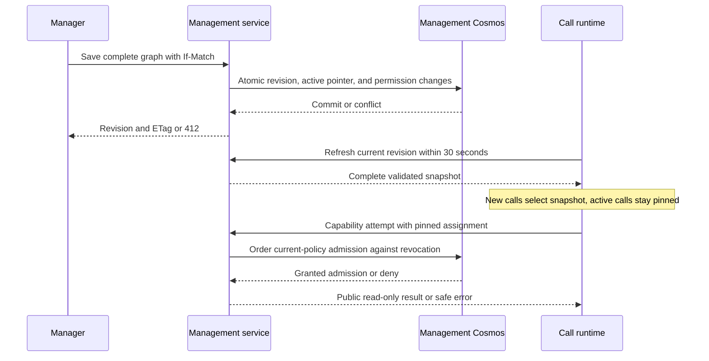

# Interface Contracts

> **Superseded in part by feature 003.** The call-era endpoints and the `caller.test.v1` browser test protocol named
> below were removed. The current contract is the text and voice conversation endpoints in
> [docs/conversation-endpoints.md](../../../docs/conversation-endpoints.md). The text below is kept unchanged as the record of this feature 001 design.

**Version**: 1.0.0 | **Scope**: Foundation interfaces now; separately marked later feature interfaces.
Use the [data model](../data-model.md) for graph validation, persistence ownership, and state rules.

## Delivery Status

| Interface | Foundation milestone | Subsequent feature |
|-----------|----------------------|--------------------|
| HTTP health/readiness | Required in both apps | Extended mode-specific checks, same versioned schema |
| Management page | Responsive Reflex shell only | Authenticated configuration editor |
| Synthetic call WebSocket | Local-only transport contract tests | Remains isolated from real provider routes |
| Configuration APIs | Not enabled | Required management-owned control plane |
| Capability execution | Not enabled | Public read-only gateway with current policy admission |
| Live phone/model adapters | Disabled | Require supported provider, quota, identity, and privacy qualification |

No health response, echo exchange, or static shell is evidence that Stories 1 through 6 are complete.
The foundation must deny unimplemented business routes instead of returning placeholder success.

## HTTP Health and Readiness

The authoritative schema is [foundation.openapi.json](foundation.openapi.json).
Both apps implement `GET /healthz` and `GET /readyz`. Liveness never contacts Cosmos, Entra,
telephony, model deployments, or tools. Mode-specific readiness uses local stand-ins in local
mode; it does not lazily discover Azure credentials. Live mode without required configuration
fails startup or reports 503, and never silently selects local adapters.

Local foundation returns `mode=local`, both feature capability flags false, and readiness status
ready only once its local app is usable. HTTP 200 readiness implies `status=ready`; HTTP 503
implies `status=not_ready`. A management backend health response alone is insufficient: the
frontend and its framework event connection must also render and pass browser verification.

Health responses are deliberately unauthenticated, minimal, and safe for probes. Include a
sanitized opaque `X-Correlation-ID`. Exclude connection strings, endpoints, environment dumps,
full stack traces, prompts, and dependency exception text. Enforce the one-second post-readiness
health response budget in controlled tests.

## Local Synthetic WebSocket

**Route**: `ws://127.0.0.1:8000/v1/dev/transport`.
This route exists only when `CALLER_MODE=local`, binds to loopback for native development,
accepts only text JSON, and has no telephony/model/tool side effects. It is absent in live mode.
Docker development publishes only loopback host ports; do not expose this route on a shared
network. It has no caller audio or agent sessions and requires no fake production credential.

Accepted request:

```json
{"type":"probe","request_id":"probe-001"}
```

Expected response:

```json
{"type":"probe_ack","request_id":"probe-001","protocol_version":1}
```

`request_id` is 1-64 ASCII letters, digits, underscore, or hyphen. Reject unknown fields,
unknown message types, invalid IDs, malformed JSON, and binary input. Maximum encoded message
size is 64 KiB; this route never echoes arbitrary input. Test a normal close (1000), invalid
message/policy close (1008), size rejection (1009), disconnect cleanup, and a synthetic internal
failure (1011). If the ASGI server closes an oversized frame first, assert its 1009 outcome
without depending on which layer performed the limit check. Close within five seconds of the
test driver's deliberate shutdown. Do not interpret this probe as a real call session.

## Later Live Call Transport

**Route**: `/v1/calls/{session_id}/media`, mounted only with an explicitly enabled, qualified
provider adapter. Only the provider, not a browser manager or arbitrary caller, opens this route.
Authenticate the handshake before accepting it, validate issuer/audience/signature/expiry and
binding to an admitted call, enforce transport encryption and connection quotas, and redact
credentials from every log. Never use a query-string secret as the documented authentication path.

The provider adapter translates its documented start/media/stop messages to internal audio-frame
events and explicit outbound send/clear/hangup operations. Its wire codec and binary/text format
must be pinned and tested with the qualified provider; the synthetic probe format is not a media
protocol. An unsupported codec or protocol rejects establishment rather than guessing.

One reader, one serialized writer, <=200 ms queued audio, and bounded tasks per connection.
Metadata and events carry session ID, physical connection epoch, agent epoch, sequence, and
monotonic timing. Enforce current epoch before output; drop late results after a handover.
On caller interruption, cancel generation and clear provider playback buffers within one second.
On terminal state, initiate no further speech or tool actions. Closing the socket is not itself
proof the provider phone connection was hung up; test the adapter's hangup acknowledgment.

Policy failure before upgrade yields HTTP handshake rejection, normally 403; not a post-upgrade
1008 frame. Normal close is 1000, policy 1008, oversized message 1009, internal failure 1011.
Use an absolute ten-second operation/failure deadline including retries and cooperative cleanup.
On failure to recover a physical owner, terminate rather than attach a competing media owner.

## OpenAI Agents SDK Runtime Boundary

The call backend MUST use the OpenAI Agents SDK for Python (`openai-agents[realtime]`) for
agent definitions and realtime execution: `RealtimeAgent`, `RealtimeRunner`, and `RealtimeSession`.
FastAPI still owns the authenticated telephony WebSocket, admission, backpressure, cancellation,
and physical media ownership. Management exposes declarative configuration; it is not replaced
by an SDK-hosted agent store, and the SDK is not required merely for Reflex configuration CRUD.

The runtime adapter maps only the permitted pinned configuration projection into SDK agents and
tool wrappers. Do not attach an unrestricted agent graph or arbitrary MCP servers to a session.
SDK tool calls MUST pass through the management capability gateway, preserving current-policy
admission on every attempt and retry. SDK filters and MCP read-only annotations do not replace
authorization or public-information classification.

Use policy-controlled transitions into fresh realtime model sessions instead of built-in
history-preserving realtime handoffs. Transfer only approved summary/reason context; preserve
the physical phone socket and pinned revision, commit one destination epoch before it speaks,
and discard the obsolete session. Failed preparation leaves the source active or closes safely.
Measure the existing two-second p95 handover and ten-second failure budgets with this adapter;
SDK support does not establish that those latency targets have been achieved.

SDK and realtime tracing are disabled by default. Application flags
`CALLER_AGENTS_SDK_TRACING_ENABLED=false` and `CALLER_REALTIME_TRACING_ENABLED=false` are resolved
before initialization. Disabled SDK tracing sets `OPENAI_AGENTS_DISABLE_TRACING=1` and
`agents.set_tracing_disabled(True)`; disabled realtime tracing sets `tracing_disabled=True` and
session `tracing=None`. The flags are independent; process-wide changes require a restart.
Explicit opt-in MUST configure approved destinations and exclude credentials, prompts, audio,
transcripts and tool payloads before any export. Do not simply enable the SDK's default exporter
or provider content capture. Reject the configuration for live data if the selected tracing
facility cannot meet these controls. Synthetic opt-in tests use in-memory approved collectors;
default local startup still has no external dependency. Tests cover defaults, each independent
flag, rejected unsafe combinations, safe attributes, and content-exclusion failures. Never attach
to already traced calls or use persistent SDK conversation sessions; SDK debug logs obey the
same content policy. Application-owned metadata tracing is separate and required in both services.

For live Azure OpenAI, use the documented GA realtime endpoint through the SDK's `model_config`
URL and explicit authentication headers, not an assumed generic provider option or preview
protocol. Configure managed-identity bearer authentication where supported. Lock the compatible
SDK/client dependencies and qualify authentication, token renewal, model settings, and session
transitions against the actual deployment before live enablement. In local mode use scripted
realtime models or injected transport doubles with no credential discovery or live connection.

## Later Management and Runtime HTTP APIs

Version prefix `/v1`; HTTPS; JSON; authenticated Entra access tokens in live mode. Validate
signature, tenant, issuer, audience, expiry, and permission/application role. Browser access uses
an appropriate server-side session/OIDC flow with secure HTTP-only cookies and CSRF protection;
do not persist tokens in browser storage or Reflex client-visible state. Service callers use
managed identity/workload identity with a distinct allowed audience and least-privileged role.
Authorization must apply to Reflex state events as well as direct API calls.

| Operation | Caller | Request/response and errors |
|-----------|--------|-----------------------------|
| GET /v1/configuration | Configuration manager | Complete graph from active revision, ETag; no credential values; 401/403 if unauthorized |
| PUT /v1/configuration | Configuration manager | Complete graph plus mandatory If-Match; atomically create revision, advance active pointer, and apply affected permission changes in one organization partition; 200 revision ID/ETag, 412 conflict, 422 invalid graph, 413 oversized graph, 428 missing precondition |
| GET /v1/runtime/configuration | Runtime identity | Validated immutable active snapshot, revision ID, schemaVersion, graphHash, ETag; If-None-Match can yield 304; no private store access |
| POST /v1/runtime/capabilities/execute | Runtime identity | session/agent/epoch/pinned revision/tool/request references and validated inputs; gateway orders current authorization and executes only an approved public read-only action |
| PUT /v1/security/revocations | Configuration manager | Disabled tool/connection/assignment set with If-Match; 200 policyVersion and ETag after authority commit, 412 stale policy; no prompt edit can bypass it |

Runtime receives the snapshot as trusted orchestration data but supplies only filtered projections
to models. Ordinary agents see their own community peers; Routing sees only community routing
metadata; Welcome/Goodbye have no foreign directory. Full management views are not agent prompts.
Every capability attempt intersects pinned assignments with current policy. The gateway denies
private/mutating capabilities even if assigned; unknown policy or unavailable authority fails
closed. Grants in a later revision cannot silently expand an existing call's pinned permissions.

For capability requests, `request_id` is stable on a retry, the deadline is preserved, and a new
admission check occurs on each attempt. Return public allowlisted results or safe error codes,
never raw exception or server-discovered unrestricted capability output. Caller input cannot
alter allowed network destinations. Denied attempts return 403 before external execution;
dependency failure is 503, invalid input 422, deadline expiry 504.

Mutation errors use `application/problem+json` with `type`, `title`, `status`, stable `code`, and
`correlation_id`. Field-validation entries identify graph paths without repeating prompts or
credential candidates. Storage conflicts preserve the UI's unsaved edits for review. There is
no draft approval, schedule, or explicit rollback screen in this release.

## Secret References and Versioned Detection

Credential references use `secret://<alias>` with alias pattern `^[a-z][a-z0-9-]{2,62}$` and an
administrator-approved registry mapping to the protected secret store. Reject unknown aliases,
embedded values, arbitrary secret-store URLs and malformed references before persistence.
Configuration reads expose only the approved reference, never the resolved credential.

Detection policy version 1 scans every ordinary text field, including names, descriptions,
prompts and nested text, before a revision write. Recognized classes include private-key PEM
blocks; credential-bearing URI user-info; connection-string assignments for `Password`, `Pwd`,
`AccountKey` or `SharedAccessKey`; SAS-style signatures in credential-bearing URLs; and bearer
tokens. Provider-key patterns must be individually named and versioned when that provider is
approved. Use synthetic positive, negative and false-positive fixtures per policy rule; do not
use real credentials in tests or claim that arbitrary secret-like text is universally detectable.

A recognized credential returns 422 with stable code `credential_literal_prohibited`, policy
version, rule ID and affected field path. Unknown/invalid references return the corresponding
safe reference error. Do not include submitted values, matched substrings, or the full rejected
document in errors, logs, audit records or traces. Rejected revisions have no partial persistence.
The literal-credential prohibition applies even to formats not recognized by automated detection.

## Configuration Update and Call Ordering



Store commit is not proof that every worker has the snapshot: verify the 60-second new-call
visibility bound. Permission revocation is ordered at current authority, not delayed to that
refresh. Already admitted in-flight reads may finish; no post-commit new admission may bypass
the revocation. Audit contains action categories/outcomes, never content or arguments.

## Logs, Probes, and Operations

Allowlisted JSON schema fields: `timestamp`, `severity`, `service`, `environment`, `event_name`,
`outcome`, `correlation_id`, optional `trace_id`, `session_ref`, `revision_id`, and stable
`reason_code`. Do not use arbitrary user text for event names, reason codes, or metric labels.
Capture startup, readiness failure, request outcome, disconnect, denial, and shutdown locally.
Tests require correlation across synthetic operations and removal of known secret/content fixtures.
Both services emit application-owned distributed spans with safe cross-service trace-context
propagation. Test parent/child correlation and allowlisted span attributes with in-memory
collectors, including malformed/untrusted correlation input and forbidden-content fixtures.
Management and runtime metrics/alerts cover errors, latency, dependency failures and saturation;
runtime adds active calls, handovers and quotas. Alert thresholds, owners and runbooks are explicit.

Future internal drain commands are authenticated service/control operations, never public health
side effects. Transition serving to draining, reject new admissions, retain established socket
routing, observe active sessions reaching zero, then terminate. Planned retirement must wait if
drain is incomplete. Publish safe active-session, failure, latency, quota, and saturation metrics;
validate alert delivery through the operator runbook before any production release.
