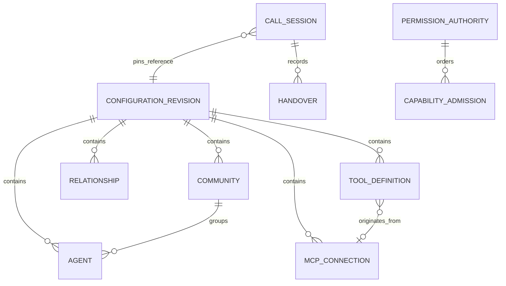
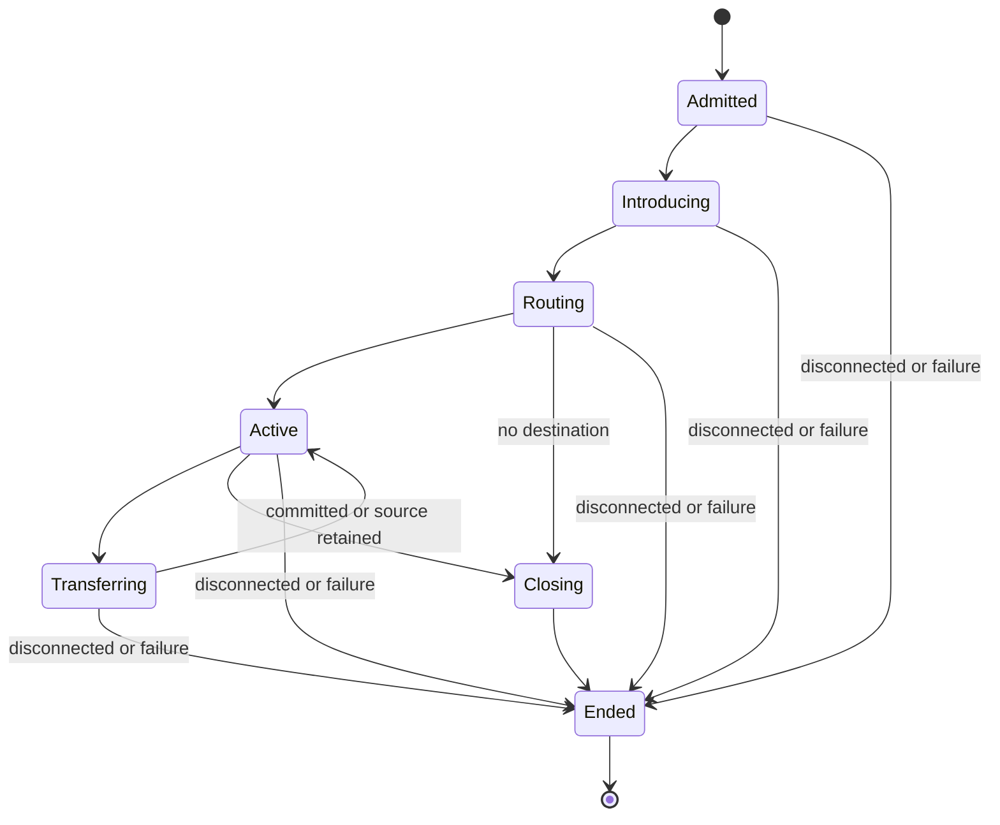

# Data Model: Call Center Agent Automation

**Status**: Phase 1 design; model implementation is later work. Foundation defines health/settings
contracts and stand-ins, not functioning configuration persistence or call sessions.

## Ownership and Storage Boundaries

Cosmos DB for NoSQL is the live durable store. One organization has stable ID `default`;
communities are not tenants. Document IDs are opaque, stable identifiers, distinct from names.
Management is the only reader/writer of its private configuration and audit containers,
including its permission-authority document. Runtime is the only reader/writer of its
session/handover metadata. Managed identity
and container-scoped Cosmos data-plane permissions enforce these boundaries. A call worker loads
configuration through management's authenticated API, never from management's container.

| Container | Owner | Partition key | Contents |
|-----------|-------|---------------|----------|
| configuration | Management | /organizationId | Immutable revisions, active pointer, and permission authority with admission ordering |
| configuration-audit | Management | /dayBucket | Allowlisted manager/security metadata only |
| call-sessions | Runtime | /sessionId | Lifecycle, connection owner, epochs, and handover metadata |
| call-audit | Runtime | /dayBucket | Allowlisted call outcomes and errors only |

No live container stores call audio, transcripts, summaries, tool arguments/results, or arbitrary
caller-provided strings. Conversation context is bounded volatile memory. Service-owned local
stand-ins implement the same repository interfaces for tests, but do not establish live Cosmos
consistency, durability, or restart guarantees.

The ER diagram describes logical relationships; a revision embeds its graph in one immutable
snapshot document. Runtime's revision reference crosses an API boundary, not a database join.

## Configuration Entities

| Entity | Fields and constraints |
|--------|------------------------|
| ConfigurationRevision | id, organizationId, schemaVersion, revisionNumber, createdAt, createdBy, graphHash, agents, communities, relationships, tools, mcpConnections; immutable after successful publication; serialized snapshot <=512 KiB |
| ActiveConfiguration | id=active, organizationId, revisionId, revisionNumber, publishedAt, _etag; publication uses conditional write |
| Agent | agentId, unique nonempty name, nonempty prompt when enabled, enabled, role, nullable communityId, capabilityAssignments; role is ordinary/welcome/routing/goodbye |
| Community | communityId, nonempty name, routingDescription, enabled, entryAgentId; enabled entry is an enabled ordinary member |
| Relationship | relationshipId, sourceAgentId, targetAgentId, allowedContextFields; all references resolve in that revision |
| ToolDefinition | toolId, name, description, schemaVersion, validated input schema, output allowlist, enabled, approvedDestinationRef, optional mcpConnectionId, effect=read_only, classification=public; assignments cannot override classification |
| MCPConnection | connectionId, name, approved HTTPS endpoint reference, enabled, credentialRef, reviewed capability catalog; server-advertised annotations are not authorization |
| CapabilityAssignment | agentId, toolId, permittedActionNames, allowedInputConstraints; exact pinned grants, intersected with current policy before every attempt |

Exactly one enabled Welcome, Routing, and Goodbye role exists, with no community membership.
Ordinary agents have exactly one community. Protected roles cannot be removed, disabled, or
repurposed; prompt edits cannot grant visibility or capability permissions. Only ordinary agents
execute public business tools. Welcome introduces; Routing selects community entry; Goodbye ends.

Community peers are all discoverable within the pinned revision. Relationships constrain handover,
not discovery. A foreign ordinary agent, its prompts, and tools are never projected to an ordinary
agent. Routing's projection includes community name/description/entry reference only. A foreign
transfer has two explicit stages: ordinary agent to Routing, then Routing to the destination entry.
Required lifecycle paths remain available even when ordinary relationships are edited.

Credential-bearing fields contain only approved opaque references in the form
`secret://<alias>`, where the alias matches `^[a-z][a-z0-9-]{2,62}$` and resolves through an
administrator-approved server-side registry. References do not contain secret values, arbitrary
vault URLs, or caller-selected destinations. A versioned policy scans all ordinary text fields
before any revision is persisted; the interface contract defines recognized credential classes
and safe errors. Detection does not make storing otherwise prohibited literal credentials legal.

## OpenAI Agents SDK Materialization

Stored agents remain declarative configuration, not serialized SDK instances, executable Python,
live credentials, or conversation history. The backend's OpenAI Agents SDK adapter builds
`RealtimeAgent` objects from the pinned revision's authorized agent projections, with reviewed
tool wrappers and application-owned context. `RealtimeRunner` owns execution and returns a
call-local `RealtimeSession`; no SDK object or durable SDK session store is written to Cosmos.
Deployment/model settings belong to the session adapter, not an unrestricted field in an agent
prompt. Reflex continues to edit the configuration rather than directly execute SDK agents.

SDK realtime handoffs retain session history, so they MUST NOT be used as context filtering.
For an agent transition, prepare a fresh realtime model session with only the permitted summary
and reason fields. Keep the caller-facing connection and pinned revision; allow output only
after the destination epoch is committed. Close/discard the obsolete model session and its
content-bearing references. If preparation fails, discard the new session and retain the source
owner or perform controlled closure. Never replay raw history, old audio, or unrestricted tool
results into the destination, including Routing and the protected lifecycle roles.

Both process-wide SDK tracing/export and realtime-session tracing are disabled by default.
Explicit application configuration may enable either only with approved destinations and the
same metadata-only content controls; unsafe opt-ins fail closed. Application-owned distributed
traces exist independently in both services and propagate safe cross-service correlation.
Operational traces never contain SDK prompts, audio, transcripts, credentials, or tool payloads.
SDK function-tool wrappers call the management capability gateway;
neither MCP discovery nor SDK handoff/tool exposure grants permission to execute an action.

## Validation and Publication

1. Validate names, role cardinality, membership, entry agents, reference integrity, input/output
   schemas, public/read-only classifications, approved destinations, and required lifecycle paths.
2. Serialize one complete immutable revision. Reject snapshots above 512 KiB with an actionable
   error; the complete transaction must remain below 768 KiB and supported SDK/service limits.
3. In the organization's configuration partition, transactionally create the new revision,
   replace the active pointer conditional on the caller's base ETag, and apply permission
   changes to the authority item conditional on its current ETag. This includes revoked
   assignments and disabled tools/servers, so a configuration save cannot delay security
   revocation until cache refresh. A stale configuration ETag returns 412 with no changes.
   An admission-only authority conflict may be retried against fresh policy while the base
   configuration ETag remains current. Never partially publish or overwrite another manager.
4. Calls acquire a validated snapshot via management. Refresh ordinary snapshot caches every
   30 seconds, leaving propagation/validation time within the 60-second acceptance target.
5. Existing calls keep their revision, including handovers. New calls can use the last validated
   revision during temporary config outages. No valid snapshot means decline new live calls.

Empty live installation bootstraps the three protected roles transactionally but does not accept
calls until a valid enabled business community exists. That is not required during foundation
startup, which uses no live database and cannot accept real telephone calls.

## Permission Authority

`PermissionAuthority`: id=security-authority, organizationId, policyVersion, disabledToolIds, disabledConnectionIds,
revokedAssignments, admissionSequence, updatedAt, updatedBy, _etag. Current reads use the
Strong-consistency authority; ordinary cached configurations cannot authorize actions alone.
The authority is in the configuration container and organization partition; its serialized size
is capped at 128 KiB so the revision/pointer/policy publication remains within its batch budget.

Every capability attempt is admitted by management's gateway, which owns the permission data
and the external tool execution boundary. A conditional authority update orders admission against
revocation; retry an ETag conflict only within the original action deadline. The admitted request
contains sessionId, agentId, agentEpoch, pinnedRevisionId, toolId, actionId, and an opaque request ID.
Arguments and results are ephemeral, not admission-record payloads. Revocation committed before
admission denies the request even for an old revision. A previously admitted in-flight read may
finish; this is not authorization for another attempt. Authority unavailability fails closed.

Validate every retry again. Reject private-data or mutating tools even if assigned. Restrict URL
destinations and redirects to approved endpoints; reject loopback, link-local, and private network
targets unless explicitly approved as an internal service. Do not let an MCP response select a
new destination or execute a capability outside the reviewed catalog.

## Runtime Entities

| Entity | Fields and constraints |
|--------|------------------------|
| CallSessionMetadata | sessionId, opaque providerCallRef, state, configurationRevisionId, physicalOwnerId, connectionEpoch, activeAgentId, activeCommunityId, agentEpoch, leaseUntil, startedAt, terminatedAt, terminalReasonCode, _etag |
| HandoverMetadata | id, handoverId, sessionId, configurationRevisionId, physicalOwnerId, connectionEpoch, sourceAgentId, destinationAgentId, sourceAgentEpoch, destinationAgentEpoch, outcome, requestedAt, completedAt, reasonCode; no transferred summary or raw text |
| AuditRecord | eventId, dayBucket, UTC timestamp, actorRef or sessionRef, revisionId, eventName, outcome, safeReasonCode, correlationId; no free-text caller details, prompts, credentials, arguments, or results |
| VolatileCallContext | call-local audio buffers, bounded conversation context, current request summary, transfer reason, approved tool result; never serialized into durable repositories |

Session IDs partition related metadata. Conditional writes create at most one physical connection
owner. Agent handovers atomically update agent owner/epoch and their outcome in that session's
partition. No cross-container transaction is assumed. Downstream outputs must carry the current
agent epoch; the physical media owner drops obsolete outputs before speech or action dispatch.

Handover states are requested, committed, failed, or canceled. On failed transfer, keep the source
agent; if it cannot continue, close. A caller disconnect cancels the attempt and terminates once.
Limit completed handovers to ten in a rolling 60 seconds by default. Use one ten-second deadline
for transfer/failure resolution, not a fresh ten seconds per retry. Media owner failure produces
a terminal result; this design does not claim automatic live WebSocket migration.

## Content Cleanup and Retention

Purge volatile content promptly at termination and always within 300 seconds. Test normal close,
abrupt disconnect, cancellation, failed transfer, and process shutdown. Do not enable crash dumps
or file-backed conversation caches. Provider-side retention is separately verified before live use.

TTL applies only to safe metadata. It is not a physical deletion guarantee and does not remove
backups immediately. Production audit/session retention periods and Cosmos region are required
approved environment inputs before any live deployment; there is no invented legal retention
default. Local tests use disposable synthetic metadata and no real caller information.
