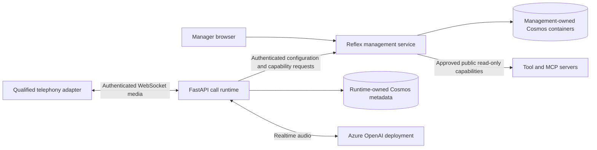

# Implementation Plan: Call Center Agent Automation

**Branch**: `main` | **Feature**: `001-call-center-agents` | **Date**: 2026-10-22 | **Spec**: [spec.md](spec.md)

**Input**: [spec.md](spec.md), its five clarifications, and the selected stack supplied with planning.

**Governance**: [Constitution v2.1.0](../../.specify/memory/constitution.md).

## Summary

Create a Python/FastAPI call-runtime service with WebSocket support and an independently
deployable Python/Reflex management service. Use the OpenAI Agents SDK for Python
(`openai-agents[realtime]`, imported as `agents`) for runtime agent construction and orchestration.
Reflex and Cosmos retain responsibility for editing and storing declarative agent definitions;
the SDK does not replace administrative CRUD or become a hosted agent-management service.
Use Cosmos DB for NoSQL for live durable data,
Docker images, isolated uv projects, GitHub Actions, and pre-commit. All authored implementation
artifacts belong under `code/`; GitHub workflow discovery metadata remains in its required
`.github/workflows/` location. This command produces design documents only.

The first implementation milestone is the clarified repository foundation: both apps start on
Windows and Linux with health checks, a rendered Reflex shell, meaningful tests, and CI, without
Azure resources or external-service credentials after dependency installation. Local deterministic
stand-ins are explicitly not production persistence. Implement and accept FR-030 through FR-032
and SC-015 through SC-017 first; do not label the complete feature implemented at that point.

Subsequent delivery implements Stories 1 through 6 and the remaining requirements: one
organization, protected lifecycle agents, isolated communities, revision pinning, authenticated
configuration changes, public read-only tool execution, and call-aware horizontal scaling.
No customer-data tools, business-changing actions, tenant administration, or management testing
playground are included. Live telephony is disabled until a supported provider is qualified;
the documented ACS lifecycle restrictions make unconditional standalone PSTN adoption unsuitable.



In local foundation mode, the diagram's cloud and external-service edges are replaced by
in-process stand-ins or remain disabled. The management shell exposes no configuration or tool
execution functionality until authenticated later delivery; health is not proof of call readiness.

Research decisions and sources are in [research.md](research.md). Domain and persistence rules
are in [data-model.md](data-model.md). Interface status and lifecycle contracts are in
[contracts/interfaces.md](contracts/interfaces.md); runnable acceptance steps are in
[quickstart.md](quickstart.md).

## Technical Context

**Language/Version**: Python `>=3.12,<3.13`; select a security-patched exact build for CI/images.

**Primary Dependencies**: FastAPI, Uvicorn (`asyncio` loop), Pydantic settings, HTTPX, and the
OpenAI Agents SDK for Python (`openai-agents[realtime]`) in the backend. Construct `RealtimeAgent`
objects from authorized configuration projections and use `RealtimeRunner`/`RealtimeSession`
behind the runtime adapter. Lock and test SDK/FastAPI/Pydantic compatibility in the backend
environment; the management app does not need the SDK merely to edit configuration.
Reflex 0.10.0 candidate verified by the implementation compatibility suite; live adapters use
`azure-cosmos` async APIs and managed identity. Pin resolved packages in each project's `uv.lock`.
Reflex frontend compiler dependencies are installed and frontend-locked before offline startup.

**Storage**: Cosmos DB for NoSQL, single-write-region Strong consistency for live authorities.
Management owns configuration and audit containers, including a same-partition permission
authority; runtime owns session and handover metadata. No shared private-store access. No persisted
media, transcripts, summaries,
or tool payloads. Setup uses no Cosmos emulator and does not initialize a live Azure client.

**Testing**: pytest, FastAPI TestClient/HTTPX with explicit lifespan handling, AnyIO `asyncio`,
pytest-playwright Chromium, deterministic failure injection, and mock-server contract tests.
SDK integration tests use scripted realtime models without credentials and assert history
isolation, tool-gateway enforcement, disabled-by-default SDK/realtime tracing, and content-free
opt-in export through approved destinations. Both services have metadata-only distributed-trace
propagation and safe-span tests, independent of the optional SDK tracing controls.
Ruff, mypy, pre-commit, secret detection, and locked dependency audits complement functional tests.
GitHub Actions runs native `windows-2022` and `ubuntu-24.04`; image smoke tests run on Ubuntu.

**Target Platform**: Native Windows and Linux developer workflows; Linux OCI images.
Future Azure runtime target is AKS with application-controlled pre-drain, ACR, Key Vault,
Azure Monitor, and private Cosmos networking. Infrastructure is Terraform only, not deployed here.

**Project Type**: Two independently packaged services: realtime call runtime and Reflex management
control plane. A separate development-tool project is not a deployed microservice.

**Performance Goals**: Foundation health responds within one second after readiness in test
environments; startup smoke harness allows 120 seconds after dependencies/assets are prepared.
Full feature retains 100 concurrent calls for 30 minutes, scale to 200 within five minutes,
p95 speech response two seconds, p95 handover two seconds, interruption one second, failure
outcome ten seconds, configuration visibility 60 seconds, and volatile cleanup five minutes.
Only measured later integration/load tests can establish those live targets.

**Constraints**: No cloud credentials/resources required for default local startup, health, or
starter CI; no calls to live phone/model/business services. Dependency downloads and advisory
lookups may require internet. Production mode fails closed on missing identity/storage/provider
configuration; it cannot fall back to local stand-ins. Only public-information read-only tools
may execute, including MCP capabilities. No authentication bypass for business endpoints.
Both services emit application-owned, metadata-only distributed traces and expose error,
latency, dependency-failure and saturation metrics with actionable monitoring. SDK tracing/export
and realtime-session tracing are disabled by default. Explicit application configuration may
enable either only with the same content exclusions and approved destinations; reject unsafe
opt-ins rather than inherit a provider's content-capturing defaults. Configuration is applied
before session construction and process-wide tracing changes require a restart.
SDK handoffs are not authorization or context-redaction boundaries: use policy-controlled fresh
model sessions with approved transfer fields rather than forwarding prior conversation history.
Azure realtime uses the documented GA endpoint and explicit authentication headers; live
deployment compatibility, token renewal, and handover latency require separate qualification.

**Scale/Scope**: One organization; one global Welcome, Routing, and Goodbye role; one community
per ordinary agent. Revision pinning plus current permission authority. Initial config publication
is bounded to a 512 KiB snapshot and 768 KiB transaction. One physical socket owner per call;
agent handovers do not imply socket migration. Source root is `code/`.

## Constitution Check

*GATE: Must pass before Phase 0 research. Re-check after Phase 1 design.*

| Principle | Pre-research check | Post-design check and evidence |
|-----------|--------------------|--------------------------------|
| I. Azure-first | PASS: selected services and tools permit Azure hosting. | PASS for foundation: Azure Cosmos/identity/monitoring boundaries; live telephony qualification is a separate disabled capability, not an approved non-Azure dependency. |
| II. Security-first | PASS: no credentials or caller data needed for setup. | PASS: mode separation, authentication before live upgrade, current permission admission, filtered fresh-session SDK transitions, SDK/realtime tracing disabled by default with privacy-gated explicit opt-in, versioned secret detection and approved references, no content persistence, and CI secret scanning. |
| III. Documentation | PASS: all implementation changes require documentation. | PASS: this plan and data model contain Mermaid designs; research, contracts, and quickstart define documentation/verification obligations. |
| IV. Microservices | PASS: call runtime and management have distinct capabilities. | PASS: separate deployables and private Cosmos containers; runtime consumes management contracts instead of its store. |
| V. Python/Reflex | PASS: both authored apps are Python; UI is Reflex. | PASS: independent Python 3.12 projects, Reflex-generated assets only, lint/type/test gates. |
| VI. Scalability | PASS: spec targets retained, not asserted by a scaffold. | PASS: bounded socket work, single-owner epochs, scale-out and pre-drain design; live capacity tests remain mandatory before live release. |
| VII. Observability | PASS: structured events and failure signals required in both apps. | PASS: both-service metadata-only distributed traces and metrics, context-propagation/safe-span tests, management and runtime monitoring, alert thresholds/owners/runbooks and verified delivery. |
| VIII. Terraform | PASS: no alternate IaC language proposed. | PASS: all Terraform sources under code; remote encrypted/locked state, reviewed plans, no apply or credentials in PR checks. |
| IX. Automated tests | PASS: starter checks must exercise actual behavior. | PASS: health, mode guard, WebSocket, browser, cross-platform and image tests; SDK scripted-model isolation, denied-tool and tracing-export checks; recorded CI results and deliberate failure verification. |

These are design-compliance checks, not claims that code or tests already exist. No constitutional
waiver is requested. Foundation completion is a development milestone, not production release.
Production enablement remains blocked until telemetry alerts, private networking and identities,
approved residency/disclosure/audit-retention rules, supported bidirectional telephony, model
availability/quotas, and measured capacity/drain evidence meet the constitution.

## Project Structure

### Documentation (this feature)

```text
specs/001-call-center-agents/
  plan.md
  research.md
  data-model.md
  quickstart.md
  contracts/
    foundation.openapi.json
    interfaces.md
```

### Source Code (repository root)

Planned paths below are implementation outputs, not files created during planning.

```text
.github/workflows/                 GitHub-required discovery metadata only
  ci.yml
code/
  backend/
    pyproject.toml
    uv.lock
    src/caller_runtime/
      main.py                      FastAPI app factory and lifespan
      settings.py
      api/                         Health and WebSocket boundaries
      domain/                      Later sessions and orchestration
      adapters/                    Local stand-ins; later Cosmos/model/phone
        agents_sdk.py              OpenAI Agents SDK mapping and session boundary
    tests/unit/
    tests/contract/
    tests/integration/
    Dockerfile
    .dockerignore
  management/
    pyproject.toml
    uv.lock
    rxconfig.py
    reflex.lock/                   Committed framework frontend dependency lock
    management_app/
      management_app.py            Reflex composition root and shell
      health.py
      settings.py
      services/                    Later configuration and capability gateway
      adapters/                    Local stand-ins; later Cosmos
    assets/
    tests/unit/
    tests/contract/
    tests/browser/
    Dockerfile
    .dockerignore
  tools/
    pyproject.toml
    uv.lock
    scripts/                       Portable smoke/CI/audit command wrappers
  contracts/                       Implementation-owned copies of accepted schemas
  infra/
    terraform/
      bootstrap/                   Explicit later remote-state provisioning
      modules/
      environments/dev/
  docs/                            Implementation runbooks and Mermaid diagrams
  .pre-commit-config.yaml
```

**Structure Decision**: Independent application locks and images, no uv workspace shared runtime,
and no general-purpose shared package until genuine duplication warrants one. Runtime and
management share versioned interface schemas, not persistence code or private data stores.
GitHub workflow YAML is the only required automation-discovery exception to the `code/` source
layout; its executable helper scripts and static-check configuration remain under `code/`.
Do not create directory placeholders or empty services merely to match this future layout.

Foundation pipeline: locked installs; pre-commit static checks; per-app lint/type/pytest; browser
shell smoke on Windows/Linux; Ubuntu image build/run; dependency/secret scanning; Markdown and
Mermaid validation; Terraform formatting and credential-free validation once Terraform exists.
No plan/apply, image publication, cloud identity, or deployment is part of a pull-request job.

Subsequent implementation ordering: foundation, management configuration and contracts, runtime
orchestration against stand-ins, qualified live speech/telephony integration, then load/failure/drain
qualification. Those are delivery dependencies, not a generated task list. `/speckit-tasks` must
produce actionable work later; this command does not create tasks or execute implementation.

Local story acceptance uses deterministic doubles and does not wait for cloud resources.
Live qualification remains pending until a separately authorized environment is provisioned or
validated as pre-provisioned, including identity, networking, provider access and quotas. The
task list must contain this explicit gate before deferred live phone, Cosmos, or load evidence.
SC-008's participant manager study is deferred; automated management and accessibility tests remain.

## Complexity Tracking

No constitutional violations or exceptions. Two deployed services reflect distinct ownership;
the tooling environment is development-only. AKS is a later hosting choice justified by explicit
long-lived-call drain control, not a requirement to provision a cluster for local setup.

## Deferred Delivery Phases

On 2026-10-28 the user explicitly deferred every remaining unchecked task to future phases.
The current work phase is paused with **114/129 tasks complete and fifteen deferred**, not
with the full feature or release accepted. T123 remains complete; T124's missing enforcement
and integration remain unfinished. Existing completed work and verification evidence are
preserved without weakening the constitution, specification or reviewer decisions.

The authoritative [future-phase index](tasks.md#future-phases-deferred-backlog) groups the
remaining work into phases 11-14: supported integrations/composition; operations/enforcement/
telemetry; environment/protected delivery; and live acceptance/final release. These groups
do not replace original task prerequisites or create approval shortcuts. Resume only on
explicit reopening of a named task or phase, with the original dependencies and applicable
provider, cluster, environment, privacy and protected-operation approvals satisfied.

No remaining implementation, cloud authentication, provisioning, deployment, image
publication, real phone/model call or live/release qualification is authorized by this
deferral. Credential-free fail-closed defaults and separate local/live evidence remain.
