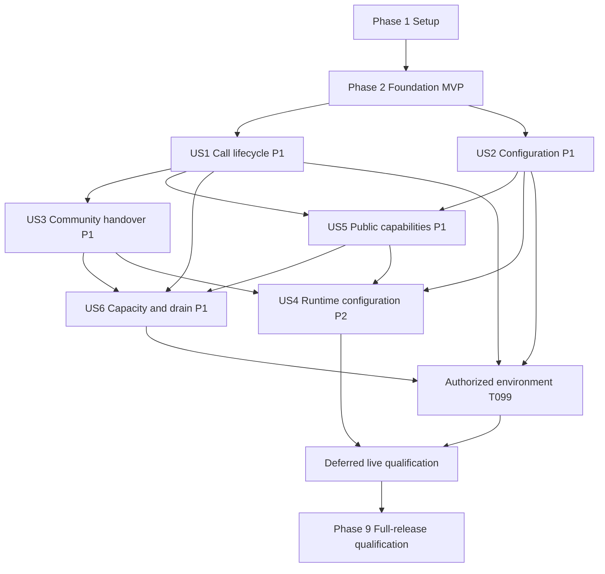

# Tasks: Call Center Agent Automation

**Input**: [spec.md](spec.md), [plan.md](plan.md), [research.md](research.md),
[data-model.md](data-model.md), [interface contracts](contracts/interfaces.md), and
[quickstart.md](quickstart.md).

**Prerequisites**: Preserve [constitution v2.1.0](../../.specify/memory/constitution.md) and
reviewer-owned checklist decisions. The foundation checklist is currently 32/32 checked;
that is requirements approval, not proof that any task below is implemented.

**Tests**: Required by FR-030, SC-015 through SC-017, the plan, and Constitution IX.
Write story contract/unit/integration tests before the behavior they specify, observe meaningful
failures, then implement and rerun. Generated tests require reviewed assertions and recorded results.

**Current local verification (2026-10-27)**: the full combined runner passes runtime 384 and
tools 129 cases; management has 403 cases with 24 editor-export setup errors, no assertion
failures/skips. Earlier 403-case native passes and 33-document/27-diagram renders are historical.
Unattended editor-build/render processes now close inherited stdin, with red-first invocation
regressions. A baseline full management run reproduced 379 passes/24 export errors; standalone
and combined runs after the change pass 403. This does not prove a global fix for framework
intermittency. Original deadlines/SSR/assertions/dependencies/discovery and all external gates
are retained. The failure recurred after feed isolation: stdin hardening is not a complete
fix. Eight tasks remain open after observed T028 CI evidence; see the current records in
`code/docs/acceptance/final.md` and `release-gates.md`.

**Publication authorization and isolation**: the user approved committing/pushing the sanitized
worktree and opening a draft PR. Private feed URLs are local-only under ignored `code/.local/`.
Public Python lock URLs match upstream filename/hash/size metadata; Bun keeps registry-relative
entries and all versions/integrities. Repository hooks/129 tools/12 recovery cases pass. The
publication guard covers worktree/index/history and detects compiler-regenerated private URLs.
Fresh public-build/image/advisory and observed native CI results remain pending; current GitHub
inspection is HTTP 403 rate-limited. No task, assertion, TLS check or live gate is waived.

**Observed CI continuation (2026-10-27, commit c60f7b0)**: Ubuntu's native job passes all
384 runtime and 403 management cases, then the actual starter assertion gate reports 0/1/0
and fixture cleanup. Its later Mermaid renderer fails; Windows still has 24 editor setup
errors. The separate Linux image job passes actual offline/non-root/three-width smoke and
strict Python/frontend/three-image audits. These observations close only T028, not T029/T031
or any live gate. Local follow-up passes 143 tooling cases and all repository gates; safe
bounded build-failure categories expose no raw logs and change no timeout/sandbox/assertion.

**Organization**: Setup, a complete credential-free foundation, P1 story phases US1/US2/US3/US5/US6,
then P2 story US4, followed by cross-cutting qualification. The numeric story labels retain the
spec's identities even though priority places US4 after US6.

## Format: `[ID] [P?] [Story] Description`

- Every task has an unchecked box, sequential T-number, concrete file paths, and an action.
- `[P]` means eligible for parallel work only after its stated prerequisites and the phase entry
  gate are complete; parallel batches must not edit the same files.
- Story tasks carry `[US1]` through `[US6]`; setup/foundation/polish tasks carry no story label.
- Each implementation task includes relevant tests, documentation, and security review in the
  same change. Dedicated documentation tasks consolidate guides; they do not postpone that duty.
- Do not change reviewer-owned checklist markers or claim a gate passed without execution evidence.

## Path Conventions

- Application code, tests, scripts, tool configuration, Dockerfiles, and Terraform belong in `code/`.
- Backend package: `code/backend/src/caller_runtime/`; management package:
  `code/management/management_app/`; isolated tools project: `code/tools/`.
- `.github/workflows/` is the required GitHub discovery-metadata exception. Executable helpers
  remain under `code/tools/scripts/`. Shared schemas live in `code/contracts/`, not a shared database.
- The paths in unchecked tasks are planned outputs, not existing files. Use the referenced design
  documents for complete field definitions; quoted constraints below are mandatory, not examples.
- Tests of SDK/model/phone behavior use deterministic doubles by default. Live suites are explicitly
  opt-in and require an authorized environment; local stand-ins do not prove live Cosmos durability.
- Local acceptance means deterministic tests pass without cloud resources. Live qualification stays
  pending until T099 proves authorized provisioning or pre-provisioned resources, image deployment,
  identity, networking, provider access and quotas. Local-only runs may continue local tasks while
  leaving T099 and live evidence unchecked; they MUST NOT convert pending live work into success.
- SC-008's participant manager study is deferred. Automated management-app and accessibility tests
  remain required; do not recruit managers or invent a participant-success acceptance threshold.

## Phase 1: Setup (Shared Infrastructure)

**Purpose**: Establish reproducible, independently packaged Python applications and development tools.

- [X] T001 Document the `code/` layout, service ownership, native Windows/Linux prerequisites, and required workflow-metadata exception in `code/docs/repository-layout.md`; create application directories only as actual files require them, without changing the existing Spec Kit documents or reviewer checklists.
- [X] T002 [P] Initialize `code/backend/pyproject.toml`, `code/backend/.python-version`, and `code/backend/uv.lock` for Python `>=3.12,<3.13`, FastAPI, Uvicorn's portable asyncio loop, Pydantic settings, async Cosmos, HTTPX, `openai-agents[realtime]`, and application-owned metadata-tracing instrumentation; resolve and record compatible security-patched SDK/FastAPI/Pydantic versions before accepting the lock (after T001).
- [X] T003 [P] Initialize `code/management/pyproject.toml`, `code/management/.python-version`, `code/management/uv.lock`, and the framework frontend lock `code/management/reflex.lock/` for the independently resolved Python/Reflex app and metadata-tracing instrumentation; qualify the Reflex candidate/toolchain without adding the agent SDK solely for configuration CRUD (after T001).
- [X] T004 [P] Initialize `code/tools/pyproject.toml` and `code/tools/uv.lock` with pinned pre-commit, Ruff, mypy support, secret detection, dependency auditing, and documentation-validation tooling; keep this development environment independent of the deployed application environments (after T001).
- [X] T005 Configure `code/.pre-commit-config.yaml` to invoke locked, explicit-path lint/format, per-application type checks, whitespace checks, and offline secret detection from repository root; document `--config code/.pre-commit-config.yaml` and avoid hooks that need cloud credentials (after T002-T004).
- [X] T006 [P] Add `code/.gitignore`, `code/backend/.dockerignore`, and `code/management/.dockerignore` exclusions for local credentials, environments, generated frontend/cache output, Terraform state/plan artifacts, and local test output while retaining both Python locks and the Reflex frontend lock (after T002-T004).
- [X] T007 [P] Copy the accepted health schema to `code/contracts/foundation.openapi.json` and document schema-version ownership in `code/contracts/README.md`; preserve the distinction between local readiness and live feature availability (after T001).
- [X] T008 Create `.github/workflows/ci.yml` with reviewed full-SHA action pins, `contents: read`, pull-request/protected-branch triggers, isolated native Windows/Linux jobs, and no publication, deployment, privileged PR checkout, or cloud credentials; call only helpers under `code/` (after T002-T007).
- [X] T009 Write initial locked-install and toolchain-preparation instructions in `code/docs/setup.md`, distinguishing dependency/browser downloads from credential-free runtime verification and documenting native Windows rather than substituting WSL-only support (after T002-T008).

## Phase 2: Foundational (Blocking Prerequisites)

**Purpose**: Deliver the first agreed milestone: two usable local foundations, not the full call center.

**Entry gate**: T001-T009 complete. No live database, Azure login, phone number, real model call,
or business tool is required. Do not create production resources to satisfy this phase.

### Foundation Tests and Implementation

- [X] T010 [P] Write `code/backend/tests/contract/test_health.py` for the accepted health schema, service identity, status/mode fields, correlation header, local readiness flags, and failure readiness response; require no outbound dependency access and observe failures before implementing the routes (after Phase 1).
- [X] T011 [P] Write `code/management/tests/contract/test_health.py` and `code/management/tests/browser/test_shell.py` for health through the composed app and a real responsive Reflex shell at 360/768/1440 widths, keyboard access, working framework connection, and no unexpected browser errors (after Phase 1).
- [X] T012 [P] Write `code/backend/tests/contract/test_dev_transport.py` for the synthetic probe contract: `request_id` is "1-64 ASCII letters, digits, underscore, or hyphen", maximum encoded message size 64 KiB, exact acknowledgment, invalid/binary/oversized input rejection, disconnect cleanup, and the declared close codes (after Phase 1).
- [X] T013 [P] Write no-credential/no-live-egress settings tests in `code/backend/tests/unit/test_settings.py` and `code/management/tests/unit/test_settings.py`, plus `code/backend/tests/unit/test_sdk_startup.py`; cover SDK/realtime tracing disabled by default, each explicit application opt-in, rejected unsafe content/destination settings, startup-only configuration, and live-mode fail-closed behavior (after Phase 1).
- [X] T014 [P] Write `code/backend/tests/unit/test_observability.py` and `code/management/tests/unit/test_observability.py` for application-owned metadata-only distributed traces in both services, cross-service context propagation, safe span attributes, structured events and correlation; use in-memory collectors and exclude credentials, prompts, audio, transcripts and tool payloads in default and opt-in cases (after Phase 1).
- [X] T015 Implement mode/settings and tracing safeguards in `code/backend/src/caller_runtime/settings.py` and `code/backend/src/caller_runtime/adapters/agents_sdk.py`; default both application tracing flags to false, applying `OPENAI_AGENTS_DISABLE_TRACING=1`, `agents.set_tracing_disabled(True)` and realtime `tracing_disabled=True`/`tracing=None`; permit only explicit privacy-safe opt-ins before initialization, require restart for process-wide changes, and construct no live connections locally (after T010-T014).
- [X] T016 Implement management settings in `code/management/management_app/settings.py`, with explicit local/live selection, no networked Cosmos or identity client construction during local imports/health, and no production fallback to local adapters (after T010-T014).
- [X] T017 Implement application-owned metadata-only distributed traces and JSON logs in `code/backend/src/caller_runtime/observability.py` and `code/management/management_app/observability.py`, with cross-service context propagation, safe span attributes, correlation and stable errors; use local in-memory collectors, approved live exporters, and reject all credential/prompt/audio/transcript/tool-payload attributes independently of optional SDK tracing (after T015-T016).
- [X] T018 Implement FastAPI app/lifespan and `/healthz`/`/readyz` in `code/backend/src/caller_runtime/main.py` and `code/backend/src/caller_runtime/api/health.py`; return truthful local capability flags, handle cleanup idempotently, and pass the backend contract tests without Azure dependencies (after T015-T017).
- [X] T019 Implement `code/management/rxconfig.py`, `code/management/management_app/management_app.py`, and `code/management/management_app/health.py` using the documented API transformer; preserve reserved Reflex routes, use development ports 3000/8001, show an actual accessible shell without fake configuration functionality, and pass T011 (after T016-T017).
- [X] T020 Implement local-only `/v1/dev/transport` in `code/backend/src/caller_runtime/api/dev_transport.py` with bounded work and explicit 1000/1008/1009/1011 close behavior; exclude it from live mode and preserve the loopback-only development boundary (after T012, T018).
- [X] T021 Implement `code/tools/scripts/smoke.py` to choose free known ports, start both local apps, wait at most 120 seconds after prepared dependencies, check one-second post-ready health responses, run shell checks, and always clean up child processes; never mistake an unrelated existing server for the test process (after T018-T020).
- [X] T022 [P] Add `code/backend/Dockerfile` using pinned base/build tools, locked non-editable runtime dependencies, a non-root user, internal port 8000, and no startup dependency downloads; preserve local mode without credentials and exclude host environments from the context (after T018-T020).
- [X] T023 [P] Add `code/management/Dockerfile` with a pinned multi-stage frontend build and unified production serving on port 3000; include compiled assets/locks, non-root execution, working custom health routes and framework WebSocket, and no unneeded database/state-service dependency for the shell (after T019).
- [X] T024 Implement `code/tools/scripts/test_images.py` for Ubuntu image build/run health and browser smoke against both actual images, loopback host publishing, bounded waits, and guaranteed cleanup; image existence alone is not successful verification (after T021-T023).
- [X] T025 Extend `.github/workflows/ci.yml` with locked lint/type/pytest and Chromium shell smoke on `windows-2022` and `ubuntu-24.04`, plus Ubuntu-only image jobs invoking T024; absent cloud credentials must not skip tests, and empty suites/nonzero exits must fail (after T021-T024).
- [x] T026 Add `code/tools/scripts/audit_dependencies.py` for hashed locked exports and strict dependency advisories, separate frontend/image dependency coverage, and safe secret scanning; advisory-fetch failures must not become clean results and no candidate secrets may be written into committed reports (after T004, T022-T025).

T026 security update (2026-10-26): the approved proxy now supplies fixes. Baseline strict
auditing reproduced 13 tools findings in virtualenv 21.14.7/filelock 4.2.0; targeted resolution
changed only those packages to 21.14.11/4.2.4 and retains floors >=21.14.9/>=4.2.1. Strict
hashed audits pass 69 backend/92 management/59 tools Python packages and 294 frontend
coordinates. All 97 then-existing tooling cases and static gates pass; two added floor/lock/
registry regressions pass, and the final complete tooling run passes 99 cases. No alternative
feed, TLS bypass, ignore or waiver was used.
User-requested retry after Docker restart: Linux engine is available. The initial current
builder scan found HIGH CVE-2026-92392 in curl/libcurl 8.22.0-r0; explicit APK floors >=8.23.0-r0
repair it. The unchanged complete audit now passes Python/frontend and all three actual images
with zero HIGH/CRITICAL findings. Final tooling has 103 passes. Real image smoke passes
offline/non-root startup, health and all 360/768/1440 browser shell/event cases. An initial
smoke timeout exposed an overbroad browser-directory selector; image-only shell selection and
owned tree cleanup were repaired with red-first regressions, without timeout/assertion changes
or excluding native editor cases from the full management suite. T026 is checked on executed
current evidence; other native/remote, full-suite, media/live and release gates remain open.

- [X] T027 Define typed runtime and management dependency ports plus deterministic local stand-ins in `code/backend/src/caller_runtime/domain/ports.py` and `code/management/management_app/services/ports.py`; make tests injectable without importing a live SDK client, sharing a private database, or inventing a production persistence substitute (after T015-T020).
- [X] T028 Add `code/tools/scripts/verify_failure_gate.py` and `code/docs/acceptance/ci-failure-gate.md` for a disposable broken starter assertion whose nonzero result is observed locally and in CI; restore the disposable fixture without altering genuine assertions, reverting user work, or claiming an unobserved remote job passed (after T025; observed Ubuntu job 122108740893 on c60f7b0, 0/1/0 and fixture_cleaned=true; later render failure retained).
- [ ] T029 Update `code/docs/setup.md` and `code/docs/architecture.md` with verified Windows/Linux commands, Mermaid service/mode diagrams, pre-commit installation, Docker port differences, and dependency preparation; document meaningful failure/recovery outcomes and validate the diagrams (after T021-T028).
- [X] T030 Add interrupted-startup, occupied-port, invalid-mode, and missing/stale-lock regressions in `code/backend/tests/integration/test_foundation_recovery.py` and `code/management/tests/integration/test_foundation_recovery.py`; ensure failed attempts leave no orphan processes or implicit cloud fallback (after T021, T027).
- [ ] T031 Run the foundation quickstart and record SC-015/SC-016/SC-017 evidence in `code/docs/acceptance/foundation.md`, including two native operating systems, both real application foundations, credential-free tests, actual Docker smoke, and deliberate failure-gate results; disclose unavailable evidence rather than marking the milestone complete (after T025-T030).

**Checkpoint: Foundation MVP**. Stop here for the initial repository delivery. Both apps are
locally usable and CI is meaningful; live call handling, agent editing, cloud resources, and
production readiness are not claimed. Later phases are a separately gated continuation.

## Phase 3: User Story 1 - Complete an Agent-Assisted Call (Priority: P1)

**Goal**: Welcome, route, converse, interrupt, and close one call with a single owner and no content leakage.

**Independent Test**: Use a prevalidated fixture with one business community and the protected
roles; no management changes or real business tools are necessary. Deterministic adapter tests
prove orchestration; only the separate qualified live-phone run proves actual calling.

### Tests for User Story 1

- [X] T032 [P] [US1] Write `code/backend/tests/contract/test_call_transport.py` for authenticated admission/media binding, callback deduplication, unsupported codec rejection, pre-upgrade rejection versus post-upgrade close codes, bounded frames, and provider hangup acknowledgment using a phone adapter double (after Phase 2).
- [X] T033 [P] [US1] Write `code/backend/tests/unit/test_call_lifecycle.py` for exactly-once admission/closure, Welcome-first and Goodbye-last behavior, caller interruption within one second, disconnection during work, absolute ten-second failure budgets, and content cleanup within 300 seconds (after Phase 2).
- [X] T034 [P] [US1] Write `code/backend/tests/integration/test_sdk_lifecycle.py` with scripted realtime models for `RealtimeAgent`/`RealtimeRunner`/`RealtimeSession`, source-owned context, disabled-by-default SDK/realtime tracing, explicit safe/unsafe opt-in cases, no durable SDK sessions and no content-bearing export (after Phase 2).

### Implementation for User Story 1

- [X] T035 [US1] Produce `code/docs/telephony-qualification.md` documenting provider lifecycle/onboarding eligibility, bidirectional audio, codecs, playback/hangup, SDK support, Azure model identity and privacy inputs; keep live adapters disabled until T099 validates the authorized environment, recording unknown eligibility as pending live qualification without blocking deterministic local implementation or selecting an unapproved provider (after T032-T034).
- [X] T036 [US1] Define `code/backend/src/caller_runtime/domain/session.py` with `sessionId`, "opaque providerCallRef", lifecycle state, pinned revision, physical owner/connection epoch, active agent/community, agent epoch, lease/timestamps, terminal reason, and ETag; define `VolatileCallContext` as "never serialized into durable repositories" and use the data-model state transitions (after T032-T034).
- [X] T037 [US1] Implement runtime-owned async session storage in `code/backend/src/caller_runtime/adapters/session_repository.py` using `/sessionId`, conditional creation/ETag writes and single-owner fencing; persist metadata only, provide a deterministic local implementation, and test conflicts without accessing management-owned containers (after T036).
- [X] T038 [US1] Implement the lifecycle coordinator in `code/backend/src/caller_runtime/domain/call_lifecycle.py`, selecting the three protected roles and a prevalidated fixture/port-provided graph, preserving one call identity and owner, and preventing any speech or new action after termination (after T036-T037).
- [X] T039 [US1] Extend `code/backend/src/caller_runtime/adapters/agents_sdk.py` to materialize only permitted pinned projections and fresh model sessions, applying disabled-by-default SDK/realtime tracing and only explicit content-safe configuration opt-ins before construction; route tools to a deny-by-default port until US5 integration, and keep live execution pending T099 (after T034, T038).
- [X] T040 [US1] Implement `code/backend/src/caller_runtime/adapters/azure_realtime.py` using the documented Azure GA realtime URL, explicit authentication headers, managed-identity token renewal, locked SDK options and bounded retries; test against a protocol double, permit no public-OpenAI/preview fallback, and defer live enablement until the T035 evidence is validated at T099 (after T035, T039).
- [X] T041 [US1] Implement verified provider event admission in `code/backend/src/caller_runtime/api/provider_webhooks.py`, validating identity, call binding and event replay/deduplication before answer/decline decisions; do not expose arbitrary caller-supplied media URLs or credentials in logs (after T035, T038).
- [ ] T042 [US1] Implement the qualified provider's answer, media translation, playback clear, and hangup operations in `code/backend/src/caller_runtime/adapters/telephony.py`; pin its actual wire protocol and keep a no-network fake for default tests, stopping if the required supported API is not available (after T035, T041).

Additional authorization (2026-10-26): the user selected "Proceed local-only; keep external
gates" for remaining provider-neutral media/cleanup/audit/release code with injected provider
doubles before qualified T042. No provider/scenario selection, real wire protocol, cloud access,
phone/model call, deployment, actual publication, commit/push or external evidence is authorized.
The following markers are isolated local completion only; default/live routes stay disabled.

- [x] T043 [US1] Implement `/v1/calls/{session_id}/media` in `code/backend/src/caller_runtime/api/media.py` with authentication before upgrade, one reader/serialized writer, 64 KiB frame and 200 ms audio-buffer starting bounds, connection/agent epochs, bounded cancellation, and registered live-mode routes only (after T037-T042; explicit local provider-neutral exception above, no default/live registration).
- [x] T044 [US1] Implement interruption, terminal cancellation, provider hangup and volatile-content disposal in `code/backend/src/caller_runtime/domain/cleanup.py`; enforce one-second interruption, five seconds after Goodbye for normal phone closure, and the 300-second maximum terminal content cleanup without dumps, spill files, or persisted summaries (after local T038-T043).
- [x] T045 [US1] Define safe audit records and runtime audit persistence in `code/backend/src/caller_runtime/domain/audit.py` and `code/backend/src/caller_runtime/adapters/audit_repository.py` with event/time/day bucket, actor or session, revision, action/outcome and correlation metadata, and "no free-text caller details, prompts, credentials, arguments, or results" (after T037, local T044).
- [x] T046 [US1] Run deterministic local journeys in `code/backend/tests/integration/test_call_journey.py` without cloud resources and record local acceptance in `code/docs/acceptance/us1.md`; define a separate pending live profile for at least 99% of 200 eligible journeys, Welcome-first/Goodbye-last and SC-011 interruption/closure evidence, to run only after T099 and at T118; never label synthetic results actual phone-call acceptance (after local T032-T045; provider exception above).
- [x] T047 [US1] Consolidate call setup, failure/closure behavior, diagnostics, privacy, operator recovery, and Mermaid lifecycle guidance in `code/docs/runbooks/call-lifecycle.md`, including the explicit provider qualification and later US3/US5 integration gates (after local T046).

Local evidence: 30 callback/media cases, actual cleanup/lifecycle integration, strict metadata
audit revalidation, cancellation disposal and 200 synthetic journeys pass. The real full-suite
runner now observes all 384 runtime cases passing, zero failures/errors/skips; no media tests
were deselected. This does not qualify telephony or real speech. The preceding 24 management
editor-export errors are historical: current full management passes all 403 cases after closing
unattended build stdin. No SSR/timeout/assertion waiver or universal framework fix is claimed.
See call runbook and the current release-gates record.

## Phase 4: User Story 2 - Configure the Agent Organization (Priority: P1)

**Goal**: Authenticated managers maintain one organization's complete, valid and durable configuration.

**Independent Test**: Use management and its own storage adapter with a synthetic runtime identity;
create two communities, preserve the protected roles, exercise conflicts and restart durability,
and inspect responsive editing without a phone call. Actual Cosmos evidence is distinct from local tests.

Continuation authorization: the user selected "Defer telephony; continue independent local work".
US2 may proceed independently while T042-T047 remain pending. This is not foundation acceptance,
a security waiver, live-mode permission or approval of a telephony provider. T048-T050 are
test-authoring tasks; checked markers do not claim that the unimplemented API/editor is green.

### Tests for User Story 2

- [x] T048 [P] [US2] Write `code/management/tests/contract/test_configuration_api.py` for authorized graph reads/writes, mandatory If-Match, complete revision responses, safe problem details, 401/403/412/413/422/428 behavior, and no credential-value disclosure (after Phase 2).
- [x] T049 [P] [US2] Write `code/management/tests/unit/test_configuration_validation.py` for graph/role/reference and snapshot/batch limits plus the versioned secret policy; include synthetic recognized-format rejection, approved/malformed/unknown `secret://<alias>` references, positive/negative/false-positive fixtures, safe field-only errors and no partial persistence (after Phase 2).
- [x] T050 [P] [US2] Write `code/management/tests/browser/test_configuration_editor.py` for two authorized managers sharing one configuration, responsive 360/768/1440 editing, keyboard/field-error behavior, protected roles, and preservation of unsaved edits on conflict; use explicit test identity injection that cannot become a live-mode bypass (after Phase 2).

### Implementation for User Story 2

- [x] T051 [US2] Define revision/agent/community/relationship schemas in `code/management/management_app/models/configuration.py` and `code/contracts/configuration.schema.json`, preserving "unique nonempty name", "nonempty prompt when enabled", "nullable communityId", "role is ordinary/welcome/routing/goodbye", "enabled entry is an enabled ordinary member", and "all references resolve in that revision" (after T048-T050).
- [x] T052 [US2] Define tool, MCP connection and assignment schemas in `code/management/management_app/models/capabilities.py`, preserving "optional mcpConnectionId", "effect=read_only", "classification=public", "assignments cannot override classification", "approved HTTPS endpoint reference", "server-advertised annotations are not authorization", and "exact pinned grants, intersected with current policy before every attempt" (after T051).
- [x] T053 [US2] Implement graph validation in `code/management/management_app/services/configuration_validation.py` and versioned scanning in `code/management/management_app/services/secret_detection.py` with rules in `code/contracts/secret-detection-policy.json`; enforce roles, communities, lifecycle paths and valid references, approved `secret://<alias>` syntax, recognized-format rejection before persistence, and 422 errors containing only policy/rule IDs and field paths, never submitted values (after T051-T052).
- [x] T054 [US2] Implement `code/management/management_app/adapters/configuration_repository.py` for one organization ID `default`, `/organizationId` and async Strong-consistency Cosmos; preserve "immutable after successful publication; serialized snapshot <=512 KiB", "id=active", "publication uses conditional write", and atomic revision/pointer/permission changes in a batch below 768 KiB, with stale base ETag producing 412 and no partial commit (after T051-T053).
- [x] T055 [US2] Implement idempotent protected-role bootstrap in `code/management/management_app/services/bootstrap.py` with stable opaque IDs and disabled call admission until an enabled business community is valid; do not make a live database bootstrap a dependency of foundation startup (after T053-T054).
- [x] T056 [US2] Implement management-owned safe mutation/security audit handling in `code/management/management_app/services/audit.py` and `code/management/management_app/adapters/audit_repository.py`, with committed revision metadata enabling idempotent audit recovery and no full prompts, secret candidates, or unrestricted results in records (after T054-T055).
- [x] T057 [US2] Implement Entra/OIDC identity and permission enforcement in `code/management/management_app/security.py` for HTTP routes and Reflex state events, validating issuer/audience/tenant/expiry/role, secure server-side sessions and CSRF, and no tokens in browser storage or client-visible state (after T048-T050).
- [x] T058 [US2] Implement manager `GET/PUT /v1/configuration` and safe errors in `code/management/management_app/api/configuration.py`, wiring graph validation, atomic publication, ETags and audit; exclude tenant selection, draft approval, scheduling and rollback product workflows (after T053-T057).
- [x] T059 [US2] Implement accessible community/agent editing in `code/management/management_app/pages/communities.py` and `code/management/management_app/pages/agents.py`, including entry-agent choices, prompts, enabled states and protected-role restrictions, without adding an agent playground (after T050, T058).
- [x] T060 [US2] Implement tool/MCP catalogs and per-agent assignment editing in `code/management/management_app/pages/tools.py`, showing approved public read-only capabilities, enabled states and credential references only; no UI choice may grant a protected or unreviewed action (after T052, T058).

T060 local qualification: independent immutable server review, fail-closed validation,
catalog/assignment CRUD and 360/768/1440 browser journeys pass under normal Reflex SSR export.
The full management suite has 240 passing tests with no skips/deselection; anonymous SSR
privacy is covered. Earlier SPA build failures remain documented in `code/docs/acceptance/us2.md`.

- [x] T061 [US2] Implement relationship and allowed-transfer-field editing in `code/management/management_app/pages/relationships.py`, enforcing lifecycle availability and the Routing-mediated foreign-community paths defined by the validator (after T053, T058-T059).
- [x] T062 [US2] Implement safe revision/conflict state in `code/management/management_app/state/configuration_editor.py`, preserving unsaved edits on 412 and explaining invalid fields without silent overwrites or credential reflection; integrate the pages through the authenticated shell (after T058-T061).
- [x] T063 [US2] Run deterministic local configuration/conflict/authorization and automated responsive/accessibility checks in `code/management/tests/integration/test_configuration_persistence.py`, recording local SC-006/SC-009/SC-018 evidence and SC-012 live durability as pending in `code/docs/acceptance/us2.md`; define the opt-in real-Cosmos profile for T118 after T099, and exclude the deferred SC-008 participant study (after T048-T062).
- [x] T064 [US2] Consolidate the configuration guide and recovery runbook in `code/docs/configuration-guide.md` and `code/docs/runbooks/configuration.md`, covering all graph fields, protected roles, permissions, invalid edits, concurrency, restart behavior, and the single-organization boundary (after T063).

## Phase 5: User Story 3 - Enforce Community Boundaries During Handover (Priority: P1)

**Goal**: Trusted visibility and transfer policy prevents foreign-agent discovery and context leakage.

**Independent Test**: Use two validated fixture communities and scripted SDK sessions; neither
the management UI nor real tools/telephony are needed to prove policy and race behavior.

### Tests for User Story 3

- [x] T065 [P] [US3] Write `code/backend/tests/unit/test_community_visibility.py` for complete same-community discovery, no foreign ordinary-agent/prompt/tool exposure, Routing's metadata-only view, and guessed foreign ID rejection independent of model prompts (after Phase 2).
- [x] T066 [P] [US3] Write `code/backend/tests/integration/test_handover_isolation.py` using fresh scripted SDK sessions, allowed summary/reason fields only, zero history/audio/tool-result replay, pinned revisions, retained phone socket, and source retention on destination preparation failure (after Phase 2).
- [x] T067 [P] [US3] Write `code/backend/tests/unit/test_handover_races.py` for competing requests, obsolete outputs, caller hangup, unavailable entry, a single absolute ten-second deadline, and the default ten committed handovers in a rolling 60 seconds followed by clarification/controlled closure (after Phase 2).

### Implementation for User Story 3

- [x] T068 [US3] Define `code/backend/src/caller_runtime/domain/handover.py` with source/destination references and epochs, timestamps, safe reason code, and outcomes "requested, committed, failed, or canceled"; preserve "no transferred summary or raw text" in durable metadata (after T065-T067).
- [x] T069 [US3] Implement trusted projections in `code/backend/src/caller_runtime/domain/visibility.py`: all enabled ordinary peers in one community, no foreign agent objects, and only names/routing descriptions/entry references for Routing; ensure protected roles cannot become unrestricted directories (after T065, T068).
- [x] T070 [US3] Implement approved context filtering in `code/backend/src/caller_runtime/domain/transfer_context.py`, defaulting to current request summary and transfer reason, excluding raw transcripts/audio/prompts/credentials/unrelated results, and keeping all transfer content volatile (after T066, T068).
- [x] T071 [US3] Implement transfer orchestration in `code/backend/src/caller_runtime/services/handover.py` using the SDK adapter to prepare a fresh model session, commit one destination epoch before output, retain the source on failure, and discard obsolete model sessions rather than use history-preserving built-in realtime handoffs (after T068-T070 and T037-T039).
- [x] T072 [US3] Extend `code/backend/src/caller_runtime/adapters/session_repository.py` with same-session-partition atomic agent-owner/epoch and handover-outcome updates, and fence stale speech/action output at the physical owner; never treat this as cross-pod socket migration (after T037, T068-T071).
- [x] T073 [US3] Implement Routing-mediated entry selection, lifecycle paths, unknown-request clarification, loop limits and controlled Goodbye in `code/backend/src/caller_runtime/services/routing.py`; ordinary agents cannot directly target a foreign ordinary agent (after T069-T072).
- [x] T074 [US3] Run isolation, race, deadline and handover-performance scenarios in `code/backend/tests/integration/test_community_journeys.py` and record SC-004/SC-005 plus failure evidence in `code/docs/acceptance/us3.md`; separate deterministic timing from later live p95 measurements (after T065-T073).
- [x] T075 [US3] Consolidate community discovery, transfer fields, SDK boundaries, failure recovery and Mermaid handover diagrams in `code/docs/runbooks/communities.md`, including the exact source-retention and terminal-state semantics (after T074).

T065-T075 are locally qualified only. `code/docs/acceptance/us3.md` records scripted SDK,
Cosmos-double, isolation/race and synthetic timing evidence, plus unqualified live p95,
real-Cosmos durability and existing deferred-media/release gates. Tools remain disabled
pending US5; this does not enable live routes or claim cross-pod socket migration.

## Phase 6: User Story 5 - Use Only Authorized Agent Capabilities (Priority: P1)

**Goal**: Only approved public read-only capabilities are admitted under current authority.

**Independent Test**: Use management's isolated policy/storage doubles, reviewed fake direct/MCP
tools, and synthetic runtime identities/sessions. Assert results, denied effects, retries and
revocation ordering without a phone call, editor, or production business connector.

### Tests for User Story 5

- [x] T076 [P] [US5] Write `code/management/tests/contract/test_capability_gateway.py` for authenticated execution/revocation contracts, safe results and 403/412/422/503/504 errors, stable retry request IDs, deadline preservation and denial before external effects (after Phase 2).
- [x] T077 [P] [US5] Write `code/management/tests/unit/test_permission_ordering.py` for admission versus committed revocation, authority ETag races, current-policy outages, pinned grants, disabled connections, and the rule that a later grant cannot expand an active call's pinned assignment (after Phase 2).
- [x] T078 [P] [US5] Write `code/management/tests/integration/test_mcp_policy.py` for malicious advertised tools, ignored read-only hints, guessed/unassigned actions, redirects/unsafe destinations, invalid inputs and private-data/mutating requests even when assigned (after Phase 2).

### Implementation for User Story 5

- [x] T079 [US5] Define current authority and admission schemas in `code/management/management_app/models/permissions.py` with "id=security-authority", policy version, disabled tool/connection IDs, revoked assignments, admission sequence, actor/time and ETag; preserve the "128 KiB" authority cap and same configuration-container organization partition, without durable arguments/results (after T076-T078).
- [x] T080 [US5] Implement pinned/current grant intersection, reviewed public/read-only classification, schema validation and destination/redirect policy in `code/management/management_app/services/capability_policy.py`; reject private or mutating capabilities regardless of assignment and do not accept caller/model/server declarations as authorization (after T052, T079).
- [x] T081 [US5] Implement the sole capability admission/execution boundary in `code/management/management_app/services/capability_gateway.py`, conditionally ordering each attempt against revocation at the Strong-consistency authority; fail closed on unknown policy, preserve the absolute deadline, and distinguish already-admitted in-flight reads from new attempts (after T054, T079-T080).
- [x] T082 [US5] Implement approved MCP discovery/catalog and invocation in `code/management/management_app/adapters/mcp.py`, limiting remote destinations and exposed capabilities to reviewed definitions; never attach arbitrary servers directly to SDK agents or treat cached discovery as permission (after T078, T080-T081).
- [x] T083 [US5] Implement public read-only tool transport in `code/management/management_app/adapters/public_tools.py`, with validated inputs, allowlisted public outputs, bounded attempts, safe uncertainty/errors and no persistence of tool payloads; no production business-changing connector is in scope (after T080-T082).
- [x] T084 [US5] Implement `/v1/runtime/capabilities/execute` and `/v1/security/revocations` in `code/management/management_app/api/capabilities.py`, authenticating the correct manager/runtime permissions, handling revocation ETags and safe problem details, and preventing any route from bypassing T081 (after T057, T079-T083).
- [x] T085 [US5] Implement SDK function-tool wrappers in `code/backend/src/caller_runtime/adapters/sdk_tools.py` that expose only permitted pinned capabilities and call the management gateway, not arbitrary local/MCP functions; bind each request to session, agent, epoch, revision and a stable request ID (after T039, T084).
- [x] T086 [US5] Implement the managed-identity gateway client in `code/backend/src/caller_runtime/adapters/capabilities.py`, checking audience/identity boundaries, preserving deadlines and retry authorization, and validating current output epochs; retain injectable local doubles and zero sensitive tracing export (after T057, T084-T085).
- [x] T087 [US5] Run direct-tool/MCP/session-isolation and revocation scenarios in `code/backend/tests/integration/test_authorized_capabilities.py` and record SC-005/SC-010/SC-019 evidence in `code/docs/acceptance/us5.md`, requiring zero private disclosures and zero business-data changes, including assigned forbidden capabilities (after T076-T086).
- [x] T088 [US5] Document public read-only tool onboarding, current-policy ordering, failure handling, revoked assignments, credential references and prohibited actions in `code/docs/runbooks/capabilities.md`; explicitly defer caller identity-verification and business-change confirmation journeys (after T087).

T076-T088 have local qualification evidence in `code/docs/acceptance/us5.md`. The final original,
uninstrumented complete management run passed all 344 tests; the backend rerun has 233 passes
and 13 existing deferred-media errors. Earlier editor prerender timeouts remain an unresolved
intermittent risk, not a proven repaired framework defect. Temporary diagnostics were removed;
no timeout/profile/assertion was changed. These local markers do not accept foundation/live
work, waive dependency advisories, enable live routes or authorize deployment.

## Phase 7: User Story 6 - Continue Serving Calls During Scale-Out (Priority: P1)

**Goal**: Add capacity, bound overload, and drain planned removals without competing owners or dropped calls.

**Independent Test**: Use prevalidated graph fixtures and read-only fake capabilities to isolate
capacity/ownership/drain behavior from the editor and revision-update workflow. Live load results
require qualified telephony/model access and a separately authorized environment.

### Tests for User Story 6

- [x] T089 [P] [US6] Write `code/backend/tests/load/test_capacity.py` with separate synthetic and opt-in live profiles for 100 calls/30 minutes, scale to 200 within five minutes and sustain 30 more; require at least 99% eligible admission, 95% greetings within three seconds, p95 ordinary speech response within two seconds excluding external-action waits, and p95 handover within two seconds, without presenting fake-model latency as live evidence (after Phase 2).
- [x] T090 [P] [US6] Write `code/backend/tests/integration/test_owner_failure.py` for duplicate admission, lease loss, stale epochs, processing failure and a terminal outcome within ten seconds, ensuring that replacement workers cannot create competing media owners (after Phase 2).
- [x] T091 [P] [US6] Write `code/backend/tests/integration/test_planned_drain.py` for serving/draining/drained transitions, no new assignments during drain, retention of established media/callback routing, postponement while active calls remain, and zero planned-removal disconnects (after Phase 2).

### Implementation for User Story 6

Local continuation authorization (2026-10-26): the user selected "Continue local controls;
keep media/live gates". T092/T093 may implement isolated control components with injected
session/connection/authentication ports before T043. T043 remains mandatory for integrated
media/callback/closure qualification and live call acceptance; no provider, route enablement,
provisioning or deployment is authorized by this exception.

- [x] T092 [US6] Implement bounded admission, dependency-quota budgeting and owner-aware routing in `code/backend/src/caller_runtime/services/capacity.py` and `code/backend/src/caller_runtime/services/owner_routing.py`; use active sessions/measured demand rather than CPU alone and return an unavailable outcome within ten seconds when admission is impossible (after T037, T043, T089-T091).
- [x] T093 [US6] Implement authenticated internal drain control in `code/backend/src/caller_runtime/services/drain.py` and `code/backend/src/caller_runtime/api/operations.py`; stop admission atomically, retain established media and required callbacks, and authorize termination only after drain, never through public health endpoints (after T092).

T089-T093 are locally complete under the explicit exception above. All 45 focused cases pass;
`code/docs/acceptance/us6.md` records virtual-time versus live evidence, instance-local control
limits and the unchanged default route boundary. The latest complete backend run has 277
passes, one existing Azure deadline-test failure (isolated rerun passes) and 13 deferred-media
errors. The full gate is not green. T094-T101, integrated T043 and live/release obligations
remain pending; no cluster-global quota, measured live load or rollout safety is claimed.
- [x] T094 [US6] Author Terraform remote-state bootstrap and reusable resource roots in `code/infra/terraform/bootstrap/main.tf` and `code/infra/terraform/modules/platform/main.tf`, with provider/version constraints, locked dependencies, encrypted access-controlled state and locking; formatting/backend-disabled validation requires no Azure provisioning (after T091, T093).

T094 local evidence: Terraform 1.17.0, signed AzureRM 5.11.0, readonly provider locks with
Windows/Linux hashes, seven native mocked cases and 31 tooling tests pass. The portable
verifier prepares dependencies explicitly and checks without backend/Azure activation;
CI/pre-commit integration grants no cloud permissions. Actual state authentication, leases,
restore, regional/network eligibility and native Linux/remote CI remain unqualified. See
`code/docs/runbooks/terraform-state.md`; T095-T101 and prior app/security/live gates remain open.
- [x] T095 [US6] Author the AKS/ACR/Cosmos/Key Vault/Monitor development composition in `code/infra/terraform/environments/dev/main.tf` and `code/infra/terraform/environments/dev/variables.tf`, with explicit approved region, Strong-consistency single-write account, service-owned containers, required retention inputs and no plaintext secrets/default production approvals (after T094).

T095 local evidence: three backend-disabled validation roots and 16 native mocked cases
pass with signed locked AzureRM 5.11.0/Terraform 1.17.0; all 31 tooling cases pass. The
development root requires explicit identity/region/sizing/retention and composes private-by-default
AKS/ACR/Strong single-write Cosmos/service containers/Key Vault/Log Analytics definitions.
No real plan/backend/authentication/apply/deployment occurred. T096-T101 and prior gates
remain open; private endpoints, service-role isolation, egress, alerts and safe rollout are
not claimed. `code/docs/runbooks/platform.md` records exact inputs, tested limits and gaps.
- [x] T096 [US6] Define least-privileged workload identities, private data networking, runtime/control-plane permissions and approved external destinations in `code/infra/terraform/modules/platform/security.tf`, denying cross-service private-store access and protecting internal drain operations; require a reviewed plan and environment authorization before any apply (after T095).

T096 local evidence: 24 mocked native cases across three roots and all 31 tooling tests pass;
signed AzureAD 3.10.0 joins the locked providers. Exact service container/secret/API grants,
federated subjects, private endpoints/DNS/NSG and dedicated reviewed firewall/default routing
are defined and asserted. No real plan, Azure/Graph login, apply or deployment occurred.
Effective denial is not inferred from additive role definitions: broader existing grants,
token exchange, routing/DNS, API-role semantics and operator delivery require T099 review.
`code/docs/runbooks/platform-security.md` records inputs, actual assertions and pending gates.
- [ ] T097 [US6] Implement runtime metrics in `code/backend/src/caller_runtime/metrics.py`, management error/latency/dependency/saturation metrics in `code/management/management_app/metrics.py`, and both-service alert definitions in `code/infra/terraform/modules/platform/monitoring.tf`; add management metric tests in `code/management/tests/unit/test_metrics.py`, require thresholds/owners/runbooks and live delivery evidence, and exclude sensitive content or unbounded labels (after T092-T096).

T097 local implementation is in progress: actual service-owned OTel meters and HTTP/controller
producer tests are present, and native mocked definitions require both-service thresholds,
owners, HTTPS runbooks and existing action-group references. All ten rules remain disabled.
No cloud collector/exporter, verified AppMetrics delta mapping, executed KQL or live delivery
evidence exists; physical-call/speech producers still require T043. The task stays unchecked,
and no live/release monitoring acceptance is inferred. See `code/docs/runbooks/monitoring.md`.
Observed local gates: all 35 new metric cases, 29 mocked native Terraform cases and 31 tooling
cases pass; strict typing and actual diagram rendering pass. Full runtime is 294 passed,
1 existing Azure budget failure and 13 missing-media errors. Full management is 338 passed
with 24 editor-export setup errors, whose inner build log was removed by the existing helper.
No retries, exclusions, timeout changes, real plan/authentication/apply or delivery tests occurred.

T097 continuation: every alert query now pins its exact declared Application Insights source,
including missing-data rules; the strict credential-free verifier passes 30 native cases.
Both services now have an explicitly injected, manually flushed standard-SDK delta reader,
with interval/count/gauge/privacy, sticky export/flush failure, empty collection, timeout-input,
no-worker and final shutdown coverage. All 63 metric cases pass (runtime 31, management 32),
and strict typing passes. No cloud exporter or default network/worker behavior is enabled;
Azure mapping, real query execution, media producers and live delivery remain pending.
The preceding full-suite failures remain open, not reclassified by these focused checks.
Focused default-compatibility/privacy regressions pass 65 runtime and 61 management cases;
the complete application/browser suites were not rerun for this explicit-reader-only increment.

Additional local authorization (2026-10-26): the user selected "Continue local T098 controls"
with injected operator/cluster doubles while T097's live evidence remains open. This permits
only isolated T098 implementation/tests, not a live adapter, cluster operation, deployment,
monitoring waiver or T043 bypass. T097 stays unchecked and all alert definitions stay disabled.

- [x] T098 [US6] Implement application-controlled rollout/scale-in orchestration in `code/tools/scripts/drain_rollout.py` and its tests in `code/tools/tests/test_drain_rollout.py`, preventing independent autoscaler/rollout deletion of active call pods; grace periods and disruption budgets alone must not be treated as call-preservation guarantees (after T093-T097; isolated local exception above).

T098 local evidence: 28 new rollout cases and all 59 tooling cases pass; all 18 planned-drain/API
cases pass, including actual ASGI drain responses and the physical-closure acknowledgment gate.
Strict typing passes the new orchestrator. One bounded attempt authenticates status before
cluster control, requires exact persistent deletion fencing, drains once, rechecks fresh state
and delegates conditional UID-bound/idempotent retirement. It does not force calls, poll, release
fences on errors or treat ambiguous submission as confirmed removal. CLI is validation-only.
Real atomic cluster enforcement, durable recovery, deployed identity and live zero-disconnect
qualification remain unimplemented/unqualified T099/T118 obligations, not proof from doubles.
See `code/docs/runbooks/drain-rollout.md`; all prior full-suite/live/security gates remain open.

- [ ] T099 [US6] Implement `code/tools/scripts/qualify_environment.py` and record `code/docs/acceptance/live-environment.md` for a separately authorized provisioned or pre-provisioned environment: validate reviewed Terraform/dev-image deployment, workload identities, private networking, storage access, supported phone/model provider access, quotas and approved privacy inputs; request no secrets through the assistant, perform no unapproved apply/deployment, and leave live qualification pending if any check is unavailable (after T035, T094-T098).

T099 local harness authored: strict bounded nonsecret metadata and an offline-only CLI always
leave live qualification pending, including valid manifests. Explicit trusted read-only
authority/probe ports enforce exact environment/revision/digest/review binding, UTC freshness,
complete fixed checks and one original deadline. All 38 qualifier cases and all 97 tooling cases
pass, including actual process exit 2, no credential/network/process fallback and safe failures.
Strict typing passes. No real environment/adapters or approval evidence exists, no live probe,
authentication, plan/apply, deployment or provider call occurred, and T099 remains unchecked.
`code/docs/acceptance/live-environment.md` records all eleven unavailable checks and next gates;
local observations are not live approval. Existing full-suite/live/security obligations stay open.

Additional local authorization (2026-10-26): the user selected "Continue isolated local T100/T101"
before unfinished T046/T097. This permits only deterministic component acceptance and the
consolidated runbook; integrated media, live monitoring, environment access, actual deployment/
removal and all full-suite/security/release gates remain open. T097/T099 stay unchecked.

- [x] T100 [US6] Run deterministic capacity/failure/drain tests in `code/backend/tests/load/test_capacity.py` and record local acceptance in `code/docs/acceptance/us6.md`; run the opt-in live SC-002/SC-003/SC-010 profile only after T099, otherwise leave measured live limits pending without blocking local work or presenting fake-model latency as live evidence (after T035, T046, T074, T087, T089-T098; isolated local exception above; live additionally requires T099).
- [x] T101 [US6] Consolidate capacity, admission, owner-loss, both-service alert and safe pre-drain/rollback procedures in `code/docs/runbooks/scaling.md`, including pending versus qualified environment state, callbacks while draining, cost/quota limits and no automatic socket migration claim (after isolated local T100; live evidence remains gated by T099).

T100/T101 isolated local evidence: 49 capacity/owner/drain cases and 31 runtime metric cases
pass (80 combined), plus 32 management metric and 66 rollout/qualification-tool cases. The
measurement fixture now rejects noninteger disconnect counts after reproducing boolean/float
zero false acceptance. Full backend discovery is 313 passed and 13 missing-media errors; the
Azure deadline case passed this run but its historical intermittent failure is not proven fixed.
No management browser rerun or live measurements occurred. `code/docs/acceptance/us6.md` and
`code/docs/runbooks/scaling.md` record actual boundaries, signals, quotas/cost gaps, callbacks,
guarded drain, uncertainty and rollback without force/remapping/undrain claims. This is not
integrated US6, working alert delivery, cluster enforcement or full-release acceptance.

## Phase 8: User Story 4 - Apply Configuration Without Disrupting Calls (Priority: P2)

**Goal**: New calls adopt validated configuration within 60 seconds while active calls remain pinned;
current security revocations are never delayed to the ordinary configuration refresh.

**Independent Test**: Use management and runtime against storage/model doubles with two sessions,
then an authorized Cosmos persistence suite; no editor interaction, real telephone call, or
capacity scale-out is necessary to prove revision semantics.

### Tests for User Story 4

- [x] T102 [P] [US4] Write `code/management/tests/contract/test_runtime_configuration.py` for service-authenticated snapshots, schema version/hash/revision/ETag, If-None-Match 304, authorization rejection and safe dependency failures (after Phase 2).
- [x] T103 [P] [US4] Write `code/backend/tests/integration/test_revision_activation.py` for 20 valid A-to-B changes, new-call visibility within 60 seconds, existing-call pinning across handovers, and revocation blocking the next affected action independently of the pinned revision (after Phase 2).
- [x] T104 [P] [US4] Write `code/backend/tests/unit/test_configuration_cache.py` for last-complete-snapshot fallback, no cached snapshot admission when none exists, hash/schema rejection, restart behavior, and no activation of partial/rejected saves (after Phase 2).

### Implementation for User Story 4

- [x] T105 [US4] Define immutable runtime revision projections and cache boundaries in `code/backend/src/caller_runtime/domain/configuration.py`, retaining the complete validated graph ID/hash/schema while exposing only allowed agent views; existing call/handover references must not mutate when the current pointer advances (after T051, T102-T104).
- [x] T106 [US4] Implement authenticated `GET /v1/runtime/configuration` in `code/management/management_app/api/runtime_configuration.py` using the management-owned repository, schema/hash/ETag responses and 304 behavior; never grant the runtime direct Cosmos configuration-container access (after T054, T057, T102).
- [x] T107 [US4] Implement validated snapshot retrieval and the 30-second ordinary refresh cadence in `code/backend/src/caller_runtime/adapters/configuration_client.py`, preserving the ten-second failure budget, last-good fallback and the 60-second new-call target; this cache must not become current permission authority (after T104-T106).
- [x] T108 [US4] Wire revision selection at admission and pin reuse across SDK/agent transfers in `code/backend/src/caller_runtime/services/configuration_activation.py`, updating call-runtime composition so only new calls see ordinary configuration changes and no redeployment is required (after T038-T039, T071-T073, T107).
- [x] T109 [US4] Integrate configuration-save revocation deltas with the current capability authority in `code/management/management_app/services/configuration_publication.py`; preserve the single-partition revision/pointer/policy transaction, distinguish admission-only ETag conflicts from stale manager edits, and do not expand pinned grants (after T054, T079-T084, T108).
- [x] T110 [US4] Run deterministic configuration-change, authority-race and outage scenarios in `code/management/tests/integration/test_configuration_publication.py` and `code/backend/tests/integration/test_revision_activation.py`; record local SC-007 evidence in `code/docs/acceptance/us4.md`, defer actual Cosmos restart/durability evidence to T118 after T099, and do not block local acceptance on missing live access (after T102-T109).
- [x] T111 [US4] Consolidate activation timing, pinned-call behavior, conflict handling, immediate revocation, cache failures and Mermaid sequence diagrams in `code/docs/runbooks/configuration-updates.md`; clarify that no draft/scheduling/rollback product workflow was added (after local T110).

T102-T111 have local component evidence: 29 runtime cache/client and 7 activation cases pass,
including twenty virtual changes, real lifecycle/SDK pinning and current gateway dispatch;
20 snapshot API and 6 meaningful local/Cosmos-double publication cases pass. The combined
snapshot/publication/authority suite has 45 passes. Strict types pass 28 runtime/32 management
modules. Full discovery remains red: runtime 349 passed/13 missing-media errors; management
378 passed/24 editor-export setup errors, with the inner export log unavailable. No retries,
exclusions, timeout changes, new dependencies, cloud authentication or deployment occurred.
`code/docs/acceptance/us4.md` and `code/docs/runbooks/configuration-updates.md` distinguish
virtual cadence/last-good/pinned/current-authority proof from actual live SC-007/SC-012, media,
alerts, persistence and release gates. These local task markers do not accept a red full gate.

## Phase 9: Polish & Cross-Cutting Concerns

**Purpose**: Consolidate integration, evidence and release readiness, not unrelated refactoring.
Entry requires the relevant story checkpoints; no final task waives a failed earlier gate.

- [x] T112 Build the deterministic regression entry point in `code/tools/scripts/verify_release.py` with separate local/live profiles and the FR-001 through FR-034 / SC-001 through SC-019 evidence matrix in `code/docs/acceptance/requirements.md`; distinguish pending live evidence from local completion and mark SC-008 deferred, not passed (after local T047, T064, T075, T088, local T101, local T111).
- [x] T113 [P] Consolidate threat assumptions, identity boundaries, model/phone paths, disabled-by-default SDK tracing and privacy-safe explicit opt-ins in `code/docs/security.md`; record accountable disclosure/residency/retention approval requirements without claiming a legal jurisdiction or compliance certification (after local story checkpoints; external qualification remains open).
- [x] T114 [P] Add cleanup, redaction, reference-policy and tracing-opt-in regressions in `code/backend/tests/integration/test_content_privacy.py` and `code/management/tests/integration/test_audit_privacy.py`, proving 300-second volatile cleanup, zero sensitive trace export in both flag states, safe audit fields, no partial rejected-credential persistence, and the limits of TTL/backups (after local story checkpoints; existing default/safe SDK tracing regressions remain required).
- [x] T115 Consolidate same-change documentation and rendered Mermaid designs in `code/docs/architecture.md`, `code/docs/setup.md`, and `code/docs/runbooks/README.md`, reconciling interfaces/ports, ownership, modes, safe tracing opt-ins, secret-policy version and local/live checkpoints (after local T112-T114).
- [x] T116 Record actual per-call model cost, Cosmos RU budgets, quotas and safe admission limits in `code/docs/capacity.md` only after T099 and the live T100 profile; otherwise record live measurements as pending without blocking local acceptance or inventing values (after local T100, T112; live measurement additionally requires T099).
- [ ] T117 Add protected image publication and reviewed infrastructure-plan automation in `.github/workflows/release.yml` with helpers in `code/tools/scripts/release_checks.py`, preserving full-SHA pins and explicit environment approval; PR jobs receive no deployment privileges, and missing live measurements remain a release gate rather than a local implementation blocker (after T096-T098, T112-T116).
- [ ] T118 Run deferred live T046/T063/T110 profiles and full live acceptance with `code/tools/scripts/verify_release.py` only after T099 validates identity/networking/provider/quota access; include real phone/model/Cosmos, load/drain, both-service traces/alerts, and ten operator diagnosis cases within five minutes, recording missing live evidence as blocked in `code/docs/acceptance/release-gates.md` and excluding deferred SC-008 (after T099, T112-T117).
- [ ] T119 Produce `code/docs/acceptance/final.md` linking actual suite results, reviewer evidence, runbooks and environment approvals; classify foundation/local completion separately, preserve SC-008 as deferred, and leave every unmet live/release obligation open rather than treating unavailable live access as successful qualification (after T118 for full release; local handoff may record pending live gates).

The release tooling runs full runtime/management/tools directories and fails empty, skipped,
missing XML, failures/errors or nonzero exits; its actual run reports runtime 384 clean cases,
management 403 clean cases, tools 119 clean cases. Local status is passed; live pending
and release blocked are never upgraded by local summaries. All 53 requirement identifiers are
listed and SC-008 is deferred. T117 has manual read-only protected workflow metadata and
trusted injected reviewed-plan/publication coordination, but no real adapters/authority or
executed publication, so it remains unchecked. T118 and full T119 remain pending, while their
release-gates/final local artifacts explicitly record absent evidence. No external result or
cost was fabricated. Native second-platform/CI and qualified T042/T097/T099 still block full
acceptance; current native editor and diagram gates pass without waiving their failure history.

## Dependencies & Execution Order

### Phase Dependencies

1. Setup T001-T009 establishes locks, tools and schemas. T002/T003/T004 are an independent
   package-initialization batch after T001; T006/T007 may proceed when their stated inputs exist.
2. Foundation T010-T031 blocks all implementation story work. T010-T014 are independent test
   files, written before T015-T020. T022/T023 are independent image tasks after their app inputs.
3. At T031, stop and accept the initial repository milestone before authorizing later work.
4. P1 order is US1, US2, US3, US5, US6; P2 US4 follows. Their test suites can be authored with
   doubles as soon as Phase 2 is complete, but implementation uses the explicit shared contracts
   and dependency tasks below. Never run a test concurrently with code it expects to be stable.
5. T099 is the separately authorized live-environment gate, not a local acceptance dependency.
  A local-only run may defer it and continue local T100-T117 work with live evidence pending.
  Polish T112-T119 distinguishes local completion from live/full-release qualification.

### User Story Dependencies

| Story | Implementation dependencies | Independent boundary |
|-------|-----------------------------|----------------------|
| US1 | Phase 2 for local work; T099 before live qualification | Prevalidated graph, deny-by-default capability port and SDK/phone doubles; T046 live profile deferred to T118 |
| US2 | Phase 2 for local work; T099 before real-Cosmos qualification | Own graph/store doubles and synthetic runtime identity; no participant manager study or phone workflow |
| US3 | Phase 2 and US1 session/SDK components T037-T039 | Fixture communities and fake model sessions; no management editor or live tool |
| US5 | Phase 2, US2 graph/store/auth T052/T054/T057, and US1 SDK adapter T039 | Isolated policy/gateway and fake direct/MCP tools; no telephone call |
| US6 | Phase 2 and US1 physical owner/transport; live T100 additionally requires T099 and US3/US5 evidence | Fixture graph/read-only fake tools for local acceptance; live measurements may remain pending |
| US4 | US2 publication/auth, US1 pinned lifecycle, US3 handovers, US5 policy authority | Two synthetic calls/configurations with local service adapters; no live telephony or scale-out |

Story nodes in the graph describe local integration checkpoints, not completed live qualification
or permission to enable an insecure intermediate
service. Until US3 and US5 are integrated, US1 uses only its limited validated lifecycle fixture
and deny-by-default capability port. A broad production call-center release requires every story.

### Within Each User Story

Tests precede the behavior they specify; constrained models precede services; authorization and
validation precede exposed business operations; integration precedes acceptance claims. The
single-organization/public-read-only scope applies throughout. Existing session ownership,
privacy, disabled-by-default tracing with safe explicit opt-ins, and no-cloud local startup
cannot regress between increments.

### Parallel Opportunities

Eligible `[P]` tasks are alternative ready work, not unconditional permission to bypass their
dependencies. US1 and US2 implementation may progress on separate teams after Phase 2; US3,
US5, and US6 begin component work only after their inputs exist. Coordinate any edits to shared
schemas, composition roots, app locks, session repositories and workflow files rather than run
those edits concurrently.

## Parallel Example: User Story 1

After Phase 2, T032/T033/T034 can be authored concurrently in distinct test files against the
accepted transport/lifecycle contracts. T035 qualification research can use those fixtures;
live adapter enablement still waits for actual supported-provider and environment evidence.

## Parallel Example: User Story 2

After Phase 2, T048/T049/T050 can be authored concurrently against the accepted manager contract.
After T058 and model dependencies, separate contributors may work on agent/community pages and
tool pages if they do not both modify the shared editor-state composition handled by T062.

## Parallel Example: User Story 3

After Phase 2, T065/T066/T067 cover projections, SDK context and race policy in separate files.
Do not run T071/T072 concurrently: transfer commitment and repository epoch semantics must agree.

## Parallel Example: User Story 5

After Phase 2, T076/T077/T078 independently specify gateway contract, policy ordering and hostile
MCP cases. Gateway implementation waits for the graph/store/auth inputs; SDK exposure must not
precede current-policy enforcement.

## Parallel Example: User Story 6

After Phase 2, T089/T090/T091 define load, owner failure and planned drain independently.
Real load execution waits for qualified adapters, deployment authorization and prior isolation/
tool evidence. Terraform formatting work must not be mistaken for an authorized apply.

## Parallel Example: User Story 4

After Phase 2, T102/T103/T104 can specify runtime snapshots, activation and cache failures
using stubs. T106 and T107 are not parallel: the client consumes the established snapshot contract.

## Implementation Strategy

### MVP First: Repository Foundation

Complete T001-T031 only for the initially agreed deliverable. Its acceptance is SC-015 through
SC-017, not the entirety of US1. Run both apps locally, validate health and the real management
shell, enforce credential-free locked tests on both operating systems, and obtain actual CI/image
and failure-gate evidence. Do not provision Azure or implement the later editor/call workflows
merely to complete this MVP.

### Incremental Delivery

After foundation acceptance, US1 can demonstrate call lifecycle against a limited fixture and
an explicitly pending live profile until T099; US2 delivers the locally testable editor; US3 establishes
general community/context isolation; US5 authorizes only approved public read-only capabilities;
US6 qualifies capacity and safe retirement; US4 adds dynamic revisions without disrupting calls.
Keep each story's independent test evidence, but do not imply dependency mocks establish the
integrated live feature. Final qualification combines active acceptance obligations after T099;
SC-008's participant manager study is deferred and does not gate this release.

### Parallel Team Strategy

One team can own runtime lifecycle/SDK work while another owns management configuration after
the foundation checkpoint. Integrate the shared schema before splitting dependent policy/SDK
wrappers. Assign one owner per lockfile/workflow/composition root, and merge independently
tested increments before capacity or revision integration depends on them.

## Requirement Coverage

| Requirements / outcomes | Primary tasks |
|-------------------------|---------------|
| FR-001, FR-002, FR-004; SC-001, SC-011 | T032-T047 locally; T099 and T118 for deferred live evidence |
| FR-003, FR-005, FR-008, FR-013-FR-017, FR-022, FR-025, FR-033; SC-006, SC-009, SC-012, SC-018 | T048-T064; projection/transfer T065-T075; T099/T118 for real durability |
| FR-006-FR-012; SC-004, SC-005 | T065-T075, T100, T118 |
| FR-019-FR-021, FR-027, FR-034; SC-005, SC-010, SC-019 | T076-T088; admission/failure T089-T101 |
| FR-023, FR-024; SC-013, SC-014 | T014, T017, T044-T045, T056, T097, T113-T115, T118 |
| FR-026-FR-028; SC-002, SC-003, SC-010 | T014/T017 both-service traces; T089-T101 capacity and monitoring |
| FR-018, FR-019; SC-007, SC-012 | T102-T111; live T099/T118 |
| FR-029 | T047, T064, T075, T088, T101, T111, T115 |
| FR-030-FR-032; SC-015-SC-017 | T001-T031 |
| SC-008 | Explicitly deferred participant manager study; no current acceptance task |

## Notes

- Phase 3 local progress, 2026-10-23: T033-T041 now have their local artifacts implemented.
  Session metadata has 18 focused cases; lifecycle/model has 37 including yielding-store
  duplicate-start and terminal-context races; repositories have 23 conditional/privacy
  cases; SDK integration has 17 scripted-model cases; Azure has 16 protocol/SDK cases;
  provider callbacks have 12 cases. Strict typing passes for the new production modules.
  These results are not a current full-backend green claim: 13 media cases remain RED on
  the absent production media router. T042 is blocked until a supported provider/scenario
  and its actual bidirectional wire/control protocol are qualified. T035 records pending
  eligibility, not provider selection or live approval. T043-T047 remain unimplemented.
  No live route, cloud client, provider SDK or network model is registered by this local work.
- T034 test-authoring snapshot, 2026-10-23: nine SDK lifecycle cases collected. Four real-SDK/privacy controls passed
  over a scripted RealtimeModel with no network or credentials; adapter-dependent cases are
  RED on the then-absent AgentsSdkAdapter. T039 now passes the expanded 17-case suite. Fresh sessions, source-owned context, failed-destination
  retention, cleanup, no durable storage and safe SDK opt-in are specified without allowing
  content-bearing provider tracing or disabling mandatory application metadata traces.
- T033 test-authoring snapshot, 2026-10-23: 17 lifecycle contracts collected and were RED on the then-absent
  coordinator. T036/T038 now pass 37 lifecycle/model cases. Injected clock/agent/phone/repository doubles cover concurrent idempotence,
  protected-role order, resumed caller input, terminal fencing, a shared ten-second budget
  and volatile cleanup without persistence. Synthetic budgets are not live latency evidence.
- Phase 3 authorization, 2026-10-23: after being shown the explicit T031 stop boundary, the
  user selected starting Phase 3 local implementation at T032 while foundation acceptance
  stays pending. This authorizes deterministic local work, not live calls, cloud provisioning,
  commits/pushes, an advisory waiver or acceptance of the missing external evidence.
  T032 initially authored 20 provider-neutral ASGI transport contracts. T041 expands the suite
  to 25 cases: 12 callbacks pass and 13 media cases remain RED, with no skipped tests.
  The earlier 104 passing foundation results are historical, not a claim the expanded current
  backend suite is green. The current full backend run is 154 passed with 13 media-router errors.
- Continuation authorization, 2026-10-23: the user explicitly requested continuing remaining
  foundation work while the virtualenv fix is unavailable. T026 stays unchecked and its
  advisory failure remains a release/acceptance gate; this is not a vulnerability suppression,
  approved mitigation, registry change or claim that the audit passed.
- Implementation status, 2026-10-23: T001-T025, T027 and T030 are complete. All three Python
  projects have current uv locks and Python 3.12.15 environments installed through the required
  a workstation-only Python mirror configuration. Backend SDK/FastAPI
  imports and credential-free agent construction pass; Reflex/FastAPI imports and locked
  development-tool imports pass. A temporary source-resolution preference worked around missing
  Reflex wheel metadata, then was removed; normal locked wheel installation succeeded.
  T003 frontend preparation now passes on native Windows using the user-approved registry
  a workstation-only npm mirror in `NPM_CONFIG_REGISTRY`, project `.npmrc`
  and `bunfig.toml`. Reflex 0.10.0 with Bun 1.4.2 and Node 24.22.0 completed production
  export. The saved manifest and 294-entry Bun lock match generated artifacts, a subsequent
  frozen-lock install passed, and exported HTML/JavaScript/CSS exist. All resolved tarball
  URLs use the Microsoft backing feed returned by that registry, not a public npm fallback.
  This resolves the prior npm certificate blocker. No TLS verification was disabled.
  Root-level locked pre-commit checks and twenty-five tooling regressions pass. CI preparation/check
  helpers run on native Windows; the workflow has immutable action pins and unprivileged
  Windows/Linux jobs. Repeated Reflex initialization preserves app/configuration and Python/Bun
  locks, with semantic frontend-manifest stability despite JSON formatting normalization.
  Setup instructions distinguish dependency/browser preparation from credential-free runtime.
  Runtime tests: 49 passed. Management tests: 30 passed, including real Chromium at widths
  360/768/1440, keyboard access, server-backed events and absence of framework error toasts.
  Screenshot review caught a registration-context hydration defect missed by the initial
  assertions; stronger assertions failed before the context repair and now pass. Owned-process
  smoke validates backend instance headers and frontend PID/port ownership, one-second health,
  readiness and child-tree cleanup. SDK opt-in is metadata-only in memory; provider realtime
  tracing opt-in fails closed because no approved content/destination controls are established.
  Docker Desktop 29.9.2 now provides a Linux x86-64 engine. Both actual images and the
  management builder pass Docker Scout 1.27.0 after switching Python bases to Alpine 3.23,
  overriding Vite to 8.3.3 and removing unnecessary standalone unzip. Non-root offline
  startup and actual image browser/health smoke pass; owned containers/tags are cleaned.
  Management uses the verified double-underscore precompiled flags and absolute build-time
  PUBLIC_API_URL. CI now includes native application/browser and Ubuntu image jobs; its
  preparation/test commands pass locally, but no remote run or native Linux host is claimed.
  T026 is implemented but blocked: strict tools auditing identifies virtualenv 21.14.7,
  CVE-2026-113722, fixed in 21.14.9. The approved Python feed exposes only <=21.14.8 even
  after refresh; no alternate feed, vulnerability suppression or unresolvable manifest floor
  is retained. Backend/management Python audits pass. Full frontend/portable image audit
  completion and foundation acceptance remain pending. T027's independent readiness ports
  and deterministic local stand-ins are injected through both factories, with 250 ms safe
  dependency checks and no SDK/client imports in the port modules. T030's six real-process
  recovery cases per service pass. T028's disposable assertion helper observed 0/1/0 and
  cleanup locally and is wired into CI, but remote evidence remains pending, so T028 stays
  unchecked. T029's docs/links and two Mermaid diagrams render locally with a pinned CLI;
  native Linux command evidence and preceding gates remain pending, so T029 stays unchecked.
  T031 records partial local evidence, not full acceptance. See local evidence in
  `code/docs/acceptance/foundation.md` and the blocker in `code/docs/security.md`.
- This document creates tasks only. No code, tests, workflow, deployment, or release is performed
  by task generation; implementation updates checked task state only after observed completion.
- Quoted model constraints are preserved from the data model; implement the referenced field
  lists as well, including opaque stable identities, UTC timestamps and service-owned partitions.
- Provider selection and production privacy/region/retention approval require real evidence.
  Unavailable qualification is a blocker for live enablement, not permission to invent support
  or request secrets through the assistant.
- Do not create customer-data tools, write-capable business tools, multi-organization management,
  a testing playground, alternative IaC, or a different frontend framework in this feature.
- Do not commit or switch branches unless the user explicitly requests it. Preserve existing
  changes and reviewer-owned checklists; record unmet acceptance criteria honestly.
