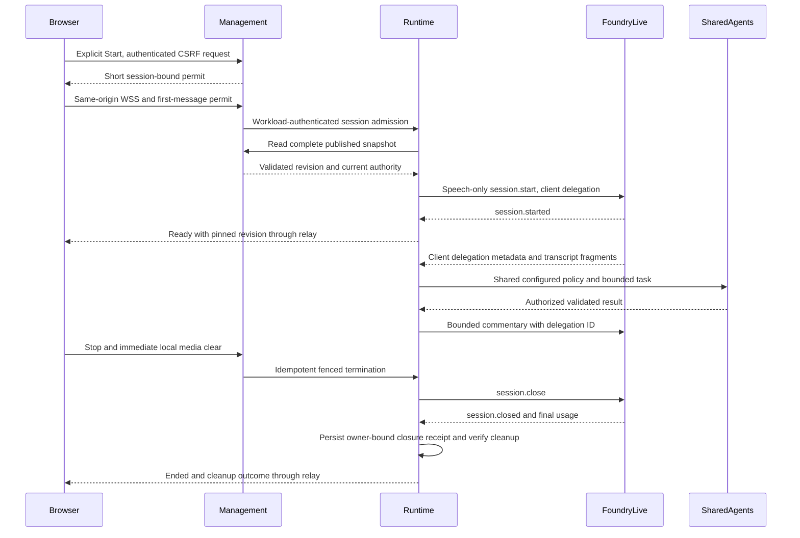

# Contract: Published Browser Tests and GPT-Live Client Delegation

**Version**: browser protocol `caller.test.v1`; new HTTP control routes `/v1`.
**Status**: Design, not an implemented/live-qualified interface. Configuration schema/HTTP v2
is independent of this first browser-test protocol. Both modalities use the same pinned
published graph and application-owned Agents backend, not provider Responses delegation.

## Service Boundary and Admission

Browser WSS terminates on the existing management origin so its HttpOnly `__Host-caller-session`
cookie and authorization remain applicable. Management is an authenticated bounded relay to
runtime's conversation WSS, not another agent executor. Runtime owns all admission, deadlines,
context, agent work and provider connections. This adds no service, hosting or telephony adapter.

1. Explicit Start calls management `POST /v1/test-tickets` with mode `text` or `speech` and
   random `requestId`; use existing manager cookie, permission, exact Origin and CSRF checks.
   Return a 30-second signed single-use permit, mode and fixed same-origin socket path with
   `Cache-Control: no-store`. Never return provider tokens. No model is allocated here.
2. Connect `WSS /v1/test-sessions` with subprotocol `caller.test.v1`. Before upgrade verify
   exact Origin, valid current cookie, manager/test permission and bounded connection capacity.
   Do not rely on Reflex's Socket.IO guard. Missing/null Origin rejects; do not allow wildcards.
3. First JSON message within three seconds is `authenticate` containing permit and `requestId`.
   Management verifies its signature/session/principal/mode binding, then forwards it through
   workload-authenticated `WSS /v1/internal/test-sessions`. Runtime verifies the management
   workload/audience and signed manager assertion; no browser-chosen identity is trusted.
4. Runtime atomically consumes nonce and reserves actor/global capacity, obtains the latest
   eligible publication through management's v2 API and starts the shared Agents backend.
   Speech additionally starts GPT-Live. Send `ready` only after all required resources are
   ready. Every step shares a ten-second admission budget; a failure initiates cleanup.

### One End-to-End Admission Deadline

Management owns the startup clock. At receipt of `POST /v1/test-tickets`, before authentication
or other awaited work, it records the request's start and fixes `admissionDeadlineUtc` to ten
seconds later. Speech obtains microphone permission before sending this request; an unanswered
permission dialog allocates no provider session and does not start the server admission clock.

Bind `admissionDeadlineUtc` and `requestId` into the signed permit. The permit's 30-second
validity is an anti-replay bound, not an extra startup allowance. Gateway authentication,
ticket issuance, socket upgrade, first-message verification, workload relay, snapshot read,
capacity CAS and model readiness all consume the same original budget. The first-message
timeout is the lesser of three seconds and the remaining admission time. Repeated delivery
of the same request/permit never resets the deadline or allocates another model.

Each service converts the trusted signed UTC deadline to a conservative local monotonic
remaining budget using an explicitly injected clock with a reviewed finite skew bound.
Reject untrusted clocks, excessive skew or backward time; never compare process-local
monotonic timestamps across machines. Child operations may shorten but never extend the
original deadline, including retries/conflicts and token acquisition. Management's own
monotonic ten-second timer remains the end-to-end response boundary.

If the deadline expires before `ready`, return the fixed unavailable/deadline outcome, fence
new work/output and begin idempotent cleanup. Cleanup has its separate existing ten-second
bound; it cannot delay the startup failure response or allow another session while closure is
uncertain. Controlled-clock tests must combine delays across both services, prove there is no
per-stage ten-second reset, and reject late readiness even if a provider call later completes.

After the initial `ready` transition, `admissionDeadlineUtc` is historical startup metadata,
not an active-session cutoff. Never renew it, start another admission period or consult its
expired value to reject later legitimate work. The original 600-second lifetime, 120-second
user-idle limit, authentication expiry and owner/epoch/terminal checks continue to apply.

No revision/community/agent/provider URL may be supplied by the browser. Snapshot cache
refresh is at most 30 seconds; stale, absent or invalid snapshots fail admission instead of
using fabricated configuration. Existing sessions keep their revision; current security checks
are still immediate. Authentication expiry/logout/permission loss ends the relay and runtime
conversation. The gateway revalidates the cookie during activity and at most every second,
independent of user-idle tracking. Failed control authority is a fail-closed terminal condition.

At most five occupied manager slots, one per stable authenticated tenant+actor across cookies,
tabs/devices/modes. Pending and cleanup-uncertain sessions occupy slots. Reject second starts
as `manager_busy`, never replace or resume. Limit pre-auth sockets to ten per process and two
per manager, with the three-second deadline and no waiting admission queue. Runtime rechecks
authoritative slot/epoch at admission, every action/output boundary and at most every second.

Permit verification uses an explicitly injected management signer and runtime verification
key allowlist, fixed RS256, fixed issuer/audience, expiry and nonce checks. No token-supplied
key URLs, implicit key discovery or algorithm negotiation. The reviewed existing secret/key
configuration must be provided before activation; planning provisions no key or secret store.
Foundry and service endpoints are exact reviewed HTTPS/WSS hosts and paths, with verified TLS,
no redirects, no browser-chosen URL and no ambient public-provider/default credential fallback.

The sequence shows speech; text omits every Foundry Live step and calls the same SharedAgents
path directly. Browser arrows from runtime represent messages through the management relay,
not an unauthenticated direct runtime endpoint.

## Application Wire Messages

Control JSON is UTF-8, strict object shape, maximum 8 KiB. Every post-auth client command has
`type`, positive monotonically increasing `sequence` and exact `sessionId`; server responses
include session ID, server sequence and current output generation. Duplicate accepted sequence
is acknowledged without repeating work; older unknown/out-of-order commands reject safely.

| Direction / Type | Required Payload Beyond Envelope | Meaning |
|---|---|---|
| Client `authenticate` | Signed `permit`, `requestId` | Only permitted pre-auth message. Never logged or sent to provider. |
| Server `ready` | `mode`, `revisionId`, `revisionNumber`, `agentId`, `expiresAt`, `idleExpiresAt`, bounds, audio format for speech | Published revision pinned, logical session admitted and required models ready. |
| Client `text.submit` | `text`, at most 4 KiB UTF-8 | Text mode only; accepted input resets user-idle. One pending input, reject excess as busy. |
| Server `text.delta` / `text.completed` | `messageId`, bounded `text`, generation | Visible shared-backend reply in text mode; no fabricated GPT-Live text turn. Total reply at most 64 KiB. |
| Server `transcript.delta` | `speaker`, bounded fragment, source timeline | Speech mode only, volatile display. Fragments are not authoritative turns, consent or successful tools. |
| Client `input.mute` | Boolean `muted` | Immediately stop/flush microphone transmission locally, then synchronize server/provider mute. Heartbeat/idle unaffected. |
| Client `output.interrupt` | Current generation | Immediately silence/clear local output; fence obsolete generation and delegated callbacks. Not automatic cancellation of an already authorized external read. |
| Server `generation.changed` | New generation and fixed reason | Old generation can never play or commit. Voice segment changes require the closure rules below. |
| Server `agent.changed` | Authorized agent/community IDs, generation | Trusted backend transition, never a browser request to bypass Routing. |
| Client `audio.played` / server `audio.credit` | Current `generation` and highest consumed `audioSequence` / bounded `availableSamples` and `acceptedAudioSequence` | Explicit flow control; reject stale-generation playback ACKs. Capture credits acknowledge the highest accepted input sequence so clients subtract unacknowledged input rather than double-grant credit. A send/append acknowledgement is not proof of audible playback. |
| Server `command.ack` | `acceptedSequence` | Acknowledge an accepted duplicate/control without repeating its work; not provider task completion or audible-playback evidence. |
| Client/server `ping` / `pong` | Bounded nonce | Transport liveness only; never resets user-idle or creates a new session. |
| Client `stop` | No content | Idempotent terminal request; immediate local capture/playback cleanup. |
| Server `error` / `ended` | Fixed `code`, `cleanupStatus`, correlation ID | No raw provider error, credential, tool payload or transcript. Terminal codes do not offer auto-resume. |

A work `error` may additionally include a bounded identifier `messageId`; no other optional
provider/body field is accepted. A busy rejection clears only its local pending marker, not
an external task or the existing active session. It is not a successful-action acknowledgement.

Binary audio frames carry a fixed big-endian header: protocol byte `1`, uint32 generation,
uint32 audio sequence, then raw mono PCM16LE at 24 kHz. Maximum PCM payload 1920 bytes
(40 ms), target 960 bytes (20 ms). Reject wrong mode, malformed/odd payload, impossible
generation/sequence, duration/rate or out-of-credit data. Decode/resample from actual browser
capture settings with a maintained audio conversion API; do not relabel 48-kHz samples as 24 kHz.
Raw browser audio is never a WAV/recording or Reflex state value. Request native AudioContext
at 24000 Hz and verify its actual rate before accepting frames; the browser resamples its input
track to that context. If unsupported, fail speech explicitly. Do not write a custom resampler
or introduce another speech provider to conceal incompatible device/context rates.

Capture queue at most 250 ms/12000 PCM bytes; playback at most 500 ms/24000 PCM bytes,
including worklet, network and relay buffers. Browser `bufferedAmount` and server transport
queues need explicit byte/deadline limits. Credits represent bounded duration, not arbitrary
message count. At most 64 pending control messages and one serialized writer per connection;
revoke credits and end visibly on sustained overflow. Provider event bodies are capped at
256 KiB before parsing/base64 allocation; split valid audio into app frames and enforce the
same aggregate queues. No unlimited socket default, hidden retry or full-recording buffer.

Browser text replies have an independent 64-KiB per-reply limit rather than sharing that limit
with user input. Volatile display context is at most 256 KiB with a 64-KiB speech transcript
portion, at most 128 rows and two active reply counters; role prefixes count toward context.
Adjacent same-speaker fragments can share a row without becoming authoritative completed turns.
Overflow fences and purges rather than silently trimming security context. Unfinished owned
relay disposal counts alongside active runners within its local five-resource admission cap.

Close codes: 1000 normal end, 1008 authentication/policy/protocol failure, 1009 oversized
message, 1011 internal/dependency failure, 1013 unavailable/busy. Send fixed app error/ended
when possible, but loss of that message never prevents local cleanup. Raw handshake errors
must not echo tokens or arbitrary headers. Permit material stays out of URLs/storage/telemetry.
Only a trusted pre-ready stable-actor refusal preserves fixed reason `manager_busy` with 1013.
It allocates no replacement and may show busy; unknown failures or post-ready connection loss
must not use that reason to claim complete cleanup. Lost confirmation stays pending with no
automatic restart. An unmounted engine loses DOM/Reflex callback authority while bounded
one-way cleanup may finish independently.

## Agent and Provider Execution

Use the existing Agents SDK, explicit asynchronous Foundry Chat Completions model/client,
server-owned configured deployment and management-published instructions/tools. Welcome,
Routing, ordinary agents and Goodbye are instantiated from the same publication for both
modes. One active agent owner, at most eight model/transition steps per request, no parallel
capability calls, at most one executing plus one pending delegation, and one shared ten-second
work budget. SDK/provider retries are zero for model/delegation work; authorization and
provider availability fail visibly, not via a different deployment or model.

### Phase-Aware Deadline Policy

| Phase / Activity | Applicable Deadline | What Must Not Happen |
| --- | --- | --- |
| Initial startup before `ready` | Original gateway-owned `admissionDeadlineUtc`, further bounded by authentication and any admitted slot's session limits | No new per-step startup budget, extended permit allowance or late readiness. |
| Accepted text/delegation or discrete active control work | Its immutable `workDeadlineUtc`, capped by current authentication, original session lifetime and current idle limits | No reuse of an expired startup deadline; queueing, model/tool steps, handover and segment continuation cannot reset the work budget. |
| Continuous active speech/media transport | Current authentication, original session lifetime and current idle limits, plus existing owner/generation/queue controls | Do not put an entire audio stream under a ten-second startup or work-item timer, or treat silence/agent output as user activity. |
| Ending / `cleanup_pending` reconciliation | Existing separate ten-second cleanup/reconciliation operation budget under trusted cleanup authority | Expired startup/work/session or manager-login timers cannot block one-way resource cleanup; cleanup cannot admit new business work, extend the session or bypass evidence checks. |

Runtime fixes `workAcceptedAt` and `workDeadlineUtc` when it first accepts validated text or
a client delegation into its bounded work queue. That is authoritative server acceptance,
before waiting for the executing item or invoking any model/tool. The work deadline is ten
seconds after that acceptance and never extends. Duplicate delivery of the same accepted
work ID retains its original deadline; each genuinely new accepted item has its own budget.
Browser timestamps, backend steps, retries, handovers and a new voice segment cannot choose
or refresh it. Discrete interrupt/handover control operations use the same bounded work rule;
stop is immediate fencing followed by the separate cleanup path.

Before each dispatch, derive remaining time from this phase-appropriate deadline and the
current security/session limits using the existing trusted-clock rules. A shorter remaining
lifetime or authentication/idle expiry wins; later input that extends idle never extends an
already accepted work deadline. Reject expired queued work before external dispatch. On work
expiry, produce the bounded safe failure, fence that work's output/actions and use the
existing cleanup/uncertainty rules rather than giving a child operation another ten seconds.
This changes no deadline duration or permission rule and does not relax the two-second
ordinary first-response target.

For example, startup accepted at time zero and ready at four seconds may handle a new request
at 60 seconds with a work deadline at 70 seconds, provided session/auth/idle checks pass.
Readiness first arriving after the original ten seconds still fails. Controlled-clock tests
must prove both cases, active media after startup expiry, queue-time consumption, no handover
budget reset and denial on work/auth/idle/lifetime expiry without waiting real minutes.

Use stateless provider calls with storage disabled where supported, volatile bounded local
history and no SDK-hosted trace upload. MCP/public tools remain application-executed through
the existing reviewed gateway; current revocation, source/target and owner/epoch checks run
immediately before every attempt. Model arguments are untrusted validated proposals. All tools
are public/read-only; provider-hosted tools and Responses delegation are not configured.

Speech connects only server-to-Foundry at the documented Live WSS path, sends `session.start`
with `gpt-live-1`, approved instructions/voice and explicit `{type: client}`, and waits for
`session.started`. Strictly validate returned mode/model. Provider input/output PCM follows
the dedicated Foundry 24-kHz guide. The initial voice instructions explain when to delegate;
they do not duplicate authoritative graph or capability policy.

At `session.delegation.created`, correlate its client target/ID with bounded input transcript
fragments and trusted state. Missing/ambiguous task text requires clarification, not a guessed
capability call. Execute shared Agents policy, validate/redact results, then append only needed
facts through `session.commentary.append` or `session.thinking.append`, with the exact ID.
Each append is at most 500 tokens; use the SDK tokenizer for the selected Live model or
a proven conservative bound of at most 500 UTF-8 bytes, not a character-count estimate.
No browser/provider claim authorizes tools or an agent transfer.

`session.input_audio.mute/unmute` and their acknowledgements may synchronize mute. No
`response.create`, `response.item.create`, Responses tools or Realtime cancel/clear events
belong to this adapter. Append acknowledgement is not consumed/spoken success. Voice usage
is cumulative: retain the latest/max confirmed snapshot, never sum snapshots; separate shared
reasoning usage comes from its own model result, not Responses-delegation envelopes.

## Interruption, Deadlines and Cleanup

Local stop/interrupt/track loss/navigation clears scheduled audio and capture immediately,
without waiting for a round trip. Browser discards every stale session/generation frame;
runtime tags audio with the generation bound to its actual provider socket. Never relabel
late output. Retire/fence a segment for an application-directed handover/explicit interruption
and confirm its closure before a continuation segment is allowed. No fault-driven reconnect;
uncertainty ends the test while retaining occupied cleanup capacity. All segments share the
same logical session, pinned revision and original deadlines. Natural interruption also
requires actual one-second audible-cutoff evidence, not an inferred provider guarantee.

Server-side transcript speech evidence from accepted audio or accepted text updates user-idle;
client heartbeat/activity flags cannot extend it. Ten-minute lifetime, two-minute user-idle
and earlier identity expiry end processing. Stop/expiry cancels pending work, fences actions
and output, disposes owned SDK/transport/device resources exactly once, and verifies cleanup
according to the resources actually attempted. For an attempted Live segment, send
`session.close` and wait within the original ten-second cleanup budget for `session.closed`;
text-only tests never create a Live session just to obtain a closure receipt. Uncertain work
or missing applicable evidence leaves the slot occupied; unconfirmed usage is reported unknown.
Metadata-only reconciliation never replays tools or adopts an orphaned voice session.

### Closure Receipts and Trusted Reconciliation

#### Resource-Aware Cleanup Evidence

Use a strict `CleanupEvidence` discriminated bundle bound to the logical test, declared mode,
owner/epoch, current generation, observation time and authoritative attempt watermark. The
verifier derives the required evidence from persisted allocation history, not a caller's
chosen kind or the absence of a provider ID. Every terminal release requires a fenced terminal
conversation, no pending/executing work, verified resource disposal and an exact conditional
authority update. No terminal release is permitted while a dispatch or allocation is uncertain.

| Evidence Kind | Required Authoritative Proof | Release Rule |
|---|---|---|
| `no_external_attempt` | Persisted zero-attempt history and a terminal fence that prevents subsequent dispatch; no model, Live or capability attempt was recorded | A failed start may release without any provider receipt, only after locally owned resources/work are disposed. Missing/corrupt history is not proof of zero attempts. |
| `work_disposed` | Complete settled-through attempt watermark, verified SDK/model/tool completion or definitive terminal outcomes, no unresolved request/task, disposed transports and proof no Live allocation was ever attempted | Text completion/stop may release and permit a new explicit start. This also covers a failed speech start that attempted only non-Live work. Local cancellation alone is not settlement or proof of a remote outcome. |
| `speech_session_closed` | Exact authenticated Live closure receipt for the current/last attempted segment, verified settled non-Live work and disposal, with prior retired segments already conditionally closed | Retain the speech receipt checks below. One segment's close during handover never releases an active logical conversation. |

#### Persist Allocation Attempts Before External Work

Before any external model/tool invocation or Live connection attempt, conditionally persist
an attempt intent in runtime's existing authority with session, mode, owner/epoch, resource
kind and a monotonic attempt sequence. Dispatch only after that write is confirmed and the
owner/epoch, phase-appropriate deadline and terminal fence still permit it. Before initial
readiness use the original admission deadline; after readiness use the active work/session
rules above, never the expired startup timer. A lost write reply requires
a Strong read before deciding; it never grants permission to dispatch or assume no attempt.
The terminal-fence CAS and dispatch-intent CAS must be mutually exclusive for that owner/epoch.

Keep bounded monotonic attempted/settled-through watermarks and at most one unresolved intent
per resource kind (`model`, `capability`, `live`), not an unbounded per-request journal. Persist
settlement/disposal observations from trusted adapters before recording `work_disposed`.
This metadata and at most one current evidence bundle per slot share the existing 128-KiB
authority cap. No prompts, arguments, results, recordings or raw provider errors are stored.

Never reset attempts or infer settlement on restart, timeout, empty process-local maps, lease
expiry, a missing provider ID, socket disposal or a cancellation request. An attempt recorded
but not known to have reached the provider remains uncertain until verified; this deliberately
favors safety over reclaiming capacity. Do not retry external work to produce missing proof.

#### Speech Closure Receipts

The provider adapter binds each authenticated Foundry WSS connection to the `session.id`
confirmed by `session.started`, logical test ID, voice-segment generation and owner/epoch.
Only observing a valid `session.closed` on that exact connection creates a closure receipt.
The receipt contains those bindings, observation UTC time, fixed close reason and latest
confirmed usage/usage-status metadata; never persist the raw event, audio or transcript.
TCP close, socket disposal, timeout, lease expiry and browser claims are not closure evidence.

Persist the receipt through the authenticated runtime owner into the existing runtime-owned
admission authority with conditional writes and exact owner/epoch matching. Retain at most
one current-segment receipt per occupied slot within the existing 128-KiB authority limit;
confirmed retired-segment evidence can be replaced only as part of the conditional transition
to the next segment. Lost/cancelled receipt-write replies require a Strong read, not another
provider request or blind capacity release.

Define the injected `CleanupReceiptVerifier.verify(slot, evidence, deadline)` contract with
fixed `verified`, `unknown` or `rejected` results. It independently reads trusted persisted
evidence provenance and attempt history, validates the matching resource-specific kind above,
and checks the exact test/mode/owner/epoch/watermark and valid observation time. Attempted
Live segments additionally require the matching provider-session/segment closure receipt.
For terminal release it also confirms the conversation is fenced terminal and all owned
model/work resources are settled and disposed; speech proof is not required for text-only
or verified never-attempted starts. A claimed text/no-attempt kind cannot hide a recorded
Live attempt, unfinished request or stale owner/epoch.
Only a verified result permits the matching conditional release or segment transition.
Duplicate verification/release is idempotent; stale/foreign/malformed evidence never renews
ownership, releases another slot or authorizes new work.

On owner restart or an ambiguous release write, metadata-only reconciliation rereads the
exact authority, attempt history and applicable evidence, then repeats verifier/CAS within ten
seconds. A verified zero-attempt state or settled text evidence can recover without a Live
receipt; uncertain recorded attempts cannot. Reconciliation remains bounded by the operation
budget. It never reconnects/adopts the old voice session or replays tools. Missing evidence
remains `cleanup_pending` and occupied. Alert the application maintainer using the existing
sink/runbook; a separately authenticated and reviewed operator recovery may supply independently
obtained resource-specific settlement/closure evidence to the same verifier, without altering
the authoritative attempt history. No force-clear, TTL reclaim,
invented provider-status API or unverified operator assertion is permitted. If no qualifying
evidence exists, capacity remains blocked and its uncertainty is reported explicitly.

Tests cover text completion/stop then a new explicit start with zero Live connections;
failed admission before any external attempt; attempted/ambiguous startup that stays occupied;
dispatch versus terminal-fence races; trusted settlement and speech receipt persistence;
reconstruction/lost writes; exact repeated release; stale/foreign/wrong-kind or watermark
evidence; late callbacks; absent applicable proof; and rejection of lease/TCP-close-only claims.
Use controlled clocks and short actual-transport cases, not real-time endurance sleeps.
Controlled receipts
prove the application contract, not actual Foundry closure or billing qualification.

Browser Stop remains usable during unanswered permission dialogs; late returned tracks are
stopped. Feature-detect output routing, resume AudioContext from the gesture, show denied/
unavailable/autoplay/device-loss states truthfully and retain no content in browser storage.
No automatic post-terminal start or action. Clear volatile content immediately where possible,
always within five minutes, even when provider cleanup metadata remains pending.

## Required Evidence

Automate origin/cookie/permit expiry/replay and cross-audience denials, concurrent starts from
independent runtime instances, five-slot saturation/uncertain closure, sequence duplicates,
queue overflow, stale generations, mutation races, deadlines and metadata-only telemetry.
Use controlled provider transcripts matching the actual documented Live protocol; do not
invent complete-turn/clear events. Qualify actual supported browsers/headsets/Foundry separately
with recorded versions, original one-/two-/ten-second goals and zero telephone-service calls.
