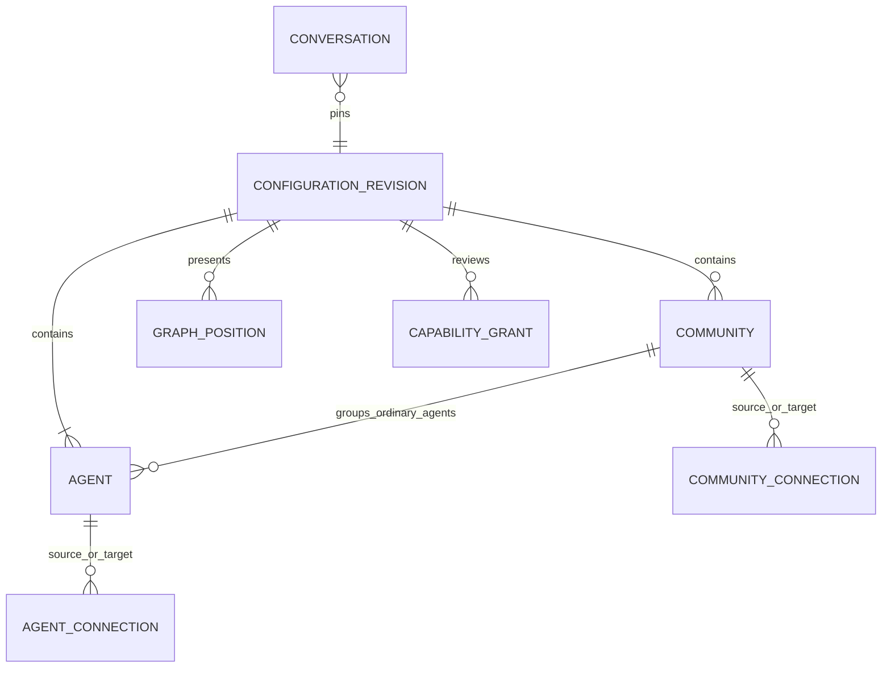
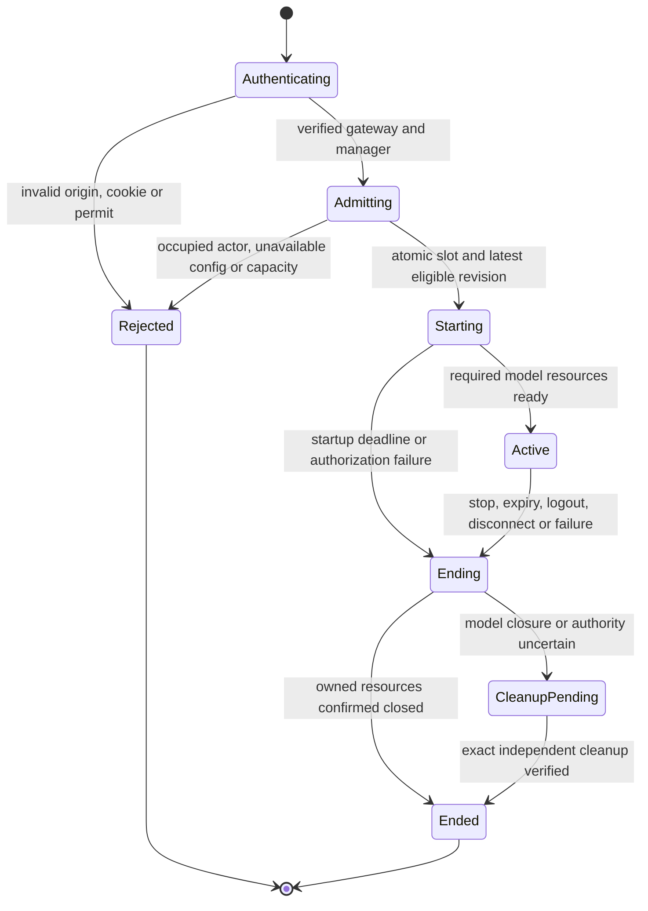

# Data Model: Published Graphs and Browser Conversations

**Status**: Phase 1 design, not an implemented schema. Read with [configuration contract](contracts/configuration.md)
and [conversation contract](contracts/conversation.md). The user approved a separate Foundry
reasoning/text deployment for the shared Agents backend; GPT-Live remains speech-only.

## Ownership and Versioning

Management owns configuration, publication, current reviewed grants and audit. Runtime owns
conversation/admission metadata and volatile execution context. Neither service reads the
other's private Cosmos container. One organization, `default`, remains the release boundary.

Publish configuration schema `2.0.0` and expose its breaking snapshot through versioned v2
configuration endpoints. No old publications exist; reject schema 1 rather than translating,
resetting or auto-migrating it. This fresh-start disposition is the compatibility plan.
Capability/revocation contracts remain at their existing versions unless their payload truly
changes. No executable schema, legacy task or private store is changed during planning.

## Configuration Entities

Identifiers retain the existing `[A-Za-z0-9][A-Za-z0-9_-]{0,127}` rule. Objects forbid unknown
properties, enforce UTF-8 byte limits and reject nonfinite numbers. Existing stricter repository
limits prevail; do not enlarge an old budget to accept a new payload.

| Entity | Fields and Relationships | Validation |
|---|---|---|
| Community | Existing `communityId`, `name`, `routingDescription`, `enabled`, `entryAgentId` | At most 50. Nonempty name up to 128 characters; description at most 4 KiB. Entry references an ordinary member; an enabled community requires enabled entry. |
| Agent | Existing `agentId`, `name`, `prompt`, `enabled`, `role`, `communityId`, `capabilityAssignments` | At most 200; prompt at most 16 KiB. Ordinary agents belong to exactly one existing community. Global Welcome/Routing/Goodbye occur exactly once each, remain enabled and have null community membership. |
| AgentConnection | Retain `relationships` and existing relationship ID/source/target/allowed-context fields | Endpoints are distinct ordinary agents in the same community. No duplicate ordered pair. Allowed transfer context is only `request_summary` and `transfer_reason`, bounded to 2 KiB total. Enabled use requires both endpoints enabled. |
| CommunityConnection | New `connectionId`, `sourceCommunityId`, `targetCommunityId`, `allowedContextFields` | Distinct existing communities; unique ID and ordered pair. Direction does not imply its inverse. Initial Routing selection is not an edge. Transfers require enabled destination and its eligible entry. |
| GraphLayout | New `layout`, with `communities` positions and `agentsByCommunity` positions | Positions are `{nodeId, x, y}` with finite coordinates from -100000 through 100000. Each ID appears once and belongs to that view. No credentials, permissions or semantic attributes. Missing positions receive deterministic local layout. |
| Tool/MCP catalog | Existing definitions, endpoint references, reviewed public/read-only schemas and assignments | Preserve current review, public-destination, credential-reference and action/input/output restrictions. No arbitrary URL or browser-authored tool may execute. At most 128 effective tools per agent/model request. |
| ConfigurationRevision | Existing server-owned ID, organization, revision number, created-at/by and `graphHash`; schema `2.0.0`, complete graph plus layout | At most 512 KiB encoded document and 1000 total directed connections. Canonical full hash includes layout; permissions are derived only from semantic graph/grants. Client cannot choose provenance, active revision or security version. |

Disabling a node does not silently delete its connections; unusable paths remain visibly
disabled. Removing referenced nodes requires explicit connection/entry repair in the same
draft. Self, duplicate, dangling and cross-community agent edges reject publication. A disabled
community may retain its valid disabled entry reference but cannot admit a conversation.

## Editor and Publication State

`EditorDraft` owns the entire organization graph across routes, its base ETag, dirty flag,
pending command and validation/conflict state. Route parameters select a view, never an
alternative draft or runtime entry. Node dragging commits only final bounded coordinates.
Connection edits are explicit commands revalidated by server-owned domain rules.

Save validates and conditionally publishes the complete revision, pointer and current security
authority atomically in management's existing partition. Old ETag means conflict with the draft
retained, not merge or overwrite. Navigation preserves the draft; reload/leave/discard requires
explicit confirmation where the browser supports it, with deterministic in-app confirmation.
Layout-only publication may create a new revision but cannot create or revoke permissions.

## Runtime Metadata

| Entity | Persisted Fields | Invariant |
|---|---|---|
| TestAdmissionAuthority | Fixed `browser-test-authority-v1` ID in runtime's existing private session container; schema, organization, ETag, UTC high-water, bounded slots, consumed permit digests, attempt/settlement metadata and resource-aware cleanup evidence | Strong read plus conditional replace; at most five occupied slots across runtime instances. No TTL-driven capacity release or automatic recreation when missing/corrupt. Explicit initialization only. |
| TestSlot | Random session ID; pseudonymous stable tenant+actor key; mode; admission/auth/idle deadlines; owner and epoch; pinned revision; terminal fence; attempted/settled-through watermarks; unresolved intents; Live-ever-attempted flag; cleanup state | Actor key is derived server-side from verified tenant/actor, independent of cookie/tab/device. Pending and uncertain-cleanup slots count as occupied. One logical conversation and active agent owner. |
| StartPermit | Nonce digest, short expiry, verified principal/auth expiry, mode, management-session digest, target runtime audience, signature, request ID and signed `admissionDeadlineUtc` | Signed by management, 30-second validity, single-use by runtime CAS. Browser receives no provider/workload credential. Never put permits in URLs or logs. Bound to the current verified management cookie at the gateway. |
| ConversationMetadata | Session/owner/epoch, current community/agent, pinned configuration, mode, deadlines, output generation, fixed terminal outcome and minimal usage counters | No audio, transcript, assembled prompts, tool arguments/results or complete browser message bodies. No TTL or restart alone proves physical/provider closure. |
| CleanupEvidence | Strict kind `no_external_attempt`, `work_disposed` or `speech_session_closed`; logical test/mode/owner/epoch/generation, observed time, attempt watermark and applicable trusted disposal/closure proof | At most one cleanup-evidence bundle per occupied slot within the existing 128-KiB authority cap. Match the session, mode, owner/epoch and current attempt watermark; uncertain evidence never releases capacity. |
| ClosureReceipt | Speech-only evidence containing logical test/provider session IDs, segment generation, owner/epoch, authenticated observation time, fixed close reason and confirmed usage/status | At most one current-segment receipt per occupied slot within the 128-KiB authority cap. For an attempted Live segment, require authenticated exact-session closure evidence. Text and no-attempt releases use their verified resource-specific evidence instead. |
| DelegationWork | In-memory session/owner/output generation, provider-segment/delegation ID, task ID, `workAcceptedAt`, immutable `workDeadlineUtc` and idempotent result state | At most one executing work item and one pending per conversation. Duplicate provider delegation IDs do not rerun work. Epoch/auth/current-grant checks precede any commit or capability attempt. |
| VolatileContext | Bounded agent history, transcript fragments and temporary sanitized tool results | At most 256 KiB/session including text history, at most 64 KiB transcript portion. Bound per-agent prompt/model tokens separately; overflow fails safely rather than silently dropping security context. Clear on termination and always within five minutes. |

Authority document cap is 128 KiB, at most five slots and 100 unexpired consumed permit
digests. Purge expired nonce digests only after their signed permit expiry; retain uncertain
slots until independent cleanup verification. Authority loss stops processing and admission.
Bound conditional conflicts to four attempts inside the original ten-second operation deadline.
Do not renew a conversation or release a slot merely because an owner lease expires.

Before any external model/tool invocation or Live connection attempt, persist an owner/epoch-
bound intent and confirm it before dispatch. Store monotonic attempted/settled-through
watermarks and at most one unresolved intent per resource kind (`model`, `capability`, `live`),
not an unbounded history. A lost intent-write reply requires a Strong read; it is not permission
to dispatch or claim no attempt. Terminal-fence and dispatch-intent CAS prevent new attempts
after ending. Settled observations and disposal proofs are trusted metadata, never raw payloads.

The independent injected `CleanupReceiptVerifier.verify(slot, evidence, deadline)` derives
the required kind from this authoritative history. `no_external_attempt` requires zero
recorded attempts, a terminal dispatch fence and verified local disposal; only then can a
failed start release without provider proof. `work_disposed` requires all recorded non-Live
work definitively settled/disposed, no pending request/task and proof no Live allocation was
ever attempted; text stop/completion can therefore release and permit a new explicit start.
A recorded/ambiguous attempt, cancellation request or empty local cache is not zero-attempt
or settled proof, even after an owner restart or lease expiry.

For `speech_session_closed`, persist a receipt only from valid `session.closed` observed on
the exact authenticated provider connection bound at `session.started`; verify its full
test/provider-session/segment/owner/epoch/time and settled non-Live work. All terminal releases
require a terminal logical conversation and verified disposal; a handover segment's receipt
cannot release an active logical slot. Reconcile Strong reads and idempotent CAS after lost
writes/restarts, never socket adoption/tool replay. Missing applicable evidence stays occupied
and alerts the maintainer; reviewed operator recovery must supply independently obtained
matching resource-specific evidence without resetting history. No force-clear or fabricated
Live session/receipt for a text-only test.

Only fixed metadata needed for cleanup/usage survives termination. Retain active/uncertain
metadata without automatic expiry; after confirmed cleanup use the existing reviewed runtime
metadata retention policy, never a new transcript-retention policy. The operator must supply
that reviewed setting before live activation. Local doubles remain isolated and disposable.

## State Transitions

Admission time starts the 600-second lifetime and 120-second idle clock. The earlier verified
authentication expiry wins. Only accepted text or server-observed input speech resets idle.
Neither modality changes nor voice-segment changes reset these deadlines. No resume, takeover,
replacement or automatic reconnection is supported. Late SDK/tool/audio callbacks cannot
advance a terminal or stale-epoch conversation.

The admission operation has a separate gateway-owned ten-second startup deadline, fixed on
receipt of the ticket POST before awaiting authentication and propagated in the signed permit.
The first-message timeout is min(three seconds, remaining startup time); 30-second permit
validity does not extend startup. Each service derives a conservative monotonic remaining
budget from the signed UTC boundary and its trusted bounded-skew clock. Waiting for browser
microphone permission occurs before the POST and allocates no session. If the startup deadline
expires before initial `ready`, reject that startup and retain any uncertain cleanup slot.
After initial `ready`, the original startup deadline is historical and cannot reject later
legitimate requests or active media; it is never renewed or reused as a session cutoff.

For accepted text, client delegation or discrete active control work, runtime fixes
`workAcceptedAt` on first validated acceptance into its bounded queue and `workDeadlineUtc`
ten seconds later. Queueing counts. Duplicate work IDs retain their original deadline; a new
accepted item has a new budget, not another admission period. Model/tool steps, handover,
segment continuation and idle refresh never extend the existing work deadline. Dispatch uses
the lesser of remaining work time, authentication expiry and original lifetime/current-idle
limits; initial pre-ready work is additionally bounded by the original admission deadline.

Continuous active media is subject to authentication, session/idle, owner/generation and buffer
controls, not a ten-second work-item or historical startup timer. Terminal fencing still denies
new business work. One-way cleanup/reconciliation uses its separate ten-second operation
budget under trusted cleanup authority even after startup/work/session/auth expiry; it cannot
extend the conversation or bypass resource-specific evidence requirements. Validate a normal
request at simulated time 60 seconds after ready at four seconds, along with expired startup,
work/queue, authentication, idle and lifetime cases and cleanup after those expiries.
Routine tests advance controlled clocks through these bounds rather than waiting in real time.

## Voice Segments and Ownership

A speech conversation owns one provider segment at a time, identified by an application
generation bound to its socket. GPT-Live has no documented app generation tag or Realtime
clear/cancel primitive. Never relabel late provider output with a new generation.

Application-directed handover or explicit interruption first fences/clears playback, retires
the old segment and confirms closure before creating an authorized continuation segment.
The logical test, revision, actor slot and deadlines remain unchanged. Transport failure or
uncertain closure is terminal/unavailable, not permission to open another billed segment.
Natural full-duplex interruption must also pass the one-second qualification; provider behavior
alone is not evidence that local buffered audio or delegated work was cancelled. A bounded
250-ms capture buffer during a transition may overflow; overflow ends safely rather than
retaining an unbounded recording. This conservative strategy must meet the original latency
goals in actual qualification or remain blocked, not receive a timeout waiver.

## Retention and Diagnostic Boundaries

Manager-authored published prompts and graph positions are durable configuration, not retained
conversation content. Browser history is memory-only, cleared on stop/navigation/auth loss,
with no local/session storage, recording, crash report payload or persisted SDK session.
Both services emit fixed content-free lifecycle, authorization, delegation, latency and quota
signals. Correlation IDs are bounded and validated; actor/session/tool identities never become
unbounded metric labels. Foundry processing/residency/abuse-monitoring terms need a separate
review before sending real content; application non-retention is not a provider zero-retention claim.
