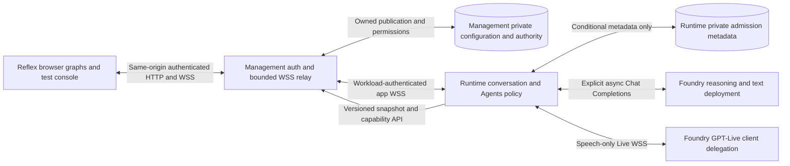

# Implementation Plan: Unified Multimodal Agents and Management

**Branch**: `main` (unchanged) | **Feature**: `002-multimodal-agent-management`
**Date**: 2026-10-29 | **Spec**: [spec.md](spec.md)

**Input**: The feature specification, its recorded clarifications and the current
[constitution](../../.specify/memory/constitution.md).

**Status**: Phase 0 resolved by explicit user approval of a shared Foundry reasoning/text
backend. Phase 1 design complete for task generation; implementation, actual Foundry/device
qualification and live activation are not performed or authorized by this planning command.

## Summary

Deliver editable community and agent graphs, a published-configuration text/speech browser
test console, a unified application-owned delegation backend and root-level repository docs.
Only Foundry GPT-Live client delegation is permitted for the speech integration; Azure Voice
Live, provider Responses delegation, telephony and hosting-specific work remain excluded.

First-party documentation confirms `gpt-live-1`, Foundry's Live endpoint and client delegation.
It also states that GPT-Live outputs voice and delegates reasoning/tool work to a separate
application backend. The user explicitly approved a separate Foundry reasoning/text deployment
for one shared Agents backend. Text calls it directly; speech reaches it through GPT-Live
client delegation. See [research.md](research.md) for evidence and the resolved decision.

## Technical Context

**Language/Version**: Current project pins are Python 3.12.15; all three manifests require
`>=3.12,<3.13`. Preserve user-owned version changes; this planning command upgrades nothing.

**Primary Dependencies**: Existing FastAPI 0.143.2, Starlette 1.8.0, Pydantic 2.14.1,
HTTPX 0.28.1, websockets 16.1.1, Reflex/reflex-base 0.10.0, Azure Identity 1.26.0,
Cosmos SDK 4.17.1 and OpenTelemetry 1.45.1. Backend locks OpenAI 3.31.0 and Agents SDK
0.24.0, but that is not proof of GPT-Live compatibility. No SDK upgrade is selected.
Use an OSS `@xyflow/react` Python Reflex component wrapper and native AudioWorklet/WebSocket
browser bridge. Resolve and lock compatible dependency versions during implementation, testing
React 19.3/Reflex 0.10 SSR and accessibility before adoption; no Enterprise license is assumed.
Use native AudioContext at verified 24 kHz to avoid a hand-written resampling engine; unsupported
context rate fails speech explicitly instead of mislabelling samples. Maintain existing locks
and upgrade nothing merely because provider documentation uses a different SDK example.

**Model Integration**: Foundry `gpt-live-1`, explicit `delegation.type=client`, trusted backend
WebSocket at `/openai/v1/live/sessions`. Dedicated Foundry documentation specifies 24-kHz mono
PCM16LE and client-delegation metadata/context events. Do not copy Realtime or Responses
delegation events into this contract. The shared reasoning backend uses an explicit Agents SDK
`OpenAIChatCompletionsModel`, asynchronous Foundry v1 client and operator-approved text/tool
deployment. Live transport uses the existing maintained `websockets` dependency directly.
Entra scope is `https://ai.azure.com/.default`; credentials are explicitly injected and bounded,
never discovered by default startup. No implicit public model, SDK tracing or provider storage.

**Storage**: Management owns one `default` organization, complete published configurations,
current capability authority and audit. Runtime consumes authenticated management contracts;
it must not directly read management's Cosmos store. Runtime owns conversation/admission
metadata. One-active-test-per-manager requires shared conditional actor-keyed authority, not
per-tab/cookie/process dictionaries. Conversation content remains volatile and unlogged.

**Testing**: Existing pytest 9.1.1, pytest-socket, HTTPX ASGI tests and Playwright 1.64.0.
Reuse schema/publication/conflict/permission/audit/editor tests and add app-owned standard
WebSocket, graph keyboard parity, microphone lifecycle and manager-wide admission contracts.
Synthetic protocol tests do not establish actual Foundry or audio-device qualification.

**Target Platform**: Existing Windows/Linux development workflows; audio acceptance is stable
desktop Edge on Windows and Chrome on Windows/Linux with recorded versions. Responsive
360/768/1440 layouts are required; mobile audio qualification is not. No hosting platform
selection, cluster work or deployment is part of this feature.

**Project Type**: The existing independently packaged runtime and Reflex management services,
plus development tooling. Do not create another frontend application or deployed service.

**Performance Goals**: Five concurrent distinct managers for ten minutes; p95 ordinary input
completion to first relevant text/audio response at most two seconds, excluding external-action
waits. Audible stop/interruption at most one second; failure/admission outcomes at most ten
seconds; content disposal at most five minutes. These remain measurement targets, not claims.

**Constraints**: One active test per manager across modes/tabs/devices, 600-second lifetime,
120-second user-inactivity deadline. Only accepted text/detected user speech resets idle.
No automatic restart, model credentials in the browser, sensitive diagnostic payloads,
unbounded audio buffers, public/private mutating tools or cloud activity from default startup.
All three explicit PR exclusions remain hard constraints.

**Scale/Scope**: Fresh-start configuration; no existing publications or legacy migration.
Two editable graph levels, equivalent keyboard/forms, both test modes and one root docs tree.
Configuration schema/HTTP v2 is a documented fresh-start break; the new browser protocol is
`caller.test.v1`. Text uses ordinary shared-backend execution, not invented GPT-Live text events.

## Constitution Check

| Principle | Current Planning Assessment |
|---|---|
| I. Azure-first | First-party model/API, regional availability and published quota evidence support the GPT-Live design. A separate shared Foundry reasoning/text backend is user-approved. Actual deployed versions, identity/access, available capacity and lifecycle/retention terms remain separately authorized live-activation checks, not a blanket local-implementation prerequisite. |
| II. Security-first | Retain verified manager/runtime identity, server-side credentials, current capability checks, content exclusions and bounded actor-keyed admission. Operational qualification remains separate. |
| III. Documentation | This plan/research, data model, two contracts, quickstart and Mermaid boundary/lifecycle/sequence diagrams describe the same change. Root docs move is planned, not performed. |
| IV. Bounded microservices | Preserve private-store ownership. Document an explicit fresh-start versioned contract break and rejection of old payloads; the user confirmed no compatibility/migration obligation or existing publications. |
| V. Python/Reflex | Python service logic and Reflex-authored UI retained. Thin framework-generated browser API/component glue is not permission to author a separate React app. Compatibility remains a test gate. |
| VI. Bounded real-time behavior | Preserve measured goals, shared manager admission, epochs, deadlines and bounded queues. Do not expand into hosting-specific scaling or old phone workloads. |
| VII. Observability | Require both-service content-free correlation, fixed event categories and app-level signals. No new hosting-specific collectors or alert infrastructure are planned. |
| VIII. Terraform | No infrastructure change is required or authorized in this PR. Existing infrastructure is untouched except incidental documentation-reference updates if necessary. |
| IX. Automated tests | Plan contract/unit/integration/browser tests and separate authorized service/device verification. No test has been executed or passed by this planning command. |

**Gate result**: Design-level GPT-Live evidence is verified in the official
[regional model catalog](https://learn.microsoft.com/en-us/azure/foundry/foundry-models/concepts/models-sold-directly-by-azure-region-availability?tabs=az-americas&pivots=standard)
and [published session limits](https://learn.microsoft.com/en-us/azure/foundry/openai/quotas-limits#gpt-live-concurrent-session-limits),
alongside the API/client-delegation sources in [research](research.md). The catalog lists
`gpt-live-1`, version `2026-09-10`, under Global Standard in `canadacentral`, `centralus`
and `eastus2`; the default non-tiered limit is ten concurrent sessions versus the app's five.
Global Standard availability is not a region-local processing guarantee or proof of unused
subscription capacity. No constitutional waiver or live-access grant is requested.

This evidence supports local implementation and the architectural availability/region/quota
assessment without requiring an existing deployed resource. Verify the selected reasoning/text
deployment's supported model capabilities and published limits before approving that binding;
check both actual deployments, Entra access, available quota, lifecycle/preview and processing/
retention terms before separately authorized live activation. Browser devices, real latency,
capacity and alert delivery remain measured acceptance gates, not inferred from documentation.

**Post-design recheck**: PASS for scoped local design against all nine principles;
no new service, direct private-store access, alternate frontend, infrastructure or excluded
speech service. This does not certify constitutional production gates: actual available
deployment/region/quota/lifecycle, security/retention review, capacity, alert delivery and
supported-browser audio remain blocking evidence requirements before affected live approval.

The earlier analysis's blanket C1 implementation blocker conflated published design evidence
with subscription-specific activation evidence. This distinction corrects that finding without
changing the constitution or asserting that any live verification has passed.

## Project Structure

### Documentation (this feature)

```text
specs/002-multimodal-agent-management/
  spec.md
  checklists/requirements.md
  plan.md
  research.md
  data-model.md
  contracts/configuration.md
  contracts/conversation.md
  quickstart.md
```

The data model, contracts and quickstart are Phase 1 outputs. Implementation tasks are
generated afterward by the tasks workflow, not by this planning command.

### Source Code (repository root)

```text
code/backend/src/caller_runtime/
  api/          authenticated app conversation ingress, independent of telephony
  domain/       published graph and application session/epoch rules
  services/     shared delegation/agent policy and manager admission
  adapters/     Foundry Live, shared text-model and runtime admission adapters
code/management/management_app/
  pages/        community overview, selected-community agents, test console
  state/        shared draft, explicit graph edits, conflict preservation
  api/          existing authenticated configuration/capability ownership
  security.py   raw WebSocket admission must not assume Reflex transport protection
code/contracts/     implementation home for generated schema and executable contract tests
code/tools/scripts/ documentation discovery/reference-validation updates
docs/               proposed single maintained documentation home
```

**Structure Decision**: Reuse the two services and their independent locks. Only application
behavior and required docs-path/verification updates are in scope. No telephony adapter,
Kubernetes/runtime hosting feature, infrastructure definition or deployment is added.

## Complexity Tracking

No added service, compatibility layer or constitution exception is proposed. The shared
reasoning/text deployment was explicitly approved; it is not a GPT-Live speech replacement.

## Architecture and Execution



Management serves the only browser-facing test socket, verifies existing cookie/session and
Origin/CSRF, and relays bounded binary/control traffic using workload authentication. Runtime
atomically admits by stable actor, pins the latest eligible revision through management,
instantiates published Agents and runs one shared text/reasoning policy. Text allocates no
speech session. Speech streams the documented Live protocol and sends client-delegated work
through the same policy. Neither browser claims nor model tool proposals grant authority.

An actor-keyed slot and fixed five-slot runtime authority use Strong reads/conditional writes
in runtime's existing private Cosmos container; local tests use controlled ports. Unknown
closure remains occupied. Authentication, model, graph, capability and ownership failures
remain unavailable/denied; there is no ambient credential discovery, default public model,
provider fallback, task replay, fault reconnection or private management-store access.

The graph draft persists across community routes. Layout commands mutate coordinates only;
directed semantic edits require explicit validation. Runtime separates initial Routing from
source-preserving community transfers and same-community discovery from handover permission.
All ordinary/session behavior is revision-pinned; security uses pinned/current/reviewed grant
intersection before each capability through the existing management gateway.

Provider transcript fragments and append acknowledgements are not task text, complete turns,
consent, task completion or audible success. Correlate provider delegation IDs and app state;
ambiguous requests need clarification. Use one executing/one pending work item, eight model/
transition steps maximum, no parallel tool actions, zero model retries and the original
ten-second work deadline. Use fixed safe errors, disable hosted SDK traces and provider
request storage where supported, and retain only bounded volatile conversation context.

App-directed interruption/handover fences output and retires the actual voice socket's
generation. New authorized continuation segments are allowed only after confirmed old closure;
fault/unknown closure ends the test, not a reconnect. Never label late old-socket output as
current. This conservative implementation must pass actual latency/audio targets; provider
natural interruption does not prove local playback or backend work was cancelled.

Management owns one ten-second admission deadline starting when it receives the ticket POST,
before authentication awaits. Microphone permission precedes that request. The signed permit
binds `admissionDeadlineUtc`/request ID; authentication, relay, snapshot, CAS and model readiness
consume only its remaining time. Thirty-second permit validity and the three-second first
message limit never restart it. Use trusted bounded-skew clocks/local monotonic timers;
fence late readiness and respond on expiry without waiting for the separate cleanup budget.

Apply the [phase-aware deadline policy](contracts/conversation.md#phase-aware-deadline-policy):
the admission deadline applies only before initial readiness and becomes historical afterward,
without renewal. Runtime gives each validated text/delegation/discrete-control item one
immutable ten-second `workDeadlineUtc` from first queue acceptance (`workAcceptedAt`), including
queueing, model/tool steps, handover and segment continuation. Duplicate work keeps its original
deadline; current authentication and original lifetime/idle limits may shorten but never extend
it. Continuous active media uses session/auth/idle and ownership/buffering controls rather than
the expired startup timer or a whole-stream ten-second work cap. Cleanup remains a separately
bounded one-way operation under trusted cleanup authority after any of these expiries, not a
path to new business work. Fast clock-driven regressions must accept valid work/media one
simulated minute after readiness and reject late startup, expired queued/work items and
auth/idle/lifetime expiry, without resetting clocks or changing the response/capacity targets.

Use resource-aware `CleanupEvidence` and the injected
`CleanupReceiptVerifier.verify(slot, evidence, deadline)`. A terminal fenced start with
authoritative zero-attempt history and verified local disposal may release as
`no_external_attempt`. Text-only/non-Live work uses `work_disposed`: all owned requests/tasks
must be definitively settled/disposed and no Live attempt may exist. Attempted Live segments
use `speech_session_closed`, retaining exact authenticated provider-session/segment/owner/epoch
receipts and settled non-Live work. Never allocate Live merely to close a text test.

Persist allocation intent before external model/tool/Live I/O and confirm its owner/epoch-
bound CAS before dispatch. Bounded attempted/settled-through watermarks, at most one unresolved
intent per resource kind and one current evidence bundle per occupied slot share the existing
128-KiB authority cap. Terminal fencing prevents new dispatch; unknown attempted work remains
occupied rather than being mistaken for no allocation. Verification matches trusted history,
session/mode/owner/epoch/watermark/time and applicable disposal/closure proof. Restart/lost-write
reconciliation rereads this evidence idempotently, with no reset, force-clear, TTL/lease reclaim,
socket adoption, invented status API, tool replay or unverified operator claim. Missing
applicable evidence alerts the maintainer; a completed text stop permits a new explicit start.

## Security and Observability

Threats include cross-origin socket hijacking, replayed permits, forged configuration/agent
targets, concurrent actor starts, stale generations, prompt/tool injection, revocation races,
unbounded audio and leaked diagnostics. Controls are exact Origin and current HttpOnly cookie,
CSRF-protected short permits, workload audience separation, shared actor CAS, strict bounded
protocols, epoch checks, public/read-only gateway validation and content-free telemetry.
Keep permits out of URLs and browser storage. Stop/leave/auth loss clears media immediately;
the 600/120-second deadlines and five-minute maximum volatile-retention bound remain hard.

Reuse the existing structured event schema: UTC timestamp, severity, service/environment,
fixed event/outcome, bounded correlation/trace IDs and allowlisted numeric timing/usage.
Add test-specific admission, start, delegation, handover, denied, cleanup-pending and terminal
events with fixed mode/reason. Never log audio, transcript fragments, prompts, tool payloads,
permits or provider error bodies; no actor/session identifiers in metric labels. Track occupied
test slots, pending cleanup, queue duration, startup/work latency, revocation denials and model
quota failure separately from production call metrics.

Define app-level alerts in existing observation/test ports: any unexpected cleanup-pending
condition beyond the ten-second cleanup budget; three consecutive dependency failures within
60 seconds; and p95 ordinary response over two seconds with at least 20 samples in five
minutes. Assign the application maintainer and link the existing runbooks after relocation.
Contract-test correlation/privacy and representative alert receipt/recovery; qualify delivery
only through an existing approved sink. This is no new hosting-specific telemetry deployment.

## Documentation Relocation

Move 32 maintained Markdown documents and their 31 Mermaid blocks suffix-preserving from
`code/docs` to root `docs`. Keep feature specs under `specs`. Update root entry points, 21
outgoing code links, inbound historical navigation and test/evidence/profile references.
Preserve old results/deferred tasks: a path repair is not live recertification or hosting work.

Change existing `verify_docs.py` discovery, `ci.py` scanning and `verify_release.py` evidence/
feature inventory. Extend `code/tools/tests/test_static_checks.py` for root discovery, local
links/assets/images/fragments and duplicate old maintained-tree rejection. Add feature-002
34-FR/10-SC traceability without overwriting feature-001 evidence or assuming old phone/
hosting profiles qualify the new app. No infrastructure definitions or runtime hosting behavior
change. Newly authored setup/interface/retention/failure guidance belongs in moved root docs.

## Verification Mapping

| Requirements | Test Ownership and Required Evidence |
|---|---|
| FR-001-006; SC-001/002 | Runtime Agents/Foundry adapter contract/integration tests: exact client delegation, explicit Azure clients, shared text/speech configuration and zero excluded/fallback paths. Separately approved real-model evidence. |
| FR-007-015; SC-003/004 | Management schema/draft/publication tests and real compiled Reflex browser journeys; directed graph edits and keyboard/forms at all three widths, source-preserving routing and conflict retention. |
| FR-016-021; SC-005/006 | Actual owned app WebSockets, native browser bridge, published-only normal entry/revision, secure upgrade, late output/track cleanup; actual Edge/Windows and Chrome/Windows/Linux audio qualification. |
| FR-022-025; SC-002/008 | Existing capability/revocation/audit tests extended for both modalities, metadata-only telemetry and volatile-retention tests; actual authority/alert verification remains explicit. |
| FR-026-028; SC-006/007/010 | Independent-runtime CAS races, five-slot exhaustion, unknown cleanup, bounded frame/credit/queue/epoch tests, controlled clocks and blocked-egress default tests; separately measured original live latency/capacity goals. |
| FR-029-032; SC-009 | Root documentation moves, reference/asset/fragment/render tests, feature-aware traceability, fresh schema/projection parity and the quickstart scenario matrix. |
| FR-033/034; SC-010 | Scope review and endpoint/configuration assertions: zero telephone-service calls, Voice Live, Responses delegation, hosting-specific code or infrastructure activation. |

Reuse existing test files/helpers rather than creating duplicate frameworks. Extend runtime
configuration cache/visibility/routing/handover tests with modality-independent fixtures,
management publication/permission/draft/editor tests, and existing tooling/static checks.
Retain real API/WebSocket/build tests alongside controlled ports, redact artifacts and record
observed results rather than copying old counts. Required native CI, lint/types, secret and
dependency scans apply during implementation; default tests remain credential-free.

Routine local/native CI uses controlled clocks to test the complete 600-second lifetime,
120-second idle and five-minute disposal boundaries quickly, plus short real-transport
concurrency tests. It never sleeps for a ten-minute endurance run or calls live models.
T087 is a separate opt-in, explicitly approved acceptance operation: five managers each run
for the full 600-second lifetime, with real accepted input preventing idle expiry. Keep this
gate outside default test collection/CI rather than skipping required local tests; an
unexecuted T087 remains unqualified and is never reported as passed by routine checks.

## Research and Design Progress

- Phase 0: complete, including first-party model/delegation evidence and explicit approval of
  the shared Foundry reasoning/text backend.
- Phase 1: complete: [data model](data-model.md), [configuration/UI contract](contracts/configuration.md),
  [browser/provider contract](contracts/conversation.md) and [validation guide](quickstart.md).
  Actual model, microphone/headset and performance qualification remain separate from protocol
  doubles and document validation. The next workflow is task generation, not immediate deployment.
- No application, dependency, documentation-location, runtime pin, constitution or previous
  feature file was modified. No cloud login, inference, browser/device test or deployment ran.
