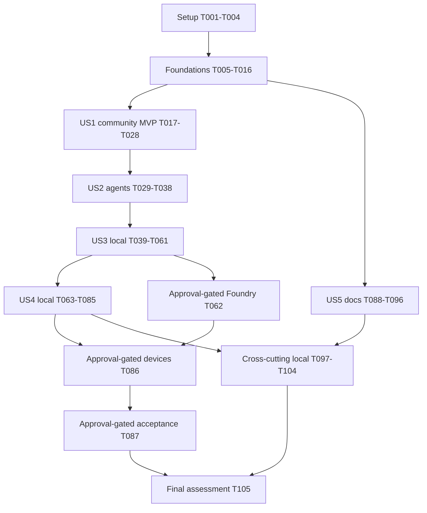

# Tasks: Unified Multimodal Agents and Management

**Input**: [spec](spec.md), [plan](plan.md), [research](research.md), [data model](data-model.md),
[configuration/UI contract](contracts/configuration.md), [conversation contract](contracts/conversation.md)
and [quickstart](quickstart.md).

**Prerequisites**: Current [constitution](../../.specify/memory/constitution.md), the existing
two Python services and their independent locks. Feature identifier is
`002-multimodal-agent-management`; the Git branch remains `main` unless separately authorized.

**Tests**: Required by FR-032, the acceptance scenarios and Constitution IX. Write meaningful
failing tests before the corresponding implementation, run the focused slice after editing,
then run the required broader gates. Never weaken assertions, timeouts, sandboxing or TLS.

**Organization**: Setup, shared foundations, five user-story phases in specification priority
order, then cross-cutting validation. All tasks start unchecked; generation proves no feature
implementation, external approval, browser-device result or live acceptance.

## Format and Path Conventions

- Format is `- [ ] Tnnn [P?] [USn?] Description with exact file paths`.
- `[P]` means eligible only within the explicitly listed parallel batch after its prerequisites;
  it does not permit racing edits to the same file or delegating without authorization.
- Story phases require their matching `[US1]` through `[US5]`; other phases have no story label.
- Paths are repository-relative. Proposed conversation, graph and test-console modules are
  new only where named; extend the listed existing tests/helpers rather than duplicating them.
- Before US5, maintained docs live under `code/docs/`; afterward use the same suffix under
  `docs/`. Story documentation tasks name both paths. Serialize their edits with the docs move.
- Models own all constraints quoted below from the data model. Preserve any stricter existing
  limit; unknown JSON fields, duplicate keys and nonfinite numbers reject, not silently coerce.
- No telephony research/integration/telephone calls, hosting-specific work, new infrastructure,
  Azure Voice Live, Responses delegation, legacy speech fallback or public OpenAI substitution.
  One separately configured Foundry reasoning/text deployment is explicitly approved for the
  shared application-owned Agents backend; GPT-Live remains the only speech service.
- Tasks involving actual Foundry/device use are explicitly gated. They authorize no login,
  credential discovery, provisioning, deployment, image publication or inference charges by
  themselves. Local controlled-port work may finish while those gates remain unfulfilled.

**Approved remediation choices (2026-10-29)**: The official model/region and published-quota
sources in the plan/research are design evidence, not proof of actual subscription capacity.
Provider deployment/access/capacity checks remain pre-live gates. Management owns one signed
ten-second admission deadline; exact authenticated closure receipts govern cleanup recovery.
Routine local/native CI uses controlled clocks and short transport/concurrency cases. The
full 600-second five-manager endurance run is only an explicitly approved acceptance operation
under T087, outside default collection/CI; it is never auto-run or reported passed when absent.

**U3 remediation choices (2026-10-30)**: Cleanup evidence is resource-aware. Text uses verified
settled work/disposal with no attempted Live allocation; speech keeps its exact authenticated
Live closure receipt. A terminal failed start can release from authoritative zero-attempt
metadata only when dispatch is fenced and local disposal is verified. Persist external attempt
intent before dispatch; attempted/uncertain work stays occupied until verified. Extend the
existing tasks/tests with fast controlled-clock and short-transport regressions, preserving
all 105 IDs and every unchecked state; no Live session is created just to close a text test.

**I3 remediation choices (2026-10-30)**: The immutable admission deadline applies only before
initial `ready`; after readiness it is historical, not a ten-second session cutoff. Runtime
fixes one immutable ten-second work budget at each item's first validated queue acceptance,
including queue/model/tool/handover time, bounded by session/auth/idle expiry. Active media
uses session limits, not the startup/work timer; one-way cleanup uses its separate budget.
Extend existing tasks with fast post-startup and expiry regressions; no deadline is enlarged,
no admission period is renewed, and T087 remains separately approved opt-in acceptance only.

## Phase 1: Setup

**Purpose**: Prepare this existing repository, not a new project or alternate frontend.

- [X] T001 Confirm the six accepted clarifications, approved remediation choices, source ownership, existing Python pins/locks and all PR exclusions against `specs/002-multimodal-agent-management/spec.md` and `specs/002-multimodal-agent-management/plan.md`; verify the model/region/published-quota design evidence is distinct from actual pre-live approvals and no sample Complexity Tracking exceptions remain, without changing the constitution or prior feature.
- [X] T002 [P] Extend `code/backend/tests/conftest.py` with deterministic clocks, published schema-2 graph factories and injected model/admission ports for browser conversations, keeping external sockets blocked and excluding telephone fixtures from the new scenarios.
- [X] T003 [P] Extend `code/management/tests/editor_app.py` and `code/management/tests/conftest.py` with owned HTTPS editor/test-console fixtures and generated test-only identities, preserving isolated working directories, original build budgets and production authentication without a test-mode bypass.
- [X] T004 Resolve an OSS `@xyflow/react` version compatible with Reflex 0.10/React 19.3 and record its supported Reflex-managed resolution in `code/management/reflex.lock/package.json` and `code/management/reflex.lock/bun.lock`; preserve unrelated dependencies/integrities and Python pins, use approved feeds with verified TLS, and do not add Reflex Enterprise or another frontend app.

**Checkpoint**: Existing local fixtures/dependencies are reproducible; default startup still
discovers no cloud credentials and allocates no model or microphone resources.

## Phase 2: Foundational Prerequisites

**Purpose**: Establish the complete fresh-start configuration and service contracts shared by
the stories. Complete this phase before story work; it does not require live resources.

### Tests First

- [X] T005 [P] Extend `code/management/tests/unit/test_configuration_validation.py` with schema-2 bounds, role cardinality, entry/membership, directed-edge/layout isolation, schema-1 rejection and generated-schema parity cases derived from T007-T009; include each boundary, forbidden value and one valid complete graph.
- [X] T006 [P] Extend `code/management/tests/integration/test_configuration_publication.py` and `code/management/tests/contract/test_runtime_configuration.py` for v2 manager/runtime contracts, exact bootstrap ETag semantics, missing/stale conditions, atomic revision/pointer/current-authority publication, audit-pending reconciliation and separately verified full/projection hashes.

### Models, Services and Versioned Interfaces

- [X] T007 Extend `code/management/management_app/models/configuration.py` with schema `2.0.0`, retaining identifiers matching `[A-Za-z0-9][A-Za-z0-9_-]{0,127}`, strict required fields and existing `ordinary`, `welcome`, `routing`, `goodbye` roles; implement Community constraints verbatim: "At most 50. Nonempty name up to 128 characters; description at most 4 KiB. Entry references an ordinary member; an enabled community requires enabled entry." Implement Agent constraints verbatim: "At most 200; prompt at most 16 KiB. Ordinary agents belong to exactly one existing community. Global Welcome/Routing/Goodbye occur exactly once each, remain enabled and have null community membership."
- [X] T008 Extend `code/management/management_app/services/configuration_validation.py` and the graph DTOs in `code/management/management_app/models/configuration.py` with `communityConnections`, retained `relationships` and presentation-only `layout`. AgentConnection: "Endpoints are distinct ordinary agents in the same community. No duplicate ordered pair. Allowed transfer context is only `request_summary` and `transfer_reason`, bounded to 2 KiB total. Enabled use requires both endpoints enabled." CommunityConnection: "Distinct existing communities; unique ID and ordered pair. Direction does not imply its inverse. Initial Routing selection is not an edge. Transfers require enabled destination and its eligible entry." GraphLayout: "Positions are `{nodeId, x, y}` with finite coordinates from -100000 through 100000. Each ID appears once and belongs to that view. No credentials, permissions or semantic attributes. Missing positions receive deterministic local layout."
- [X] T009 Update revision serialization/hashing in `code/management/management_app/models/configuration.py` and generate `code/contracts/configuration.schema.json`; enforce "At most 512 KiB encoded document and 1000 total directed connections. Canonical full hash includes layout; permissions are derived only from semantic graph/grants. Client cannot choose provenance, active revision or security version." Preserve Tool/MCP constraints: "Preserve current review, public-destination, credential-reference and action/input/output restrictions. No arbitrary URL or browser-authored tool may execute. At most 128 effective tools per agent/model request."
- [X] T010 Extend `code/management/management_app/services/configuration_publication.py`, `code/management/management_app/adapters/configuration_repository.py` and `code/management/management_app/services/bootstrap.py` for fresh schema-2 protected roles and complete atomic publication; preserve Strong reads, same-partition authority ordering, exact conditional first publication, rejected-write preservation and audit recovery without replay or migration.
- [X] T011 Implement `GET/PUT /v2/configuration` and `GET /v2/runtime/configuration` in `code/management/management_app/api/configuration.py` and `code/management/management_app/api/runtime_configuration.py`; retain distinct manager/workload identities, Origin/CSRF, strong ETags/304, 428 missing conditions, 409 conflicts, strict bounded JSON, fixed safe problems and the shared ten-second deadline; reject schema-1 instead of adding compatibility endpoints.
- [X] T012 Update `code/management/management_app/state/configuration_editor.py` to consume the v2 publication envelope and request-specific save acknowledgements; update `code/backend/src/caller_runtime/domain/configuration.py` with the strict policy-only projection, `policyHash` and management-verified full `graphHash`, preserving provenance/revision identity and excluding layout/secrets without falsely recomputing a full hash from missing fields.
- [X] T013 Extend `code/backend/tests/unit/test_configuration_cache.py`, then update `code/backend/src/caller_runtime/adapters/configuration_client.py` for authenticated v2 reads, projection-hash parity, ETag/304, at-most-30-second refresh and fail-closed stale/absent/invalid admission; keep last-good data from granting new sessions beyond freshness and never read management's private container.
- [X] T014 Preserve guarded composition and default-unavailable behavior in `code/management/management_app/composition.py`, `code/management/management_app/management_app.py` and `code/backend/src/caller_runtime/main.py`; register only explicitly injected v2 resources and verify empty-business configuration cannot admit a conversation or cause ambient credential/model discovery.
- [X] T015 Extend the existing structured metadata/error contracts in `code/contracts/README.md`, `code/backend/src/caller_runtime/observability.py` and `code/management/management_app/observability.py` for configuration-v2/test activity, retaining UTC/severity/service/environment/event/outcome/correlation/trace fields, bounded fixed codes and no sensitive payloads or unbounded metric labels.
- [X] T016 Run the focused T005/T006/T013 and guarded-startup regression suites, document the fresh-start contract break and validation outcomes in `code/docs/configuration-guide.md` (or `docs/configuration-guide.md` after US5), and record source revision/observed results in `specs/002-multimodal-agent-management/tasks.md` without treating controlled ports as real Cosmos qualification.

**Checkpoint**: Full schema-2 publication, versioned consumption and strict ownership are
tested locally. No migration, live model, telephone path or hosting feature is needed.

## Phase 3: US1 - Manage Communities and Transfer Paths (P1, MVP)

**Goal**: Community overview, directed connections, stable community links and reliable draft
publication, usable without any model connection.

**Independent Test**: Configure two communities with an eligible seeded ordinary entry each,
add one directed community edge, drag a node, publish, reopen both community links and reload.
The saved edge stays one-way, positions do not grant permission, stale/invalid saves preserve
the prior publication/draft, and no model is contacted.

### Tests First

- [X] T017 [P] [US1] Extend `code/management/tests/unit/test_configuration_draft.py` for community create/edit/remove, directed-edge mutations, position-only changes, retained organization-wide draft across child navigation, dirty-discard confirmation and request-specific stale-save conflicts.
- [X] T018 [P] [US1] Extend `code/management/tests/browser/test_configuration_editor.py` with the US1 independent journey, direct/reloaded/missing/unauthorized child links, two-manager conflicts and equivalent graph/forms/keyboard operations at 360/768/1440 widths; assert zero model calls.

### Implementation and Checkpoint

- [X] T019 [US1] Add validated community/connection/position commands to `EditorDraft` in `code/management/management_app/state/configuration_editor.py`, preserving membership/permissions on drag and requiring explicit repair or confirmation for referenced deletions.
- [X] T020 [US1] Add the minimal Python Reflex xyflow wrapper in `code/management/management_app/components/configuration_graph.py`, with local drag feedback, bounded final-position events, explicit directed-edge commands, stable canvas dimensions, Tailwind-compatible CSS and browser-only hooks safe during SSR.
- [X] T021 [US1] Rework `code/management/management_app/pages/communities.py` into the initial editable community overview, retaining create/edit/remove and directed source/target forms as keyboard equivalents rather than making the graph the only editor.
- [X] T022 [US1] Register `/configuration` and `/configuration/communities/[community_id]` in `code/management/management_app/management_app.py`; expose selected-community identity, return navigation and existing agent-editor shell, with safe missing/unauthorized states and no substitute community or runtime entry override.
- [X] T023 [US1] Integrate shared-draft route lifecycle and explicit dirty leave/reload/discard guards in `code/management/management_app/state/configuration_editor.py` and `code/management/management_app/components/configuration_graph.py`; do not call the replacing `load()` on every child route or silently discard browser-back edits.
- [X] T024 [US1] Integrate busy/unsaved/saved/audit-pending/conflict UI and publication controls in `code/management/management_app/management_app.py`, retaining unsaved edits after validation, stale ETag or ambiguous network outcomes and never claiming a different draft generation was saved.
- [X] T025 [US1] Complete accessible names, icon tooltips, focus retention, touch/keyboard position and edge editing, empty/unavailable states and non-overlapping responsive layout in `code/management/management_app/pages/communities.py` and `code/management/management_app/components/configuration_graph.py`.
- [X] T026 [US1] Execute the focused T017/T018 suites and actual compiled Reflex US1 browser journey using `code/management/tests/editor_app.py`; inspect screenshots/keyboard paths at all three widths and repair only observed community/draft defects without changing original test/build budgets.
- [X] T027 [US1] Document community graph editing, publication/conflict recovery and route behavior in `code/docs/configuration-guide.md` and `code/docs/runbooks/communities.md` (or their suffix-preserving `docs/` paths after US5), updating the affected existing Mermaid design if behavior changes.
- [X] T028 [US1] Verify the complete US1 independent test and meaningful negative assertions, then append actual local results and remaining non-US1 scope to `specs/002-multimodal-agent-management/tasks.md`; do not label this MVP as the complete multimodal feature.

## Phase 4: US2 - Configure Agents Within One Community (P1)

**Goal**: Edit ordinary agents, entry/capability assignments and directed intra-community
handovers while preserving global protected roles and peer-discovery boundaries.

**Independent Test**: With one community and three agents, change prompts/enabled state/entry,
edit directed handovers and positions, publish and reopen. Eligible peers remain discoverable,
an absent/reversed handover or foreign agent is denied, and invalid entry edits cannot publish.

### Tests First

- [X] T029 [P] [US2] Extend `code/management/tests/unit/test_configuration_validation.py` and `code/management/tests/unit/test_configuration_draft.py` for agent membership/entry/reference repair, protected-role cardinality and assignments, edge direction, disabled-node visibility and agent position-only edits.
- [X] T030 [P] [US2] Extend `code/backend/tests/unit/test_community_visibility.py` with phone-independent eligibility predicates testing same-community discovery versus directed handover, foreign-ID denial, protected-role separation and source-preserving community-transfer requirements.
- [X] T031 [P] [US2] Extend `code/management/tests/browser/test_configuration_editor.py` with the three-agent journey, keyboard/graph parity, protected-role reachability, reviewed capability edits, invalid-entry publication and reopen/reload checks at 360/768/1440.

### Implementation and Checkpoint

- [X] T032 [US2] Add agent, entry, reviewed-assignment, directed-handover and per-community position commands to `code/management/management_app/state/configuration_editor.py`, enforcing the T007-T009 constraints and retaining unrelated communities/draft state.
- [X] T033 [US2] Implement the selected-community agent editor in `code/management/management_app/pages/agents.py` and `code/management/management_app/pages/relationships.py`, showing only eligible ordinary members with directed connections, explicit entry selection and equivalent forms/keyboard controls.
- [X] T034 [US2] Integrate per-community agent nodes and layouts through `code/management/management_app/components/configuration_graph.py` and the dynamic route in `code/management/management_app/management_app.py`, preserving focus, stable identity, dirty navigation and no semantic changes from dragging.
- [X] T035 [US2] Implement the pure membership/discovery/allowed-handover predicates in `code/backend/src/caller_runtime/domain/visibility.py`, reusing the strict graph DTO and keeping initial Routing distinct from source-bound directed transfers; do not introduce or qualify telephone adapters.
- [X] T036 [US2] Preserve one global protected-role editor and reviewed public/read-only capability assignment controls reachable from `code/management/management_app/management_app.py` and `code/management/management_app/pages/agents.py`; ordinary agents cannot gain peer prompts/tools or foreign-community authority through these views.
- [X] T037 [US2] Run T029-T031 and existing publication/permission regressions, and update agent/entry/handover guidance in `code/docs/configuration-guide.md` (or `docs/configuration-guide.md` after US5), recording tested keyboard, entry-denial and atomic-publication behavior.
- [X] T038 [US2] Execute the full US2 independent test through `code/management/tests/browser/test_configuration_editor.py` and the pure runtime predicates, then record observed results in `specs/002-multimodal-agent-management/tasks.md` without claiming a live model handover occurred.

## Phase 5: US3 - One Configured Backend for Text and Speech (P1)

**Goal**: One application-owned Agents executor and policy for text and GPT-Live client
delegation, consuming only authoritative published configuration.

**Independent Test**: Drive equivalent text and documented speech-delegation events through
the runtime's actual owned internal WebSocket with injected providers. Compare revision,
protected entry/routing, directed handovers, current capability revocations and terminal state;
text allocates no Live session. Real Foundry proof is separately gated in T062.

### Tests First

- [X] T039 [P] [US3] Add exact Foundry client-delegation contract tests in `code/backend/tests/contract/test_gpt_live.py` for startup/readiness, PCM/timeline fragments, metadata-only delegation IDs, bounded context appends, cumulative usage/closure and explicit denial of Responses/Realtime/Voice Live/public-provider fallbacks.
- [X] T040 [P] [US3] Add shared-policy/lifecycle tests in `code/backend/tests/unit/test_conversation.py` for published roles, text/speech parity, source-bound Routing, single ownership, stale epochs and bounded context; prove phase-aware deadlines with valid work/media at simulated t=60s after ready at t=4s, rejected first readiness after startup expiry, immutable per-item acceptance/queue/work timing, no duplicate/handover reset, denial on auth/idle/lifetime/terminal expiry and one-way cleanup still permitted under trusted cleanup authority. Use controlled clocks, not real-minute waits.
- [X] T041 [P] [US3] Add admission-authority tests in `code/backend/tests/unit/test_test_admission.py` for stable actor/replay/CAS/capacity bounds and resource-aware cleanup: text settled/disposed with zero Live connections, terminal zero-attempt failed-start release, intent persistence before dispatch, terminal-fence/dispatch races, attempted/ambiguous startup retaining capacity, strict speech receipts, owner restart/lost writes/idempotent release and stale/foreign/wrong-kind/watermark evidence. Missing history, cancellation, local cache emptiness, time/lease/TCP-close alone never prove settlement or reset the original deadline; use controlled clocks, not endurance sleeps.
- [X] T042 [P] [US3] Add runtime service integration cases in `code/backend/tests/integration/test_conversation.py` for 20 valid publications/new starts within 60 seconds, existing-session revision pinning and immediate current-grant revocation, with real app transport and controlled management/model ports rather than phone fixtures.

### Models, Authority and Model Adapters

- [X] T043 [US3] Define runtime slot/permit/attempt/evidence DTOs in `code/backend/src/caller_runtime/domain/conversation.py`, including mode/actor, signed admission deadline/request ID, per-item `workAcceptedAt`/immutable `workDeadlineUtc`, owner/epoch/revision/generation, terminal fence, attempted/settled watermarks and Live-ever-attempted state. TestSlot: "Actor key is derived server-side from verified tenant/actor, independent of cookie/tab/device. Pending and uncertain-cleanup slots count as occupied. One logical conversation and active agent owner." ConversationMetadata: "No audio, transcript, assembled prompts, tool arguments/results or complete browser message bodies. No TTL or restart alone proves physical/provider closure." CleanupEvidence: "At most one cleanup-evidence bundle per occupied slot within the existing 128-KiB authority cap. Match the session, mode, owner/epoch and current attempt watermark; uncertain evidence never releases capacity." ClosureReceipt: "At most one current-segment receipt per occupied slot within the 128-KiB authority cap. For an attempted Live segment, require authenticated exact-session closure evidence. Text and no-attempt releases use their verified resource-specific evidence instead." Use strict `no_external_attempt`, `work_disposed`, `speech_session_closed` evidence with bound observation/provenance/disposal fields, retain 600-second lifetime/120-second user idle and earlier auth expiry, and reset idle only on accepted text/server-observed speech.
- [X] T044 [US3] Implement the injected runtime-owned authority in `code/backend/src/caller_runtime/adapters/test_admission_repository.py`: fixed `browser-test-authority-v1`, schema/UTC/ETag, slots/nonces, terminal fence, monotonic attempted/settled watermarks, Live-ever-attempted flag, at most one unresolved intent per model/capability/live kind and one current cleanup-evidence bundle per slot. Preserve "Strong read plus conditional replace; at most five occupied slots across runtime instances. No TTL-driven capacity release or automatic recreation when missing/corrupt. Explicit initialization only." Enforce "Authority document cap is 128 KiB, at most five slots and 100 unexpired consumed permit digests"; conditionally confirm exact owner/epoch intent before external dispatch, persist trusted settlement/disposal and speech receipts within the same cap, reread ambiguous writes and never reset history or reclaim on expiry.
- [X] T045 [US3] Implement admission/cleanup and pre-dispatch gates in `code/backend/src/caller_runtime/services/test_admission.py`: atomic nonce/actor/global reservation and four bounded conflicts use the original signed admission deadline only before initial ready. After ready, never renew/reuse startup expiry: discrete work uses its immutable runtime queue-acceptance deadline capped by current auth/lifetime/idle limits; continuous media uses session/auth/idle controls; cleanup uses its separate ten-second budget under trusted cleanup authority. Before every business model/tool/Live attempt, confirm owner/epoch-bound intent and the phase-appropriate deadline/terminal fence; serialize dispatch/finalization and keep at-most-one-second authority rechecks. Release failed starts without provider proof only from trusted terminal zero-attempt metadata plus verified disposal; lost writes/attempted or unknown outcomes remain conservative. Preserve no replacement/replay, exact idempotent CAS release and safe late-callback rejection.
- [X] T046 [US3] Implement an explicitly injected async Foundry text adapter in `code/backend/src/caller_runtime/adapters/foundry_text.py` using existing `OpenAIChatCompletionsModel`/Agents SDK, reviewed deployment/base URL and Entra token provider; require exact approved TLS hosts, zero model retries, no implicit defaults/redirects/public OpenAI, storage disabled where supported and SDK-hosted tracing disabled. Use T045's confirmed intent gate before model I/O and emit trusted bounded settlement/disposal observations afterward; cancellation request or local transport disposal alone is not definitive remote completion.
- [X] T047 [US3] Implement the direct maintained-websockets Foundry adapter in `code/backend/src/caller_runtime/adapters/gpt_live.py` for `/openai/v1/live/sessions`, exact `gpt-live-1`, explicit `{type: client}`, immutable startup instructions/voice and `session.started` readiness; validate returned configuration, async bearer acquisition and a 256-KiB provider event limit before decoding, with no fabricated API/SDK events. Persist and confirm T045's Live-attempt intent before external connection work; a recorded attempt with no known provider ID is still uncertain, not proof of no allocation.
- [X] T048 [US3] Complete PCM16LE mono 24-kHz input/output, timed transcript fragments, mute acknowledgements, client-delegation ID correlation, error classification and cumulative/final usage in `code/backend/src/caller_runtime/adapters/gpt_live.py`; append only validated commentary/thinking with the exact ID and at most 500 tokens using a proven at-most-500-UTF-8-byte conservative bound or verified tokenizer, never treating an append ACK as task success or audible playback.

### Shared Execution, Lifecycle and Transport

- [X] T049 [US3] Instantiate global Welcome/Routing/Goodbye and ordinary Agents from the pinned publication in `code/backend/src/caller_runtime/services/conversation_agents.py`, retaining configured names/prompts/reviewed assignments and at most 128 effective tools; no separate test/modality definitions or provider-hosted tool authorization.
- [X] T050 [US3] Implement shared entry/routing/handover ownership in `code/backend/src/caller_runtime/services/conversation.py` using T035 predicates, trusted source community and exact allowed destination entry; reject foreign guesses and preserve one active agent/epoch without changing telephone-ingress behavior.
- [X] T051 [US3] Add the authenticated management capability client in `code/backend/src/caller_runtime/adapters/capability_client.py` and invoke it from `code/backend/src/caller_runtime/services/conversation.py`, preserving reviewed public/read-only operations, bounded validated arguments/results and pinned/current/reviewed grant intersection before every attempt, including revocation/ownership races and no private-store access. Require T045's confirmed intent/terminal-fence gate before capability dispatch and return trusted metadata-only settlement observations; unknown outcomes never authorize work replay or cleanup release.
- [X] T052 [US3] Implement text submission and bounded reply streaming in `code/backend/src/caller_runtime/services/conversation.py`, with 4-KiB accepted user text, 64-KiB maximum complete reply, one pending input and no microphone/Live allocation; text and speech use the same published-policy path, and invalid input/heartbeats never reset idle.
- [X] T053 [US3] Implement application-owned client delegation in `code/backend/src/caller_runtime/services/delegation.py` with provider-segment/delegation ID, task ID, owner/generation, `workAcceptedAt` and immutable `workDeadlineUtc`: "At most one executing work item and one pending per conversation. Duplicate provider delegation IDs do not rerun work. Epoch/auth/current-grant checks precede any commit or capability attempt." Fix the ten-second work budget at first validated runtime queue acceptance, including queueing/model/tool/handover/segment-transition time, capped by auth and original lifetime/current-idle limits; retain eight steps, no parallel capabilities and zero retries. Duplicate IDs/child steps never reset that budget, only genuinely new accepted work gets a new deadline, expired queued work cannot dispatch, and post-ready work never consults the historical admission timer. Ambiguous task text requires clarification, not a guessed tool call.
- [X] T054 [US3] Implement actual provider-socket generation fencing and authorized speech continuation in `code/backend/src/caller_runtime/services/conversation.py` and `code/backend/src/caller_runtime/adapters/gpt_live.py`; retire/close the old segment before a handover/explicit-interrupt continuation, never relabel late chunks, retain logical revision/actor/deadlines and end on faults/unknown closure rather than reconnecting or opening an overlapping billed segment.
- [X] T055 [US3] Implement terminal/expired/authority-loss cleanup and volatile history in `code/backend/src/caller_runtime/services/conversation.py`: "At most 256 KiB/session including text history, at most 64 KiB transcript portion. Bound per-agent prompt/model tokens separately; overflow fails safely rather than silently dropping security context. Clear on termination and always within five minutes." Implement injected `CleanupReceiptVerifier.verify(slot, evidence, deadline)` in `code/backend/src/caller_runtime/services/test_admission.py`, deriving `no_external_attempt`, `work_disposed` or `speech_session_closed` from trusted attempt history and matching test/mode/owner/epoch/watermark/time. Require terminal fencing and verified disposal: zero-attempt starts can release without provider proof; text requires definitive settled model/tool work and no Live attempt; attempted Live retains exact authenticated closure receipts plus settled non-Live work. Reconcile Strong reads/CAS after restart/lost writes idempotently within ten seconds; unknown attempts/applicable proof remain occupied with alerts and reviewed evidence-only recovery, never force-clear/replay/adopt sockets or create Live merely to close text. Cleanup cannot delay admission failure responses.
- [X] T056 [US3] Add fixed test-mode lifecycle/delegation/denial/usage/latency/cleanup events in `code/backend/src/caller_runtime/observability.py` and extend `code/backend/tests/integration/test_content_privacy.py`, proving no audio/transcripts/prompts/payloads/permits/provider bodies persist or leak and no test counts as production telephone-call evidence.
- [X] T057 [US3] Expose workload-authenticated `WSS /v1/internal/test-sessions` in `code/backend/src/caller_runtime/api/test_sessions.py` with an injected fixed-RS256 manager-permit verifier in `code/backend/src/caller_runtime/adapters/test_identity.py`; verify issuer/audience/key allowlist/session/actor/mode/nonce/expiry before allocation and implement strict `caller.test.v1` JSON/binary messages, sequences/duplicates, safe errors/close codes and declared frame/credit/queue limits from `specs/002-multimodal-agent-management/contracts/conversation.md`.
- [X] T058 [US3] Compose the new runtime ports in `code/backend/src/caller_runtime/composition.py` and `code/backend/src/caller_runtime/main.py` only from explicit reviewed identity/endpoints/deployments, existing private-container factory, signing-key allowlist, capacity and retention inputs; preserve credential-free default startup and fail closed for absent approval, stale configuration, lower available quota or missing initialized authority.
- [X] T059 [US3] Run T039-T042 and actual owned-runtime-WebSocket lifecycle/pressure tests in `code/backend/tests/integration/test_conversation.py`, including independent-process actor-slot contention, lost/cancelled CAS replies, malformed/oversized frames, pending cleanup and stale segment output; controlled providers are not real model/capacity qualification.
- [X] T060 [US3] Add a deny-by-default, metadata-only opt-in qualification driver and tests in `code/tools/scripts/verify_multimodal.py` and `code/tools/tests/test_verify_multimodal.py`; require explicit reviewed existing environment/identity/deployments, region/lifecycle/retention/quota and cost/time scope before any network/model action, report unknown closure honestly and make no cloud discovery/provisioning/telephony/hosting calls.
- [X] T061 [US3] Execute the US3 local independent test, update shared-agent/provider/failure/retention guidance in `code/docs/architecture.md` and `code/docs/configuration-guide.md` (or their `docs/` paths after US5), and record exact local results/remaining external gates in `specs/002-multimodal-agent-management/tasks.md`.
- [ ] T062 [US3] Only after separate operator authorization, use `code/tools/scripts/verify_multimodal.py` to verify actual existing Foundry deployment/version/model mapping, Entra scope/role, supported streaming/tools/storage, region/residency/lifecycle/preview and available Live/text quota; exercise client delegation and confirmed closure without telephone calls, then record metadata-only evidence in `specs/002-multimodal-agent-management/tasks.md`; leave this task blocked/unconfirmed if approval or evidence is absent.

## Phase 6: US4 - Browser Published-Configuration Tests (P1)

**Goal**: An authenticated manager can explicitly start/stop text or microphone/headset tests
against the normal published flow, with truthful state, secure relay and bounded resources.

**Independent Test**: From an owned authenticated browser start a published speech test,
grant generated-device permission, exchange audio, interrupt/mute/stop and repeat in text
with microphone denied. Assert displayed revision, default Welcome/Routing flow, cross-tab
admission, expiry and cleanup. Synthetic media is local protocol evidence, not physical-device
qualification; T086/T087 cover the separately approved actual browser/model acceptance.

### Tests First

- [X] T063 [P] [US4] Add management ticket/upgrade/relay contract tests in `code/management/tests/contract/test_browser_tests.py` for exact Origin/cookie/CSRF/current-role checks, 30-second permit expiry/replay/session binding, RS256 issuer/audience/key rejection, signed `admissionDeadlineUtc`, min(three seconds, remaining time) first-message timeout, pre-auth limits/logout and no allocation before authorization; use controlled clocks with cumulative gateway/relay/runtime/model delays to prove one ten-second ticket-POST-to-ready/failure boundary, no reset from permit expiry/retries and no late readiness or cleanup-delayed failure.
- [X] T064 [P] [US4] Extend `code/management/tests/browser/test_configuration_editor.py` with text-without-microphone, explicit speech gesture, denied/unanswered permission, late tracks, unavailable devices/playback, mute/interruption/stop/navigation and published-revision/normal-entry scenarios at 360/768/1440.
- [X] T065 [P] [US4] Add console/relay pressure and framing tests in `code/management/tests/unit/test_test_console.py` for strict mode/session/generation/sequence, credit accounting, bufferedAmount/worklet/relay aggregate caps, duplicate/oversized messages, terminal callbacks and no content/permit persistence.

### Authentication, Relay and Console

- [X] T066 [US4] Define StartPermit and console DTOs in `code/management/management_app/models/test_session.py`, including nonce digest, verified principal/auth expiry, mode, management-session digest, runtime audience, signature, request ID and signed `admissionDeadlineUtc`: "Signed by management, 30-second validity, single-use by runtime CAS. Browser receives no provider/workload credential. Never put permits in URLs or logs. Bound to the current verified management cookie at the gateway." Keep runtime-verifier parity with T043/T057, no client-provided authority fields and strict 8-KiB JSON; permit validity cannot extend the separate original ten-second startup budget.
- [X] T067 [US4] Implement CSRF-protected `POST /v1/test-tickets` and explicitly injected fixed-RS256 signing in `code/management/management_app/api/test_sessions.py` and `code/management/management_app/security.py`; start the gateway's ten-second monotonic admission timer at request receipt before authentication awaits and sign the corresponding `admissionDeadlineUtc`/request ID/mode, with exact verified manager/test permission, 30-second permit expiry, fixed socket path and `Cache-Control: no-store`; repeated delivery cannot reset startup, and no model/token URL is allocated here.
- [X] T068 [US4] Implement same-origin `WSS /v1/test-sessions` in `code/management/management_app/api/test_sessions.py`, verifying cookie/permission/exact Origin before upgrade, `caller.test.v1`, first-message authentication within min(three seconds, remaining signed startup budget), ten pre-auth sockets/process and two/manager, session-bound permit consumption and no reliance on Reflex Socket.IO protection; reject absent/null Origin, expired startup and unsupported query authority, fence at the original deadline and return failure without awaiting cleanup completion.
- [X] T069 [US4] Implement the bounded workload-authenticated runtime relay in `code/management/management_app/adapters/test_session_client.py`, with exact approved HTTPS/WSS hosts, TLS/no redirects, current cookie/permission checks at activity and at most every second, one serialized writer and fixed close codes; propagate/verify the signed original `admissionDeadlineUtc` and only its remaining budget through identity, snapshot, CAS and model readiness, rejecting untrusted/skewed/backward clocks rather than extending it, with no provider credentials/secret discovery or policy execution in management.
- [X] T070 [US4] Implement transient test state in `code/management/management_app/state/test_console.py`: explicit mode/start/stop, busy/unavailable/terminal states, immutable displayed published revision/agent identity, bounded volatile messages and cleared request/permit content; selected editor community/draft never overrides runtime routing and no session auto-resumes.
- [X] T071 [US4] Build the Python Reflex test surface in `code/management/management_app/pages/test_console.py`, exposing accessible mode/device selection, text input/replies, start/stop/mute and truthful recording/playback/error state without feature-marketing text, hidden capture, browser token storage or a separate text backend.
- [X] T072 [US4] Add a narrow Python Reflex browser component in `code/management/management_app/components/live_audio.py` using native AudioContext requested/verified at 24000 Hz and AudioWorklet; acquire/resume from the explicit gesture, stream mono PCM16LE without a recording container or Reflex event-state audio, and fail clearly if the native context rate is unsupported rather than writing a resampler or using another speech service.
- [X] T073 [US4] Implement the protocol-byte-1/uint32-generation/uint32-sequence binary header, at-most-1920-byte PCM payload (40 ms), target 960 bytes (20 ms), 8-KiB JSON, 4-KiB input and 64-KiB reply limits in `code/management/management_app/components/live_audio.py` and `code/management/management_app/adapters/test_session_client.py`; enforce capture <=250 ms/12000 PCM bytes, playback <=500 ms/24000 PCM bytes and 64 pending controls across every buffer, using credits/played acknowledgements and bounded transport sends rather than unbounded WebSocket defaults.
- [X] T074 [US4] Implement immediate mute/interrupt/stop playback fencing in `code/management/management_app/components/live_audio.py` and `code/management/management_app/state/test_console.py`, flushing local queues without waiting for a round trip, rejecting old session/generation frames and never interpreting append/send ACKs as audible playback or an interrupt as successful external-action cancellation.
- [X] T075 [US4] Implement idempotent permission/media/socket lifecycle in `code/management/management_app/components/live_audio.py`, stopping late-granted tracks after cancellation, clearing unanswered starts, AudioContext/worklets/capture/playback on leave/visibility loss/auth expiry/disconnect and purging volatile content within five minutes; heartbeats/agent output cannot extend user-idle and faults never silently start a new billed session.
- [X] T076 [US4] Complete feature-detected headset/output routing, device-change/unplug/autoplay failure and honest OS-default fallback in `code/management/management_app/components/live_audio.py` and `code/management/management_app/pages/test_console.py`; do not require unsupported `selectAudioOutput` or claim hardware routing from a UI selection alone.
- [X] T077 [US4] Extend the existing guarded management resource composition in `code/management/management_app/composition.py` for signer/verifier, runtime workload relay and explicit test permission/retention/capacity inputs, reusing current Entra/Cosmos/audit ownership without reopening old hosting tasks or activating live resources by default.
- [X] T078 [US4] Register `/configuration/test` and reachable test controls in `code/management/management_app/management_app.py`, preserving authenticated graph pages/drafts and normal published Welcome/Routing behavior from every entry route; visiting the page never opens a microphone/model connection or executes unsaved configuration.

### Integration, Documentation and Qualification

- [X] T079 [US4] Extend `code/management/tests/editor_app.py` to connect both actual owned apps over HTTPS/WSS with injected management/model/storage ports, then execute T063-T065 and the text/speech synthetic-media browser journeys; preserve external-socket denial, all original build budgets and isolated frontend artifacts.
- [X] T080 [US4] Add multi-tab/different-cookie/different-mode and separate-runtime contention journeys in `code/management/tests/contract/test_browser_tests.py`, proving exactly one active test for one verified tenant+actor, rejection without replacement, five distinct occupied slots and unknown cleanup blocking another start.
- [X] T081 [US4] Extend `code/management/tests/unit/test_test_console.py` and `code/backend/tests/integration/test_conversation.py` with fast resource-aware text stop/restart/no-Live, no-attempt failure release, unknown retention, fence races, stale/foreign/wrong-kind proof and restart/lost-write cases, retaining speech receipts. Advance controlled clocks to ready at t=4s, accept a valid question and active media at t=60s despite startup expiry, enforce its work deadline at t=70s, reject first late readiness and expired queued/work items, and prove no duplicate/step/handover reset. Also cover auth/120-second idle/600-second lifetime expiry, terminal denial, one-way evidence-checked cleanup after expiry, one-second output cutoff and five-minute disposal; use short real transports, no wall-clock endurance waits or fabricated live qualification.
- [X] T082 [US4] Run actual compiled Reflex console/graph accessibility and overlap checks through `code/management/tests/browser/test_configuration_editor.py` at 360/768/1440, with fake-media/permission doubles for automation, confirming visible stop and keyboard reachability; do not certify stable Edge/Chrome or physical headsets from bundled Chromium alone.
- [X] T083 [US4] Extend `code/tools/scripts/verify_multimodal.py` and `code/tools/tests/test_verify_multimodal.py` with explicit approved stable-browser/device/loopback timing scenarios and a distinct opt-in live-endurance mode for T087, metadata-only sample/version reporting, unchanged latency/cost limits and receipt/cleanup uncertainty; absent mode/approval rejects before microphone/model use, and default local/native CI neither invokes the 600-second live run nor silently skips a required local assertion or reports live qualification passed.
- [X] T084 [US4] Update test-console controls, exact guarded composition invocation/prerequisites and failure/cleanup guidance in `code/docs/setup.md` and `code/docs/configuration-guide.md` (or their `docs/` paths after US5), clearly separating credential-free local fixtures from authorized Foundry/headset qualification.
- [X] T085 [US4] Execute the US4 local independent journey and complete its security/device-double regressions, then record actual local outcomes, synthetic-versus-physical evidence boundaries and still-gated T086/T087 in `specs/002-multimodal-agent-management/tasks.md`.
- [ ] T086 [US4] Only after T062 and separate device/model approval, use `code/tools/scripts/verify_multimodal.py` to qualify current stable Edge/Windows and Chrome/Windows/Linux with actual microphone/headset output, denied/unanswered permission, mute, autoplay/unplug, interruption/stop/navigation/logout/connection loss; record exact versions, <=1-second audible cutoff, <=10-second failures and cleanup metadata in `specs/002-multimodal-agent-management/tasks.md`, not recordings/transcripts; leave blocked if unavailable.
- [ ] T087 [US4] Only as a separately opted-in acceptance run under the explicit T062/T086 environment/time/spend approval, use the live-endurance mode of `code/tools/scripts/verify_multimodal.py` to execute at least 20 eligible journeys split ten text/ten speech, with five isolated concurrent managers each completing the full 600-second lifetime; supply accepted participant text/speech before idle expiry, measure p95 relevant response <=2 seconds after actual input completion excluding declared external-action waits, 20 publication/fresh-start checks <=60 seconds, next-action revocation denial and shutdown at the lifetime cap. Keep this real-duration run outside default local/native CI; record observed distributions/usage/closure in `specs/002-multimodal-agent-management/tasks.md`, leave unexecuted qualification pending and never substitute virtual time, silence/keepalives or a shorter run for its live evidence.

## Phase 7: US5 - Root-Level Maintained Documentation (P2)

**Goal**: Root `docs/` is the single maintained home, with intact content, evidence, assets,
references and automation; historical telephony/hosting documents move without new behavior.

**Independent Test**: Starting at the repository root, follow setup/architecture/runbook and
code-contract links, validate assets/fragments, render all diagrams and prove no second
maintained old docs tree remains. This story needs no model or browser-device approval.

### Tests First

- [X] T088 [P] [US5] Extend `code/tools/tests/test_static_checks.py` with root-doc discovery, valid/missing local link/image/asset/fragment, old-tree duplicate rejection, root-plus-contract scan coverage and preservation of historical evidence/reference text; fixtures must fail for each broken-reference class before tooling changes.

### Relocation and Consumer Updates

- [X] T089 [US5] Inventory the current maintained documents/assets and suffix-preservingly move `code/docs/` to `docs/`, verifying the baseline 32 Markdown files/31 Mermaid blocks plus any intentional same-feature additions without content loss, duplicate copies, moved feature specs or rewritten historical results.
- [X] T090 [US5] Repair moved-document outgoing code references, image/asset/fragment destinations and the ownership inventory in `docs/repository-layout.md`; preserve docs-to-docs relative links and all prior acceptance results, with no functional change to the operational hosting/telephony documents.
- [X] T091 [US5] Change `code/tools/scripts/verify_docs.py` to discover root docs and applicable contract/feature references, validate images/assets/heading fragments and reject a second maintained old docs tree while retaining the pinned actual Mermaid renderer, sandbox and existing timeouts; make T088 pass without weakening checks.
- [X] T092 [US5] Update `code/tools/scripts/ci.py` and, only if its existing application/document path filters require it, `.github/workflows/ci.yml` to scan/test root docs without introducing new infrastructure, deployment or hosting behavior; keep private feed/publication guards covering every new nonignored document.
- [X] T093 [US5] Repair documentation/evidence destinations in `code/tools/scripts/verify_release.py`, `code/backend/tests/load/test_capacity.py` and `code/management/tests/integration/test_configuration_persistence.py`; only change path consumers here, preserving old qualification status and not enabling old live/hosting/release profiles.
- [X] T094 [US5] Repair repository navigation in `README.md`, `code/contracts/README.md`, the navigable links in `specs/001-call-center-agents/tasks.md` and the setup link in `specs/002-multimodal-agent-management/quickstart.md`; preserve old task IDs/checkboxes/evidence and distinguish historical literal path mentions from broken current links.
- [X] T095 [US5] Execute T088 plus root-document/reference/asset/fragment and actual diagram rendering through `code/tools/scripts/verify_docs.py`, proving default checks no longer depend on a maintained `code/docs/` tree and recording exact inventory/results in `specs/002-multimodal-agent-management/tasks.md`.
- [X] T096 [US5] Consolidate the feature's user/setup/security/ownership and app-failure guidance in existing `docs/configuration-guide.md`, `docs/architecture.md`, `docs/setup.md` and linked runbooks, verify all earlier story doc edits followed the move, and complete the US5 independent test without recertifying prior operational evidence.

## Phase 8: Polish and Cross-Cutting Validation

**Purpose**: Close local engineering gates, report qualification honestly and preserve all
scope boundaries. Gated live tasks may remain blocked; never convert their absence to a pass.

- [X] T097 Implement/test app-level alert classification through existing observation ports in `code/backend/src/caller_runtime/observability.py`, `code/management/management_app/observability.py` and `code/tools/tests/test_verify_multimodal.py`: cleanup uncertainty beyond ten seconds, three consecutive dependency failures in 60 seconds and p95 >2 seconds with >=20 samples/five minutes; verify correlation/privacy/receipt/recovery with controlled sinks and document accountable maintainer/response links in `docs/runbooks/monitoring.md`, without new hosting collectors or alert infrastructure.
- [X] T098 Create feature-specific traceability/evidence in `docs/acceptance/multimodal-agent-management.md` and extend the feature-aware inventory in `code/tools/scripts/verify_release.py`, mapping every FR-001 through FR-034 and SC-001 through SC-010 to actual tests/results or an explicit blocked gate while preserving feature-001 reports and all deferred tasks.
- [X] T099 Review and run cross-service privacy/authorization regressions in `code/backend/tests/integration/test_content_privacy.py` and `code/management/tests/contract/test_browser_tests.py`, covering endpoints/keys/permits, telemetry/browser storage, rejected/provider errors, current-policy/epoch races and five-minute disposal; record no critical/high security gaps as clean unless actually remediated or constitutionally approved.
- [ ] T100 Run the full backend, management and tools suites, actual Reflex build/browser journeys, lint/type checks and applicable secret/dependency/public-origin gates from `specs/002-multimodal-agent-management/quickstart.md`, retaining zero failed/error/skipped required tests and recording observed counts without copying old feature evidence or creating a root frontend lock.
- [ ] T101 Verify the existing native Windows/Linux application CI in `.github/workflows/ci.yml` collects all new contract/integration/browser tests and documentation checks, adding only missing application-test wiring; record actual executed results in `docs/acceptance/multimodal-agent-management.md`, not an inferred CI pass, image publication or hosting deployment.
- [X] T102 Document/test safe unavailable behavior for an unsupported schema/deployment, authority outage, uncertain cleanup and an older artifact encountering schema 2 in `docs/runbooks/configuration.md` and `code/backend/tests/integration/test_conversation.py`; do not add legacy fallback, data reset/migration or hosting rollback machinery.
- [X] T103 Audit feature-only source/dependency/contract changes and old deferred-task preservation against `specs/002-multimodal-agent-management/spec.md`, recording in `docs/acceptance/multimodal-agent-management.md` that no telephony research/integration, Azure Voice Live, Responses delegation, alternate frontend, hosting-specific code or infrastructure activation entered the change.
- [X] T104 Reconcile `specs/002-multimodal-agent-management/quickstart.md`, both files under `specs/002-multimodal-agent-management/contracts/` and `docs/acceptance/multimodal-agent-management.md` with the implemented behavior; run final local link/asset/fragment, whitespace, secret/private-origin and actual changed-diagram checks, with no fabricated qualification or loosened budget.
- [X] T105 Review independent story checkpoints and all nine constitutional gates in `docs/acceptance/multimodal-agent-management.md`; require separately authorized T062/T086/T087 and actual approved-sink alert delivery before claiming affected live acceptance, otherwise report precise incomplete gates while preserving completed local work and making no deployment/merge/release assertion.

## Dependencies and Execution Order

### Phase and Story Dependencies

| Work | Prerequisites and Completion Boundary |
|---|---|
| Setup T001-T004 | Start here; T002/T003 may run together after T001. T004 selects only the required graph dependency. |
| Foundations T005-T016 | Setup complete; T005/T006 tests before T007-T015, then T016 focused validation. Blocks all story implementation. |
| US1 T017-T028 | Foundations; community/route/draft MVP with no model. |
| US2 T029-T038 | US1 shared draft, wrapper and child routes; pure runtime eligibility needs no model/provider. |
| US3 local T039-T061 | Foundations and US2 eligibility; implements actual app transport with provider/storage doubles. |
| US3 actual T062 | US3 local, explicit operator approval and reviewed existing resources/quotas; may remain blocked independently. |
| US4 local T063-T085 | US1/US2 views and US3 local ports; does not wait for actual model approval T062. |
| US4 actual T086/T087 | T062, US4 local, explicit device/environment/time/cost authorization; T087 follows T086 only as a separately opted-in full 600-second acceptance run, never default local/native CI. |
| US5 T088-T096 | Foundations only; independent of runtime/browser/model completion. Serialize T089-T094 with any task editing docs paths or tooling files. |
| Polish local T097-T104 | All local story checkpoints including US5; T097 extends T056/T069 observation behavior, T098 precedes evidence updates. |
| Final assessment T105 | Completed applicable local gates plus explicit disposition of T062/T086/T087 and alert delivery. Missing external gates block live acceptance, not independent local work. |



The graph shows full live acceptance dependencies; T105 may instead document an explicitly
blocked assessment. No arrow authorizes cloud activity. US5 can run earlier after foundations
but must hand off relocated paths before another task edits the same document. Do not start
T062/T086/T087 merely because their IDs precede independent local work in the next phase.

### Within Each Story

1. Write/review tests for that slice, demonstrate the intended missing/incorrect behavior,
   then implement models/policy before endpoints and UI integration.
2. Tests referring to not-yet-built interfaces may start red; never leave an introduced required
   test silently skipped. Run the focused test as the first action after its production edit.
3. Keep same-file tasks sequential, including schema generation, draft mutations, graph
   wrapper, composition, console/audio bridge and existing browser test file edits.
4. Update same-change documentation at its current physical home and record exact evidence.
5. A local checkpoint is independently testable; an unexecuted live gate stays unexecuted.

### Explicit Parallel Batches

| Ready Boundary | Tasks Safe Together | Distinct Ownership |
|---|---|---|
| After T001 | T002 + T003 | Backend fixtures versus management HTTPS fixtures. |
| After T004 | T005 + T006 | Schema/unit tests versus publication/runtime HTTP tests. |
| After T016 | T017 + T018 | US1 draft-unit versus browser tests. |
| After T028 | T029 + T030 + T031 | US2 management unit, runtime visibility and browser tests. |
| After T038 | T039 + T040 + T041 + T042 | Live adapter contract, conversation unit, admission unit and runtime integration tests. |
| After T061 | T063 + T064 + T065 | Manager HTTP/WSS contract, browser journey and console/pressure unit tests. |
| After T016, before shared tooling edits | T088 alongside one non-doc/non-tool story batch | US5 static-doc tests do not edit runtime or management files. |

These are opportunities, not requests to spawn agents. Await all prerequisites and reconcile
each batch before its implementation steps; do not run the same persistent terminal concurrently.

### Parallel Example per User Story

```text
US1 after T016: T017 draft unit cases || T018 compiled-browser journey cases
US2 after T028: T029 validation/draft cases || T030 visibility cases || T031 browser cases
US3 after T038: T039 provider contract || T040 policy unit || T041 admission unit || T042 integration
US4 after T061: T063 gateway contract || T064 browser lifecycle || T065 console pressure
US5 after T016: T088 static-doc tests || T017 US1 draft tests, before moving any shared doc path
```

## Requirement and Acceptance Coverage

| Requirement | Owning Tasks |
|---|---|
| FR-001 | T039, T046-T049, T060, T062, T103 |
| FR-002 | T035, T049-T053, T057, T063, T099 |
| FR-003 | T040, T049-T053, T061, T071, T087 |
| FR-004 | T007-T012, T032-T036, T049 |
| FR-005 | T006, T011-T014, T042, T058 |
| FR-006 | T039, T046-T048, T058, T102-T103 |
| FR-007 | T017-T021, T025-T028 |
| FR-008 | T018, T022-T023, T031, T034 |
| FR-009 | T029-T034, T036-T038 |
| FR-010 | T008, T030, T035, T040, T050 |
| FR-011 | T008, T030, T035, T050 |
| FR-012 | T005, T007, T010, T029, T036, T049 |
| FR-013 | T005-T011, T029, T037 |
| FR-014 | T006, T012, T017-T018, T023-T024, T031 |
| FR-015 | T018, T020, T025-T026, T031, T064, T071, T082 |
| FR-016 | T057-T059, T063, T067-T069, T077-T079 |
| FR-017 | T064, T072-T076, T082-T083, T086 |
| FR-018 | T055, T064, T070-T076, T081, T086 |
| FR-019 | T041, T043-T045, T052, T055, T064, T070-T071, T079, T081, T085, T087 |
| FR-020 | T013, T042, T070, T078, T087 |
| FR-021 | T040, T043, T050, T053-T055, T074-T075, T081 |
| FR-022 | T009, T036, T042, T049, T051, T053, T087, T099 |
| FR-023 | T046-T047, T057-T058, T063, T066-T069, T077, T099 |
| FR-024 | T043, T055-T056, T065, T070, T075, T099 |
| FR-025 | T015, T056, T069, T097-T099 |
| FR-026 | T041, T043-T045, T052-T055, T057, T068, T073, T080-T081, T087 |
| FR-027 | T040, T045, T054-T055, T074, T081, T086-T087 |
| FR-028 | T002-T003, T014, T058-T060, T077, T079, T083, T100 |
| FR-029 | T088-T090, T095-T096 |
| FR-030 | T088, T090-T095, T104 |
| FR-031 | T005-T012, T016, T102 |
| FR-032 | T016-T018, T027, T029-T031, T037, T061, T063-T065, T084, T096, T098-T101, T104 |
| FR-033 | T001-T003, T035, T039, T060, T062, T087, T103 |
| FR-034 | T001, T058, T060, T077, T089-T094, T097, T101, T103 |
| SC-001 | T040, T042, T049-T053, T061, T079, T087 |
| SC-002 | T005-T006, T030, T039-T042, T051, T057, T063, T080, T099, T103 |
| SC-003 | T018, T025-T026, T031, T034, T064, T071, T082 |
| SC-004 | T006, T017-T018, T023-T024, T029, T031, T037 |
| SC-005 | T064, T071-T076, T079, T082-T083, T086 |
| SC-006 | T040-T041, T043-T045, T054-T055, T064-T065, T074-T075, T080-T081, T086 |
| SC-007 | T041, T045, T059-T060, T083, T087 |
| SC-008 | T013, T042, T051, T079, T087 |
| SC-009 | T088-T096, T104 |
| SC-010 | T001-T003, T014, T039, T058-T060, T077, T079, T083, T100, T103 |

## Implementation Strategy

### MVP First

Complete T001-T028, then demonstrate the US1 independent community/publication journey with
no model credentials, microphone or cloud resource. Stop and validate that increment. US2-US5
remain required for the full feature; the MVP does not waive them or authorize deployment.

### Incremental Delivery

1. Establish strict configuration/publication contracts and local test fixtures.
2. Deliver US1 communities, then US2 agent graphs, preserving their independent checkpoints.
3. Deliver US3 shared Agents/Live backend locally, then US4 authenticated browser console.
4. Complete US5 relocation independently after foundations, coordinating the documentation
   path handoff with whichever implementation phase is active.
5. Close local cross-cutting/CI/privacy/documentation gates. Run actual model/device/capacity
   qualification only with explicit scoped approvals; otherwise retain clearly blocked tasks.
6. Review evidence rather than counting checkboxes as live proof. Do not commit, create/switch
   branches, push, merge, publish images or deploy without a separate explicit request.

### Completion Rules

Each completed task must identify meaningful passing checks and source paths in a dated
progress entry. Keep untouched source/user changes intact. An approval-gated task is never
checked solely because its driver/double exists. A failed gate stays failed until its actual
cause is repaired and the same check passes; no scope expansion, skipped test or invented
provider event is an acceptable substitute. Feature-001 acceptance/deferred work stays unchanged.

## Implementation Progress

### 2026-10-30: T001 Preflight

Confirmed the six specification clarifications and the approved U3/I3 choices, management-owned
publication/security and runtime-owned conversation metadata, the documented Azure design
evidence versus actual live gates, and all telephony/hosting/provider exclusions. No template
exception rows remain in the plan. All three current Python pins are 3.12.15; the independent
tracked dependency locks and existing source files were unchanged at entry.

The specification-quality checklist remains read-only at 16/16 checked. Existing Git/Docker/
Terraform ignore files were inspected and eight critical generated/private/state ignore
probes passed, so no ignore-rule or infrastructure edit was needed. No implementation hooks
are registered. Only T001 is completed here; no application/provider/device behavior or live
capacity has been qualified, and no cloud action, branch switch, commit or publication ran.

### 2026-10-30: T002 Runtime Fixtures

Extended `code/backend/tests/conftest.py` with detached schema-2 graphs/revisions, canonical
full hashes including layout, controlled UTC/monotonic time, and async model/admission doubles
that reject unconfigured calls. New scenarios use no telephone fixture or external provider;
existing schema-1 fixtures and the project's external-socket denial remain unchanged.

In `code/backend/tests/unit/test_configuration_cache.py`, all nine new cases first failed
for the absent fixtures, then passed after implementation (0.22 seconds). The complete nearby
cache suite passed 38 tests (9.94 seconds); Ruff on both changed files and editor diagnostics
were clean. This is setup evidence only: schema-2 production DTO/publication and conversation
ports remain later tasks, not implemented or model-qualified by these factories.

### 2026-10-30: T003 Owned Management Fixtures

Extended `code/management/tests/conftest.py` with the shared existing HTTPS-host factory and
an isolated backend-only fixture that rejects frontend installation. The existing browser
tests now reuse that host. `code/management/tests/editor_app.py` derives generated identities
from the owned fixture namespace and limits fixture-login destinations to editor/test-console
paths; shipped authentication and the original 180-second build/120-second readiness budgets
remain unchanged. The console destination prepares later tests; it does not implement a console.

Four new `code/management/tests/integration/test_management_composition.py` cases first failed
for the missing fixture. After using the actual Reflex-owned management lifecycle, all four
passed (3.31 seconds); the complete composition module passed 21 tests (4.78 seconds), with
one existing Starlette/httpx deprecation warning. The shared-host live-mode rejection passed
one test (0.34 seconds), and actual compiled Reflex HTTPS anonymous/login checks passed two
tests (166.52 seconds). Scoped Ruff, editor diagnostics and whitespace checks passed.

The compiled host rewrote saved frontend-lock whitespace only: parsed structures and a Git
ignore-whitespace comparison confirm no dependency/version/integrity/registry change. The
owned processes were stopped by fixture teardown. No provider, device, model, cloud identity
or conversation behavior was qualified; the publication and test-console implementation
remain later tasks.

### 2026-10-30: T004 Graph Dependency Resolution

Resolved MIT-licensed `@xyflow/react` 12.12.0 through the approved registry with TLS verification
enabled after the public metadata endpoint's TLS handshake failed. Its React/React DOM peer
range is `>=17`. Pylance/runtime inspection verified Reflex 0.10.0 and the inherited supported
`frontend_packages: list[str]` setting. Declared the exact package in
`code/management/rxconfig.py`; normal Reflex init/export generated its saved resolution in
`code/management/reflex.lock/package.json` and `code/management/reflex.lock/bun.lock`.

Both actual Reflex build stages completed within their unchanged 180-second budgets. A
separate Node ReactDOMServer probe rendered a real ReactFlow node with React 19.3.0. All
pre-existing dependency/dev/override fields and complete Bun package/integrity entries matched
the entry revision exactly; only xyflow and its required 19 new dependency entries were added.
Python pins/locks, existing React/Vite/Reflex versions and TLS checks were not changed.

Scoped Ruff, editor diagnostics, whitespace and the worktree/index/history public-origin/
secret guard passed. No root frontend lock files were generated; a pre-existing empty root
`reflex.lock` directory was left alone after correcting an overly broad directory-only probe.
No Enterprise package, alternate frontend app, graph UI, cloud action or live qualification
was introduced. Setup T001-T004 is complete; shared production schema/publication remains next.

### 2026-10-30: T005 and T007-T009 Configuration Foundation

Implemented strict schema-2 graph/position/connection DTOs in
`code/management/management_app/models/configuration.py` and semantic validation/full graph
field selection in `code/management/management_app/services/configuration_validation.py`.
Regenerated `code/contracts/configuration.schema.json` directly from the revision model.
Protected lifecycle transitions are not editable edges; layout validates references without
granting semantic permissions. Existing reviewed public/read-only and secret protections remain.

The shared management fixtures now use schema 2; old schema-1 rejection is an explicit negative
case. Forty-four new boundary/graph cases first failed, then passed. The full existing/new
validation/privacy/generated-schema module passed 137 tests (latest 1.42 seconds). Both local
and Cosmos-double atomic layout-publication/hash/unchanged-authority cases passed (1.52 seconds).
Scoped Ruff, editor diagnostics and strict mypy on both changed production modules passed.

T006's new manager/runtime v2 endpoint/projection tests remain pending implementation, not
checked or reported passed. Bootstrap, versioned APIs, editor/runtime projection/cache,
composition and the foundation documentation/checkpoint remain T010-T016 work. No real Cosmos,
provider, browser graph, microphone or live acceptance qualification is inferred here.

### 2026-10-30: T010 Protected Bootstrap and Atomic Publication

Updated `code/management/management_app/services/bootstrap.py` to initialize schema-2 protected
roles with stable IDs, empty business/connection/layout collections and no editable lifecycle
paths. Existing generic revision/pointer/current-authority publication and Strong/CAS private
repository logic already carry the full schema-2 graph via the updated graph-field inventory;
no store redesign, migration, reset or mutation replay was added.

Expanded `code/management/tests/unit/test_configuration_bootstrap_audit.py` across local and
Cosmos doubles: concurrent/idempotent bootstrap, no business admission, exact strong ETag,
wildcard/stale refusal, preserved rejected state and conditional first business publication.
Both cases first failed on schema 1, then passed (2.12 seconds). Updated two old persistence
inputs to remain meaningful under the tighter prompt limit and protected-edge policy, without
changing rejection/atomicity assertions. The complete storage/bootstrap/publication/audit slice
passed 56 tests (7.46 seconds), with only the explicitly pending v2 HTTP case deselected and
one existing Starlette/httpx warning. Scoped Ruff, strict bootstrap typing and diagnostics pass.

This verifies controlled local contracts, not actual Cosmos qualification. T006's v2 endpoint/
projection cases and T011-T016 remain incomplete; no live resource or old deferred work ran.

### 2026-10-30: T006/T011 Versioned Configuration APIs

Implemented manager `/v2/configuration` and workload-only `/v2/runtime/configuration` in the
existing API modules, with no v1 configuration compatibility route. Missing/malformed/stale
conditions return 428/422/409; manager response serialization now verifies the canonical full
revision digest as well as schema. Authorization, publication and audit use the original
ten-second request deadline, including bounded denial/audit work and safe 504 outcomes.

Added the pure projection in `code/management/management_app/services/configuration_publication.py`:
full source integrity is checked first, provenance/full `graphHash` is retained, and layout/
credential references are omitted before calculating independent `policyHash`. Current
ETag/304, identity separation, strict payload bounds and content-free errors remain enforced.
Updated the strict Reflex ingress allowlist and editor request/conflict version wiring;
existing capability/revocation contracts remain v1 with their unchanged semantics.

The new v2 publication/runtime cases first failed, then passed. A new manager corruption
negative exposed an unverified-digest response and passed after reusing the existing full
revision verifier. A controlled 9.5-second elapsed-work clock plus 100-ms real watchdog proves
audit receives the original absolute deadline and leaves a committed save audit-pending,
without a ten-second sleep. All 52 API/publication cases passed (5.55 seconds); the migrated
health/security/persistence/composition slice passed 106 cases (12.46 seconds). Scoped Ruff,
editor diagnostics and strict mypy on five changed production modules passed. One existing
Starlette/httpx warning remains. Bootstrap/audit reconciliation evidence is recorded above.

Runtime DTO/cache adoption, remaining editor behavior and foundation composition/metadata/
documentation gates remain T012-T016. These HTTP contracts and controlled identities are not
actual Cosmos/Foundry/browser-device qualification, and no deployment or old deferred work ran.

### 2026-10-30: T012 Runtime Projection and Editor Adoption

Updated `code/backend/src/caller_runtime/domain/configuration.py` to accept only strict
schema-2 policy projections, validate canonical `policyHash`, and retain the authenticated
management full `graphHash` separately. The runtime cannot recompute that full digest from
missing layout. Layout, credential references, unexpected metadata, invalid graph directions/
references, protected-edge edits and over-budget collections/tools reject before cache install.
Snapshot content stays detached and hidden from its representation. New projection factories
and corrupt/rehashed-policy cases reuse existing backend fixture/cache test modules.

All eleven new runtime projection cases first failed, then passed. The full cache suite
passed 49 cases (latest 5.20 seconds). The existing generic revision factory now emits v2
projections while preserving earlier revision IDs/prompt markers; legacy phone fixtures and
phone source behavior were not changed or qualified by this task.

The editor uses v2/409 and preserves request-specific save acknowledgements. Removed obsolete
implicit lifecycle-edge creation from agent/community/entry mutations, retaining protected
roles and explicit ordinary handovers. Four updated schema-2 draft cases first failed at that
behavior, then all 41 draft/capability/conflict/acknowledgement cases passed (latest 3.71 seconds).
Scoped Ruff, strict typing and diagnostics passed for runtime/editor slices. Graph routes/UI,
freshness/admission policy, remaining composition/metadata and broad foundation checkpoint
are still later tasks; no actual model, device, private store or live behavior is qualified.

### 2026-10-30: T013 Authenticated Refresh and Fresh Admission

Updated `code/backend/src/caller_runtime/adapters/configuration_client.py` to request only the
authenticated `/v2/runtime/configuration` projection. The cache's injected monotonic clock
rejects new pins at 30 seconds, on missing data or backward/nonfinite time; retained immutable
snapshots remain usable by existing holders rather than becoming fresh admission authority.
Matching authenticated 304 revalidates the exact current snapshot only. Validation time is
fixed at request acceptance, so token/transport delays cannot extend freshness; future or
stale-snapshot revalidation refuses without replacing/releasing existing content.

Eight new controlled-clock cases first failed, then passed. Strengthened prior outage/invalid-
refresh assertions to retain old content while explicitly denying new admission. Added stale
304/future-time protection; the full cache slice passed 58 tests (4.56 seconds). Updated only
the existing revision-activation test's v2 URL/clock/outage oracle, preserving its twenty-change,
pinning, revocation and worker-ownership checks; all seven passed (6.46 seconds). The combined
65-case cache/activation gate passed (6.18 seconds), with clean scoped Ruff, strict typing on
both production modules and editor diagnostics. The language-server constructor-signature
query returned no explicit call sites; it is not claimed as call-site coverage.

Only management's authenticated API is read, never its private store. No phone source/adapter,
infrastructure, live provider, old deferred task or real-duration endurance profile changed.
Guarded composition, metadata contracts and the broad foundation documentation/checkpoint
remain T014-T016; browser/model qualification remains separately gated.

### 2026-10-30: T014 Guarded Startup and Empty-Business Denial

Verified the existing explicit management/runtime composition boundaries continue registering
only injected v2 resources and default local startup exposes no business/configuration API
or ambient cloud/model acquisition. No new composition abstraction or resource discovery was
needed. Added two cache tests for valid fresh protected-only/all-disabled-business publications;
both initially admitted incorrectly, then passed after adding an enabled-business prerequisite
to new pins in `code/backend/src/caller_runtime/domain/configuration.py`. Those snapshots remain
cacheable and editable, not execution authority.

With external sockets blocked, runtime health/settings/cache/activation passed 85 tests
(13.80 seconds) and management health/settings/guarded composition passed 38 (18.19 seconds).
The socket-denial tests generated their expected blocked-external-connect warnings; management
also retains the existing Starlette/httpx warning. Scoped Ruff, strict typing and diagnostics
passed. No live credentials/provider, telephony adapter, hosting behavior or infrastructure
was introduced; metadata and the broader foundation/docs checkpoint remain T015-T016.

### 2026-10-30: T015 Bounded Metadata and Contract Documentation

Extended both independently owned telemetry modules with fixed configuration/test operations,
closed text/speech mode and phase/reason vocabularies, and required bounded test-event metadata.
Existing UTC/severity/service/environment/event/outcome/correlation/trace/span fields, 512-item
capture bounds, traceparent-only propagation, exception-content exclusion and no default
network export remain. Prompts, audio, transcripts, permits, provider bodies, tool payloads
and actor/session trace attributes reject. No dynamic metric labels or exporter were added.

Updated management's existing configuration route labels to v2 and retained unmatched collapse
for removed/unknown paths. `code/contracts/README.md` documents the current schema/HTTP/hash/
ETag/deadline/privacy/error contract and the closed vocabulary, with explicit qualification
boundaries. It describes prepared test emitters, not an implemented conversation or alert sink.

The seven new focused vocabulary/route cases first failed, then passed. Full runtime telemetry/
metrics passed 48 tests (12.05 seconds); management passed 47 (2.92 seconds). Scoped Ruff, strict
typing and editor diagnostics passed. Document title/local references validated; the local
probe was corrected to respect `validate_documents` returning diagrams rather than a document
count (this README has none). T016's broader foundation/docs checkpoint remains pending.

### 2026-10-30: T016 Shared Foundation Checkpoint

Source base is `a4379c987a3c696a94175bddd5fbdfd83d41d2bd` with uncommitted feature changes;
SHA-256 of `git diff --binary -- code` at this checkpoint is
`065f12043895a82ba9af03888af071bb7ab340989cf0b4bddb7d034dcc84d2c8`.
No new commit, branch change, push or cloud operation identifies or qualifies these edits.

The focused T005/T006/T013 and guarded composition checks are recorded above. The full runtime
suite passed 590 tests (82.73 seconds); all management non-browser tests passed 478 (53.19
seconds), with 29 browser tests explicitly left for compiled story gates rather than claimed
passed. The first direct runtime run passed 586 and failed four recovery cases before app
startup because child uv commands tried uncached offline build dependencies. The exact
six-case recovery slice passed under the existing prepared CI environment (33.70 seconds),
then the unchanged complete runtime suite passed there. No assertions, TLS, sandbox or
timeouts were loosened. Expected socket-denial and existing Starlette/httpx warnings remain.

Both applications passed full Ruff and strict mypy: 34 runtime and 32 management source
modules. The worktree/index/history secret/public-origin and tracked whitespace guards passed.
All 33 maintained documents validated and all 31 Mermaid diagrams rendered with pinned CLI
12.0.0, prepared Chromium and original sandbox/budgets. Updated
`code/docs/configuration-guide.md` explains schema/HTTP v2, policy/full hashes, immutable
deadline, 409/422 conflict semantics, no editable lifecycle edges and fail-closed freshness.
Its changed publication sequence was actually rendered; historical T122 evidence is preserved
and explicitly labelled historical. Later prose-only evidence additions changed no diagram.

Telemetry signature checks found no incompatibilities: runtime four compatible/three
uncertain of seven sites, management twelve compatible/two uncertain of fourteen. Uncertain
language-server sites are not claimed verified by that tool; executed tests/strict types are
the observed application checks. Tools/native Linux/remote CI/full compiled story suites,
actual Cosmos/Foundry/device/endurance and approved-sink alert delivery are not qualified here.
T001-T016 is complete locally; US1-US5 and the later cross-cutting/live gates remain required.

### 2026-10-30: T017-T028 US1 Community MVP

Implemented the community overview/directed-connection/coordinate forms in
`code/management/management_app/pages/communities.py`, the thin Reflex xyflow/leave-guard bridge
in `code/management/management_app/components/configuration_graph.py`, authorized mutations/
shared-draft/view selection in `code/management/management_app/state/configuration_editor.py`,
and the stable parent/child routes in `code/management/management_app/management_app.py`.
Missing positions use deterministic local fallback; drag changes layout only. Referenced node
and directed-edge removal require explicit confirmation. Empty/missing/unauthorized states
do not fabricate business data or route to a substitute. Global settings retains protected
roles/reviewed controls. No model executor, ticket or media resource is composed by this editor.

The new graph/draft tests first failed, then passed. Initial actual 360px browser evidence
failed on the missing graph surface. Subsequent real runs exposed and repaired a post-yield
save acknowledgement issue: Reflex copies private draft objects, so Python identity was not
logical ownership. A private copy-stable identity plus frozen submitted graph/ETag/generation
accepts only matching acknowledgements, preserves newer edits as Unsaved and ignores explicit
replacement/reload responses. Tests cover each distinction. A real-JavaScript thin-bridge
probe prevents unchanged/repeated/intermediate move dispatch. Measured maximum-name overlap
was repaired by local fallback spacing only; raw saved coordinates remain unchanged.

Eight compiled US1 browser cases cover three widths (360/768/1440), real node dragging,
keyboard/form equivalents and framing, directed publication, child links/reloads/back/forward,
retained dirty drafts, explicit discard, safe missing/anonymous access, 128-character names,
protected-only emptiness and cancel/confirm connection removal with no active change before
Save. Existing schema-1 lifecycle assumptions in relationship regressions were migrated to
valid ordinary peers/protected-edge rejection, preserving conflict/context/privacy assertions.
Overview screenshots at mobile/desktop were visually inspected; all-width geometry/keyboard
checks passed. The existing 180-second build, 120-second readiness and browser assertion
budgets, HTTPS ownership, authentication, TLS and sandbox protections remain unchanged.

The full management suite passed **534 tests**, zero failed/error/skipped/deselected (380.94
seconds), including all 60 draft/navigation/component cases and all 34 editor/three shell
browser cases. Full Ruff and strict mypy passed for 33 management source modules; diagnostics
were clean. All 33 maintained documents and 31 Mermaid diagrams validated/rendered with pinned
CLI 12.0.0 and sandboxed prepared Chromium, including the updated save sequence. Secret/public-
origin and whitespace guards passed. Guide and existing community runbook document current
routes/recovery while preserving explicitly historical feature-001 phone/runtime material.

Source base remains `a4379c987a3c696a94175bddd5fbdfd83d41d2bd`; tracked `git diff --binary -- code`
SHA-256 is `498a517d665c426b96ce89cd7f1b7226a7326cc26dec77abdca34f0cee7d9e05` at this checkpoint.
The only new untracked code component has SHA-256
`6fc017e34baf793dba9886944fc1d3e7d1fb67c92604533a26239ec2ffbdfe55`.
These are local Windows/synthetic-identity checks, not native Linux/remote CI, actual Cosmos,
Foundry, audio-device, endurance or alert-delivery qualification. US2-US5 and all later local/
approval-gated tasks remain required. No branch/commit/push/merge, live call, infrastructure,
hosting or telephony source work ran; this MVP is not the complete multimodal feature.

### 2026-10-30: T029-T038 US2 Selected-Community Agents

Implemented per-community agent position/cleanup/reference-repair commands, scoped graph/
entry/relationship/assignment rows and authorized events in
`code/management/management_app/state/configuration_editor.py`; integrated the agent canvas,
entry and coordinate forms, focus and explicit deletion confirmation in
`code/management/management_app/pages/agents.py`. The shared wrapper/dynamic child route
retains stable draft identity and one dirty-leave guard. Global protected roles and reviewed
catalog controls remain reachable; ordinary nodes/options exclude protected/foreign members.
Existing relationship forms remain the keyboard equivalent and use the new scoped rows.

Added strict schema-2 browser predicates in `code/backend/src/caller_runtime/domain/visibility.py`:
ordinary same-community directed handover, protected initial Routing and source-bound directed
community transfer. Disabled/foreign/guessed/inverse/protected misuse denies. Discovery does
not itself grant an edge. Existing controlled legacy predicates remain unchanged, and the new
browser methods reject schema 1 rather than falling back to those paths. No phone interface,
provider adapter, hosting mechanism or live-model execution was added.

Six new draft and twelve pure-policy cases first failed, then passed. Four further model
negatives explicitly reject foreign/protected layout nodes. The complete pure policy slice
passed 27 cases; current model/draft coverage passed 207 (latest 8.51 seconds). The compiled
three-agent journey first failed on the missing canvas, then passed at all three widths with
entry/handover/reload, layout-only drag and atomic invalid-entry denial. Server-controlled
checkboxes are tested with click plus explicit state assertions, without changing timeouts.
Existing agent deletion tests now traverse the required dialog rather than bypassing it.

The full unchanged rerun passed **602 backend tests** (101.38 seconds) and **547 management
tests** (392.46 seconds), zero failed/error/skipped/deselected. An initial backend run passed
601 and failed one pre-existing legacy realtime timeout assertion; the exact test passed
unchanged (7.80 seconds), then the full rerun passed. No excluded code, assertion or budget was
changed to hide that transient failure. Expected socket-denial and existing Starlette/httpx
warnings remain. Full Ruff/mypy passed (34 runtime/33 management source modules), diagnostics
were clean and publication/whitespace guards passed.

Immediate screenshot review found one edge visually crossing behind an unrelated agent.
Only missing-position defaults were staggered into two columns; explicit positions/permissions
were preserved. An actual SVG-path/DOM geometry assertion and all three agent browser cases
passed again (134.56 seconds), then 207 model/draft tests and full management static gates
passed. Fresh mobile/desktop screenshots were inspected; no subsequent test run is claimed as
the earlier image artifact. The guide documents the current agent/entry/repair policy and
the pure-versus-executable distinction; its existing diagram sources are unchanged.

Source base remains `a4379c987a3c696a94175bddd5fbdfd83d41d2bd`; tracked code-diff SHA-256 is
`06e0f638208280deca7d992a404c3bc409b24e8b4f5328534f0ba31f45d222a1` at this checkpoint, and the
new graph component SHA-256 is `6997874723e83f5c7f2970b71ff1e925a1eefe551765324b87ef8df36dd98ba9`.
These are local Windows/synthetic checks, not native Linux/remote CI, actual Cosmos, Foundry,
model handover, audio-device/endurance or alert-delivery proof. US3-US5 and the later local/live
gates remain required. No branch/commit/push/merge, live provider, infrastructure or excluded
telephony/hosting work ran; graph/policy completion is not full multimodal acceptance.

### 2026-10-30: T043 Strict Conversation Metadata and Phase Clocks

Added `code/backend/src/caller_runtime/domain/conversation.py` with strict content-free
permit/slot/resource-intent/progress/cleanup/closure/authority DTOs. Fixed private authority
partition/ID, five slots, 100 nonce digests and 128-KiB encoded bounds are explicit. Stable
actor identity excludes cookie/device/mode; permit timestamps bind original startup while
token validity is at most 30 seconds. Cross-field validation rejects active/foreign/wrong-mode/
wrong-watermark cleanup, future/foreign attempts, mismatched Live receipt provenance and
unsettled history. Text cannot manufacture a Live receipt or allocation. These DTOs describe
metadata, not independent proof or release authorization.

The fast phase clocks implement original startup only before readiness, immutable accepted-
work deadlines including queue/child time, 600-second lifetime, 120-second user idle, earlier
authentication and a separate one-way cleanup budget. Controlled tests accept media/work at
t=60 after ready at t=4, deny work at its t=70 cutoff and first late readiness, and preserve
work deadlines across idle refresh. No real-minute wait or external/model I/O is involved.

The initial tests first failed at the missing domain; additional ownership/evidence negatives
exposed and repaired cross-field/future-generation gaps. All **32** current domain/clock/permit/
metadata cases passed (0.37 seconds), with clean scoped Ruff, strict typing and diagnostics.
Only T043 is checked here. T039-T042 remain incomplete: the provider contract is intentionally
red at the absent Live adapter, the default-unavailable transport test passes but its explicit
router case is red at the absent module, and full shared-policy/CAS/reconciliation/20-publication
journeys are not implemented. Signature verification, actual provider connection and capacity
release are not inferred from DTO validation. No source/live qualification beyond the earlier
graph checkpoints is claimed; no model, cloud, phone, hosting or infrastructure action ran.

### 2026-10-30: T044 Strong/CAS Browser Authority

Added the injected fixed-ID runtime repository in
`code/backend/src/caller_runtime/adapters/test_admission_repository.py`, using the existing
generic runtime container port and its `/sessionId` partition: both document ID and partition
key are `browser-test-authority-v1`. Strong reads, exact ETags/conditional replaces, disabled
write retries, `ttl=-1`, strict schema/128-KiB bounds and detached snapshots are explicit.
Only an explicit initializer creates the authority; missing/corrupt reads cannot reset it.
Monotonic guards retain owner/revision/deadline/history, unexpired nonce digests, terminal
fences and occupied slots without verified persisted terminal cleanup evidence.

The first admission-service slice in `code/backend/src/caller_runtime/services/test_admission.py`
uses that repository for atomic actor/nonce/five-slot reservation, four bounded conflicts,
Strong-confirmed owner/epoch/resource intent and one-way settlement/evidence writes. Lost or
cancelled replies are reread, not replayed; a local operation cannot adopt another reservation.
An independent verifier is required for resource-specific release; unknown/unsettled/wrong-kind
proof retains capacity. Explicit cleanup-only recovery fences but never adopts business state.
Bookkeeping is pruned only after Strong authority removal, not time/lease expiry. These are
controlled storage/service contracts, not actual external proof or live capacity qualification.

Red-first tests cover the absent repository/service, same-ETag two-instance actor contention,
single-use nonce and cross-cookie/mode identity, expired occupied capacity, terminal/dispatch
interleaving, lost/cancelled writes, zero-attempt and text-work cleanup without Live allocation,
unknown retention, restart/expired-auth cleanup and bounded local bookkeeping. All **58**
current domain/storage/admission cases passed (1.30 seconds); scoped Ruff, strict typing on
three production modules and diagnostics passed. Installed Cosmos SDK 4.17.1 introspection
confirms keyword support and documented disabled write retries for create/replace calls.

T045 still requires the periodic/output authority gates and complete lifecycle integration;
T039-T042/provider/router/executor/actual WebSocket journeys remain incomplete. No real Cosmos,
provider receipt, model, cloud credential, phone, hosting, infrastructure or live qualification
was exercised. No new commit, branch, push, deployment or prior-feature task change occurred.

### 2026-10-30: T045 Admission, Dispatch and Cleanup Authority Gates

Completed the tested gate slice in `code/backend/src/caller_runtime/services/test_admission.py`:
original signed startup deadline/four CAS conflicts, nonce consumption/stable actor/five-slot
reservation, no expiry reclaim, initial readiness and current owner/epoch/generation/terminal
limits. Active work uses its own immutable accepted budget; media/output does not reuse expired
startup. Accepted matching-mode user activity refreshes only idle, never expired sessions or
the original authentication/lifetime/startup/work limits. No service constructor starts work
or initializes authority automatically.

Intent is conditionally persisted and Strong-confirmed before a separate serialized pre-I/O
operation gate rechecks exact current attempt/owner/generation/deadline/fence. A concurrent
stop sets an immediate local fence; cancelled/ambiguous work remains attempted/unsettled and
the same intent cannot be dispatched twice. Output/media Strong checks and an explicitly owned
watcher are bounded within one second. A blocked watcher callback first exposed a liveness
gap, then passed after sharing the short authority deadline and failing closed, not polling
or renewing clocks. Storage/local bookkeeping stay bounded.

Resource-aware release requires the independent injected verifier plus terminal exact
session/mode/owner/epoch/watermark/settlement/disposal evidence. Verified zero-attempt starts
can release without provider proof; settled text needs no fabricated Live receipt. Unknown
or cancelled/unsettled work stays occupied. Persisted evidence precedes conditional removal;
lost replies are reread, not replayed. Cleanup-only restart can fence but cannot adopt a
business session. Expired login/startup/session clocks do not prevent trusted one-way cleanup.

The final **64** current domain/storage/admission/phase/race/dispatch/recovery cases passed
(1.45 seconds), with clean scoped Ruff, strict typing on three source modules and diagnostics.
Tests include same-ETag two-instance actor races, terminal during intent confirmation and after
confirmation/before I/O, explicit replay denial after cancellation, t=4 ready/t=60 active/t=70
work cutoff, unknown retention, text stop/restart/no-Live, lost/cancelled writes, expired-auth
cleanup and bounded bookkeeping. These are controlled ports/clocks, not real Cosmos/receipt,
provider/audio, capacity or whole-conversation qualification. T039-T042 and T046 onward remain
incomplete; no live call, provisioning, deployment, phone or hosting scope was executed.

### 2026-10-30: T046 Explicit Foundry Reasoning/Text Adapter

Added `code/backend/src/caller_runtime/adapters/foundry_text.py` using the installed Agents
0.24.0/OpenAI 3.31.0 signatures, explicit `OpenAIChatCompletionsModel`, async v1 client and
operator-supplied Azure HTTPS host/deployment/credential/limits. The installed client uses
`httpx2`, reused without dependency/pin changes. Constructor validation is credential-lazy;
public/noncanonical endpoints reject. Entra uses `https://ai.azure.com/.default`. Model retries,
redirects, provider storage, parallel tools and hosted/content tracing are disabled. Non-JSON
or unsafe per-request body/header/cache/context overrides reject before credentials or intent.

Actual model I/O uses confirmed intent plus the serialized final operation gate. SDK streaming's
first network iteration is gated; subsequent reads/output use original work/current authority
limits. Only complete responses/terminal streams settle the exact attempt. Early close,
cancellation, network/parse/redirect errors remain unresolved rather than claiming remote
disposal. The model transport enforces identity encoding and a 256-KiB response bound before
SDK JSON/SSE parsing; an initial test proved the uncapped path consumed all chunks, then passed
with the bound. Visible text is capped separately. No implicit public model or provider fallback.

Ten new adapter cases first exposed the missing module/unsupported stream/oversize transport
path, then passed: lazy exact binding, Chat Completions/store false, authority-before-HTTP,
terminal denial, no retry/redirect, complete versus early-closed streams, pre-parse byte cap
and pre-credential override denial. The complete current domain/admission/text slice passed
**74 tests** (10.56 seconds), with clean scoped Ruff, strict typing and diagnostics. All provider
HTTP was controlled `httpx2` transport, not real inference. Internal normalized SDK stream
`response.*` objects are not Live wire events, Responses API calls or Responses delegation.

T039-T042 and T047 onward remain incomplete, including actual Live protocol/connection,
shared executor, owned-session journeys and live qualification. Current broad backend status
is not claimed green while those initial tests are red. No credentials were discovered, no
real model/storage/cloud call ran, and no phone/hosting/infrastructure/branch/commit work ran.

### 2026-10-30: T047 Explicit Foundry Live Connection Boundary

Implemented `GptLiveProtocol`, `GptLiveAdapter` and the bound segment handle in
`code/backend/src/caller_runtime/adapters/gpt_live.py`, grounded in freshly fetched official
Foundry Live reference/client-delegation examples. Only the exact v1 Live path/model and
explicit client mode are used. Startup/returned instructions/voice/configuration are strict;
async scoped credentials remain lazy and private. The installed websockets 16.1.1 redirect
hook is overridden to reject every redirect. TLS verifies approved Azure hosts, proxy and
compression are disabled, provider messages cap at 256 KiB and queues/write/start/close budgets
are explicitly bounded. Constructor starts no socket/worker/model or credential discovery.

Before handshake/start I/O, T045 persists and Strong-confirms the exact owner/epoch/Live intent
and runs its serialized final operation gate. `session.started` binds its authenticated
connection/session ID once, via a one-way authority update added to the admission service;
pre-dispatch binding/replacement IDs reject. A recorded failure with no provider ID stays
attempted/unsettled, never zero-allocation. Exact-connection `session.closed` creates the
owner/epoch/generation/provenance receipt and one-way settlement, not local TCP disposal alone.
Wrong returned delegation/configuration and unknown connection outcomes have no fallback,
retry, forged readiness or receipt.

Sixteen official-wire pure protocol cases and eight adapter/binding safety cases passed.
Initial oversized-parameter setup errors were Windows `PYTEST_CURRENT_TEST` length, not parser
behavior; bounded explicit IDs fixed the harness without changing payload/limit assertions.
The combined current protocol/domain/admission/text/Live slice passed **98 tests** (18.32
seconds), with clean scoped Ruff, strict typing and diagnostics. All socket/credential/provider
ports were injected controlled doubles, no actual WSS/Foundry session or inference.

T048 still owns complete application audio/mute/context/event behavior, while T039-T042 and
shared executor/owned app transports remain unfinished. These checks are not actual Cosmos,
deployment/identity/quota, voice/headset, billed closure, latency or live qualification. No
Responses/Realtime/Voice Live/public-provider fallback, phone adapter, hosting, infrastructure,
branch, commit, image publication or deployment was introduced or run.

### 2026-10-30: T039/T048 Exact Live Wire and Session I/O

Completed the provider-only contract tests in `code/backend/tests/contract/test_gpt_live.py`
and the documented session I/O in `code/backend/src/caller_runtime/adapters/gpt_live.py`.
PCM is raw headerless mono PCM16LE 24 kHz, even/nonempty and bounded per input frame; provider
events cap before parse/base64, and decoded output is bounded before queueing. Timed input/
output transcript fragments remain fragments, not authoritative tasks/turns. Client delegation
IDs come only from the metadata event; thinking/commentary preserve the exact known ID and
the conservative 500-UTF-8-byte bound. Mute/unmute use documented acknowledgements. Context
append ACK is not task success, playback, idle refresh or work/closure settlement.

Session sends are serialized/bounded and current authority/generation gates precede I/O/output.
Late generation output is denied, never relabelled; cleanup separately consumes queued events
until exact `session.closed`. Latest/max cumulative voice usage is retained, not summed.
Transport disposal/cancellation without provider closure stays unresolved/occupied. Only the
bound authenticated connection/intent produces the receipt; errors are fixed safe outcomes,
not raw provider body text. Unsupported Responses/Realtime modes/events and public/alternate
provider binding reject rather than fall back.

Initial exact-wire/session cases first failed at absent code, then passed. The full current
protocol/domain/admission/text/Live slice passed **102 tests** (14.84 seconds), with clean
scoped Ruff, strict typing and diagnostics. Tests cover exact startup, changed config denial,
timelines, odd/oversized/nonfinite/duplicate payloads, mute and unknown/oversized context,
metadata-only delegation, ACK non-success, cumulative/final usage, generation fencing and
missing close proof. All transport/provider/credential ports were controlled; no actual
Foundry session, microphone, audible output, billed usage/closure or real Cosmos was exercised.

T040-T042 and T049 onward remain incomplete: shared configured Agents execution, work queue,
capability/current-revocation integration, owned app WebSockets, browser console, documentation
relocation and later qualification are not inferred from provider contracts. No live/model
network, deployment, phone/hosting/infrastructure or Git-publication action ran.

### 2026-10-30: T049 One Published Configured-Agent Registry

Added `code/backend/src/caller_runtime/services/conversation_agents.py` to construct the same
explicit SDK Agent definitions from one pinned publication for both modes: unchanged configured
names/prompts, one global protected-role set, ordinary reviewed assignments, application-owned
function tools and the explicit model port. Built-in SDK handoffs/MCP/provider-hosted tools,
storage, parallel tool calls and SDK/model retries are disabled. The combined policy/business
function set caps at 128 and rejects duplicate names or hosted tools before execution.

The registry tests first failed at the missing module, then passed all four positive/hosted/
duplicate/over-budget cases without mutating configuration or invoking tools/models. Installed
SDK inspection verified explicit zero-retry settings; the Foundry wrapper accepts only that
safe declaration and its mocked real-SDK request test passes with it. The current combined
registry/provider/admission/domain slice passed **106 tests** (12.19 seconds), with clean scoped
Ruff, strict typing and diagnostics. These prove shared definitions and boundaries, not an
executed routing decision, tool action, actual inference or text/speech session.

T040-T042 and T050 onward remain incomplete: active owner/transitions, capability revocation,
work queue/delegation, volatile context and real owned app/browser journeys are not inferred.
No live provider, audio device, Cosmos qualification, phone/hosting/infrastructure or Git-
publication action ran. Separate operator approval remains required for affected live gates.

### 2026-10-30: T050 Shared Active-Agent Ownership

Added the pinned `ConversationPolicy` and conditional authority owner transition. Initial
Welcome/Routing entry, directed ordinary handovers, source-preserving cross-community Routing
with an exact transient destination, stale-agent epochs and Goodbye share one policy in both
modes. Both publication hashes bind construction; CAS transitions advance the agent epoch and
output generation without resetting the actor, revision or original clocks. Reconstructed
transient Routing cannot choose a destination. Telephone-ingress behavior is unchanged.

Four new cases first failed at the missing module, then passed, including a controlled Live
socket: a no-op retirement callback cannot transition an unresolved segment; an exact bound
`session.closed` settlement precedes the owner change. Speech without a retirement hook fails
closed. The combined conversation/admission/provider slice passed **110 tests** (17.46 seconds).
The final exact-target extension passed all **17 conversation tests** (9.84 seconds); scoped
Ruff, strict typing and editor diagnostics passed. These remain controlled local observations,
not actual Foundry closure, audible cutoff, physical-device or end-to-end browser acceptance.

T040-T042 and T051 onward remain incomplete. No model/cloud/device, phone/hosting, deployment
or Git-publication action ran; actual speech continuation remains T054 work.

### 2026-10-30: T051 Ordered Single-Attempt Capability Dispatch

Added the exact-approved-origin conversation capability client and serialized policy invocation.
Pinned ordinary grants, public/read-only tools and bounded argument schemas are checked before
credentials; the management gateway retains current/reviewed/pinned grant intersection and
ordered revocation admission. An optional strict `singleAttempt` request control prevents
gateway replay for conversation work while preserving earlier callers' default behavior and
metadata-only admission records. The same immutable work deadline reaches the gateway.

Confirmed owner/generation-bound intents precede HTTP. Definitive success/denial settles the
matching attempt; lost/unknown outcomes remain unresolved and prevent replay. A stopped owner
cannot dispatch after token acquisition. A controlled late result initially exposed an output
deadline gap; the final deadline check now rejects it without falsifying completed settlement.
Ungrantable tool/action and oversized input tests show zero credential/attempt allocation.

All eight runtime capability cases passed (11.22 seconds); the complete current US3 slice
passed **118 tests** (16.33 seconds). Management capability/revocation contracts and ordered
grant/race tests passed **42 tests** (2.70 seconds), including a red-first exactly-one-attempt
regression. Scoped Ruff, strict typing and diagnostics passed. This is controlled authority/
HTTP evidence, not actual capability network execution, Foundry or private-store qualification.
T040-T042 and T052 onward remain pending; no external or Git-publication action ran.

### 2026-10-30: T052/T053 Shared Text and Client-Delegation Execution

Added the volatile single-executing/single-pending queue with immutable acceptance receipts,
segment/delegation duplicate suppression, bounded metadata retention, expired-queue refusal,
eight combined model/tool steps and explicit disposal. Text accepts at most 4 KiB UTF-8;
duplicate, invalid and busy input does not refresh user-idle. A metadata-only activity CAS
was separated from the in-flight dispatch lock after a real pending-input regression exposed
the stall; confirmed intent/terminal dispatch fencing and race tests remain passing.

One executor uses the installed Agents SDK and shared pinned registry in both modes. Model
steps stop after a function tool; application code rechecks ownership, performs the authorized
transition/capability and rebuilds the exact active configured agent under the same budget.
Function tools run serially and reject a second callback per step. Initial global routing
retains the accepted request; ordinary transfers pass only relationship-approved summary/
reason fields, never another agent's prompt or raw source history. Text replies cap at 64 KiB
and emit bounded deltas. Speech appends only bounded exact-ID commentary; ambiguous work
requests clarification with zero model/tool invocation, not a guessed action or fabricated
text turn. Duplicate delegations never rerun completed work or renew the original deadline.

Nine focused real-SDK/controlled-HTTP/Live-event and queue cases passed (8.91 seconds), including
Welcome/Routing/exact entry, directed handover and context isolation, oversized reply refusal,
post-startup work, pressure/idle rules and clear/ambiguous speech delegation. All **127** current
provider/admission/conversation tests passed (9.34 seconds); scoped Ruff, strict typing and
diagnostics passed. These remain local controlled execution observations, not actual inference,
audible playback, browser-console or full backend qualification. T040-T042 and T054 onward
remain incomplete; actual socket continuation, independent cleanup proof and owned WebSocket
composition are not inferred. No actual provider/cloud/device or Git-publication action ran.

### 2026-10-30: T054 Actual Segment Retirement and Authorized Continuation

Added conditional generation retirement, synchronous actual-socket output fencing and explicit
`SpeechSegments` ownership. Handover/interrupt retires the old transport before awaiting work,
confirms authenticated provider close and successful local transport disposal, then permits
one original-budget continuation. Lost close or failed disposal terminal-fences the logical
session, retains occupied authority and cannot reconnect. A provider fault never opens a new
socket. Close/read/write paths retain the generation of their actual socket, including queued
readers and writers; continuation facts use documented new-session general context, not a
relabelled old delegation ID. Logical actor/revision/lifetime/auth clocks are unchanged.

Accepted work tracks only its own authorized owner/generation transitions; explicit same-agent
interruption does not adopt old work. Capability callbacks also recheck their captured source
inside the policy lock. A coordinated reader may wait only for an explicitly authorized
continuation under the same work budget, never a fault retry. Provider close and transport
disposal are distinct observations; neither a cancellation nor a TCP close fabricates either.

Seven new controlled actual-socket/real-SDK cases cover confirmed/unknown closure, disposal
failure, explicit interruption/stale callbacks, complete speech routing/segment contexts and
reader races/fault refusal. The full current US3 slice passed **134 tests** (16.28 seconds),
with scoped Ruff, strict typing and diagnostics clean. This is local protocol/resource evidence,
not actual billed Foundry closure, physical audible cutoff or live acceptance. T040-T042 and
T055 onward remain pending; cleanup proof/recovery, owned WebSockets and browser work are not
inferred. No actual provider, device, private store, deployment or Git-publication action ran.

### 2026-10-30: T055 Independent Cleanup Proof and Volatile Disposal

Added strict metadata-only cleanup observations, a bounded trusted observation source and
`ResourceCleanupVerifier`. Actual model/gateway completion and authenticated Live closure
callbacks supply exact attempt/settlement/receipt observations; a separately injected owned-
resource probe verifies SDK/transport disposal and cleared context. Caller evidence or persisted
UUIDs alone cannot verify cleanup. Missing observations after restart remain unknown, not zero
allocation or permission to replay/adopt. Strong history derives the required resource kind.

Owned cleanup fences business, cancels and drains the installed SDK's public stream, closes
owned model/Live transports and clears history, pending input, transcript and runner content
within a separate at-most-ten-second operation, including after authentication/lifetime expiry.
Authority failure does not prevent best-effort resource disposal and never grants release.
Disposal timeout emits fixed metadata-only pending status; failed work reports its safe error
before cleanup. Aggregate context caps at 256 KiB, transcript at 64 KiB, with overflow clearing/
fencing rather than trimming security context. Only server-verified input speech refreshes idle.
Repeated old-ID cleanup now checks Strong absence before allocating a sixth local tracking map.

Thirteen new controlled cases cover independent/missing/mismatched proof, actual bound Live
closure/disposal, completed-versus-cancelled text, zero-attempt text/speech startup cleanup,
expired timers, transcript budgets/activity, failed pending input, full-map idempotence,
authority loss and timed-out disposal. The full current slice passed **147 tests** (18.88
seconds), with scoped Ruff and strict typing on seven source files clean. One intermediate
neighbor run timed out at its unchanged one-second SDK HTTP-entry barrier before cleanup;
the exact case/neighbors then passed unchanged, as did the full rerun. No assertion, timeout,
TLS setting, budget or test selection was weakened. Editor diagnostics were clean at the
preceding cleanup checkpoint. This remains controlled local evidence, not actual provider/
store/device/retention-system or full application qualification. T040-T042 and T056 onward
remain incomplete. No external, deployment, phone/hosting or Git-publication action ran.

### 2026-10-30: T056 Test-Only Metadata and Content Privacy

Extended the existing bounded telemetry envelope with fixed test delegation/denial/usage/
latency categories and allowlisted finite numeric measurements. Shared execution emits actual
test lifecycle/work/cleanup metadata, first backend text/work/cleanup timing and available model
usage; unknown usage has no fabricated zero. Live snapshots retain the validated cumulative
maximum and final usage is emitted only from authenticated close. No raw provider bodies or
model/user-supplied metric names are accepted. Test events remain distinct from production
telephone-call accounting, and backend text timing is not physical audible-latency evidence.

Added actual-SDK controlled-text and PCM/transcript/usage speech privacy journeys capturing
authority writes, logs, traces and events. Private input/reply/prompt/audio/transcript/token
markers are absent, owned content purges, provider storage is disabled and no production
call/admission/reservation/handover/speech counter may be touched. Closed measurement tests
reject invalid names, absent/negative/nonfinite/boolean values and non-test use before logging.
Updated the shared contract README with the same numeric bounds and honest unknown accounting.

The combined current US3 provider/admission/execution/telemetry/privacy slice passed **166
tests** (19.78 seconds), with clean scoped Ruff and strict typing. These prove controlled local
data paths, not actual inference/usage/billing, physical latency, full backend or browser-console
acceptance. T040-T042 and T057 onward remain pending; actual owned runtime WebSocket composition
is still unbuilt. No actual provider/cloud/device/store, deployment or Git-publication action ran.

### 2026-10-30: T057 Explicit Guarded Runtime Test Transport

Added the fixed-RS256 permit verifier with an explicit bounded RSA public-key allowlist, fixed
issuer/audience, strict original-startup/session/actor/mode/nonce/time claims and injected
clock/skew. Key URLs, algorithm negotiation, tampering, foreign bindings and malformed/oversized
claims reject before allocation. Already-resolved PyJWT/crypto and JSON Schema are direct
runtime requirements; canonical offline lock freshness passes with every third-party package
version/source/integrity unchanged. No dependency upgrade or key discovery occurred.

Added the explicitly composed WSS-only internal socket: bounded pre-auth (ten global, two
verified per stable actor), fixed first-message/original startup deadline, verified unchanged
workload principal, single serialized writer, strict bounded application JSON and binary PCM,
uint32 sequence/fingerprint duplicate handling, independent authority/workload watcher and
safe close classifications. Capture/playback credit enforces 12000/24000 PCM bytes and
1920-byte input frames. Played ACKs bind the actual generation and sent sequence; old audio
is discarded, never relabelled. Same-change contract notes document accepted-input credit
correlation and duplicate command acknowledgements without claiming audible completion.

Controlled socket journeys exercise text streaming, speech PCM both ways, mute, played ACKs,
explicit interrupt/one continuation, duplicate no-replay, identity/expiry/control loss and
malformed/pressure cases. Verified timed input fragments are bounded and correlated without
asserting complete ASR turns; a no-tool structured clarity check through the same pinned Agent/
model either requests clarification or executes exact unrewritten text under the original
work budget. Synchronous local fencing precedes awaited close/store operations and blocks
token-delayed dispatch. A missing-workload test exposed a pre-upgrade handshake hang; the
owned test was stopped, safe rejection/principal checks fixed, and both cases passed directly.
No assertion, timeout, TLS protection or resource budget was weakened.

Required unit/integration conversation basenames exposed pytest's prepend-import collision;
standard importlib collection now includes both, with no renames or exclusions. The final
**full backend suite passed 810 tests** (156.62 seconds), with only its expected socket-denial
warning, clean scoped Ruff/strict typing on five sources, diagnostics and protocol links.
This is controlled local/ASGI evidence, not actual TLS-network/provider/device qualification.
T040-T042 and T058 onward remain incomplete; default startup still exposes no ambient test
socket and actual reviewed runtime composition is next. No cloud/model/device/store access,
provisioning, phone/hosting work or Git-publication action ran.

### 2026-10-30: T058 Explicit Reviewed Runtime Composition

Added frozen reviewed binding/quota/region/lifecycle/retention/identity/private-store inputs
and explicit existing-container, credential, workload identity and RSA-key ports. Construction
does no resource/credential I/O. Provider validation is role-bound even when endpoint values
coincide; reasoning explicitly requires streaming, function tools, disabled storage and the
structured output actually used by fragment clarity. Missing authority fails before acquiring
credentials; lifecycle never initializes/recreates authority or discovers provider/identity.

Lifecycle owns the authenticated management-only configuration refresher, admission/evidence
ports and shared per-session adapters. Reservation retains the exact immutable snapshot chosen
before CAS, including a concurrent publication-refresh test; reconstructed owners cannot adopt
it. Initial readiness uses the same pinned Welcome Agent/model without tools, under the original
startup budget, and retains no generated readiness content. Text opens no Live connection;
speech starts its approved client-delegated segment only after shared-backend readiness.
Definitive/unknown failures and failures before controller construction use separately owned,
resource-aware cleanup without delaying the startup error or guessing settlement.

`create_app` mounts/enters this runtime only when explicitly supplied. Default routes,
credential-free startup, existing live-mode refusal and telephone behavior are unchanged.
The guarded router uses lifecycle-owned telemetry rather than eagerly creating another provider.
Controlled app-lifespan journeys verify fixed signed permits, readiness and independent cleanup.

The final **full backend suite passed 837 tests** (128.42 seconds), no skips/deselections,
with only its expected socket-denial warning, clean scoped Ruff/strict typing on six sources
and editor diagnostics. An intermediate full run passed 836 with one paused-admission teardown
cancellation. The test now completes its owned accepted/rejected connections through the
protocol and also asserts exactly one same-actor admission; its exact rerun and full suite
passed. No pressure assertion, deadline, TLS rule or resource budget was relaxed.

This verifies explicit local composition and controlled SDK/ASGI behavior, not actual Azure
identity/store/model access, TLS-network transport qualification or live acceptance. T040-T042
and T059 onward remain incomplete; T062/T086/T087 still require separate operator authorization.
No real provider/cloud/device/store, infrastructure/deployment, hosting/phone or Git-publication
action ran.

### 2026-10-30: T040-T042/T059 Local Policy, Authority and Real Transport Gate

Completed the initial test tasks against the implemented shared runtime: controlled phase
clocks, published role/owner/epoch parity, directed source-bound routing, immutable queue/work
budgets, aggregate/transcript context limits and one-way expired cleanup; strict authority/
resource proof, races, ambiguous/lost/cancelled writes, replay/capacity/restart and receipt
negatives remain active. Aggregate overflow explicitly denies before model intent/I/O and
purges/fences without trimming security context. No routine test sleeps through real minutes.

Added actual loopback TLS listeners with generated ephemeral certificates, explicit CA trust,
hostname verification and bounded owned shutdown. The default trust store rejects the test
certificate. Real encrypted text/speech paths verify framing/credits, playback overflow,
safe close codes, pending cleanup and actual old-socket versus new-generation audio. Two
spawned runtime processes race the same initial Strong/CAS document through controlled local
IPC; distinct PIDs yield exactly one stable-actor reservation, both consumed nonce outcomes
and no provider attempt. All owned listeners/processes exit after tests.

The composed signed-permit TLS journey performs twenty valid publications/new starts within
the unchanged sixty-second bound, keeps the original session pinned and exercises an actual
SDK capability proposal against an immediately denying current management gateway. It exposed
new starts reusing an old still-fresh cache entry: browser admission now explicitly revalidates
current configuration within its original startup deadline. Ordinary/background refresh and
existing-session pins are unchanged; unavailable revalidation fails closed. The test-controlled
SSE body was also made deterministic per response after observations showed replay consumed
two scripted proposals; production policy and all assertions stayed unchanged.

The focused policy/authority/provider/cache/transport slice passed **299 tests** (37.32 seconds)
before the final aggregate boundary case. The final **full backend suite passed 845 tests**
(219.40 seconds), no skips/deselections, with only the expected socket-denial warning, clean
scoped Ruff/strict typing and diagnostics. Real TLS/IPC is local transport/concurrency evidence;
model, management and store ports are controlled and do not qualify actual Foundry/Cosmos,
billed capacity, physical audio, residency/retention or supported devices. T060 onward remains
incomplete; actual T062/T086/T087 acceptance still requires separate operator authorization.
No cloud/model/device/store access, phone/hosting/deployment or Git-publication action ran.

### 2026-10-30: T060 Deny-by-Default Multimodal Qualification Harness

Added the separate fixed-check GPT-Live qualification driver and 26 controlled-port cases.
Strict bounded manifests require explicit existing Azure endpoints/deployments/model/version,
available quota, supported reasoning features, identity/provider/residency/lifecycle/retention/
cost review references and finite cost/time scope. Unknown/duplicate/content-bearing fields,
public-provider bindings and invalid limits reject before execution. CLI manifest validation
always returns pending/exit 2; no execution flag, implicit credential or resource discovery is
available. A valid document alone cannot authorize network/model actions.

Programmatic observation requires a separate exact-fingerprint, unexpired authorization port
and explicit probe. Quota/region/lifecycle/retention prerequisites precede model/Live checks;
every sequential probe is reauthorized and receives the same original time boundary plus only
remaining cost scope. Missing/stale/future/mismatched/unconfirmed evidence, unknown cost or
closure and exceptions remain pending/failed, never invented success. Raw probe stdout/stderr/
logs are suppressed, reports expose only closed checks/reasons/fingerprints, and even a fully
observed harness report does not blanket-qualify the feature or physical devices/endurance.

All 26 driver cases passed (0.59 seconds), including a short controlled authorization-expiry
case with no real-minute wait. The **full tools suite passed 246 tests** (57.30 seconds), with
clean scoped Ruff, strict typing and diagnostics. All probes were controlled; no actual Azure
identity/model/session/store, credential discovery, provisioning, phone/hosting or deployment
operation ran. T061's local documentation/checkpoint is next; T062 actual Foundry qualification
remains unconfirmed and requires separate operator approval. No Git-publication action ran.

### 2026-10-30: T061 US3 Local Checkpoint and Explicit External Gates

Updated the current architecture and configuration guidance with the explicit reviewed shared
runtime, no-tool initial readiness, current-publication admission/old pins, one configured
reasoning path, GPT-Live client delegation, fragment clarity, phase-aware deadlines, bounded
audio/context and independently verified resource-specific cleanup. The browser console,
ticket signer and management relay are explicitly still US4 work. Historical feature-001
acceptance/deferred notes remain intact; no phone/hosting work or production qualification
is inferred from these local components.

Final local gates: **845 backend tests** (219.40 seconds), **548 management tests** including
browser regressions (382.99 seconds), and **246 tools tests** (57.30 seconds), no intentional
skips/deselections. Runtime-wide Ruff/strict typing passed on 46 source modules; management
Ruff/typing passed on 33. Scoped qualification typing/diagnostics and worktree/index/history
public-origin plus whitespace guards passed. Expected existing deprecation/socket-denial and
frontend lock line-ending warnings were not hidden or fixed through unrelated changes.
All **33 maintained documents** validate and all **32 Mermaid diagrams** actually render
through the pinned 12.0.0 sandboxed validator with unchanged TLS/build/render budgets.

Read-only source checkpoint: base HEAD
`a4379c987a3c696a94175bddd5fbdfd83d41d2bd`; observed branch `feat/spec-002` (the workspace
branch changed outside this implementation, which did not create/switch it). Tracked
`git diff --binary -- code` SHA-256:
`e6fbb2f9ac510ba4e767edd5b586456eb2b3bdabf6af4589b3a84d4a40ea6a2a`.
The sorted path-to-SHA-256 manifest for 19 untracked nonignored code files hashes to
`93a6cad4d7c304b455910c918007336d9e79eb78cb15e7f8fa4f21fb51b9e252`.
These are historical source checkpoints and will change during US4/US5; no files were staged,
committed, pushed or published by this implementation.

**T062 not run/unconfirmed**: no separate operator authorization was supplied for actual
Foundry deployment/model/version/identity/features/available quota, billed session/closure,
residency/lifecycle/retention or latency qualification. No cloud discovery, credential lookup,
real model/store/device call, provisioning or deployment was performed. T086 physical stable
browser/device checks and T087 real-duration five-manager acceptance remain separately gated;
native CI/image/remote acceptance has not been rerun for this uncommitted checkpoint. These
gates do not block the independent local US4 console/relay or US5 documentation relocation.

### 2026-10-30: T066/T067 Strict Manager Test Metadata and Signed Tickets

Added independent strict frozen management permit/ticket/console DTOs and mechanical runtime
parser parity. Ticket requests contain only mode/request ID; all tenant/actor/cookie-digest/
nonce/auth-expiry/startup claims are server-owned. Metadata is bounded to 8 KiB; console state
rejects content/permits and cannot claim ready without the trusted session/revision envelope.
The fixed signer uses explicit bounded RSA keys, exact RS256 issuer/audience/header policy,
no key URLs/discovery and current-cookie/principal binding. No provider/workload credential
appears in a ticket, URL or telemetry.

The explicitly composed CSRF/cookie `POST /v1/test-tickets` captures UTC/monotonic receipt
before authorization and keeps one ten-second startup boundary despite delayed authentication.
Signed permit expiry is at most thirty seconds and does not extend startup. Exact repeated
requests reuse the original nonce/ticket/deadline; consumed, changed-cookie/mode and expired
requests never renew it. A logout-during-request-processing regression first exposed stale
issuance; current session/test roles are now rechecked before signing. Expired startup fails
before signature. Current cookie/Origin/CSRF/secure-transport/test-role checks do no bearer
fallback or access-key discovery.

The current combined identity/ticket/raw-socket/relay foundation passes **124 tests** (30.57
seconds), with clean scoped Ruff, strict typing on four sources and diagnostics. Raw WSS and
text/speech relay increments are locally tested but T063-T065/T068-T069 remain unchecked until
their complete integrated pressure/lifecycle criteria pass. Management now explicitly depends
on runtime-identical `websockets` 16.1.1: canonical offline lock check passes and every prior
management package/source/integrity entry hashes unchanged to
`a13aa59ea6bbe099d6cd0eb56bf0fd7ee74a266166a5f542dd83e5bdf107774a`.
The single package was installed with lock hashes through the approved feed after a cache miss;
no Python/Reflex/React or existing package pin, TLS check or dependency budget was changed.

No actual identity/provider/model/device/store, deployment, phone/hosting or Git-publication
action ran. The browser console/UI remains unbuilt; T062/T086/T087 are still separately gated.

### 2026-11-01: T077 Reviewed Composition and Console Foundations

Extended the existing management composition with optional review-fingerprinted test permission,
RSA signer/public-key allowlist, workload audience/credential, exact runtime HTTPS origin, five
slots, 300-second retention and bounded clock-coherence inputs. Missing/mismatched ports fail
before bootstrap writes or credential acquisition. Only explicit test composition mounts the
ticket/raw-WSS APIs and adds the reviewed ticket POST to the strict outer ingress boundary.
The existing lifecycle closes the owned relay and resource ports within its cleanup budget;
default configuration still acquires no test/model/workload resources.

Added the metadata-only Reflex control and Python console page plus a narrow browser bridge.
Explicit native gestures request/verify a 24-kHz AudioContext and use AudioWorklet PCM, with
credit-reserved capture, generation-bound playback accounting, bounded volatile text and
immediate local mute/interrupt/stop/permission-cancellation disposal. Runtime complete cleanup
is required before restart; unknown cleanup is pending. The published test route is reachable
from both graph views and does not execute a draft or start media merely on entry. These are
implemented foundations, not a completed compiled browser acceptance claim.

The complete current identity/ticket/raw-WSS/relay/console/composition slice passed **172 tests**
(43.91 seconds). The final console unit module passed **40 tests** (8.33 seconds), including
actual Node execution of PCM/credit/generation, late-permission, text-no-media, published-pin
and confirmed-end behavior. Scoped Ruff and strict mypy on seven touched sources passed;
existing Starlette/httpx warning remains. No assertion, TLS, sandbox, duration/capacity limit
or dependency pin was relaxed. A positive real-clock composition fixture explicitly declares
100ms coherence tolerance inside the unchanged one-second maximum; deterministic zero-skew
tests remain intact. Temporary controlled diagnostics were removed after fixing ingress.

T063-T065/T068-T076/T078-T085 remain unchecked pending complete owned two-app HTTPS/WSS,
compiled browser, device-double, pressure and lifecycle criteria. No current full management
suite, native CI, actual Foundry/Cosmos identity/store/model, physical device or endurance gate
is inferred from this scoped pass. T062/T086/T087 remain unrun/unconfirmed; no cloud discovery,
provider spend, phone/hosting/infrastructure, branch/commit/push/merge or deployment action ran.

### 2026-11-01: T065/T068-T069/T072-T074 Actual Two-App Transport and PCM

The existing editor fixture now explicitly composes generated manager/test permissions and
shared ephemeral RSA keys, a real workload-authenticated relay and a separately owned runtime
process over generated-trust HTTPS/WSS. Both directions verify certificates; canonical fixture
origin rewriting exists only in injected test transports. Model calls use the real Agents SDK
with controlled HTTP, Live uses controlled exact protocol events and authority uses the existing
Strong/CAS double. Process startup shares the host's original absolute 120-second deadline;
the 180-second build, ten-second conversation startup and all browser assertions remain unchanged.
Fixture subprocesses and listeners are owned and disposed. No production fallback was added.

Actual compiled entry/no-auto-start/reload/keyboard checks passed at 360/768/1440, with immediate
mobile/desktop screenshot review. Denied permission cases and a late-permission-after-Stop case
pass without ticket allocation. The actual published text journey passes normal Welcome/Routing/
entry, exact displayed revision, streamed reply, no microphone and confirmed cleanup. Three
native generated-track speech journeys pass at all widths with real encrypted PCM both ways,
mute, generation interruption, immediate local disposal and confirmed Stop. These are synthetic
local protocol results, not stable Edge/Chrome or physical headset/audible qualification.

The raw two-app contract proves a different cookie/mode cannot replace a stable actor, the
original session remains live, exactly five managers occupy capacity, the sixth is denied and
all completed text stops release with zero Live allocation (155.98 seconds including build).
Fast tests cover ten global/two-manager pre-auth limits, disconnect recovery, original remaining
first-message budget, logout and skew, Node/worklet sample/credit/header/generation bounds,
64-control/bufferedAmount pressure, unanswered permission and late callback disposal. A real
protocol mismatch exposed the runtime's optional bounded work-error messageId; relay/browser
now accept only that documented field, keep fixed error values and do not invent task success.

The complete current scoped security/contract/relay/console/composition gate passes **177 tests**
(203.04 seconds), including the actual two-app contract. Full management source Ruff and strict
mypy pass on **39 source files**; all touched fixture/test helpers pass scoped Ruff. Separate
compiled results: entry/denial five cases (147.15 seconds), text one (149.54 seconds), synthetic
speech three (162.02 seconds), late permission one (145.70 seconds). A harness assignment-return
issue and fixture projection/import/input-capability defects were fixed at their actual owners;
no assertion, TLS check, timeout, sandbox or production context bound was weakened.

Only T065/T068/T069/T072/T073/T074 are checked here. Remaining US4 browser/device/lifecycle,
documentation and full gates stay open, as do US5 and polish. T062/T086/T087 remain unrun and
unconfirmed. No actual provider/cloud/store/device access, credential discovery, spend,
telephony/hosting/infrastructure, Git publication or deployment was performed.

### 2026-11-01: T084/T088-T096 Root Documentation Independent Checkpoint

Inventoried and suffix-preservingly moved all **32 files/32 Markdown documents** from
`code/docs/` to root `docs/`. Every pre-edit SHA-256 matched immediately after the move;
there were no separate asset files and no old maintained tree remains. The **32 maintained
Mermaid blocks** include the intentional feature-002 shared-runtime addition to the baseline
31. Specifications stayed under `specs/`; no duplicate copies, migration or historical result
rewrite was introduced. A missing root README now supplies direct maintained navigation.

Repaired only outgoing code/navigation destinations and current evidence-path consumers.
Read-only comparison against HEAD proves feature-001's entire tasks/evidence text and every
checkbox unchanged except its three navigable link destinations. Operational hosting/telephony
runbooks changed only relative links, not behavior, approval or qualification. Current feature
console/setup/ownership/privacy/cleanup and explicit composition guidance follows the move;
historical sections and deferred release profiles remain labelled and unactivated.

Red-first static tests exposed missing images, heading fragments, escaped references and root
discovery. The existing Markdown parser now validates decoded local links/images/assets and
duplicate heading fragments, discovers root docs/contracts/feature artifacts and rejects a
second maintained old tree. Existing CI file enumeration now passes root docs, root navigation
and feature artifacts into its pre-commit/secret/publication checks; the workflow had no path
filter requiring change. Renderer version 12.0.0, sandbox, verified feeds and original budgets
remain unchanged. All **52 discovered documents** validate and **42 Mermaid diagrams** actually
render, including applicable feature artifacts, not just fence counting.

The final **full tools suite passes 255 tests** (55.83 seconds). Moved evidence consumers pass
**34 management persistence tests** (10.67 seconds) and **50 controlled runtime capacity/profile
tests** (1.47 seconds); no live profile ran. Scoped tooling Ruff passes. Strict types pass for
the three changed tooling modules with imported diagnostics separately reported: unrestricted
checking still finds four existing imported smoke/publication baseline issues, not claimed
clean. An unchanged disposable failure-gate timeout passed in the prepared environment, and
three one-port smoke doubles were updated to the two-owned-app contract without assertion or
budget changes. No actual provider/cloud/store/device, phone/hosting/infrastructure, deployment
or Git-publication action occurred. Remaining US4/polish and T062/T086/T087 remain required.

### 2026-11-01: T063-T064/T070-T071/T075-T076/T078-T083/T085 US4 Local Checkpoint

The **full management suite passes 699 tests** (501.05 seconds), zero failures/errors/skips
or deselections, including all **72 compiled editor/console browser cases**. The complete
browser module separately passes 72 (309.66 seconds); the current runtime policy/admission/
integration slice passes **224 tests** (39.94 seconds), including existing separate-process
actor contention, real TLS, phase clocks, resource-aware proof/races/restart and expiry.
Expected Starlette/httpx and explicit external-socket-denial warnings remain. These counts
are local Windows/synthetic observations, not remote/native Linux or actual model acceptance.

The compiled console covers 360/768/1440 entry, no auto-start/reload, explicit gesture,
denied/unanswered/late permission, native PCM, mute/interrupt/Stop, unavailable actual-rate/
playback/sink states, device change, hidden document, navigation, logout and connection loss.
Logout uses a distinct generated cookie so revocation does not invalidate shared fixtures.
Old detached engines cannot update new-view DOM/Reflex callbacks; an already-lost socket
shows pending immediately, never fabricated complete cleanup. Explicit global Routing clears
the previous community. Overview and selected-community text journeys keep an unsaved draft,
run only the published Welcome/Routing/entry, confirm stop/restart with zero Live allocation
and return to the still-unsaved editor. Final screenshots were inspected at all three widths;
the supported Reflex badge setting removes the observed composer overlap, with a red-first
configuration test. No CSS masking, assertion, SSR, sandbox or timeout weakening was used.

The actual two-app TLS contract now also proves unknown attempted readiness retains a slot
and blocks a second ticket without model replay (197.07 seconds including build). A trusted
same-actor pre-ready denial preserves only the fixed manager_busy reason through runtime/
relay, allowing truthful busy UI without changing the existing active owner. The exact
contract passes again (190.70 seconds); unknown or post-ready failures remain conservative.

The qualification tool has explicit device and separate live_endurance scopes with exact
stable browser/OS versions, predecessor evidence, independent reauthorization before each
probe, original cost bounds, fixed scenarios, UTC/coherent clocks, metadata-only samples and
strict cutoff/failure/p95 limits. Endurance requires five full 600-second participants,
ten text/ten speech journeys, twenty fresh-publication checks <=60 seconds, revocation denial
and confirmed closure. Short/unknown observations cannot qualify. Offline CLI validation
always returns pending/exit 2 and has no execution flag or implicit credential/device action.
All **47 qualification tests** pass (0.58 seconds), with clean strict typing and Ruff. Controlled
clocks/ports validate rules, not a real endurance run; reports always keep live qualification pending.

**T062/T086/T087 remain not run/unconfirmed**. No real Foundry/Cosmos/identity/device call,
credential discovery, spend, physical audible-latency claim, deployment, phone/hosting work
or Git publication occurred. Full final source/security/dependency/native-CI/alert-sink gates
remain the polish phase; earlier full-suite counts are not copied as that final qualification.

### 2026-11-02: T097 Bounded Application Alert Classification

Both independently owned telemetry modules now classify fixed content-free `test.alert`
reasons: cleanup uncertainty strictly beyond ten seconds, three consecutive dependency-
unavailable observations within sixty seconds (success resets), and backend first-text p95
over two seconds with at least twenty samples within five minutes. Five cleanup records/timers,
three failure timestamps and 512 numeric samples per mode bound state. Owned timers close with
telemetry; late events cannot recreate state. Numeric/phase/reason allowlists and traceparent-
only correlation remain, with no arbitrary metric label, body, session/actor label or default
network export. An explicit nonblocking sink receives a detached allowlisted event only.

Actual cleanup lifecycle/latency/proof signals share a generated correlation. Known elapsed
cleanup time cannot reset uncertainty or delay an overdue alert. Composed startup observes
retained terminal authority without adopting resources, changing owner/history, replaying
work or releasing capacity. Runtime admission and manager relay supply dependency signals;
busy, permission and capacity denials do not become dependency streaks. Controlled sink errors
do not leak private diagnostics or alter business authority. The monitoring runbook names
maintainer/environment-owner responsibilities and evidence-only response/recovery links,
while retaining historical platform/disabled-alert evidence unchanged.

The runtime alert/privacy/execution/owned-TLS integration slice passes **155 tests** (32.66
seconds); management alert/relay/composition passes **93** (17.91 seconds). Qualification and
cross-service observer verification passes **49 tests** (4.00 seconds). Full application Ruff
and strict mypy pass on 46 runtime and 39 management sources. One unchanged spawned-process
contention case initially missed its twenty-second result window, then passed unchanged
(6.56 seconds); the complete slice passed in the existing prepared environment. No timeout,
assertion, TLS, sandbox or resource limit was weakened.

This completes local classification and controlled observer proof, **not approved-sink
delivery**. No real collector/notification, named production recipient acknowledgement,
physical timing, Foundry/device/endurance, cloud access, hosting/phone change, deployment or
Git publication ran. T062/T086/T087 and actual sink delivery remain explicit live blockers;
T098-T105 still own the feature-wide report and final source-specific verification.

### 2026-11-02: T098 Feature-Specific Traceability

Added `docs/acceptance/multimodal-agent-management.md` with exactly 34 FR and 10 SC rows,
primary executable evidence links, observed dated local checkpoints, all nine constitutional
gates and explicit actual Foundry/device/endurance/sink/native-CI gaps. Current full-source
verification remains pending rather than inheriting earlier counts. All report/root references
validate; no historical feature report or deferred marker was recertified.

The release inventory now accepts an explicit feature selector. Feature 002 has 44 exact
requirement/criterion entries pointing to its own evidence; feature 001's default 53-entry
inventory and deferred participant-study status are unchanged. Live mode still returns
pending/blocked with exit 2 and no execution. All **17 release-tool regressions** pass (0.59
seconds), including old XML/completeness/blocked-release cases and the new no-effect feature
selector. Final T099-T105 source/security/native-CI/assessment work and T062/T086/T087 remain
open; no provider/device/cloud, deployment or Git-publication action ran.

### 2026-11-02: T099/T102/T103 Scoped Privacy, Unavailable Behavior and Exclusions

The current runtime privacy/ownership/unavailable/real-transport slice passes **138 tests**
(33.40 seconds) in the documented backend directory and prepared environment. Manager
identity/ticket/relay/console/telemetry privacy passes **172 tests** (228.88 seconds), including
the actual two-app contract. Reviewed regressions cover fixed signatures/origins/credentials,
strict payloads, current permission/epoch races, late callbacks, resource-specific settlement
and immediate volatile disposal without provider-content logging or browser persistence.

The review repaired two concrete boundedness defects with red-first tests: a legal 64-KiB
reply after 4-KiB input was rejected by a combined display counter, while tiny fragments lacked
a structural row cap; browser state now independently enforces reply/aggregate/transcript and
row/reply-counter bounds and purges on overflow. Relay admission now counts unfinished owned
socket-disposal tasks as well as active runners, refusing before credentials when five remain.
No missing security/dependency/live result is declared clean by this scoped review.

Controlled deployment-404 readiness tests pass in both modalities (two cases, 15.67 seconds):
one attempted/unsettled model request, no ready/Live/fallback, terminal occupied capacity and
no private provider body in telemetry. Existing schema-1/stale-publication/authority-outage/
restart/closure-proof tests remain active. Current recovery guidance documents safe v2 refusal,
older-artifact handling and evidence-only recovery without reset, migration, replay or hosting
rollback machinery; historical feature-001 operator material retains its original scope.

A read-only Git/path audit found no infrastructure, Docker, deployment/release-controller,
telephone adapter, legacy speech execution or hosting behavior changes. The constitution is
unchanged. Feature-001's entire task/evidence text and checkbox states still match HEAD except
three navigable root-document link destinations. New protocol paths explicitly reject Azure
Voice Live, Responses delegation and public/legacy speech substitution; no alternate frontend
was added. Existing credential-free Terraform validation required preparation of its missing
pinned local binary, then passed three roots/32 mock native tests; no plan/apply or definition
change occurred. Full suite/advisory/source-final/native-CI gates remain separate T100/T101;
actual T062/T086/T087 and approved-sink delivery remain unrun/unconfirmed.

### 2026-11-02: T100 Final Gates in Progress and Explicit Advisory Blocker

The exact local CI source gate passes all canonical offline locks, complete application
lint/format/types, whitespace, credential-free Terraform validation, offline secrets and
worktree/index/history public-origin checks, plus **283 tools tests** (59.84 seconds).
The relocation scan was repaired with red-first tests to ignore only missing current-worktree
paths while retaining strict symlink/input checks and independent index/history rejection.
Two new-document final newlines and a browser-test formatting defect were repaired through
existing formatters; no assertion, timeout, sandbox or TLS rule changed.

The first actual feature-aware full profile returned management **704** and tools **283**
tests passed, zero failures/errors/skips, but runtime `runner_or_result_unavailable`; the
aggregate profile is failed, not qualified by earlier counts. A complete runtime rerun from
the prepared backend directory with visible progress passed **851 tests** (124.24 seconds).
The unattended runner's inherited input was closed through a red-first regression; all 18
runner/inventory tests pass and the original full profile is being rerun under its unchanged
900-second per-suite bound. The cause of the earlier missing runtime result is not claimed
proved solely by input hardening; the actual aggregate rerun is still required.

Subsequent verification located the stalled existing Windows spawned-process test through a
sanitized function/phase-only diagnostic. Closing input alone did not resolve it. Both existing
process cases pass with the project Python module entrypoint and JUnit (7.23 seconds). Release
and native CI launchers now use `python -m pytest`; seven command-wiring regressions first
failed, then passed, with all assertions/deadlines and complete collection preserved. Only the
superseded owned profile tree was stopped; no unrelated process or hosting implementation
changed. The corrected actual feature-aware profile then **passed all 851 runtime, 704
management and 284 tools tests**, zero failures/errors/skips in each parsed JUnit result.
The aggregate keeps live pending/release blocked. The earlier failed attempt remains evidence,
not overwritten or counted as a pass; T100 still cannot close because of the advisory below.

Final documentation verification passes **53 documents** and actually renders **42 Mermaid
diagrams** with pinned 12.0.0, original sandbox, verified preparation and unchanged budgets.
Current Python advisory lookups pass all three independent environments, but the resolved
frontend audit fails for **minimatch 10.2.6, GHSA-g3hv-75wg-m249 / CVE-2026-118764**,
classified Moderate by the reviewed advisory. The reported fixed release is **11.0.1**;
the approved mirror does not list it and its version endpoint returns 404. One canonical
registry lookup failed with normal TLS. No package/pin/integrity change, alternate unapproved
feed, TLS bypass, advisory ignore or mitigation waiver was introduced.

**T100 stays unchecked/blocked**: obtain an available verified fix through an approved source,
perform targeted persisted override/lock resolution and actual build/router/browser checks,
then rerun strict advisories and required source gates. Missing approval/artifact is not a
pass or permission to weaken policy. T101 current native CI and T062/T086/T087 plus approved
sink delivery remain unobserved/unrun; no Git publication, provider/device/cloud spend,
infrastructure activation or deployment occurred.

### 2026-11-02: T104/T105 Final Local Reconciliation and Blocked Assessment

The final corrected feature-aware profile passes **851 runtime, 704 management and 284 tools
tests**, each with zero failures/errors/skips in actual parsed JUnit. The existing per-suite
900-second limit, full discovery and all test/process assertions remain unchanged. The final
exact CI source gate passes all canonical offline locks, complete lint/format/application
types, whitespace, existing credential-free Terraform tests, offline secrets and worktree/
index/history public-origin checks; its complete tools rerun passes **284** (56.82 seconds).
The earlier failed/superseded aggregate runs remain disclosed rather than counted as passes.

Contracts/quickstart now match guarded v2 composition, optional bounded work-error correlation,
trusted pre-ready busy refusal, independent browser reply/context/transcript/structural limits,
unfinished relay-disposal capacity, detached callbacks and spawn-safe module test commands.
Root documentation checks pass **53 documents** and all **42 actual Mermaid renders** through
the pinned sandboxed renderer. Later edits are prose-only; local links/assets/fragments and
whitespace validate. The read-only quality checklist remains 16/16, one maintained root docs
tree remains, and no root frontend lock files were created. Historical feature-001 evidence,
deferred markers and the constitution are preserved.

All nine constitutional gates and independent local stories were reviewed in the feature
acceptance report. **The feature is not fully accepted/release-qualified:** T100 remains
blocked by the Moderate minimatch advisory and unavailable verified fix; T101 current native
Windows/Linux workflow evidence is unobserved, with no Git publication authorized. T062 actual
Foundry, T086 physical stable-browser/headset and T087 full-duration five-manager acceptance
remain separately unrun/unconfirmed. Actual approved-sink alert delivery and accountable
recipient acknowledgement are also unverified. No missing result is declared passed and no
mitigation, advisory ignore, TLS bypass, model fallback or budget relaxation was introduced.

Task status is **100/105 completed**, with exactly T062/T086/T087/T100/T101 unchecked.
Completion of T105 records this blocked assessment, not live approval. A synthetic owned
loopback preview is available without default model/microphone activity; it does not qualify
real providers or devices. No branch/commit/staging/push/merge, image publication, deployment,
infrastructure activation, phone integration or actual model/device/cloud spend occurred.

## Phase 9: Convergence

**Assessment**: Reviewed 34 functional requirements, 10 success criteria and 26 user-story
acceptance scenarios, all 105 existing task obligations, 12 grouped plan decisions and all
nine constitutional principles. Nine HIGH partial findings remain: three locally reproduced
browser lifecycle defects and six incomplete engineering/qualification gates. No CRITICAL
constitutional violation was established; absent pre-live/pre-merge evidence stays blocking,
not passed. The minimatch advisory's own severity remains Moderate. This section does not
change earlier completion claims, checkbox states or historical results.

**Execution**: These tasks supplement, not replace or complete, T062/T086/T087/T100/T101 and
T105's outstanding approved-sink evidence. Complete local regressions before external
qualification. Each executable correction requires a failing-then-passing regression in the
existing test files and focused validation with unchanged limits. Retain all scope, approval,
credential, spend and publication restrictions; a task is not authorization for external use.

- [ ] T106 HIGH F1: Resolve the strict frontend dependency gate per T100 and plan: reproducible locked dependencies (partial). `code/management/reflex.lock/bun.lock` still resolves `minimatch` 10.2.6, with the recorded Moderate GHSA-g3hv-75wg-m249/CVE-2026-118764 blocker. Obtain a maintainer-reviewed fixed artifact through an approved feed with verified TLS and integrity, update only the supported resolution in `code/management/reflex.lock/package.json`, `code/management/reflex.lock/bun.lock` and `code/management/rxconfig.py` as actually required, and test cross-major compatibility rather than assuming it. Rerun `code/tools/scripts/audit_dependencies.py` and the T100 build/browser/full-source gates after the local corrections, recording actual results in `docs/acceptance/multimodal-agent-management.md`. Leave blocked if no verified compatible artifact is available; no advisory ignore, unapproved registry, TLS bypass, unrelated pin churn or weakened assertion.
- [X] T107 HIGH F2: Fence stale WebSocket close/error callbacks per FR-021 and T075 (partial). In `code/management/management_app/components/live_audio.py`, `socket.onerror` and `socket.onclose` currently act on the mutable engine without checking their owning socket/epoch; an old socket's delayed normal close changes a newly starting test to ended/unavailable. Add ownership checks to all socket callbacks while preserving delivery of the current stopping session's confirmed cleanup, and extend `code/management/tests/unit/test_test_console.py` plus the existing browser journey in `code/management/tests/browser/test_configuration_editor.py` with delayed old close/error events after confirmed completion and an explicit replacement start. Assert that the replacement's media, ticket, socket and status are untouched and genuinely current failures still stop it; never auto-restart or replace an occupied session.
- [X] T108 HIGH F3: Reject stale worklet capture across mute/interrupt flush boundaries per FR-017, FR-018, FR-027 and T073/T074 (partial). In `code/management/management_app/components/live_audio.py`, resetting `reserved` on mute without a local capture/grant identity allows a queued pre-mute PCM callback to consume fresh credit after unmute; the read-only budget probe accepted that old frame. Correlate capture, grants and flush acknowledgements so pre-flush callbacks cannot be relabelled as fresh audio or terminate an otherwise valid continuation. Extend `code/management/tests/unit/test_test_console.py` and the existing synthetic-media journey in `code/management/tests/browser/test_configuration_editor.py` with queued capture/grant/clear events across rapid mute/unmute and interrupt. Preserve protocol generation/sequence authority, PCM bounds, aggregate credits and immediate local fencing; do not renew deadlines, fabricate credit or reset runtime generation locally.
- [X] T109 HIGH F4: Detect playback loss after readiness per FR-017, SC-005, US4/AC2 and T076 (partial). `code/management/management_app/components/live_audio.py` checks `AudioContext.state` during startup only; a read-only suspended-context probe left an active speech test ready without stopping media. Observe active context state/failure changes, surface an actionable playback-unavailable state, fence capture/playback and dispose owned resources without an unnoticed active test or automatic new provider session. Extend `code/management/tests/unit/test_test_console.py` and `code/management/tests/browser/test_configuration_editor.py` with post-ready suspension/interruption/closure and late events during teardown; retain the one-second obsolete-output and ten-second failure limits and ensure deliberate teardown is idempotent. Local doubles do not complete T086 physical playback qualification.
- [ ] T110 HIGH F5: Complete actual provider qualification per FR-001, FR-006, FR-028, US3/AC1 and T062 (partial), only after separate operator authorization for the exact existing environment, identity, deployments, time and spend. Use the reviewed ports of `code/tools/scripts/verify_multimodal.py` to verify actual Foundry GPT-Live/text deployment mapping, supported client delegation, Entra access, available quota, region/residency/lifecycle/retention and authenticated exact-session closure. Record bounded metadata-only results and remaining uncertainty in `docs/acceptance/multimodal-agent-management.md` and this task's completion evidence in `specs/002-multimodal-agent-management/tasks.md`; preserve T062 until its own criteria are observed. Missing approval/access/evidence leaves this blocked. No credential discovery, provisioning, telephony, hosting work, alternate speech service or model fallback.
- [ ] T111 HIGH F6: Complete physical browser/headset qualification per FR-017, SC-005, SC-006, US4/AC2 and T086 (partial), only after T110/T062 and separate device/model approval. Use `code/tools/scripts/verify_multimodal.py` with actual current stable Edge/Windows and Chrome/Windows/Linux, recording exact browser/OS versions and genuine microphone/output observations for denied/unanswered permission, playback/autoplay, unplug, mute, interruption, stop, navigation, logout and connection loss. Verify <=1-second audible cutoff, <=10-second failures and actual cleanup, including the T107-T109 lifecycle corrections. Record metadata-only evidence in `docs/acceptance/multimodal-agent-management.md` and `specs/002-multimodal-agent-management/tasks.md`; leave blocked when a platform/device or approval is unavailable. Bundled Chromium, synthetic media and Node probes cannot qualify T086.
- [ ] T112 HIGH F7: Demonstrate the actual capacity/latency/publication targets per SC-001, SC-007, SC-008 and T087 (partial), only after T110/T111 and the separately approved full-duration environment/time/spend scope. Execute the live-endurance mode of `code/tools/scripts/verify_multimodal.py` with five isolated concurrent managers each completing 600 seconds, accepted user input preventing idle expiry, at least ten text and ten speech journeys, measured p95 relevant response <=2 seconds excluding declared external-action waits, 20 new-publication starts <=60 seconds, existing-session pins and next-action revocation denial. Record actual distributions, usage and confirmed shutdown/closure in `docs/acceptance/multimodal-agent-management.md` and `specs/002-multimodal-agent-management/tasks.md`. Unknown closure, shorter runs, virtual clocks, silence or missing approval remain unqualified; do not add endurance waits to routine tests or native CI.
- [ ] T113 HIGH F8: Demonstrate end-to-end approved alert delivery per plan: Security and Observability, Constitution VII, T097 and T105 (partial), without adding hosting collectors or reopening feature-001 work. Inspect/use the explicit observation ports in `code/backend/src/caller_runtime/observability.py` and `code/management/management_app/observability.py` and their owning `code/backend/src/caller_runtime/main.py` and `code/management/management_app/composition.py` lifecycles; preserve credential-free defaults and add only any necessary explicitly injected approved-sink binding. Extend the existing service `tests/unit/test_observability.py` files and `code/tools/tests/test_verify_multimodal.py` for bounded nonblocking delivery, shutdown, cross-service correlation and content/credential exclusion. Only after separate approval of an existing sink, record representative actual cleanup-uncertainty/dependency/latency alert receipt, accountable recipient acknowledgement and recovery evidence in `docs/acceptance/multimodal-agent-management.md`, linked to `docs/runbooks/monitoring.md`. Controlled sink assertions alone do not complete this gate; absent approval or actual delivery remains blocked.
- [ ] T114 HIGH F9: Obtain reviewer-visible current native CI evidence per plan: Verification Mapping, Constitution IX and T101 (partial). Verify `.github/workflows/ci.yml` and `code/tools/scripts/ci.py` retain complete backend/management/tools collection, compiled responsive Reflex journeys, documentation rendering and strict advisory gates after T106-T109; extend existing tooling regressions only for an observed wiring defect. Use an already authorized current run or request the operator's separate authorization for any required Git publication/workflow action, then record actual Windows and Linux results in `docs/acceptance/multimodal-agent-management.md` and `specs/002-multimodal-agent-management/tasks.md`. Local suite results and static workflow inspection are not a native CI pass. Do not stage, commit, create/switch branches, push, publish images or deploy from this task without separate explicit authorization; keep T101 blocked while results are unavailable or required gates fail.

### 2026-11-02: T107-T109 Local Corrections and Failed Full-Suite Gate

The read-only quality checklist remains 16/16. Existing Python/frontend/Docker/Terraform
ignore rules cover the actual setup; no ignore, dependency or lock change was needed.
The approved-feed fixed-version request still returns 404, and its package metadata omits
minimatch 11.0.1. T106 remains blocked with T100; no workaround or advisory suppression.

T107 now binds callbacks to the actual owning socket/epoch and retains confirmed cleanup on
the currently stopping socket. T108 adds bounded browser-local capture/grant/flush identities,
matching acknowledgements before fresh grants, stale-frame rejection and interrupted-generation
fencing without inventing credits or changing the server protocol. T109 observes active audio
context suspension/interruption/closure, stops owned media, retains the playback-unavailable
error and detaches old context listeners. No session is automatically restarted.

Eight new Node regression cases were exercised before/after their fixes: old close/error
callbacks, capture mute/interrupt boundaries and three active playback states failed first;
the old-message control case already passed. All eight pass afterward. The complete console
unit module passes 56 tests. All 11 affected compiled text/synthetic-media journeys pass
(225.84 seconds), including old socket callbacks after explicit restart, stale capture,
fresh post-interrupt audio and real context suspension/closure at 360/768/1440.

The complete management suite then ran all 718 tests: **715 passed, 3 setup errors**, no
skips, in 666.25 seconds. All 78 compiled editor/console tests passed. The unchanged shell
fixture's three widths failed before assertions at `smoke.running_apps` / `wait_ready` with
`smoke_readiness_deadline_exceeded`. The cause is unconfirmed. Stop at this failed required
gate; no retry, unrelated shell repair, weakened assertion or changed deadline was applied.
Earlier 851/704/284 aggregate results remain historical, not a pass for this increment.
Backend/tools suites were not rerun for these browser-only changes.

Only T107/T108/T109 are newly complete: **103/114 checked**, with original
T062/T086/T087/T100/T101 and convergence T106/T110/T111/T112/T113/T114 still unchecked.
Actual Foundry/device/endurance/sink/native-CI evidence is absent. No later application task,
sink binding, credential discovery, Git publication, deployment, telephony/hosting work or
actual model/device/cloud spend was attempted. See `docs/acceptance/multimodal-agent-management.md`.

Final scoped repository hooks pass lint/format, complete management application typing,
whitespace, offline secrets and full worktree/index/history private-origin checks. Local
reference validation passes all 53 documents and confirms 42 unchanged diagram sources;
no new diagram render is claimed. Runtime typing/Terraform are not applicable to this
six-file increment. Task inventory validates 114 unique IDs, 103 checked and exactly the
11 open IDs above. The failed complete management gate remains failed, not waived.

### 2026-11-02: T113 Local Binding and Current Passing Local Regression

The earlier shell readiness failure did not reproduce in one owned startup probe: runtime,
management and frontend all reached readiness within the original deadline. The three exact
unchanged shell browser cases passed in 47.88 seconds. No smoke source, fixture, assertion
or deadline was changed; the earlier 715-pass/3-setup-error result remains historical and
its original cause is unconfirmed, not claimed repaired.

T113's local composition gap is implemented through optional `test_alert_sink` injection
in runtime `create_app` and reviewed `ManagementResources`. Both defaults remain `None`.
Two actual lifecycle tests failed before their binding existed and pass afterward, proving
one-item nonblocking enqueue, queue-full containment, detached allowlisted metadata, shared
correlation/trace context and no post-close callback. The existing qualification-tool test
now collects four local alert contracts per service, including the composition paths.
The operator-facing guide and monitoring runbook document synchronous bounded nonblocking
enqueue only, resource-provider ownership/cleanup and no delivery claim from local emission.
No endpoint, exporter, collector, default worker, credential discovery or real sink was added.

The existing feature-aware full profile then parsed actual passing JUnit for **852 runtime,
719 management and 284 tools tests**, each exit zero with zero failures/errors/skips.
Every suite retained its original 900-second limit and complete discovery. This includes
the previously failing shell widths; the later pass does not prove the old failure's cause.
Local status is passed, live status pending and release status blocked.

Task status remains **103/114 checked**, with exactly T062/T086/T087/T100/T101 and
T106/T110/T111/T112/T113/T114 unchecked. T113 requires separately approved actual sink
delivery/recipient/recovery evidence and is not completed by its local binding/tests.
The official minimatch advisory still lists only 11.0.1 as fixed; no new compatible target,
artifact approval, pin/lock change or waiver was inferred. Provider/device/endurance/native-CI
qualification, Git publication, deployment and actual model/device/cloud spend remain unrun.

Final scoped hooks pass lint/format, both complete application type checks, whitespace,
offline secrets and full worktree/index/history private-origin checks. Local references
validate across 53 documents and 42 unchanged diagram sources; no new render is claimed.
The current approved-feed version lookup again returns 404 for minimatch 11.0.1, and root
metadata still omits it. No pins/locks/feed/TLS/advisory rules changed; T106/T100 remain
blocked. Terraform checks are not applicable. All 114 IDs and the exact 11 unchecked states
remain unchanged; no absent actual qualification is converted into completion.

### 2026-11-02: Operator Review Decisions and Authorized Source Publication

The operator explicitly retained the approved-mirror-only dependency policy; canonical npm
downloads are not authorized. T106/T100 remain blocked until a verified fix is available.
The operator authorized feature-002 commit, push and PR publication on the current branch
after exact scope/privacy review, excluding unrelated changes and all private inputs.
This grants no merge, release, image publication, deployment or live qualification.

At the operator's request, an ignored `code/.local/multimodal-qualification.toml` template
was created with blank secret inputs, disabled execution flags, zero cost/time scope and
existing-resource/review/device/sink fields. TOML parsing, disabled gates, blank secrets,
Git ignore and untracked status were verified without printing values. It is not auto-loaded
by applications or qualification commands. Filling it provides inputs for a later redacted
review, not execution approval or evidence. Never stage, publish, log or echo the file.

The reviewed publication set contains 165 changed paths, all within feature-002 code, tests,
contracts, documentation/specification or the suffix-preserving documentation relocation.
Feature-001 task changes are exactly three navigation repairs; the constitution, Terraform
and existing workflows remain unchanged. Current source still has 103/114 tasks checked;
actual provider/device/endurance/sink and current native-CI evidence remain pending.

Authorized feature commit `49175e111da62d0834e483b0f7f2072cc372bf14` is now pushed to
`feat/spec-002`, with [draft PR #3](https://github.com/marvinbuss/caller-ai/pull/3).
Exact-source [CI run 41462727627](https://github.com/marvinbuss/caller-ai/actions/runs/41462727627)
is being observed; no outcome is inferred. The source/tooling gate passed all locks,
lint/format, both application type checks, credential-free Terraform tests, offline secrets,
public-origin checks and 284 tools tests (85.22 seconds) before staging. The 165 reviewed
paths became 134 changed Git files after rename detection. Exact index/worktree binding and
the staged/new-history private-origin guard passed; the local input file is excluded.
No merge, release, image publication, deployment or actual qualification was authorized.

### 2026-11-02: Actual Hosted CI Failure and Unreproduced Drag Checkpoint

[Run 41462727627](https://github.com/marvinbuss/caller-ai/actions/runs/41462727627)
completed failed on exact source `49175e111da62d0834e483b0f7f2072cc372bf14`:

- Windows job 125335617006: 852 runtime, 719 management and 284 tools tests passed; the
   assertion-failure gate and actual 53-document rendering passed (Chrome 156.0.8078.48).
   Dependency auditing failed on minimatch 10.2.6 / GHSA-g3hv-75wg-m249.
- Ubuntu job 125335616653: tools 284 and runtime 852 passed; management 718 passed and one
   failed. The 768-pixel US1 community-graph publication/navigation/presentation journey
   reached line 651 expecting Unsaved after a drag but observed Saved. Later assertion,
   documentation/rendering and advisory steps were unexecuted, not passes.
- Linux image job 125335616483: actual offline/non-root image smoke and three browser
   widths passed; its audit failed on the same frontend advisory. Image smoke does not
   certify that the subsequent image vulnerability scans passed or even ran.

The native CLI log reader supplied bounded sanitized counts/test names/advisory identifiers;
no raw logs or private qualification inputs were emitted. Direct log-download API access
was unavailable, but API quota was not exhausted; no auth/TLS/account bypass was attempted.

A single local run of the exact 768-pixel journey with a read-only viewport/hit-test probe
passed in 205.69 seconds. The failure did not reproduce, and no root cause is asserted.
The temporary probe was removed; Git comparison proved the test file identical to the
published source, and its lint passed. No application fix, changed timeout, weakened
assertion or selective CI retry was made. Stop at this failed native verification checkpoint.

T101/T114 remain unchecked, as do the dependency and actual qualification gates. Status
is still 103/114. The draft PR stays unmerged; the operator's ignored local input file
remains excluded. This evidence-only update does not claim a new revision's CI passed.

### 2026-11-02: Bounded Graph Drag Actionability Follow-Up

The resumed implementation checked the installed xyflow drag-end path: final position
updates are supplied, so no duplicate application callback was added. The existing browser
journey instead now calls `native_node.hover(timeout=5000)` before taking raw drag coordinates.
This explicitly waits for a stable, in-view pointer target without enlarging the original
five-second assertion bound. All actual mouse drag, Unsaved/Saved, persisted-layout and
semantic-isolation assertions remain unchanged; no application component or dependency changed.

The exact compiled community-graph journey passes all three required widths (360/768/1440):
three tests, 215.17 seconds. The earlier Ubuntu failure's cause is still unconfirmed; this
test-actionability improvement is not certified as its application root-cause repair.
Fresh native CI remains required, and all 11 blocked markers remain unchanged (103/114).
The approved mirror again returns 404 for fixed minimatch 11.0.1 and root package metadata
omits it; the mirror-only policy and advisory gate remain unchanged. No private inputs were
read, and no live qualification, merge or deployment occurred.

### 2026-11-02: Fit-to-View Completion Follow-Up

Actionability-only source `0cc25b701f628f0a22700e02bab98aaa3366c53b` / run 41472458285
completed failed. Windows again passed 852 runtime/719 management/284 tools and actual
53-document rendering before the minimatch audit failure. Linux image smoke passed before
the same audit failure. Ubuntu passed 852 runtime, then management 718 passed/one failed:
the 360-pixel journey's immediate post-fit containment assertion at line 674. The earlier
768-pixel drag-status failure did not recur; no global root-cause repair is inferred.

The same browser journey now waits at most 5000ms for exactly two graph nodes to satisfy
its original size/containment predicates after fit-to-view, then keeps every original
bounding-box assertion. This waits for viewport completion rather than sampling a transient
layout; it adds no sleep, retry, application component change or enlarged deadline.
All three compiled widths pass locally (226.49 seconds), and 360/1440 screenshots were
inspected with both nodes contained. Fresh native validation remains pending; historical
failures, advisory blocking, private-input exclusion and all 11 unchecked states remain.

