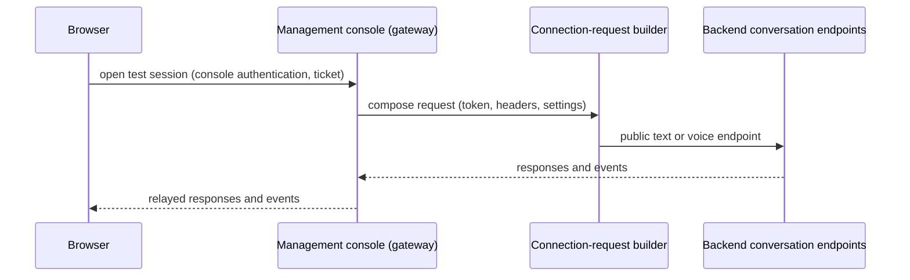

# Contract: Management Console Connection

The console's test feature uses the same public endpoints as any other client (see [conversation-endpoints.md](conversation-endpoints.md)).

## Flow

## Rules

- The browser never connects to the backend directly; the console remains the gateway (spec clarification Q1).
- Exactly one function composes every backend connection request: the signed start permit issued by the console, standard headers, and the `settings` extension point. Text and voice both use it. The browser-facing socket stays a WebSocket; the relay turns a text submission into a `POST /v1/conversations/text` and forwards the streamed events back. For text the relay keeps only the `conversationId` of the open test (no history, which the backend stores), mints a fresh single-use permit on the server for every text turn, and never sends that permit to the browser. A stored conversation is never read by management.
- `settings` is sent only when provided by the console and is always empty in this feature; a non-empty value is rejected by the backend with `settings_not_supported`.
- The console's own gateway routes (renamed from `/v1/test-tickets` and `/v1/test-sessions` to `/v1/console/tickets` and `/v1/console/sessions`, subprotocol `caller.test.v1` to `caller.console.v1`) describe the console-to-browser leg only; they carry no backend-only semantics. For text the console opens its browser socket without a backend call and shows the published revision from management's own configuration; the backend pins the revision per turn.
- Console errors surface the backend's stable error code unchanged.
- The text mode of the console shows a static notice that text test conversations are stored for 30 days and visible only to their owner; the notice is plain text and changes no behavior.

## Verification

- Relay tests assert the backend request equals what any other client would send (same builder output, no extra headers or fields).
- Browser tests keep one passing path per behavior; duplicates are removed (see [research.md](../research.md), Decision 6).
