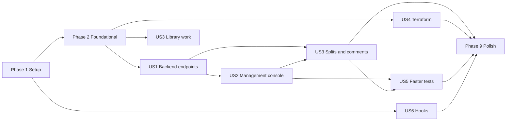

---

description: "Task list for Codebase Simplification and Consistency Cleanup"
---

# Tasks: Codebase Simplification and Consistency Cleanup

**Input**: Design documents from `/specs/003-codebase-simplification/`

**Prerequisites**: [plan.md](plan.md), [spec.md](spec.md), [research.md](research.md), [data-model.md](data-model.md), [contracts](contracts/conversation-endpoints.md), [quickstart.md](quickstart.md)

**Tests**: Included. Constitution Principle IX and spec FR-021 require meaningful automated tests for every changed or retained behavior. Tests are written before the implementation they cover and must fail first where new behavior is introduced.

**Organization**: Tasks are grouped by user story. Paths are relative to the repository root. Each project runs in its own environment (`code/<project>/.venv/Scripts/python.exe`); run one terminal command at a time. All verification uses controlled doubles; no cloud resource, live provider or real environment is used (FR-027).

## Format: `[ID] [P?] [Story] Description`

- **[P]**: Can run in parallel (different files, no dependency on an incomplete task)
- **[Story]**: User story the task belongs to (US1 to US6)

---

## Phase 1: Setup (Baselines and Guard Checks)

**Purpose**: Record the "before" numbers and add automated checks that make every later deletion provable.

- [X] T001 Run each project's suite once with `pytest -q --durations=25` (backend, management, tools) and record wall-clock time and the slowest tests under a new "Local suite baseline" table in `specs/003-codebase-simplification/research.md` (FR-022)
- [X] T002 [P] Record the ten largest production files, total production line count and the count of modules lacking a purpose docstring for `code/backend/src/caller_runtime`, `code/management/management_app` and `code/tools/scripts` in `specs/003-codebase-simplification/research.md` (SC-004, SC-005 baseline)
- [X] T003 Create `code/tools/scripts/check_modules.py`: (a) import-reachability from `caller_runtime.main` and `caller_runtime.composition` (backend) and `management_app.management_app` (management), reporting unreachable production modules; (b) report every production module whose first statement is not a module docstring. Support a report mode (exit 0) and `--strict` (non-zero on any finding)
- [X] T004 [P] Create `code/tools/tests/test_check_modules.py` using temporary packages: reachable module passes, unreachable module is reported, missing docstring is reported, `--strict` exit codes (SC-001, SC-005)
- [X] T005 Wire `check_modules.py` in report mode into `code/tools/scripts/ci.py` and `code/.pre-commit-config.yaml` next to `check_whitespace.py`; it flips to strict in T086

**Checkpoint**: Baselines recorded; reachability and docstring checks available.

---

## Phase 2: Foundational (Blocking Prerequisites)

**Purpose**: Shared types and the shared connection contract that every story depends on. No story starts before this phase completes.

- [X] T006 Extend `code/backend/src/caller_runtime/domain/ports.py` with `CredentialPort` (from `adapters/azure_realtime.py`) and `ContainerPort` and `SessionConflict` (from `adapters/session_repository.py`), plus any further symbol that a live module (anything reachable from `main.py`/`composition.py`) imports from a module slated for deletion, found with `check_modules.py` and a repository-wide usage search
- [X] T007 Update imports to the relocated types in `code/backend/src/caller_runtime/composition.py`, `adapters/capabilities.py`, `adapters/capability_client.py`, `adapters/configuration_client.py`, `adapters/test_admission_repository.py` and every affected file under `code/backend/tests/`; run the backend suite to confirm nothing else changed
- [X] T008 Reduce `code/backend/src/caller_runtime/services/configuration_activation.py` to revision pinning only: remove `admit`, `AdmittedConfiguration` and every `CallLifecycle`, `AgentPort`, `PhonePort`, `RepositoryPort` import; keep `select_new_call` and `running`; update `code/backend/tests/integration/test_revision_activation.py` accordingly
- [X] T009 Create `code/backend/src/caller_runtime/api/connection.py` implementing the shared connection contract from `contracts/conversation-endpoints.md`: bearer-token extraction and independent validation of the signed manager start permit (reuse the verifier in `adapters/test_identity.py`; bearer header on text, first `start` message on voice), `ConnectionSettings` (pydantic, `extra="forbid"`; "Absent or `{}` is accepted. Any other value is rejected with `settings_not_supported`"), the error vocabulary `unauthorized`, `forbidden`, `settings_not_supported`, `limit_exceeded`, `capacity_unavailable`, `invalid_request`, `upstream_unavailable`, `internal_error` with their HTTP statuses (401, 403, 422, 413, 503, 400, 502, 500) and one WebSocket close code each in the 4000 range, a fixed `reason` per error from a closed list (including `conversation_not_found` under `invalid_request` and `history_unavailable` under `upstream_unavailable`; authentication failures limited to `permit_invalid`, `permit_expired`, `permit_replayed`, `session_expired`), one mapping table that groups every internal code raised in `services/test_admission.py`, `services/conversation.py`, `api/test_sessions.py` and `adapters/test_identity.py` under a public code (unlisted codes become `internal_error` without `reason`), and the shared message, frame (256 KiB) and turn-timeout limits
- [X] T010 [P] Create `code/backend/tests/unit/test_connection_contract.py`: settings omitted, `{}`, unknown field, authority-changing field (`revision_id`, `identity`, `capability`, `credential`), missing, invalid and expired permit, error-to-status and error-to-close-code mapping, `reason` values, a test that fails when an internal code raised in the live backend modules is missing from the mapping table, limit constants (SC-003, FR-007, FR-008)

**Checkpoint**: Foundation ready; user stories can start.

---

## Phase 3: User Story 1 - One Text and One Voice Entry Point on the Backend (Priority: P1) - MVP

**Goal**: The backend exposes `/healthz`, `/readyz`, `POST /v1/conversations/text` and `WS /v1/conversations/voice` only; call integration and all duplicate paths are gone.

**Independent Test**: List every route of the created app; run one text turn, a follow-up turn that continues from stored history, and one voice session with doubles; confirm every retired path returns not-found and no unreachable production module remains.

### Tests for User Story 1

- [X] T011 [P] [US1] Create `code/backend/tests/contract/test_text_endpoint.py`: success streams `text.delta` then `text.completed` as server-sent events, a new conversation returns `conversationId` in the first event, a follow-up with that id continues from stored history, an unknown, expired or foreign id fails identically (`invalid_request`, reason `conversation_not_found`), permit required, one slot taken per request and released after verified cleanup, a second in-flight turn for the same manager fails with `capacity_unavailable`, `unauthorized`, `forbidden`, oversized request (`limit_exceeded`, 413), invalid body (`invalid_request`, 400), nonempty `settings` (`settings_not_supported`, 422), error event after stream start, a request carrying a `history` field fails with `invalid_request`, an unavailable history store fails closed with `upstream_unavailable` reason `history_unavailable` without generating a reply, same published-configuration behavior as feature 002 (FR-001, FR-004)
- [X] T012 [P] [US1] Create `code/backend/tests/contract/test_voice_endpoint.py` (port the speech-relevant cases from `tests/unit/test_test_admission.py` and `tests/integration/test_conversation.py`): subprotocol `caller.voice.v1` required, first-message authentication and admission, `settings` rejection, audio exchange, interruption, stop, bounded cleanup, closure confirmed before capacity release, saturation (all slots in use gives `capacity_unavailable` without disturbing active sessions, queues stay bounded), one error code per close (FR-001, FR-004, FR-015; Principle VI evidence)
- [X] T013 [P] [US1] Create `code/backend/tests/contract/test_route_inventory.py`: routes are exactly `/healthz`, `/readyz`, `/v1/conversations/text`, `/v1/conversations/voice`; each retired path (`/v1/internal/test-sessions`, `/v1/calls/{id}/media`, `/v1/provider/callbacks`, `/v1/operations/drain/*`, `/v1/dev/transport`) is not found; `metrics.route_for` knows only the new routes (FR-003, SC-001, SC-011)
- [X] T014 [P] [US1] Create `code/backend/tests/unit/test_text_history_repository.py` with a Cosmos container double: item id and partition key `/ownerKey` from the permit's tenant and manager, item `ttl` of 2592000 seconds written on every update, ETag-conditioned append after a completed turn only, a failed turn writes nothing, an unreachable store raises a content-free `history_unavailable` error and writes nothing, total stored size at most 256 KiB (`conversation_context_limit`), foreign, unknown and expired ids indistinguishable (`conversation_not_found`), agent-change reset, voice mode writes nothing, no conversation text in raised errors (FR-028 to FR-031, SC-013)
- [X] T015 [P] [US1] Rewrite the text case in `code/backend/tests/integration/test_content_privacy.py` so text content may exist only in the history container and never in logs, metrics, traces, error bodies, alert payloads, the admission authority record or any other store; keep the speech cases unchanged (audio, transcripts and provider bodies stay volatile); record in the test docstring that this deliberately narrows the feature 002 text guarantee (FR-031, SC-013)
### Implementation for User Story 1

- [X] T016 [US1] Create `code/backend/src/caller_runtime/domain/text_history.py` (conversation model, owner key from the permit's actor key, 256 KiB bound) and `code/backend/src/caller_runtime/adapters/text_history_repository.py` using `ContainerPort` from `domain/ports.py`, ETag-conditioned replace, `ttl` on every write and identical refusal of foreign, unknown and expired ids (FR-028, FR-029, FR-030)
- [X] T017 [US1] Add `text_history_container` and `text_history_ttl_seconds` (default 2592000) to `RuntimeOptions` in `code/backend/src/caller_runtime/composition.py` (where the other runtime wiring options live; `settings.py` only holds startup flags), extend the container factory in `code/backend/src/caller_runtime/composition.py` to take a container name (tested with two containers), wire the history repository with the existing credential, emit a content-free `history.store` telemetry event (outcome and latency), extend the telemetry allow-lists (`EVENTS` and the per-event attribute and reason sets) in `code/backend/src/caller_runtime/observability.py` and `code/backend/tests/unit/test_observability.py` for `history.store`, add a cached background probe (sentinel read about every 10 seconds) so `code/backend/src/caller_runtime/api/health.py` reads only the cached result and reports not ready with the fixed reason `history_store_unavailable` when it is bad or older than 30 seconds (update `code/backend/tests/contract/test_health.py`), and change `code/backend/src/caller_runtime/services/conversation.py` so text mode loads and appends stored history instead of `self._history` (keep the 256 KiB limit, the failed-turn rule and the agent-change reset) while speech mode keeps its in-memory history (FR-028, FR-029, FR-031)

- [X] T018 [US1] Create `code/backend/src/caller_runtime/api/text.py` with the text router using `api/connection.py` and the existing conversation service in `services/conversation.py`; one request is one turn and one admission slot, streamed as server-sent events (`text.delta`, `text.completed`, `error`); loads and appends stored history through the history repository and never accepts caller-supplied history; apply admission and limits (FR-001, FR-004)
- [X] T019 [US1] Add the `text-conversations` container (partition `/ownerKey`, container default expiry `-1` so item `ttl` applies) to `service_containers` in `code/infra/terraform/modules/platform/services.tf` and extend the backend identity's Cosmos data-plane role assignment in `code/infra/terraform/modules/platform/security.tf` to cover it, with no local key authentication; update `code/infra/terraform/test-fixtures/` and `code/tools/scripts/verify_terraform.py` expectations; run only credential-free checks, no apply (FR-031, Principle VIII)
- [X] T020 [US1] Rename `code/backend/src/caller_runtime/api/test_sessions.py` to `api/voice.py`; serve `/v1/conversations/voice` with subprotocol `caller.voice.v1`; replace its private auth, settings, error and limit handling with `api/connection.py`; keep every retained behavior (FR-001, FR-015)
- [X] T021 [US1] Rename `TestRuntimeComposition` to `ConversationRuntime` in `code/backend/src/caller_runtime/composition.py`; have it register both routers; update `main.py` (parameter names, remove the `dev_router` include and the `api/dev_transport` import) and the tests that build the app
- [X] T022 [US1] Update the route allow-lists in `code/backend/src/caller_runtime/main.py`, `metrics.py` (`route_for`, `METHODS`) and `observability.py` to the four live routes plus a shared `kind` (`text` or `voice`) telemetry attribute; remove call-only metrics and events (`caller.handovers`, `caller.handover.duration`, `HANDOVERS` and `handover()` in `metrics.py`, drain route handling, owner and epoch binding helpers used only by call routing, and owner-routing event names that no remaining code emits (verify each name by search and `check_modules.py` first; names raised by test admission such as `stale_owner` stay); update `tests/unit/test_metrics.py` and `tests/unit/test_observability.py`
- [X] T023 [US1] Delete `code/backend/src/caller_runtime/api/media.py`, `api/provider_webhooks.py`, `api/operations.py`, `api/dev_transport.py` and their tests `code/backend/tests/contract/test_call_transport.py`, `tests/contract/test_dev_transport.py`
- [X] T024 [US1] Run `check_modules.py` for the backend; delete the call-lifecycle group once it reports them unreachable: `domain/call_lifecycle.py`, `domain/session.py`, `domain/handover.py`, `domain/transfer_context.py`, `domain/cleanup.py`, `services/handover.py` (for any module still imported by live code, move the needed symbol into `domain/ports.py` or record the reason in `research.md`) (FR-010)
- [X] T025 [US1] Delete the capacity, rollout and audit group once unreachable: `adapters/capacity_repository.py`, `adapters/rollout_repository.py`, `adapters/audit_repository.py`, `adapters/session_repository.py`, `domain/audit.py`, `services/capacity.py`
- [X] T026 [US1] Delete the routing and drain group once unreachable: `services/owner_routing.py`, `services/routing.py`, `services/drain.py`
- [X] T027 [US1] Delete tests that only cover removed behavior, naming the removed behavior in the commit description: `code/backend/tests/integration/test_call_journey.py`, `test_handover_isolation.py`, `test_owner_failure.py`, `test_planned_drain.py`, `tests/load/test_capacity.py`, `tests/unit/test_call_lifecycle.py`, `test_handover_races.py`, `test_audit.py`, `test_cleanup.py`; trim the call-era cases from `tests/unit/test_session_repository.py` (delete if nothing live remains) and from `tests/integration/test_community_journeys.py`, `test_foundation_recovery.py`, `test_content_privacy.py` (keep every case about retained behavior). Never delete or weaken tests for content privacy, admission and one in-flight test per manager, limits or verified cleanup (the text-content privacy case is rewritten, not removed, in the history privacy task); delete only cases whose subject is a removed feature, and run the backend suite after each deletion
- [X] T028 [US1] Delete `code/tools/scripts/drain_rollout.py`, `code/tools/scripts/kubernetes_rollout.py` and `code/tools/tests/test_drain_rollout.py`; remove their references from `code/tools/scripts/ci.py`, `.github/workflows/*.yml`, `code/infra/`, `docs/containers.md` and `docs/runbooks/` found with a repository-wide search
- [X] T029 [US1] Search `code/backend/src/caller_runtime/settings.py`, `code/tools/scripts/qualify_environment.py`, `smoke.py`, `release_checks.py`, `verify_multimodal.py`, `verify_release.py` and their tests for call, telephony and provider-callback settings, probes and cases; remove or update them so no active code depends on removed behavior (FR-002)
- [X] T030 [US1] Document the current contract: create `docs/conversation-endpoints.md` from `contracts/conversation-endpoints.md` (with a Mermaid sequence diagram of text and voice); remove current operational docs for removed features (`docs/runbooks/call-lifecycle.md`, `docs/runbooks/drain-rollout.md`, `docs/telephony-qualification.md`) and fix links in `docs/runbooks/README.md` and `docs/architecture.md`; mark `specs/002-multimodal-agent-management/contracts/conversation.md` superseded with a link to `docs/conversation-endpoints.md`, preserving its recorded text (contract document only; other superseded markers are T088) (FR-026, clarification Q5)
- [X] T031 [US1] Record the threat assessment for stored text content in `docs/security.md` (data stored, owner-only access, encryption at rest and in transit, managed identity, log exclusion, 30-day retention, and replay of stored untrusted content into later prompts: stored turns are sent back only as conversation turns and never as system instructions, the 256 KiB context limit and agent-change reset apply, only the owner's history is loaded, and a poisoned conversation is abandoned by starting a new one or expires), add `docs/runbooks/text-history.md` (retention, emergency purge by owner key with approval, expiry behavior, failure and recovery, history-store error-rate and latency alert thresholds with owner and response steps) and update the data-ownership section of `docs/architecture.md` with a Mermaid diagram showing that only the backend reads the container (FR-030, FR-031, Principles II and III)
- [X] T032 [US1] Run the backend suite and `check_modules.py` (report mode) and confirm zero unreachable production modules and that `/healthz`, `/readyz`, text and voice are the only routes; record deleted line counts in `specs/003-codebase-simplification/research.md`

**Checkpoint**: Backend interface is final; US1 is independently verifiable (MVP).

---

## Phase 4: User Story 2 - Management Test Console Uses the Same Backend Endpoints (Priority: P1)

**Goal**: The management server (still the browser-facing gateway) reaches the backend only through the two public endpoints, built in one place with an empty settings extension point.

**Independent Test**: Run a text test and a voice test from an authenticated browser against doubles; recorded backend traffic shows only the two public endpoints; nonempty settings are rejected by the backend.

### Tests for User Story 2

- [X] T033 [P] [US2] Create `code/management/tests/unit/test_backend_connection.py`: builder output for text and voice (token, standard headers, `settings` omitted or `{}`), refusal to emit nonempty settings, one builder used by both modalities, a fresh single-use permit per text turn that is never exposed to the browser (FR-009, FR-007)
- [X] T034 [P] [US2] Update `code/management/tests/unit/test_test_console.py` and `code/management/tests/integration/test_management_composition.py` so the backend double records requested paths and asserts only `/v1/conversations/text` and `/v1/conversations/voice` are used and the relay's request equals what any plain client sends, text requests carry only `conversationId` and `text`; keep the one-active-test-per-manager, revision/mode visibility, fail-closed and bounded-cleanup cases (SC-002, FR-006)

### Implementation for User Story 2

- [X] T035 [US2] Create `code/management/management_app/adapters/backend_connection.py`: the single function that composes a backend connection request (the signed start permit issued by the console, headers, `settings` extension point) for text and voice; settings are sent only when the console supplies them (always empty in this feature); text requests carry only `conversationId` and `text` (FR-009)
- [X] T036 [US2] Refactor `code/management/management_app/adapters/test_session_client.py` to use `backend_connection.py`: text turns call `POST /v1/conversations/text` and the streamed events are relayed to the browser socket; the relay keeps only the `conversationId` of the open test, mints a fresh single-use permit on the server for each text turn, never shows it to the browser and holds no history; voice uses `WS /v1/conversations/voice` with `caller.voice.v1`; remove the `/v1/internal/test-sessions` URL and `caller.test.v1`; split the module so none exceeds 600 lines where a natural seam exists (FR-005)
- [X] T037 [US2] Rename the console's own gateway routes and subprotocol: `/v1/test-tickets` to `/v1/console/tickets`, `/v1/test-sessions` to `/v1/console/sessions`, `caller.test.v1` to `caller.console.v1`; update `management_app/api/test_sessions.py`, `models/test_session.py` (`socket_path` literal), `components/live_audio.py` (lines using the ticket fetch and socket path), `security.py` (public-route list), `composition.py` (ticket route list) and `observability.py` (route list)
- [X] T038 [US2] Add a static notice to the text mode of the test console in `code/management/management_app/pages/test_console.py` (and `code/management/management_app/state/test_console.py` if the text needs state) saying that text test conversations are stored for 30 days and visible only to their owner; add a rendered-text case to `code/management/tests/unit/test_test_console.py` and mention it in the management section of `docs/setup.md` (FR-030)
- [X] T039 [US2] Update `code/management/tests/contract/test_browser_tests.py` and `code/management/tests/browser/test_shell.py` for the renamed gateway routes and subprotocol chosen in T037
- [X] T040 [US2] Confirm backend rejection of authority-changing and nonempty settings end to end through the console path (reuse the T010 cases through the relay in `code/management/tests/unit/test_test_console.py`) and surface the backend's stable error code unchanged in `code/management/management_app/api/test_sessions.py` (FR-008)
- [X] T041 [US2] Update `specs/003-codebase-simplification/contracts/management-connection.md` with the chosen gateway route and subprotocol names and update `docs/architecture.md` and the management sections of `docs/setup.md` with the revised Mermaid flow (FR-026)
- [X] T042 [US2] Run the management suite including browser cases and record that no test-only backend endpoint is referenced anywhere in `code/management/` (search), SC-002

**Checkpoint**: US1 and US2 work together; the console is a peer of any future client.

---

## Phase 5: User Story 3 - Readable Code, Explaining Comments and Official Libraries (Priority: P2)

**Goal**: Hand-written equivalents of official-library capabilities are gone or justified; every production module states its purpose; big modules are split where a natural seam exists.

**Independent Test**: `check_modules.py --strict` passes docstring coverage; the Library Decision Log has an entry for every capability; the GPT-Live contract tests pass on the SDK-based adapter.

### Tests for User Story 3

- [X] T043 [P] [US3] Update `code/backend/tests/contract/test_gpt_live.py` to run against the SDK-based adapter with a local fake server: client-delegation events, 256 KiB frame bound, bounded queue, timeouts, confirmed-closure behavior, refusal of redirects and of unverified TLS (FR-012, FR-015)

### Implementation for User Story 3

- [X] T044 [US3] Verify with a small local probe against the installed `openai` 3.31.0 that `AsyncOpenAI(...).live.connect()` with `websocket_connection_options` enforces TLS verification and redirect refusal and exposes the needed frame/queue limits; record the result and any retained local control in `specs/003-codebase-simplification/research.md` Decision 3
- [X] T045 [US3] Rewrite `code/backend/src/caller_runtime/adapters/gpt_live.py` on `AsyncOpenAI(...).live.connect()` with `azure.identity.get_bearer_token_provider`; keep only the closure-confirmation repair and timeout logic that the SDK does not provide, each with a one-line reason comment; update `composition.py` (FR-012)
- [X] T046 [US3] Delete `code/backend/src/caller_runtime/adapters/azure_realtime.py` and `code/backend/tests/unit/test_azure_realtime.py`; remove the `agents.realtime` TYPE_CHECKING imports from `adapters/agents_sdk.py` and the realtime usage from `tests/integration/test_sdk_lifecycle.py`; drop the `[realtime]` extra in `code/backend/pyproject.toml` and relock `code/backend/uv.lock` through the approved mirror; run `code/tools/scripts/audit_dependencies.py` (FR-013)
- [X] T047 [P] [US3] Create `docs/library-decisions.md` from the Library Decision Log in `research.md`, extended by a pass over backend, management and tools dependencies: each capability lists the official library used or the reason for retained custom code (SC-006)
- [X] T048 [US3] After T036, decide and record in `docs/library-decisions.md` whether the management upstream `websockets` usage remains (gateway relay) and why
- [X] T049 [P] [US3] Split `code/backend/src/caller_runtime/services/conversation.py` (1273 lines) into cohesive modules at natural seams (turn handling, persistence, delegation); update imports and tests
- [X] T050 [P] [US3] Rename `services/test_admission.py` to `services/admission.py` and `adapters/test_admission_repository.py` to `adapters/admission_repository.py` (`test_identity.py` as `identity.py`), splitting `admission.py` (1138 lines) at natural seams; update imports, `composition.py` and tests (e.g. `tests/unit/test_test_admission.py` to `test_admission.py`)
- [X] T051 [P] [US3] Split `code/management/management_app/state/configuration_editor.py` (1301 lines) at natural seams
- [X] T052 [P] [US3] Split `code/management/management_app/security.py` (867 lines) and `components/live_audio.py` (877 lines) at natural seams (each split module keeps a purpose docstring)
- [X] T053 [US3] Sweep remaining code for single-use abstractions and duplicated helpers (for example sanitizers repeated across `observability.py` and `metrics.py` in backend and management); consolidate or remove with tests unchanged (FR-010)
- [X] T054 [P] [US3] Add module purpose docstrings (purpose, inputs, outputs, failure behavior, security assumptions where they apply) and one-line "why" comments for non-obvious decisions, ordering rules, deadlines and cleanup logic in `code/backend/src/caller_runtime/api/`, `domain/` and `settings.py` (FR-011) (done: every module in this area has a multi-line docstring (purpose, inputs, outputs, failure behavior, security assumptions) and why-comments at ordering rules, deadlines, cleanup and security decisions)
- [X] T055 [P] [US3] Same documentation pass for `code/backend/src/caller_runtime/adapters/` and `services/` (FR-011) (done: every module in this area has a multi-line docstring (purpose, inputs, outputs, failure behavior, security assumptions) and why-comments at ordering rules, deadlines, cleanup and security decisions)
- [X] T056 [P] [US3] Same documentation pass for `code/management/management_app/` (`adapters/`, `api/`, `components/`, `models/`, `pages/`, `services/`, `state/` and top-level modules) (FR-011) (done: every module in this area has a multi-line docstring (purpose, inputs, outputs, failure behavior, security assumptions) and why-comments at ordering rules, deadlines, cleanup and security decisions)
- [X] T057 [P] [US3] Same documentation pass for `code/tools/scripts/*.py` (FR-011) (done: every module in this area has a multi-line docstring (purpose, inputs, outputs, failure behavior, security assumptions) and why-comments at ordering rules, deadlines, cleanup and security decisions)
- [X] T058 [US3] Run `check_modules.py` in report mode; fix every missing docstring; record the after-values for total production lines and largest files in `specs/003-codebase-simplification/research.md`, with a recorded reason for each module still above 600 lines (SC-004 advisory)

**Checkpoint**: Libraries and readability goals met; strict check passes locally.

---

## Phase 6: User Story 4 - One Terraform Definition for Every Stage (Priority: P2)

**Goal**: The same Terraform code serves dev, test, prod and any later stage; only a backend file and a variable file differ.

**Independent Test**: Credential-free validation of the three example pairs plus a throwaway fourth pair with zero code edits; static check finds no stage-name condition.

### Tests for User Story 4

- [X] T059 [P] [US4] Update `code/tools/tests/test_terraform_delivery.py`: arbitrary stage names (including an unknown fourth), state key read from the backend file, protected deployment-environment name taken from workflow inputs rather than derived from a name format, rejection of malformed files, no per-name logic
- [X] T060 [P] [US4] Add a static check to `code/tools/scripts/verify_terraform.py` that fails when any `.tf` file under `code/infra/terraform` branches on an environment name (validation regex on an environment name, `var.environment` or literal `dev`/`test`/`prod` in a condition, or an interpolated state key), with cases in `code/tools/tests/test_static_checks.py`; add an assertion that only the backend identity has a data-plane role on the `text-conversations` container and the management identity has none (FR-031)

### Implementation for User Story 4

- [X] T061 [US4] In `code/infra/terraform/bootstrap/variables.tf` and `main.tf` remove the `environment` validation regex and the hard-coded `"${var.environment}/platform.tfstate"` key (line 120) so bootstrap holds no state key for the platform stack; each stack's backend file (`bootstrap` and `platform`) carries its own `key` (FR-016, FR-017)
- [X] T062 [US4] In `code/infra/terraform/environments/variables.tf` and `main.tf` remove the `environment` validation regex and the `environment` output; replace the `environment` tag input with an optional `label` variable (default `null`) used only for naming and tags (FR-017)
- [X] T063 [US4] Review `code/infra/terraform/modules/platform/retirement.tf` and the other module files for stage-name logic or call-era resources; remove what is call-only (decide which Cosmos containers still serve retained behavior: `call-sessions` and `call-audit` in `services.tf`, and check which container backs the admission authority in `adapters/test_admission_repository.py` before removing any) and record each decision in `specs/003-codebase-simplification/research.md` (Principle VIII: document operational impact and recovery)
- [X] T064 [US4] Update `code/tools/scripts/terraform_delivery.py`: remove `f"{environment}/{stack}.tfstate"` and `f"{environment}-terraform-{stack}-{operation}"` derivations; read the key from the backend file and the protected environment name from the workflow input; keep the OIDC-only and identity-match checks unchanged
- [X] T065 [US4] Keep `environment` a free-form input in `.github/workflows/terraform-deploy.yml`, `terraform-bootstrap.yml` and `terraform-infrastructure.yml` with no list of stage names; adding a stage must need no workflow edit, so only document the `<name>-terraform-<stack>-<operation>` protected environment naming; add no triggers and weaken no protection (FR-017, FR-019)
- [X] T066 [P] [US4] Create or update synthetic nonsecret examples in `code/infra/terraform/config/` for `dev`, `test` and `prod`, for both `bootstrap` and `platform` (backend `*.azurerm.tfbackend.json.example` and `*.tfvars.json.example`), differing only in data (FR-018)
- [X] T067 [P] [US4] Update `code/infra/terraform/test-fixtures/` and the credential-free path of `verify_terraform.py` so all three example pairs validate through the same code path, and a generated fourth pair validates with no source edit (SC-007)
- [X] T068 [US4] Update `docs/runbooks/terraform-delivery.md`, `terraform-state.md`, `platform.md` and `docs/setup.md` to describe the single convention, the three stages and "add a stage" steps; align `contracts/environment-files.md`
- [X] T069 [US4] Run `terraform fmt -check`, the credential-free validation and `code/tools` tests; confirm no plan or apply ran against a real environment

**Checkpoint**: One Terraform definition verified for three stages.

---

## Phase 7: User Story 5 - Faster Automated Testing Without Losing Coverage (Priority: P2)

**Goal**: Measured shorter required checks and a quick tier, with every retained requirement still tested.

**Independent Test**: Compare the T001 baseline with the post-change timings; verify the traceability table covers every retained requirement.

- [X] T070 [P] [US5] Register a `quick` marker (unit and contract) in `code/backend/pyproject.toml`, `code/management/pyproject.toml`, `code/tools/pyproject.toml` (`--strict-markers` is on) and apply it to the unit and contract tests; the full tier stays unmarked-inclusive
- [X] T071 [US5] Remove duplicate coverage between `code/backend/tests/unit/test_conversation.py` (2193 lines) and `tests/integration/test_conversation.py` (2142 lines): keep one test per behavior, name the covering test for each removed one in the commit description (reviewed: only the SDK startup case was a true duplicate; `tests/unit/test_sdk_startup.py` was removed and `tests/integration/test_sdk_lifecycle.py` covers both of its cases (it gained the environment and restart assertions); the paired conversation test files test different layers and stay; see research.md)
- [X] T072 [US5] Share the expensive setup in `code/management/tests/conftest.py` and `tests/editor_app.py`: one compiled Reflex build and one browser session reused across the 81 browser cases instead of per test, with tests isolated by data not by rebuild (tried and reverted: a session-wide compiled frontend on fixed ports ran the suite in 506 s against 503 s for the per-host build, so it gave no measurable saving, and it made the 24 speech console cases fail on the Ubuntu CI run; the per-host build that passed on both systems was restored; see research.md)
- [X] T073 [US5] Merge duplicate browser cases in `code/management/tests/browser/test_configuration_editor.py` and `tests/contract/test_browser_tests.py`, keeping one passing case per behavior (reviewed: none merged; the cases cover distinct behaviors and the width parametrization is required responsive evidence)
- [X] T074 [P] [US5] Reduce repeated setup cost in `code/tools/tests/test_static_checks.py` and `test_verify_multimodal.py` with module-scoped fixtures (profiled: the time is three real child-process runs, the failure gate at 37 s and the two service-alert contract cases at 11 to 13 s, not repeated setup; module-scoped fixtures would not shorten them, so nothing was changed)
- [X] T075 [US5] (decision recorded: xdist is on the mirror but its lock needs public artifact URLs; see docs/library-decisions.md) Check the approved mirror for `pytest-xdist`; if present add it to the dev dependencies of the projects whose tests are isolated, relock and enable `-n auto` for those suites; otherwise record the reason in `docs/library-decisions.md` and `research.md` (FR-020, FR-013)
- [X] T076 [US5] Add a quick mode to `code/tools/scripts/ci.py` (marker-based, per project) and reduce redundant CI work in `.github/workflows/ci.yml` (docs render at 142-305 s, image audit at about 167 s: cache or share steps, run independent steps in parallel jobs) without removing any required check or adding triggers (done as agreed: job names kept, dependency caching added; the benefit is unmeasured until a CI run, and Mermaid or Chromium caching needs a pinned `actions/cache` reference)
- [X] T077 [US5] Create `docs/testing.md`: tiers, how to run each, what is opt-in (live and real-environment acceptance), and the rule that no test is skipped or weakened for speed (FR-021)
- [X] T078 [US5] Re-measure local suites and the CI steps under conditions comparable to T001; record the after-values and a reason for any advisory target not met in `specs/003-codebase-simplification/research.md` (SC-008)
- [X] T079 [US5] Create `docs/acceptance/codebase-simplification.md` mapping every retained requirement (FR-001 to FR-031) to at least one passing test or check, and listing each removed test with the removed behavior or the covering test (SC-009)

**Checkpoint**: Test time reduced and coverage mapped.

---

## Phase 8: User Story 6 - GitHub Hooks for the Spec Workflow (Priority: P3)

**Goal**: Spec Kit offers GitHub steps at defined stages, always confirmed, always skippable.

**Independent Test**: Load the hook configuration in a test; run each hook with and without `gh` available.

- [X] T080 [P] [US6] Create `code/tools/tests/test_spec_hooks.py`: `.specify/extensions.yml` parses; every hook has `optional: true` and a prompt; no hook is registered on a non-Spec-Kit event; the local push/pull-request command refuses to act without confirmation and skips with a reason when `gh` or authentication is missing (stubbed commands) (SC-010, FR-024, FR-025)
- [X] T081 [US6] Read the installed bundled `git` and `github` extension manifests (`specify extension --help`, `specify extension list`) and write their exact command identifiers into `specs/003-codebase-simplification/contracts/github-hooks.md`
- [X] T082 [US6] Enable the bundled `git` and `github` extensions with the Spec Kit extension command so their files are committed under `.specify/`
- [X] T083 [US6] Create the local extension `.specify/extensions/caller-github/extension.yml` and `commands/push-pr.md`: check `git`, `gh` and authentication first; show branch, target and title; require explicit confirmation; never force-push; never store credentials
- [X] T084 [US6] Create `.specify/extensions.yml` registering the hooks from `contracts/github-hooks.md` (`before_specify` branch; `after_specify`, `after_plan`, `after_tasks`, `after_implement` commits; `after_tasks` issues; `after_implement` push and pull request), each `optional: true` with a prompt (FR-023)
- [X] T085 [US6] Create `docs/spec-workflow-hooks.md` listing each hook, its prompt, prerequisites and how to disable it; link it from `docs/setup.md` and `docs/repository-layout.md`; run the hook flow once with `gh` unavailable (PATH without `gh`) and confirm a clear skip message and an unaffected workflow

**Checkpoint**: Hooks documented, tested and optional.

---

## Phase 9: Polish and Cross-Cutting Concerns

- [X] T086 Flip `check_modules.py` to `--strict` in `code/tools/scripts/ci.py` and `code/.pre-commit-config.yaml`; add a check in `code/tools/tests/test_static_checks.py` that active code, tests, workflows, Terraform and current docs contain none of the retired paths (`/v1/internal/test-sessions`, `/v1/calls/`, `/v1/provider/callbacks`, `/v1/operations/drain`, `/v1/dev/transport`, `caller.test.v1`) except an explicit allowlist (regression tests that assert absence, this feature's own documents under `specs/003-codebase-simplification/`, and historical specs, task logs and acceptance records)
- [X] T087 [P] Update `docs/architecture.md`, `docs/setup.md`, `docs/security.md`, `docs/containers.md`, `docs/repository-layout.md`, `docs/capacity.md`, `docs/runbooks/monitoring.md`, `docs/runbooks/scaling.md` and `docs/runbooks/README.md` for the new surface; state the remaining voice-session behavior (bounded admission, bounded frames and queues, timeouts, confirmed closure before capacity release, shutdown and reconnect recovery) per Principle VI; include text history data ownership, retention and purge; refresh every affected Mermaid diagram (Principle III)
- [X] T088 [P] Add supersession banners and repair links, without changing recorded results, in `docs/acceptance/*.md` and every document under `specs/` (except `specs/003-codebase-simplification/`, which names the retired paths on purpose) and `docs/acceptance/` that contains one of the retired paths listed in T086 (found by search; the T086 allowlist uses the same directories), pointing to the current documents (everything except the conversation contract handled in T030) (FR-014, FR-026, clarification Q5)
- [X] T089 Update `specs/003-codebase-simplification/plan.md` (final endpoint, route and container names) and `contracts/*.md` to match what was built
- [X] T090 Run the full validation: all three project suites, `code/tools/scripts/ci.py`, `verify_docs.py`, `check_whitespace.py`, the repository secret scan, `check_publication.py`, `verify_terraform.py`, `audit_dependencies.py`; fix findings at the earliest failing step; confirm the default suites still run with network access blocked except localhost (`--disable-socket` in each `pyproject.toml`) so no live call or credential is needed (FR-027, SC-012)
- [X] T091 Walk through `specs/003-codebase-simplification/quickstart.md` with doubles, update it where reality differs, and record final before/after measurements in `research.md`
- [X] T092 Append a short "Implemented and deferred" section to `specs/003-codebase-simplification/research.md` listing deferred items (real-environment verification, direct browser-to-backend, configurable settings, call integration design)

---

## Dependencies and Execution Order

### Phase dependencies

- **Setup (Phase 1)**: no dependencies; T003 before T004/T005
- **Foundational (Phase 2)**: needs Phase 1; blocks all stories. T006 then T007 then T008; T009 then T010
- **US1 (Phase 3)**: needs Phase 2. The history store tasks T014 to T019 follow T010 and the Terraform container task T019 shares `services.tf` with T063 and `verify_terraform.py` and `test-fixtures/` with T060 and T067, so do those three after it. Delete order matters: T023 then T024, T025, T026 (each re-checked with `check_modules.py`), then T027, T028, T029
- **US2 (Phase 4)**: needs US1 (endpoints exist). T035 before T036; the browser-test update follows the gateway rename
- **US3 (Phase 5)**: library work (T043 to T047) needs Phase 2 only; T048 needs T036; splits (T049 to T052) need US1 and US2 deletions and renames done; the documentation pass (T054 to T057) comes after splits; T058 last
- **US4 (Phase 6)**: independent of US1 to US3; can run in parallel with them
- **US5 (Phase 7)**: needs US1 and US2 (removed tests) and benefits from US3 splits; T078 after all test changes
- **US6 (Phase 8)**: independent; can run in parallel with any other story
- **Polish (Phase 9)**: after all selected stories; T086 after T058

### Story dependency graph



### Parallel opportunities

- Phase 1: T002 with T003; T004 after T003
- Phase 2: T010 with T006 to T008 (different files)
- US1: T011, T012, T013 together; T024 to T026 are sequential
- US2: T033, T034, T039 together
- US3: T043, T047, T049, T050, T051, T052 together; T054 to T057 together
- US4: T059, T060 together; T066, T067 together; US4 in full runs beside US1 to US3
- US5: T070, T074 together
- US6: whole phase beside any other
- Polish: T087, T088 together

### Parallel example: User Story 1 tests

```text
T011 code/backend/tests/contract/test_text_endpoint.py
T012 code/backend/tests/contract/test_voice_endpoint.py
T013 code/backend/tests/contract/test_route_inventory.py
```

---

## Implementation Strategy

### MVP first

1. Phases 1 and 2 (baselines, guard checks, shared types, connection contract)
2. Phase 3 (US1): the backend surface is final and the dead code is gone
3. Stop and validate with `quickstart.md` section 1; then Phase 4 (US2) completes the P1 outcome

### Incremental delivery

1. P1 value: US1 then US2
2. P2 value in any order, with US4 in parallel: US3 (after US1 and US2), US4, US5 (after US3)
3. P3 value: US6
4. Polish: strict checks, docs, final measurements

Each step leaves the suites passing; advisory targets (25 percent, 600 lines, 50 percent, three minutes) are recorded, not gated.

## Notes

- A deletion task is complete only when `check_modules.py` shows nothing live imports the deleted module and the project suite passes.
- A removed test must name the removed behavior or the test that still covers it (Principle IX).
- Do not run any plan, apply, live provider call or cloud action; do not commit or push unless the user asks.

## Phase 10: Convergence

- [X] T093 Diagnose and fix the failing `Native checks (windows-2022)` job, step "Check source and tooling regressions" (`ci.py check`), on pull request #5 commit `eee8a28` (run 41817409529) until the required check passes on both operating systems, without skipping or weakening any check, per FR-021 and SC-008 (partial) (done: two causes were found and fixed or reverted, the non-canonical shared web directory on Windows and the shared build on Ubuntu; commit `f20c377` is green on both systems on its third attempt, after two intermittent Windows failures recorded in research.md that did not reproduce locally) (done: two causes were found and fixed or reverted: the non-canonical shared web directory on Windows and the shared build on Ubuntu; commit 20c377 is green on both systems on its third attempt, after two intermittent Windows failures recorded in research.md that did not reproduce locally)
- [X] T094 Investigate the browser failure `Cannot read properties of null (reading 'name')` in `code/management/tests/browser/test_configuration_editor.py::test_responsive_keyboard_editing_and_protected_roles[chromium-1440]` (CI run 41807919799), together with the one-off local failure of `test_console_synthetic_speech_pcm_mute_interrupt_and_confirmed_stop[chromium-controls-768]`; fix a product or test race if found, otherwise record the cause and why no change is needed in `research.md`, per FR-015 and FR-021 (partial) (done: six repeated local runs passed and the case passed in every other CI run, so no cause was found and no code changed; recorded in research.md)
- [X] T095 Replace the "CI step durations were not re-measured" note in `specs/003-codebase-simplification/research.md` (Final suite timings) with the native-test, documentation-render and image-audit durations of the first fully green run of this pull request, compared with the T001 baseline, per FR-022 and SC-008 (partial) (done: values from runs 41803375451 and 41827283123 recorded; they show no reduction)
