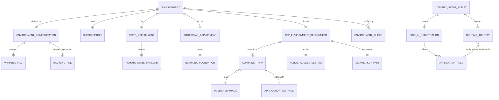

# Data Model: First Internal Test Environment

The entities are configuration, deployment and secret-handling concepts. Field names match the
contracts in [environment-files.md](contracts/environment-files.md) and
[application-settings.md](contracts/application-settings.md). Validation rules cite the requirement
that they enforce. Application data (configurations, audit entries, conversation history) keeps the
shapes the applications already define and is not redefined here.

## Entity overview

## Environment

| Field | Type | Rules |
|---|---|---|
| `name` | string | One of `int`, `dev`, `tst`, `prd`. Equals the directory name and the variable file prefix (FR-010). |
| `tenant_id` | GUID | Required. Not a secret. |
| `subscription_id` | GUID | Required and unique per environment (FR-011). |
| `client_id` | GUID | Deployment identity for OIDC, used by the deployments and the environment check. It holds the `tester` role and the read-only Graph permission `Application.Read.All` (FR-053), no directory write permission. Required. Not a secret. |
| `location` | string | Required Azure region that supports every declared service, and for the runtime one of `canadacentral`, `centralus`, `eastus2`, `swedencentral` (live model region rule). |
| `tags` | map(string) | Must include `owner`. Values must not contain secrets (FR-012). |
| `public_access` | object | See Public access setting. |

Lifecycle: *configured* (files validated) → *state ready* → *network ready* → *identity ready* →
*provisioned* → *verified* (check passed, including the functional journey) → *accepted* (operator walk of the editor recorded). Teardown
reverses the order. Only *verified* may be reported as success by the pipeline (FR-029).

## Public access setting (FR-016 to FR-021)

| Field | Type | Rules |
|---|---|---|
| `enabled` | bool | Defaults to `false` when absent. `true` for `int`. |
| `allowed_cidrs` | list(string) | Required and non-empty when `enabled`. Each entry a valid CIDR. The open ranges `0.0.0.0/0` and `::/0` are allowed only when listed explicitly and produce a validation warning (`int` lists `0.0.0.0/0` so GitHub-hosted runners can reach it). Ignored when disabled. |

Effects: `enabled` sets the environment's `public_network_access`, each app's `ingress.external_enabled`
and one `Allow` rule per range. Transitions change only these settings (FR-020).

## State deployment and remote state backend (FR-006, FR-031)

| Field | Type | Rules |
|---|---|---|
| `resource_group_name` | string | Required. |
| `storage_account_name` | string | 3 to 24 lowercase letters or digits, globally unique. |
| `state_retention_days` | number | 7 to 365. |
| `writer_principal_ids` | list(GUID) | Deployment identities that get blob data roles on the `tfstate` and `tfplans` containers only. |

Fixed: containers `tfstate` and `tfplans`, shared keys off, identity-only access, TLS 1.2, versioning, soft
delete, delete lock. Keys `<env>/state.tfstate`, `<env>/bootstrap.tfstate` and
`<env>/app_environment.tfstate` are pairwise distinct across all environments.

State transitions: *absent → created with local state → migrated → local copy removed*. A failed migration
keeps the local state and refuses removal until the remote blob is confirmed.

## Backend file (one per deployment)

| Field | Rules |
|---|---|
| `resource_group_name`, `storage_account_name` | Equal the `state` object. |
| `container_name` | `tfstate`. |
| `key` | `<env>/<deployment>.tfstate`, deployment one of `state`, `bootstrap`, `app_environment`. |
| `use_azuread_auth`, `use_oidc` | `true`. `use_cli` is `false` except during the one-time state creation. |
| Forbidden | `access_key`, `sas_token`, `client_secret` (FR-012, FR-031). |

## Network foundation (bootstrap, FR-005, FR-008, FR-044)

| Field | Type | Rules |
|---|---|---|
| `resource_group_name`, `vnet_name` | string | Required. |
| `address_space` | CIDR | Required. |
| `container_apps_subnet_cidr` | CIDR | Inside the address space, "at least /27", delegated to `Microsoft.App/environments`, no overlap. |
| `private_endpoint_subnet_cidr` | CIDR | Inside the address space, no overlap. |

Fixed: one network security group with only the default rules and one route table with no routes, both
associated to the Container Apps subnet. No custom security rule, custom route, NAT gateway or firewall
(FR-044). Outputs: resource group, virtual network ID, subnet IDs, DNS zone IDs, and the names of the
network security group and the route table. No secrets.

## Container app (app environment deployment, FR-025, FR-037, FR-047)

| Field | Type | Rules |
|---|---|---|
| `name` | string | Container app name, 2 to 32 lowercase letters, digits or hyphens. |
| `image.repository` | string | Under `ghcr.io/marvinbuss/caller-ai/`. |
| `image.tag` or `image.digest` | string | Exactly one is set. A tag matches `sha-<40 hex>` or `v<semver>`. A digest matches `sha256:<64 hex>`. `latest` rejected. |
| `cpu`, `memory` | number, string | A valid Consumption combination, default `0.5` and `1Gi`. |
| `min_replicas`, `max_replicas` | number | Both fixed to `1` in `int`. |
| `health_path` | string | `/healthz` for liveness, `/readyz` for readiness and startup. |

Kinds: `runtime` (port 8000, signed-permit check) and `management` (port 3000, own sign-in and role
checks). State transitions: *image version changed → new revision started → readiness passes → active*.
A failed start leaves the previous revision active, and the check reports the application and version
(FR-037).

## Published image

| Field | Rules |
|---|---|
| `repository` | `ghcr.io/marvinbuss/caller-ai/runtime` or `/management`. |
| `tag` | `sha-<40 hex>`, written once. A second push of the same tag is refused. |
| `digest` | Recorded in the workflow summary. |
| `visibility` | Public. Verified by an anonymous pull. |
| `scan` | Trivy secret and vulnerability scan passed, else nothing is published. |

## Application settings (FR-047)

The non-secret values each container receives at start. Full list in
[application-settings.md](contracts/application-settings.md). Rules: every value comes from the app
environment deployment's inputs or outputs, so one image runs everywhere. A missing or invalid value stops
the start with one fixed reason code and no input value in the message. Secrets reach the container only as
Key Vault references resolved by the platform.

## Secrets inventory (FR-041, FR-046, FR-051)

| Secret | Created by | Holders | Lifetime |
|---|---|---|---|
| Management sign-in client secret | Identity script | Ignored local file (until stored), GitHub environment secret, remote state, Key Vault | At most 90 days, renewed by rerunning the script and replacing the GitHub secret. |
| Permit private key | `permit-key` module in the app environment deployment | Remote state, Key Vault | Until rotated. Rotation adds a second public key to the runtime setting during the overlap. |
| Permit public key | Same pair | Runtime setting (not a secret) | Same. |

No other secret, certificate or key exists. The documentation records both exceptions (FR-041, FR-051).

## Identity objects (identity script, FR-040, FR-042, FR-052, FR-053)

| Object | Fields and rules |
|---|---|
| Sign-in registration | `tenant_id`, `app_client_id`, redirect URI `https://<management default domain>/v1/security/callback` (path confirmed in spike S-4). |
| Application roles | `editor`, `tester`, `runtime`. Names come from the variable file and equal the settings `CALLER_MANAGER_ROLE`, `CALLER_TEST_ROLE` and the runtime role. |
| Runtime identity | A user-assigned managed identity in `app_environment.identity.resource_group_name`, attached to the runtime app by the deployment, assigned the `runtime` role by the script. |
| User group | `user_group_id` (required): a group that receives the `editor` and `tester` roles. See research R-06. |
| Deployment identity role | The service principal of `environment.client_id` is assigned the `tester` role so the environment check can sign in as a tester (FR-053), and receives the read-only Graph permission `Application.Read.All`. |

The app environment deployment reads the names and fails, naming the setting, when one does not exist
(FR-042).

## Model access (FR-039)

| Field | Rules |
|---|---|
| `account_id` | Resource ID of an existing account. A missing account fails, naming the setting. |
| `text_deployment` | Existing deployment name used for text. |
| `live_deployment` | Existing realtime deployment name used for speech. Must differ from `text_deployment`. |

## Environment check (FR-028, FR-029)

| Field | Meaning |
|---|---|
| `environment` | Name checked. |
| `checks[]` | One entry each: `id`, `service`, `status` (`pass`, `fail`, `skipped`), `detail`. |
| `result` | `pass` only if no check failed. A skipped check needs a reason and fails the run unless allowed. |

Check ids: `services-provisioned`, `settings-complete`, `revisions-healthy`, `images-running`,
`public-access-matches`, `no-custom-outbound`, `private-endpoints-approved`, `model-access`, `runtime-role-assigned`, `registration-and-roles-exist`,
`secrets-present`, `signin-redirect-matches`, `state-isolated`, optional `alert-test`, and `functional-journey`
(run by the pipeline from the runner). Details in [tooling-and-workflows.md](contracts/tooling-and-workflows.md).

## Rules across entities

| Rule | Source |
|---|---|
| State keys, subscription IDs and global names are unique across all environment directories. | FR-011, Edge Cases |
| No file contains a field named like a secret, or a value that looks like one, outside the documented allow-list. | FR-012, SC-008 |
| `public_access.enabled` needs `allowed_cidrs`. | FR-019 |
| Every identity name in the file exists and is non-empty. | FR-042 |
| The two model deployments exist and differ. | FR-039 |
| Both apps run exactly one replica in `int`. | FR-050, R-19 |
