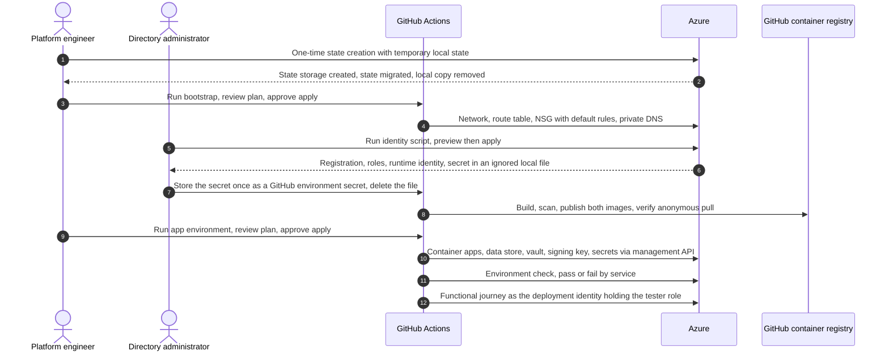
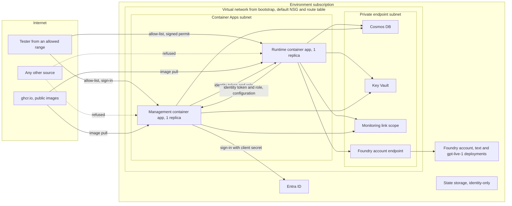
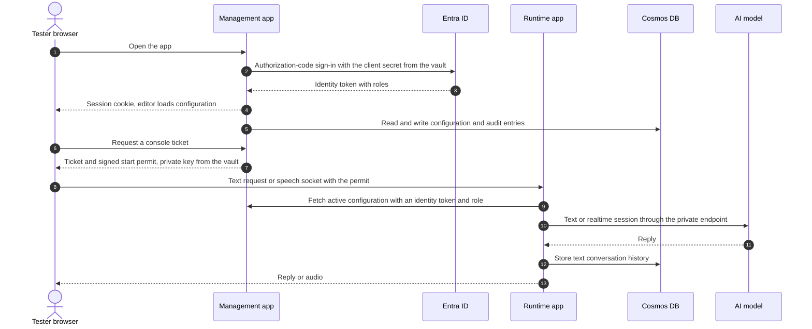

# Implementation Plan: First Internal Test Environment

**Branch**: `feat/spec-004` | **Date**: 2026-11-05 | **Spec**: [spec.md](spec.md)

**Input**: Feature specification from `/specs/004-int-environment-setup/spec.md`

## Summary

Stand up the first real environment, `int`, from one variable file and three backend files, and make
it useful: a signed-in tester can use the management application's configuration editor and test
console (text and speech) against the runtime and a Foundry account with two model deployments that the
environment creates. This replaces the earlier
design (AKS, Azure Firewall, a bootstrap that creates the state storage, `dev`/`test`/`prod`
examples) and an earlier version of this plan (App Service, egress allow-list, `platform` root).

Deployments, in order:

1. **State deployment** (`state`): creates the remote state storage once, with temporary local state
   that is migrated into the new storage.
2. **Bootstrap deployment** (`bootstrap`): creates all network resources (virtual network, subnets,
   network security group and route table with default rules and routes) and private DNS, and
   publishes their identifiers. No outbound rules, no firewall, no state storage.
3. **Identity script** (PowerShell and Azure CLI, run once by a directory administrator): creates the
   management sign-in registration with its application roles and client secret, and the runtime's
   user-assigned identity with its role assignment.
4. **Image publishing**: builds, scans and publishes both images to GitHub's container registry, so
   the images exist before the app environment deployment starts.
5. **App environment deployment** (`app_environment`): creates the Container Apps environment and the
   two container apps, Cosmos DB, Key Vault, the signing key pair, monitoring and the identities and
   roles that connect them, with a public-access flag.
6. **Environment check**: control-plane verification after every apply (including that the named
   sign-in registration and roles exist), plus the functional journey
   (unauthenticated redirect, text and speech conversation) run by the pipeline from a GitHub-hosted
   runner as the deployment identity holding the tester role. On the first deployment the check fails
   once at the sign-in redirect, because the callback address exists only after the apps do. The
   redirect phase registers it and the check is rerun.

**This feature now includes application code.** Both images start only in `local` mode today. They
contain the editor, test console, runtime and the store adapters, but no deployable composition
(no Cosmos client or credential factory, no reading of settings). The plan adds a **live mode** to
each application, composed only from settings and managed identities, in the existing "reviewed
composition" style. See [research.md](research.md) R-10 to R-14.

Key design decisions (details in [research.md](research.md)):

- **Hosting:** Azure Container Apps (workload profiles, Consumption profile), one replica per
  application. The environment is created external so the public-access flag can switch its
  `public_network_access` in place. The flag also sets each app's `ingress.external_enabled` and
  allow-list rules.
- **Management sign-in:** the application's own Microsoft Entra sign-in (an authorization-code flow
  with server-side sessions already in the code), not the platform's built-in sign-in. The built-in
  sign-in would run in front of the application's own session guard and conflict with it. The
  approved client-secret exception is unchanged. The spec uses the same wording.
- **Secrets:** the sign-in client secret and the permit private key are written to the Key Vault
  through the Azure management API (the `azapi` provider), because a data-plane write from a
  GitHub-hosted runner cannot reach a private vault. Container apps read them through Key Vault
  references and their managed identities.
- **Network:** all network resources live in bootstrap with default rules only. The app environment
  deployment receives subnets and DNS zone IDs from the bootstrap outputs, so bootstrap can later be
  replaced by a customer network (FR-045).

## Technical Context

**Language/Version**: Terraform 1.17.0 (pinned in `.terraform-version`); Python 3.12 for the applications and `code/tools`; PowerShell 7 with Azure CLI for the identity script; GitHub Actions YAML.

**Primary Dependencies**: `hashicorp/azurerm` 5.11.0, `Azure/azapi` (exact version pinned at implementation, used only for Key Vault secret writes and for read-only data sources that `azurerm` lacks), `hashicorp/tls` (exact version pinned at implementation, used only for the permit key pair). `azuread` is not used (FR-042). Applications already depend on `azure-cosmos`, `azure-identity`, `msal`, `openai-agents`, `reflex` 0.10.0, `fastapi`. Trivy for image and Terraform scans. Pester 5 for the script tests.

**Storage**: Terraform state and plans in an Azure Storage account created by the state deployment; Cosmos DB for NoSQL (serverless) with the containers the repositories already expect; Key Vault for the two approved secrets.

**Testing**: `terraform test` with mock providers for every module and root; pytest for tooling and for the new application live-mode composition (fake Cosmos and credential ports); an in-process end-to-end test project `code/e2e` that composes both applications with fake ports; the existing browser tests for the editor and console; Pester for the identity script; a structure check, an environment-file check and an environment check (including the functional journey, FR-053).

**Target Platform**: Azure, one subscription per environment. GitHub-hosted Ubuntu runners deploy with OIDC. Applications run as Linux containers on Azure Container Apps.

**Project Type**: Infrastructure as code, delivery tooling and workflows, plus application live-mode composition in two existing Python projects.

**Performance Goals**: None beyond testing needs. SC-012 (within 5 minutes of a finished deployment), SC-015 (text reply within 15 seconds) and SC-001 (bring-up in a working day).

**Constraints**: One variable file and one backend file per deployment per environment (FR-009). No custom outbound rules or routes (FR-044). No directory changes by the app environment deployment (FR-042). Public images hold no secrets or environment values (FR-038). One image per application for every environment (FR-047). Exactly one replica per application in `int`, because the management application keeps sessions in memory and the runtime keeps live sessions in memory.

**Scale/Scope**: One environment (`int`), three deployments, thirteen reusable modules, two applications, one identity script, one image workflow, two application live-mode compositions, one end-to-end test project.

## Constitution Check

*GATE: Must pass before Phase 0 research. Re-checked after Phase 1 design below.*

Governing document: [.specify/memory/constitution.md](../../.specify/memory/constitution.md), version 2.1.0.

| Principle | Status | Evidence and plan |
|---|---|---|
| I. Azure-First Platform | PASS with one approved exception | Hosting, identity, network, storage, monitoring and delivery use Azure services. The exception is GitHub's container registry as image source, approved by the owner. FR-038 requires the written assessment (D-05). Model availability is proved by the apply of both model deployments and confirmed by the environment check (FR-039). |
| II. Security-First Engineering | PASS with two approved exceptions | Managed identities everywhere, no shared keys on Cosmos or state, vault private, applications check tokens and roles. The two approved secrets are the sign-in client secret (FR-046) and the permit private key (FR-051), both ending up in the protected state. Any tenant user may sign in (FR-019), but editing and testing need roles that the script assigns to the owner's group. `int` sets an open allow-list range so GitHub-hosted runners can reach it, so sign-in, the role check and the permit are the access control. Threats are listed below. |
| III. Documentation as a Deliverable | PASS (planned) | D-01 to D-09 below with Mermaid diagrams here, in `docs/environments.md` and in `docs/security.md`. |
| IV. Bounded Microservices | PASS | Runtime and management stay separate deployables, with separate images, identities and apps. No new service boundary. They talk through their existing documented endpoints (FR-052). |
| V. Python Backend and Reflex Frontends | PASS | New application code is Python. PowerShell is the identity script only. |
| VI. Scalable Real-Time Call Handling | PASS, no new call handling | The test console is a test tool with existing admission limits. `int` declares no capacity (FR-050) and runs one replica per app, which is stated as a limitation. The rationale (not a call-handling feature, existing admission limit, in-memory sessions) is recorded in `docs/capacity.md`. Active-session scaling signals belong to the call-handling features. |
| VII. Structured Logging and Monitoring | PASS (planned) | Container logs and metrics go to Log Analytics. Alerts use platform metrics (5xx requests, restarts, replica count, CPU and memory) plus scheduled log-query alerts over the applications' structured events for dependency failures and latency (the event fields are confirmed in the monitoring module task). A correlation test across the two applications and a sensitive-data exclusion test run in CI. Alert delivery is tested with an action group test notification. |
| VIII. Terraform Infrastructure as Code | PASS once the constitution update is ratified | All resources are Terraform, pinned and checked (including a Terraform security scan). Directory objects, and the runtime identity the script must create so it can assign a role, are administered by the identity script. The maintainers ratify in a separate constitution update, before the script is built, that Principle VIII governs infrastructure resources and that this script administers directory objects (FR-043). Adding `azapi` and `tls` providers is recorded as a library decision. State is remote, encrypted and locked, and holds two secrets (FR-031, FR-051). |
| IX. Automated Tests | PASS (planned) | Terraform tests for every module and root, tooling tests, application composition and contract tests, an in-process end-to-end test of both applications with fake Azure ports (CI), the existing browser tests, Pester, and live checks. The live acceptance scenarios are release gates, not merge gates (see Test plan). |

**Gate result**: no unjustified violation. Two approved exceptions (GitHub registry, two secrets) and
one constitution ratification (the identity script) are recorded under Complexity Tracking and must
be written up in D-05 before merge. The identity script is not merged before the ratification is recorded.

### Threats and controls (Principle II)

| Threat | Control |
|---|---|
| `int` reachable by anyone | The allow-list is required when the flag is on, and `int` sets the open range explicitly so GitHub-hosted runners can reach it (validation warns, D-05 records it). The management application requires sign-in and its role checks. The runtime's conversation endpoints require a signed permit. |
| Any tenant user can sign in | The application's role checks (editor and tester roles) limit who can use it. The script assigns the roles to the group named in the variable file (FR-019). |
| Runtime health endpoints open | They carry no conversation or dependency detail. The allow-list gates them. |
| Sign-in secret or permit private key exposed | Written to the vault through the management API only, never printed, read through managed identities, held in the encrypted, locked remote state, never in files or logs. Secret validity is at most 90 days. |
| State storage on a public endpoint | Identity-only access, shared keys off, versioning, soft delete, delete lock, writer roles scoped to two containers. |
| Public images leak code or secrets | Trivy secret and vulnerability scan blocks publishing. The source repository is private, so publishing exposes application code (owner accepted). |
| Deployment identity abused | OIDC federation limited to the repository's protected environment, required reviewers before plan and apply, least-privilege roles in the runbook. |
| Deployment identity holds the tester role (FR-053) | A compromised pipeline identity could use the test console and model sessions. Protected GitHub environments, an OIDC subject limited to this repository, and the runtime's existing admission limit on live sessions. The identity holds no directory write permission (FR-042). |
| Health endpoints and the sign-in page reachable by anyone (open range) | They carry no conversation or dependency detail and no data. Every data endpoint needs sign-in plus a role, or a signed permit. |
| Model sessions abused | Allow-list, sign-in, test-role check and the runtime's existing admission limit on live sessions. |

## Project Structure

### Documentation (this feature)

```text
specs/004-int-environment-setup/
├── plan.md              # This file
├── research.md          # Phase 0 output
├── data-model.md        # Phase 1 output
├── quickstart.md        # Phase 1 output
├── contracts/           # Phase 1 output
│   ├── environment-files.md
│   ├── deployment-interfaces.md
│   ├── application-settings.md
│   └── tooling-and-workflows.md
├── checklists/
│   └── requirements.md
└── tasks.md             # Phase 2 output (/speckit-tasks command, stale until regenerated)
```

### Source Code (repository root)

```text
code/infra/
├── environments/                        # configuration only, one directory per environment
│   └── int/
│       ├── int.tfvars.json
│       ├── state.azurerm.tfbackend.json
│       ├── bootstrap.azurerm.tfbackend.json
│       └── app_environment.azurerm.tfbackend.json
├── scripts/identity/
│   ├── Initialize-Identity.ps1
│   └── tests/Initialize-Identity.Tests.ps1
└── terraform/
    ├── .terraform-version  .terraformignore
    ├── state/                           # root 1
    ├── bootstrap/                       # root 2: network.tf, private_dns.tf
    ├── app_environment/                 # root 3 (replaces `environments/` and the old `platform` name)
    │   ├── variables.tf  providers.tf  outputs.tf  main.tf
    │   ├── container_apps.tf  data_store.tf  secret_store.tf  signing_key.tf  secrets.tf
    │   ├── monitoring.tf  workload_identity.tf  model_access.tf
    │   └── tests/
    └── modules/                         # HashiCorp standard structure, README, tests/
        ├── state-backend/  network/  private-dns/  private-endpoint/
        ├── container-app-environment/  container-app/
        ├── data-store/  secret-store/  key-vault-secret/  permit-key/
        └── monitoring/  workload-identity/  model-access/

code/backend/src/caller_runtime/
├── live.py                              # NEW: composition from settings, managed identity, Cosmos factories
├── entrypoint.py                        # NEW: create_app_from_environment() used by the container command
├── settings.py                          # CHANGED: live mode allowed when live settings are valid
└── adapters/azure_clients.py            # NEW: credential and Cosmos container factories (ports already exist)
code/backend/Dockerfile                  # CHANGED: command runs the entrypoint factory
code/backend/tests/                      # NEW unit, contract and integration tests for live composition

code/management/management_app/
├── live.py                              # NEW: ManagementRequest, resources factory, authority, reviewed composition
├── management_app.py  settings.py       # CHANGED: live mode, editor pages registered for the deployed build
└── adapters/azure_clients.py            # NEW: credential, Cosmos factories, Key Vault-sourced secrets
code/management/Dockerfile  rxconfig.py  # CHANGED: runtime API address, editor pages in the exported frontend
code/management/tests/                   # NEW composition tests, existing browser tests kept
code/e2e/                                # NEW test-only project: both applications in-process with fake Azure ports

.github/workflows/
├── terraform-deploy.yml                 # CHANGED: three roots, secret input, check step
├── terraform-state.yml  terraform-bootstrap.yml  terraform-app-environment.yml
├── images.yml                           # NEW
└── ci.yml                               # CHANGED: Pester, security scan, new checks

code/tools/scripts/                      # terraform_delivery.py and verify_terraform.py changed;
                                         # validate_environment.py, check_terraform_structure.py,
                                         # check_environment.py, verify_published_images.py new
docs/                                    # environments.md, runbooks (bring-up, public-access,
                                         # image-publishing, application-live-mode), security.md, ...
```

**Removed**: `code/infra/terraform/modules/platform/`, `code/infra/terraform/environments/`,
`code/infra/terraform/config/`, the old bootstrap state resources, `terraform-infrastructure.yml`,
every `dev`, `test` and `prod` example, and the AKS-era document passages.

**Structure Decision**: Environment configuration lives in `code/infra/environments/<env>/`, apart
from the Terraform code (FR-010). Reusable modules follow HashiCorp's standard structure. Deployments
are thin roots with one file per service holding that service's module call (FR-001, FR-002).
Directory administration stays in `code/infra/scripts/identity/`. Application live-mode code stays in
the two existing projects, following their existing ports-and-reviewed-composition style.

### Architecture

Deployment sequence (FR-006, FR-040, FR-046, FR-051):



Network and service boundaries in `int` (public access enabled):



Test console journey (FR-048):



### Test plan (Principle IX)

| Area | Test | Asserts |
|---|---|---|
| Every module | `terraform test`, mock providers | Defaults, validation failures, outputs, and the absence of anything the module must not create (FR-003). |
| Roots | `terraform test` composition tests | Wiring, variable slicing, public access on and off, no directory resources, no custom outbound rules, no network resources outside bootstrap (FR-005, FR-042, FR-044). |
| Layout | `check_terraform_structure.py` + tests | Files per root and module, descriptions, README per module, module calls only where allowed (SC-007). |
| Terraform security | Trivy `config` scan in `verify_terraform.py check` + tests | No high or critical misconfiguration, no public data store, no shared keys (FR-030). |
| Environment files | `validate_environment.py` + tests | Rules in [environment-files.md](contracts/environment-files.md), cross-environment uniqueness, no secrets (FR-013, SC-006, SC-008). |
| Delivery | `test_terraform_delivery.py` | Variable slicing, `state-create`, refusal of local state, lock wait, plan hash, secret passed as an environment variable and never logged (FR-007, FR-046). |
| Identity script | Pester | Preview changes nothing, second run no-op, missing right stops early, secret only in the ignored file, never printed, failure paths (FR-040 to FR-043, FR-052, SC-013). |
| Application live mode | pytest unit, contract and integration | Settings validation with fixed reason codes, composition from fake credential and Cosmos ports, permit sign and verify across both apps, role checks, no secret in errors (FR-047, FR-051, FR-052). |
| Browser journey | existing browser tests against the editor host | Editor and test console flows still pass with the new composition (FR-048, SC-015). |
| Images | `verify_published_images.py` tests, workflow checks | Tag not overwritten, scan blocks publish, anonymous pull (FR-036 to FR-038). |
| Live environment | `check_environment.py` after each apply | Services match configuration, public access matches the flag, revisions healthy, role and secret presence, image versions, no custom outbound rules (FR-028, SC-005, SC-012, SC-014). |
| Live functional | `--functional` in the pipeline after each apply | Unauthenticated redirect, probes, text conversation reply, speech session start and stop as the deployment identity with the tester role (FR-028, FR-053, SC-012, SC-015). |
| Live operator walk | operator in a browser | Editor sign-in and publish, persistence after restart and image change (FR-048, SC-016). |
| In-process end to end | `code/e2e/tests/test_live_journey.py` in CI | Both applications composed with fake Cosmos and model ports: sign-in, publish, test ticket, text reply (Principle IX). |
| Documentation | `verify_docs.py` | Diagrams render, links resolve. |

Merge gates are everything above except the two live rows. The live rows are release gates, recorded
in `docs/acceptance/int-environment.md`, because they need the owner's subscription.

## Phase 1 Design Re-check

After design ([data-model.md](data-model.md), [environment files](contracts/environment-files.md),
[deployment interfaces](contracts/deployment-interfaces.md), [application settings](contracts/application-settings.md),
[tooling and workflows](contracts/tooling-and-workflows.md), [quickstart.md](quickstart.md)):

- **I**: unchanged, one approved non-Azure dependency.
- **II**: two approved secrets, both written only through the management API into the vault, with state as an accepted holder. No other secret is added.
- **III**: D-01 to D-09 are listed and tied to tasks.
- **V**: application code stays Python, and the Reflex build change keeps Reflex as the frontend.
- **VII**: alerts cover platform metrics and log-query alerts over the applications' own events.
- **VIII**: the identity script is limited to `code/infra/scripts/identity/` and awaits constitutional ratification. `azapi` is used only for vault secrets and read-only data sources, `tls` only for the key pair.
- **IX**: every requirement group has a named test.

No new violations. Gate remains PASS.

## Documentation deliverables (Principle III)

| ID | Deliverable | Covers |
|---|---|---|
| D-01 | `docs/environments.md` | Overview, diagrams, environment convention, limitations (one replica, public exposure, default network rules, open tenant sign-in), references. |
| D-02 | `docs/runbooks/environment-bring-up.md` | State, bootstrap, identity, images, app environment, checks, teardown, recovery, rollback, secret renewal and key rotation. |
| D-03 | `docs/runbooks/public-access.md` | Flag, allow-list, enabling, disabling, verifying. |
| D-04 | `docs/runbooks/image-publishing.md` | Tags, immutability, scans, public package step, rolling back. |
| D-05 | `docs/security.md` | Threats, Principle I assessment and approval, Principle VIII rationale and approval, the two secret exceptions, state sensitivity, open tenant sign-in. |
| D-06 | Rewritten `terraform-state.md`, `terraform-delivery.md`, `platform.md`, `platform-security.md` | The three deployments and the managed services. |
| D-07 | Module READMEs | Purpose, inputs, outputs, failure behavior, security assumptions. |
| D-08 | `monitoring.md`, `scaling.md`, `capacity.md` updates | Alerts with owners and runbooks, `int` capacity statement, one-replica reason. |
| D-09 | `docs/runbooks/application-live-mode.md` | The settings contract, reviewed composition, reason codes, how to change a setting, what each failure means. |

## Complexity Tracking

| Violation or tension | Why needed | Simpler alternative rejected because |
|---|---|---|
| Non-Azure image source (Principle I) | The owner wants images pullable at any time without a pull credential. | An Azure registry needs credentials or private connectivity. Rejected in the clarifications. |
| Identity script outside Terraform (Principle VIII, ratification) | Directory objects need directory permissions that the deployment identity must not hold (FR-042). The script also creates the runtime identity so it can assign it a role. | `azuread` in Terraform would give the deployment identity directory write access. |
| Two secrets in the remote state (Principles II and VIII) | The owner approved a sign-in client secret and a Terraform-generated permit key. | Federated sign-in or Key Vault signing would need application changes (see R-04 and R-05, a possible later removal). |
| `azapi` and `tls` providers (Principle VIII) | Vault secrets must be written over the management API because the runner cannot reach a private vault. Terraform generates the permit key (FR-051). | `azurerm_key_vault_secret` needs a data-plane path to a private vault. A script-made key adds manual steps. |
| One file per service in roots versus HashiCorp's `main.tf` rule | FR-001, with FR-002 scoped to reusable modules. | One file for every call. |
| Application code in an infrastructure feature | The owner wants a working editor and console in `int` (FR-047, FR-048). | Local mode cannot serve them. |
| One replica per application | In-memory sessions and live sessions. | Multiple replicas need shared session state, which is out of scope. |

## Open items for the owner

| # | Item | Why |
|---|---|---|
| 1 | The maintainers ratify in a constitution update that Principle VIII governs infrastructure resources and that the identity script administers directory objects. | FR-043. The script tasks wait for it. |
| 2 | Confirm that application code becomes public through the images (private repository). | FR-038. |
| 3 | Provide the real region, subscription, deployment identity, Foundry account name, the text model and the model quota for both deployments in `int`, and the group for `app_environment.identity.user_group_id`. | First bring-up. |
