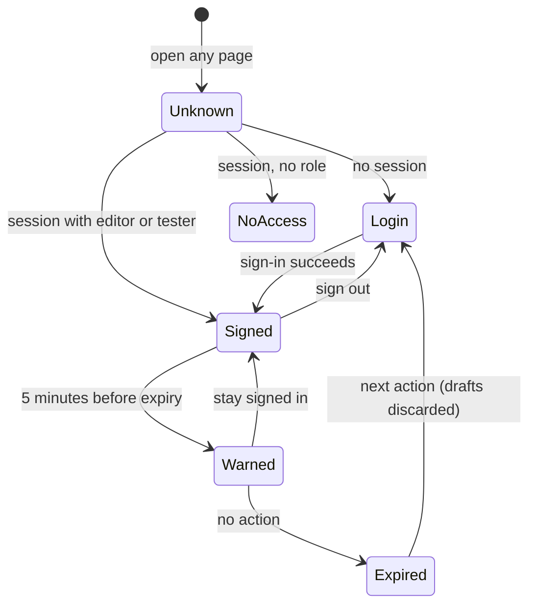
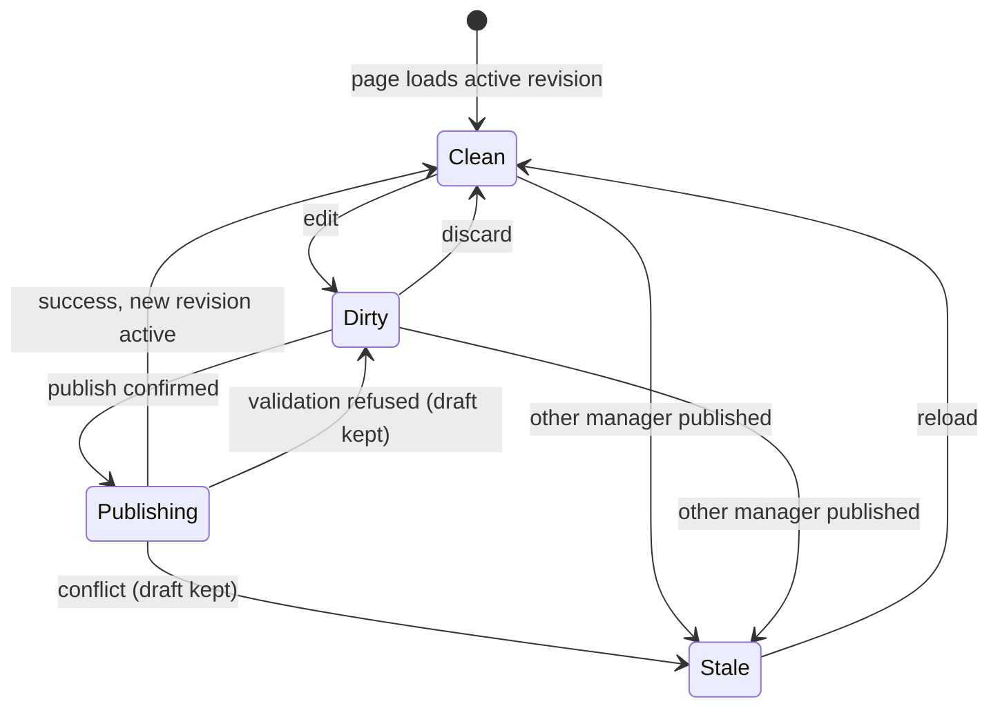

# Data Model: Management Frontend Redesign

Feature: [spec.md](spec.md) · Decisions: [research.md](research.md)

The stored and published configuration keeps the shape defined in `specs/002-multimodal-agent-management/contracts/configuration.md`, raised to schema `2.1.0` with additive fields. Everything marked *view only* is computed by the management app and never stored in the configuration.

## Stored configuration (schema 2.1.0)

### ConfigurationGraph (changed)

| Field | Type | Change | Rule |
|-------|------|--------|------|
| `schemaVersion` | `"2.0.0"` or `"2.1.0"` | Changed | The management app writes `2.1.0`; the runtime reads both |
| `agents` | list of Agent | Unchanged | Max 200 |
| `communities` | list of Community | Field added | Max 50 custom communities |
| `relationships` | list of Agent handover link | Unchanged | Max 1000 |
| `communityConnections` | list of Community connection | Unchanged | Max 1000 |
| `tools`, `mcpConnections` | lists | Unchanged | Managed in the Tools section |
| `layout` | GraphLayout | Deprecated | Read for old revisions; new revisions write empty lists |
| `conversationSettings` | Conversation settings | New, optional | Absent means environment defaults |

### Agent (unchanged shape)

| Field | Rule in the new editor |
|-------|------------------------|
| `agentId` | Immutable |
| `name`, `prompt` | Editable for every agent (FR-010) |
| `role` | `welcome`, `routing`, `goodbye` = pre-defined agent; `ordinary` = custom agent |
| `communityId` | `null` for pre-defined agents (shown inside their default community); a custom community id for custom agents |
| `enabled` | Fixed `true` for pre-defined agents; editable for custom agents unless the agent is its community's entry agent (FR-013) |
| `capabilityAssignments` | Always empty for pre-defined agents; editable for custom agents (FR-037) |

### Community (field added)

| Field | Type | Rule |
|-------|------|------|
| `communityId` | identifier | Immutable; must not use the reserved `default-` prefix |
| `name` | text | Unique among communities, not one of Welcome, Routing, Goodbye |
| `routingDescription` | text, max 4 KiB | Shown to Routing when `routable` |
| `enabled` | boolean | |
| `entryAgentId` | agent id | Exactly one, an enabled ordinary agent of this community |
| `routable` | boolean, **new**, default `true` | Drawn as a Routing → community link; Routing offers only routable communities |

### Community connection (unchanged)

Directed link between two custom communities. Default communities never appear in this list.

### Agent handover link (`relationships`, unchanged)

Directed link between two ordinary agents of the same custom community (FR-038). Never between communities and never on default communities.

### Conversation settings (new)

| Field | Type | Allowed values | Absent means |
|-------|------|----------------|--------------|
| `voice` | text | An `id` of the runtime's voice catalog (see Voice catalog entry) | `CALLER_LIVE_VOICE` |
| `maxOutputTokens` | integer | 1 to the environment's `CALLER_MAX_OUTPUT_TOKENS` | the environment value |
| `idleTimeoutSeconds` | integer | 30 to 120 | 120 |

Applied when a conversation is admitted; running conversations keep their values.

## Publication metadata (new, stored with the revision, never published to the runtime)

| Field | Type | Meaning |
|-------|------|---------|
| `publishedAt` | UTC time | When the revision became active |
| `publishedBy` | actor reference | Who published (same reference the audit log uses) |
| `publishedByName` | text, max 256 | Publisher's display name from the sign-in token; editors only; never logged |
| `agentStamps` | map of agent id → Agent stamp | Last published change per agent |

**Agent stamp**: `revisionNumber`, `changedAt`, `changedBy`, `changedByName`. Computed at publication by comparing each agent's canonical form with the previous active revision; unchanged agents keep their previous stamp; agents new in this revision get this publication's stamp. An agent missing from the stamps shows "not yet published".

## View model (management app, never stored)

### Default community (*view only*)

| Field | Value |
|-------|-------|
| `id` | `default-welcome`, `default-routing`, `default-goodbye` |
| `name` | Welcome, Routing, Goodbye |
| `entryAgentId` | The agent with the matching protected role |
| `fixed` | `true`: no edit, delete, add-agent or connection controls |

Fixed links drawn: Welcome → Routing. Goodbye carries the label "Reachable from every community" instead of drawing links from every community.

### Graph node and link

| Element | Kind | Style tokens (see [contracts/ui-shell.md](contracts/ui-shell.md)) |
|---------|------|------------------------------------------------------------------|
| Default community, pre-defined agent | fixed | slate fill, lock icon, label "Default" |
| Custom community, custom agent | editable | white fill, teal border, pencil icon, label "Custom" |
| Entry agent | marker | flag icon, label "Entry" |
| Unreachable community | warning | warning icon, label "Unreachable", listed at publish |
| Invalid community (e.g. disabled entry agent) | error | error icon, blocks publication |

Reachability: a custom community is reachable when it is routable, or when a chain of community connections leads to it from a reachable, enabled community. Disabled communities are neither reachable nor reported.

### Graph view preference (*browser only*)

Key: environment origin + actor reference + node id. Values: `x`, `y`, `collapsed`. At most 400 entries, oldest evicted first. Cleared values fall back to the automatic arrangement.

### Drafts (*server session only*)

| Draft | Contains | Publishes |
|-------|----------|-----------|
| Graph draft | Everything except `conversationSettings` | Active revision + graph changes |
| Settings draft | `conversationSettings` only | Active revision + settings changes |

Both hold the ETag of the revision they started from. A newer active revision shows a notice; publishing on a stale ETag returns a conflict and keeps the draft.

### Service status (*view only*, from the runtime)

| Field | Meaning |
|-------|---------|
| `text.endpointHost`, `text.deployment` | Foundry host and text deployment |
| `voice.endpointHost`, `voice.region`, `voice.model` | Foundry realtime host, region and the voice model sent in `session.start` (`gpt-live-1`) |
| `<model>.reachable`, `<model>.checkedAt` | Last probe result and time |
| `<model>.lastCallOutcome`, `<model>.lastCallAt` | Outcome and time of the last real model call, if any |
| `supportedVoices`, `limits` | Voice catalog and ceilings the Settings page validates against |

### Voice catalog entry (*runtime constant, reported by status*)

| Field | Type | Example |
|-------|------|---------|
| `id` | API name sent as `audio.output.voice` | `quartz` |
| `name` | Display name | Quartz |
| `language` | Language | English |
| `accent` | Regional influence or `null` | Australian |
| `presentation` | `Feminine`, `Masculine` or `null` | Feminine |

The catalog is the reviewed GPT-Live list in [research.md R15](research.md#r15-voice-catalog-and-drop-down).

### Session (changed behavior)

| Field | Rule |
|-------|------|
| `expiresAt` | Issue time + 15 minutes, capped by the sign-in token expiry |
| Warning | Shown from `expiresAt` − 5 minutes |
| Extension | Moves `expiresAt` by 15 minutes, still capped by the token expiry |
| Re-sign-in at token expiry | Open drafts (with their starting ETag) saved in the tab's session storage keyed by actor reference, restored after sign-in for the same actor only, then removed; cleared on sign-out |
| Roles | `editor` and/or `tester`; neither → "no access" |

## State transitions

