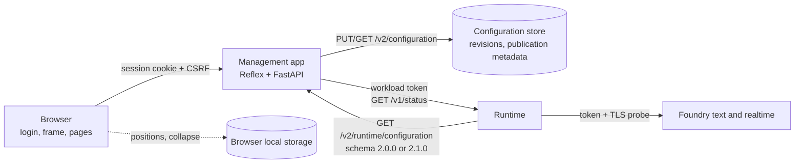
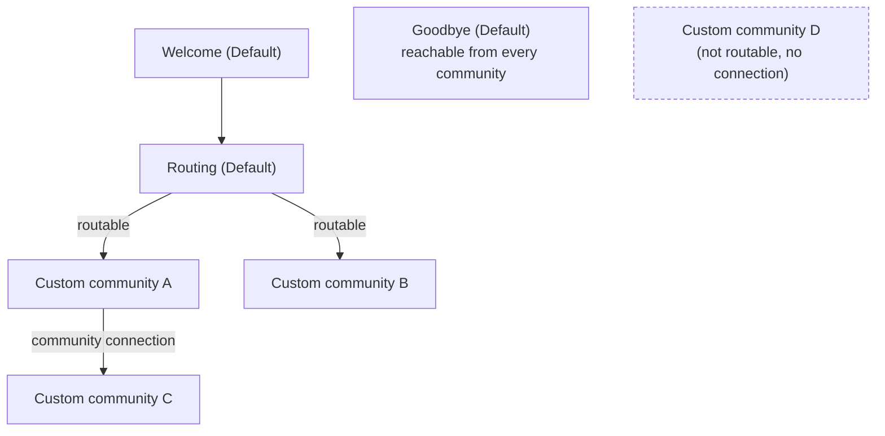

# Implementation Plan: Management Frontend Redesign

**Branch**: `005-management-frontend-redesign` | **Date**: 2026-11-11 | **Spec**: [spec.md](spec.md)

**Input**: Feature specification from `specs/005-management-frontend-redesign/spec.md`

## Summary

Rebuild the Reflex management frontend around one authenticated frame: a login page with the new Caller AI logo, a sidebar (Dashboard, Community and Agent, Test, Status, Settings) and a top bar with the logo mark (User Profile, User Settings placeholder, sign out). The Community and Agent page shows one graph with three fixed default communities (Welcome, Routing, Goodbye), projected from the existing protected agents, next to custom communities and agents, with per-node settings below the graph, a Tools section, agent handover links, browser-local positions and collapse state, rule refusals with named rules, and a notice when another manager publishes. A new Settings page publishes three conversation settings (voice from a drop-down of the reviewed GPT-Live voice catalog, reply length limit, idle timeout) in their own draft. A new Status page shows the Foundry hosts, text deployment, voice region and reachability from a new read-only runtime endpoint. The configuration contract moves to schema `2.1.0` with two additive fields (`routable`, `conversationSettings`); the runtime reads both versions. Testers can run tests without the editor role once `TESTER_ONLY_TESTS` is turned on after the security review; it ships off. Validation is automated only; manual checks (security review, usability checks, environment walkthrough) are deferred to a later stage by the owner. Decisions are in [research.md](research.md).

## Technical Context

**Language/Version**: Python 3.12 (`.python-version` 3.12.15) for both applications; the graph component's browser code is JavaScript generated through Reflex (allowed by Constitution V).

**Primary Dependencies**: Reflex 0.10.0 with Radix components and `@xyflow/react` (existing), FastAPI (management API and runtime), Azure Identity, Azure Cosmos DB client (existing).

**Storage**: Existing Cosmos DB configuration store (revisions, active pointer, audit) in the management app; new publication metadata stored with each revision. Browser local storage for graph view preferences. No new Azure resource.

**Testing**: pytest (unit, contract, integration) in `code/backend` and `code/management`; Playwright browser tests in `code/management/tests/browser`; Node-based JavaScript tests for generated browser code; docs check `verify_docs.py`.

**Target Platform**: Azure Container Apps (`ca-caller-<env>-management`, `ca-caller-<env>-runtime`); desktop browsers (Edge, Chrome) for the frontend.

**Project Type**: Web application: a Reflex frontend with a FastAPI management API, plus the runtime service.

**Performance Goals**: Graph with 20 communities and 100 agents gives feedback within 100 ms for drag, zoom and collapse, and reflects edits within 1 s (SC-006); sign-in to page within 5 s (SC-002); new-revision notice within 30 s (SC-011).

**Constraints**: No new Azure resources or identities; no change to session lifetime cap or role names; settings never exceed today's environment limits; status shows no secrets; WCAG 2.1 AA; one write path for configuration (`PUT /v2/configuration`).

**Scale/Scope**: Up to 50 custom communities, 200 agents, 1000 links per configuration (existing limits); a handful of concurrent managers per environment; six pages plus login.

## Constitution Check

*GATE: Must pass before Phase 0 research. Re-checked after Phase 1 design below.*

| Principle | Status | Evidence |
|-----------|--------|----------|
| I. Azure-First | Pass | No new platform or service; status reads the existing Foundry endpoints through the runtime |
| II. Security-First | Pass | Threats and controls below; tester-only test access (R11) ships behind a switch that stays off until the deferred security review is recorded, so the release gate holds; automated authorization tests cover both switch states |
| III. Documentation | Pass | Deliverables listed below, with Mermaid diagrams of the page structure, default community structure and status flow |
| IV. Bounded Microservices | Pass | Management keeps configuration ownership; runtime owns model settings; new `GET /v1/status` is a versioned, documented contract; schema `2.1.0` has a compatibility and rollback plan ([configuration-v2.1.md](contracts/configuration-v2.1.md)) |
| V. Python and Reflex | Pass | All frontend work in Reflex; graph JavaScript stays generated by the Reflex component |
| VI. Real-Time Call Handling | Pass | Settings stay within today's limits; idle timeout only shortens sessions; admission limits unchanged |
| VII. Structured Logging | Pass | New events in the documented schema without personal content (R14, [ui-shell.md](contracts/ui-shell.md#events-management)); publisher names never logged |
| VIII. Terraform | Pass | No infrastructure change; no new settings |
| IX. Automated Tests | Pass | Test plan below covers every functional requirement, in CI |

### Threats and controls (Principle II)

| Threat | Control |
|--------|---------|
| Management content shown before sign-in | Frame renders login only without a session; all page data comes from role-checked server events (FR-001, R9) |
| Open redirect through `returnTo` | Exact-match allowlist of page routes; anything else ignored ([ui-shell.md](contracts/ui-shell.md#sign-in-and-session)) |
| Privilege confusion between editor and tester | Server-side role check on every API and Reflex event; UI hiding is not a control (FR-003) |
| Tester-only users starting tests | Off by default (`TESTER_ONLY_TESTS = False`); enabled only by a reviewed change after the security review; existing admission limits and published-revision-only tests; automated role tests for both switch states (R11) |
| Session hijack extended indefinitely | Extension capped by the sign-in token expiry; CSRF on `/auth/session/extend` (R10) |
| Drafts saved in the browser during re-sign-in read by another user | Tab session storage only, keyed by actor reference, restored only for the same actor, removed after restore and on sign-out; holds configuration text, never tokens (R10) |
| Status leaking secrets or internals | Fixed response schema with host names, deployment and region only; workload-authenticated runtime endpoint; no paths, keys or tokens ([status.md](contracts/status.md)) |
| Status endpoint used for load | 60-second cache, one probe in flight per model, refresh throttled per session |
| Settings used to raise cost or capacity | Values bounded by environment ceilings reported by the runtime and re-checked by management validation and runtime admission; voice limited to the reviewed catalog |
| Publisher names exposed | Stored only in revision metadata, returned to editors only, excluded from logs and the runtime projection (R8) |
| Corrupting the fixed default structure through the API | Default communities are not data; reserved ids and names refused (`reserved_name`); protected-role rules unchanged |
| XSS through names or instructions in the graph | Values rendered as text by React; no HTML injection paths; existing content limits |

## Project Structure

### Documentation (this feature)

```text
specs/005-management-frontend-redesign/
├── plan.md              # This file
├── research.md          # Phase 0 decisions R1–R14
├── data-model.md        # Phase 1 data and view model
├── quickstart.md        # Phase 1 validation guide
├── contracts/
│   ├── configuration-v2.1.md
│   ├── status.md
│   └── ui-shell.md
├── assets/              # Caller AI logo design files (mark and full logo)
├── checklists/requirements.md
└── tasks.md             # Phase 2 (/speckit-tasks)
```

### Source Code (repository root)

```text
code/management/assets/
├── caller-ai-logo.svg, caller-ai-mark.svg   # new: copied from the feature's assets/
└── favicon.ico                              # replaced: derived from the mark

code/management/management_app/
├── management_app.py          # changed: new routes, redirects, frame on every page
├── security.py                # changed: returnTo allowlist, session extend, role checks (tester-only tests)
├── theme.py                   # new: design tokens
├── observability.py           # changed: new events
├── api/
│   ├── configuration.py       # changed: warnings, publication metadata, schema 2.1.0
│   ├── status.py              # new: GET /v1/status (editor or tester)
│   └── test_sessions.py       # changed: tester role alone only when TESTER_ONLY_TESTS is on
├── adapters/
│   ├── configuration_repository.py  # changed: publication metadata and agent stamps
│   ├── runtime_status_client.py     # new: workload-authenticated call to runtime /v1/status
│   └── text_relay.py                # changed: idle timeout from active revision
├── models/configuration.py    # changed: routable, conversationSettings, 2.1.0
├── services/
│   ├── configuration_validation.py  # changed: reserved names, conversation settings, reachability warnings
│   ├── configuration_publication.py # changed: agent stamps
│   └── graph_view.py                # new: default community projection, reachability, view rules
├── components/
│   ├── frame.py               # new: sidebar, top bar, session warning, role gates
│   ├── configuration_graph.py # changed: default/custom styles, collapse, browser-local positions, outline list
│   └── live_audio*.py         # unchanged
├── pages/
│   ├── login.py, dashboard.py, status.py, settings.py   # new
│   ├── community_agent.py     # new: composes graph, settings panels and Tools
│   ├── agents.py, communities.py, relationships.py, tools.py  # changed: become panels inside community_agent
│   └── test_console.py        # changed: inside the frame, stop on leave
└── state/
    ├── session.py             # new: session, roles, expiry warning
    ├── status.py, settings.py # new
    ├── configuration_editor.py, editor_draft.py  # changed: graph draft without settings, rules, notice polling
    └── test_console.py        # changed: stop on page leave

code/management/tests/{unit,contract,integration,browser}/   # new and changed tests

code/backend/src/caller_runtime/
├── api/status.py              # new: GET /v1/status
├── adapters/status_probe.py   # new: token + TLS probe, last-call outcome
├── domain/voices.py           # new: reviewed GPT-Live voice catalog (R15)
├── domain/configuration.py    # changed: accept 2.1.0, routable, conversationSettings
├── domain/visibility.py       # changed: Routing offers routable communities only
├── domain/conversation.py     # changed: idle timeout from settings (≤120 s)
├── composition.py             # changed: per-session voice and max output tokens
└── main.py                    # changed: mount status router

code/backend/tests/{unit,contract,integration}/   # new and changed tests

docs/
├── management-frontend.md     # new: pages, roles, frame, design tokens (Mermaid)
├── configuration-guide.md     # changed: default communities, routable links, settings, Tools
├── architecture.md            # changed: status flow, schema 2.1.0
└── runbooks/monitoring.md     # changed: new events
```

**Structure Decision**: Keep the two existing applications. The management app gains a frame component, new pages and one API route; the runtime gains one read-only route and reads two optional configuration fields. No new service, store or infrastructure.

### Architecture





### Test plan (Principle IX)

| Area | Tests | Level |
|------|-------|-------|
| Login gating, `returnTo` allowlist, no-access, role-required pages | Every route without session, with each role mix; malicious `returnTo` values; logo shown on login and in the top bar with an accessible name | Unit + browser |
| Session warning and extension | Warning at T−5 min; extend capped by token expiry; CSRF required; expired session message | Unit + contract + browser |
| Tester-only access | Both `TESTER_ONLY_TESTS` states: off (default) ticket and socket require editor and tester; on, they accept tester-only; configuration always refuses tester-only; shipped default is off | Contract |
| Default community projection and rules | Each rule in FR-009 to FR-013 and FR-038 refused with rule id and message; reserved names | Unit (graph_view, validation) + browser |
| Reachability warnings | Routable, chained, unreachable, disabled cases; publish warning body | Unit + contract |
| Separate drafts | Settings publish leaves graph draft; graph publish keeps active settings; conflict keeps draft | Integration + browser |
| Voice catalog and drop-down | Catalog entries well-formed and unique; drop-down grouped by language with default marked; unknown voice refused by management and runtime | Unit + contract + browser |
| Agent stamps | Changed, unchanged and new agents across three publications | Unit + integration |
| Notice polling | ETag change shows notice within one poll; draft unchanged | Unit + browser |
| Graph view preferences | Positions and collapse in local storage; eviction at 400; automatic arrangement without overlap | JavaScript + browser |
| Accessibility | Keyboard-only walkthrough including outline list; contrast check of tokens; `aria-current` | Browser + unit (token contrast) |
| Status | Runtime endpoint auth, schema, no secrets, cache, probe timeout; management endpoint roles, unreachable runtime | Contract (both apps) |
| Runtime schema 2.1.0 | 2.0.0 and 2.1.0 accepted; Routing offers routable only; settings applied at admission; bounds enforced | Unit + integration |
| Test page | Existing console suite unchanged; stop on leave | Browser |
| Performance | 20 communities / 100 agents graph interaction timings | Browser |
| Usability proxies (SC-003, SC-005, SC-007) | One-selection navigation to every named page; scripted create-connect-publish flow within 5 minutes; grayscale render shows default and custom nodes differ by shape, icon and label | Browser |
| Events | New events emitted with no personal content | Unit (observability) |

No manual test is part of this feature. Deferred to a later stage by the owner (2026-11-11): the security review of tester-only access, the usability checks with managers, and a manual walkthrough on `int` ([quickstart.md](quickstart.md#deferred-manual-checks)).

## Phase 1 Design Re-check

All gates pass after design. The deferred manual checks are recorded in the quickstart and the open items. They do not block implementation; the security review blocks only turning on tester-only test access (R11), which ships switched off.

## Documentation deliverables (Principle III)

- `docs/management-frontend.md` (new): pages, routes and roles, frame behavior, session warning, design tokens, graph conventions; Mermaid diagrams of page navigation and the default community structure.
- `docs/configuration-guide.md`: default communities, routable links, unreachable warnings, agent handovers, Tools section, Settings page and separate drafts.
- `docs/architecture.md`: status flow and schema `2.1.0` compatibility.
- `docs/conversation-endpoints.md`: runtime `GET /v1/status`.
- `docs/runbooks/monitoring.md`: new events.
- Remove descriptions of the old `/configuration` pages; keep historical acceptance records unchanged.

## Complexity Tracking

No constitution violations to justify.

## Open items for the owner

| Item | Status |
|------|--------|
| Security review of tester-only test access (R11) | Deferred to a later stage by the owner; the access ships behind `TESTER_ONLY_TESTS = False` and is enabled by a reviewed change that records the review |
| Usability checks with managers (SC-003, SC-005, SC-007) | Deferred to a later stage; automated proxies in this feature |
| Voice list | Decided: drop-down of the reviewed GPT-Live catalog (R15); re-read the source table when writing the constant |
| Logo | Decided: generated Caller AI logo (R16), design files [caller-ai-logo.svg](assets/caller-ai-logo.svg) and [caller-ai-mark.svg](assets/caller-ai-mark.svg) |
