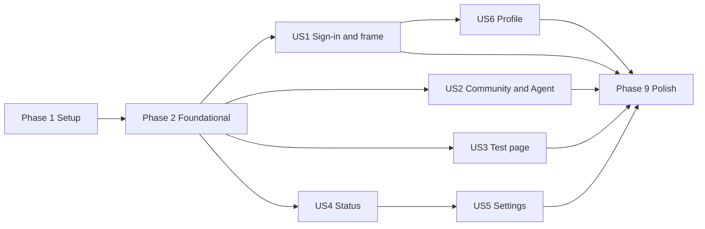

---

description: "Task list for the management frontend redesign"
---

# Tasks: Management Frontend Redesign

**Input**: Design documents from `specs/005-management-frontend-redesign/`

**Prerequisites**: [plan.md](plan.md), [spec.md](spec.md), [research.md](research.md), [data-model.md](data-model.md), [contracts/](contracts/configuration-v2.1.md), [quickstart.md](quickstart.md)

**Tests**: Required. FR-036 and Constitution IX ask for automated tests in CI for every changed behavior. Tests are written before the code they cover and must fail first. Manual checks are deferred by the owner ([quickstart.md](quickstart.md#deferred-manual-checks)); no task asks for one.

**Organization**: Tasks are grouped by user story so each story can be built and tested on its own.

## Format: `[ID] [P?] [Story] Description`

- **[P]**: Can run in parallel (different files, no dependency on an unfinished task)
- **[Story]**: The user story the task belongs to (US1 to US6)
- Paths are relative to the repository root. `code/management` is the management app (Reflex + FastAPI); `code/backend` is the runtime.
- Tasks added after generation (T071 and up) keep their number and are placed where they run; follow the order of the list, not the numbers.

## Commands

- Offline checks: `uv run --project code/tools --locked python code/tools/scripts/ci.py check`
- Runtime tests: `uv run --directory code/backend --locked pytest tests -q`
- Management tests (Node.js on `PATH`): `uv run --directory code/management --locked pytest tests -q`
- Docs: `uv run --project code/tools --locked python code/tools/scripts/verify_docs.py`
- In the mirror-feed setup: `. .\code\.local\feeds.ps1` then `Remove-Item Env:UV_DEFAULT_INDEX`; after management tests run `git checkout -- code/management/reflex.lock`.

---

## Phase 1: Setup (Shared Infrastructure)

**Purpose**: Brand assets and design tokens every page uses.

- [X] T001 [P] Copy `specs/005-management-frontend-redesign/assets/caller-ai-logo.svg` and `caller-ai-mark.svg` unchanged to `code/management/assets/`, and replace `code/management/assets/favicon.ico` with a 16/32/48 px icon rendered from the mark (research R16)
- [X] T002 [P] Write `code/management/tests/unit/test_theme.py`: every text/background pair in the tokens meets WCAG 2.1 AA ("4.5:1 text, 3:1 large text and essential graphics"); `default-fill`, `custom-fill`, `entry`, `warning`, `danger` and `focus` exist; default and custom styles differ in fill, icon and label, not only in color (FR-015, FR-030)
- [X] T003 Create `code/management/management_app/theme.py` with the tokens from [contracts/ui-shell.md](contracts/ui-shell.md#design-tokens) (`brand` teal `#197767`, `surface`, `surface-muted`, `border`, `text`, `text-muted`, `default-fill` slate + lock icon + "Default", `custom-fill` white + `brand` border + pencil icon + "Custom", `entry` + flag icon + "Entry", `warning` + "Unreachable", `danger`, `focus`), with a module docstring; make T002 pass

---

## Phase 2: Foundational (Blocking Prerequisites)

**Purpose**: Schema 2.1.0 in both apps, the voice catalog, the route table and the authenticated frame. No user story can start before this phase is done.

### Tests for Phase 2

- [X] T004 [P] Extend `code/management/tests/unit/test_configuration_validation.py`: schema `2.1.0` accepted; `communities[].routable` "boolean, optional on read, default `true`"; `conversationSettings` fields `voice`, `maxOutputTokens`, `idleTimeoutSeconds` optional with unknown fields refused (rule `schema`); community ids starting with `default-` and names equal to `Welcome`, `Routing` or `Goodbye` (case-insensitive) refused with rule `reserved_name`; a `2.0.0` document still reads with `routable` true ([contracts/configuration-v2.1.md](contracts/configuration-v2.1.md))
- [X] T005 [P] Extend `code/backend/tests/unit/test_configuration_cache.py` and `code/backend/tests/unit/test_community_visibility.py`: runtime accepts `2.0.0` and `2.1.0`; `routable` absent means `true`; `conversationSettings` absent means environment defaults; any other version is refused as today
- [X] T006 [P] Create `code/backend/tests/unit/test_voices.py`: the catalog ids are unique, match `[a-z][a-z0-9_-]{0,63}`, include `marin` as default, each entry has `name`, `language`, `accent` (text or `null`) and `presentation` (`Feminine`, `Masculine` or `null`), and contain none of `alloy`, `ash`, `ballad`, `coral`, `echo`, `sage`, `shimmer`, `verse`, `cedar` (research R15)
- [X] T007 [P] Create `code/management/tests/unit/test_frame.py`: route table matches [contracts/ui-shell.md](contracts/ui-shell.md#routes) (`/login`, `/`, `/communities`, `/test`, `/status`, `/settings`, redirects from `/configuration`, `/configuration/communities/[id]`, `/configuration/test`); sidebar order "Dashboard, Community and Agent, Test, Status, Settings"; entries filtered by role (editor: all; tester only: Dashboard, Status, plus Test only when `TESTER_ONLY_TESTS` is on; neither: none)

### Implementation for Phase 2

- [X] T008 Update `code/management/management_app/models/configuration.py`: `schema_version` `Literal["2.0.0", "2.1.0"]`, `Community.routable: bool = True`, optional `ConversationSettings` (`voice`, `max_output_tokens`, `idle_timeout_seconds`, `extra="forbid"`), `layout` kept for reading; new revisions write `{"communities": [], "agentsByCommunity": {}}`
- [X] T009 Update `code/management/management_app/services/configuration_validation.py`: rule `reserved_name` (ids must not start with `default-`; names must not equal Welcome, Routing, Goodbye case-insensitively); range checks are added in US5; make T004 pass
- [X] T010 [P] Update `code/backend/src/caller_runtime/domain/configuration.py` and the schema check in `code/backend/src/caller_runtime/domain/visibility.py` to accept `2.0.0` and `2.1.0`, read `routable` (default `true`) and `conversationSettings` (all optional), and keep both in `for_runtime()` and the policy hash; make T005 pass
- [X] T011 [P] Create `code/backend/src/caller_runtime/domain/voices.py` with the reviewed GPT-Live catalog from [research.md R15](research.md#r15-voice-catalog-and-drop-down) as an immutable tuple of entries and `DEFAULT_VOICE = "marin"`; re-read the source table on <https://developers.openai.com/api/docs/guides/live-conversations#voice-options> first and record the check date in the module docstring; make T006 pass
- [X] T012 Update the management app to write `2.1.0` from `code/management/management_app/state/editor_draft.py` and `code/management/management_app/services/configuration_publication.py` (always write `routable`; never write layout positions)
- [X] T013 Create `code/management/management_app/components/frame.py`: one root frame that renders a neutral loading state until the session is known, the login page without a session, "no access" with sign-out for a session without either role, a "role required" message without page data for a page the roles do not allow, and otherwise the sidebar (role-filtered, current entry highlighted with `aria-current="page"`, collapsed behind a menu button below 768 px), the top bar with the mark and "Caller AI" linking to `/`, and the page; a shared page-content wrapper that shows a loading indicator when a page's data takes longer than 1 second and an error with a Retry button when loading fails (FR-031, edge case "A page fails to load its data"); colors from `management_app/theme.py`; make T007 pass
- [X] T014 Update `code/management/management_app/management_app.py`: register `/login`, `/`, `/communities`, `/test`, `/status`, `/settings` through the frame; redirect `/configuration` and `/configuration/communities/[community_id]` to `/communities` and `/configuration/test` to `/test`; remove the old index status shell and the "CALLER / CONTROL" header
- [ ] T069 Update `code/tools/scripts/smoke.py` (editor fixture) and `code/management/tests/editor_app.py` so the fixture serves the new routes, a status double (runtime up, down, slow and failing), role-switchable fixture sessions (editor, tester, both, none) with configurable session and token expiry, a `TESTER_ONLY_TESTS` override for tests, and configuration responses that can be delayed or fail; the browser tests in every story use it
- [X] T071 Migrate the existing browser tests to the new frame: rewrite the responsive cases in `code/management/tests/browser/test_shell.py` for the frame (360, 768 and 1440 px widths, tab order, sidebar collapsed behind the menu button below 768 px, no horizontal scroll), change the routes in `code/management/tests/browser/test_configuration_editor.py` and its console cases to `/communities` and `/test`, and add a case that `/configuration`, `/configuration/communities/[id]` and `/configuration/test` redirect to the new routes; all browser tests pass after T014

**Checkpoint**: Schema, catalog and frame in place. User stories can start.

---

## Phase 3: User Story 1 - Sign in and move around the application (Priority: P1) 🎯 MVP

**Goal**: A protected, navigable shell: login page with the logo, deep-link return, role-aware sidebar, dashboard, sign-out, session warning and extension.

**Independent Test**: Open the frontend without a session, sign in with each role mix, and visit each sidebar entry; let a session approach expiry and extend it.

### Tests for User Story 1

- [X] T015 [P] [US1] Extend `code/management/tests/unit/test_security.py`: `GET /auth/login?returnTo=` accepts only an exact page route from [contracts/ui-shell.md](contracts/ui-shell.md#sign-in-and-session) and ignores anything with a scheme, host, `//`, `\`, query or fragment; `POST /auth/callback` redirects to the accepted path or `/`; `GET /auth/session` returns `roles`, `displayName`, `account`, `expiresAt`, `tokenExpiresAt`; `POST /auth/session/extend` requires CSRF, moves `expiresAt` to now + 15 minutes "capped by `tokenExpiresAt`", and returns `401 session_expired` when already expired
- [X] T016 [P] [US1] Create `code/management/tests/browser/test_frame.py`: without a session every route shows only the login page with the logo (accessible name "Caller AI") and makes no page data request (SC-001); deep link returns to the page after sign-in; tester-only, editor-only, both and no-role sessions see the right sidebar and pages; every named page is reached in one selection (SC-003 proxy); 20 fixture sign-ins each reach the first page in under 5 seconds measured from the callback, excluding the identity provider's own time (SC-002); a cancelled or failed fixture sign-in shows the login page with a retry message and creates no session; sign-out returns to login
- [ ] T017 [P] [US1] Add to `code/management/tests/browser/test_frame.py`: with a short fixture session the warning appears 5 minutes before expiry; "Stay signed in" extends it and keeps an open draft; when the fixture sign-in token is about to expire, "Stay signed in" saves the open graph and settings drafts in session storage, signs in again, returns to the same page and restores them for the same user only, then clears the storage; a different user or sign-out never sees them; an expired session's next action shows login with the message that unpublished changes were discarded and never reports them as saved (FR-006)

### Implementation for User Story 1

- [X] T018 [US1] Update `code/management/management_app/security.py`: `returnTo` allowlist on `/auth/login` stored in the login cookie, callback redirect to it or `/` (was `/configuration`), extra `/auth/session` fields, new CSRF-protected `POST /auth/session/extend` capped by the token expiry; make T015 pass
- [ ] T019 [US1] Create `code/management/management_app/state/session.py`: load `/auth/session`, expose roles, display name, account and expiry, schedule the warning at `expiresAt` − 5 minutes, call `/auth/session/extend`, and when the token itself is about to expire save the open drafts (with their starting ETag) to the tab's session storage keyed by actor reference, sign in again with `returnTo`, restore them for the same actor only and remove them; clear them on sign-out; route an expired session to `/login` with the discarded-changes message (research R10)
- [X] T020 [P] [US1] Create `code/management/management_app/pages/login.py`: full logo from `assets/caller-ai-logo.svg`, one sign-in button to `/auth/login` with the current `returnTo`, retry message when sign-in failed or was cancelled
- [X] T021 [P] [US1] Create `code/management/management_app/pages/dashboard.py`: welcome heading and links to the pages the roles allow, laid out so widgets can be added later (FR-007)
- [X] T022 [US1] Wire the session warning and sign-out into `code/management/management_app/components/frame.py`; emit `ui.page_view` (`page`, `outcome` = `shown`, `login`, `no_access`, `role_required`), `auth.sign_in` and `auth.session_extend` through `code/management/management_app/observability.py` with no names, accounts or tokens; make T016 and T017 pass

**Checkpoint**: The MVP: protected shell with logo, navigation, dashboard and session handling.

---

## Phase 4: User Story 2 - Shape the community and agent network (Priority: P1)

**Goal**: One graph with the fixed default communities, custom communities and agents, routable links, handovers, Tools, per-node settings, browser-local view, rule refusals, agent stamps and the new-revision notice.

**Independent Test**: From a configuration with only the protected agents, add a custom community with two agents, link it from Routing, change its entry agent, draw a handover, try every forbidden action, and publish.

### Tests for User Story 2

- [X] T023 [P] [US2] Create `code/management/tests/unit/test_graph_view.py`: default communities `default-welcome`, `default-routing`, `default-goodbye` projected from the protected roles with their agent as entry agent and `fixed` true; fixed link Welcome → Routing; Goodbye labeled "Reachable from every community"; a missing protected agent is a blocking error; reachability marks an enabled community "Unreachable" when it is not routable and no chain of community connections from a reachable, enabled community leads to it, and never reports disabled communities
- [X] T024 [P] [US2] Add to `code/management/tests/unit/test_graph_view.py`: each refusal returns its rule id and a message naming the item, and leaves the draft unchanged: delete/rename/modify a default community, add an agent to a default community, change a default connection, delete or move a pre-defined agent, change a pre-defined agent's `enabled` or tools, delete or disable the current entry agent, leave a community without an entry agent, draw a handover between agents of different communities or on a default community (FR-009 to FR-013, FR-038, SC-004)
- [X] T025 [P] [US2] Extend `code/management/tests/contract/test_configuration_api.py`: `PUT /v2/configuration` success body carries `warnings` with `{"code": "community_unreachable", "communityId": ...}` and never blocks on them; `GET /v2/configuration` returns `publication` (`publishedAt`, `publishedBy`, `publishedByName`, `agentStamps`) to editors only; the runtime projection in `code/management/tests/contract/test_runtime_configuration.py` never contains `publication` or layout positions
- [X] T026 [P] [US2] Extend `code/management/tests/integration/test_configuration_publication.py`: across three publications, changed agents get the new stamp (`revisionNumber`, `changedAt`, `changedBy`, `changedByName`), unchanged agents keep theirs, new agents get the publication's stamp; `publishedByName` is "text, max 256" and never appears in logs (assert with `code/management/tests/integration/test_audit_privacy.py`)
- [X] T027 [P] [US2] Extend `code/backend/tests/unit/test_community_visibility.py`: the Routing view lists only communities that are enabled, routable and have an enabled entry agent; a `2.0.0` revision behaves as today
- [X] T028 [P] [US2] Extend `code/management/tests/browser/test_configuration_editor.py` on `/communities`: default nodes show slate fill, lock icon and "Default", custom nodes white fill, teal border, pencil icon and "Custom", entry agent flag and "Entry"; a grayscale render still distinguishes them (SC-007 proxy); each forbidden action from T024 shows its message and changes nothing; no panel without selection, agent settings with enabled state and "last changed" (or "not yet published") on agent selection, community settings on community selection; a configuration response delayed over 1 second shows the loading indicator, and a failing load shows an error with Retry that recovers when the fixture succeeds again; a custom community whose entry agent is disabled is marked invalid and publishing is refused with a message naming it; deleting a community that other communities connect to asks for confirmation naming the connections that will be removed, and the graph updates at once after confirming (FR-014, FR-020, FR-031)
- [X] T029 [P] [US2] Add to `code/management/tests/browser/test_configuration_editor.py`: add a community with two agents, draw Routing → community, change the entry agent, draw a handover, publish; graph updates at once and the confirmation names the new revision; the scripted flow finishes within 5 minutes (SC-005 proxy); removing the Routing link and publishing shows "Unreachable" and lists it in the confirmation
- [X] T030 [P] [US2] Add to `code/management/tests/browser/test_configuration_editor.py`: drag and collapse persist after reload in the same browser without an unpublished-change marker; storage holds "At most 400 entries, oldest evicted first"; nodes without a stored position never overlap; the outline list selects every node by keyboard and opens its settings (FR-016, FR-032)
- [X] T031 [P] [US2] Add to `code/management/tests/browser/test_configuration_editor.py`: a publication from a second browser context shows the new-revision notice within 30 seconds and leaves the draft unchanged until Reload; publishing on the stale draft returns a conflict and keeps it (FR-017, SC-011)
- [X] T032 [P] [US2] Add to `code/management/tests/browser/test_configuration_editor.py`: Tools section adds a tool, assigns it to a custom agent, refuses it for pre-defined agents, and removing a tool in use asks for confirmation naming the agents (FR-037)
- [X] T033 [P] [US2] Add a performance case to `code/management/tests/browser/test_configuration_editor.py`: with 20 communities and 100 agents, drag, zoom and collapse give feedback within 100 ms and an edit appears within 1 second (SC-006)

### Implementation for User Story 2

- [X] T034 [US2] Create `code/management/management_app/services/graph_view.py`: default community projection, fixed links, reachability, and one rule function per refusal returning `(rule_id, message)`; make T023 and T024 pass
- [X] T035 [US2] Add reachability warnings to `code/management/management_app/services/configuration_validation.py` and the `warnings` body to `code/management/management_app/api/configuration.py`
- [X] T036 [US2] Add publication metadata and agent stamps in `code/management/management_app/services/configuration_publication.py` and `code/management/management_app/adapters/configuration_repository.py` (stored next to the revision, excluded from the runtime projection and both hashes), and return `publication` to editors from `code/management/management_app/api/configuration.py`; make T025 and T026 pass
- [X] T037 [P] [US2] Update `code/backend/src/caller_runtime/domain/visibility.py` so the Routing view offers only routable communities; make T027 pass
- [X] T038 [US2] Update `code/management/management_app/state/editor_draft.py` and `code/management/management_app/state/configuration_editor.py`: graph draft excludes `conversationSettings` (copied from the active revision at publish), every action goes through `graph_view` rules and emits `configuration.rule_refused` (`rule`, `item_kind`), delete and publish confirmations name what changes, and a background check of `GET /v2/configuration` with `If-None-Match` every 15 seconds raises the notice
- [X] T039 [US2] Update `code/management/management_app/components/configuration_graph.py`: default/custom/entry/unreachable/invalid styles from `theme.py`, collapse with agent count, positions and collapse in browser local storage keyed by origin + actor reference + node id with "At most 400 entries, oldest evicted first", deterministic non-overlapping automatic arrangement, no `onMove` writes to the draft, and a keyboard and screen-reader outline list that selects nodes
- [X] T040 [US2] Create `code/management/management_app/pages/community_agent.py`: graph, outline list, selected-node settings panel below the graph, Tools section, publish bar and notice; reuse the panels in `code/management/management_app/pages/agents.py`, `communities.py` (with the "Routable from Routing" link), `relationships.py` (handovers) and `tools.py`, removing their standalone page layout; register it at `/communities` in `code/management/management_app/management_app.py`; wrap its data loading in the frame's loading and error wrapper from T013; make T028 to T033 pass

**Checkpoint**: Community and Agent page complete and testable with US1 or alone behind the frame.

---

## Phase 5: User Story 3 - Test voice and text conversations (Priority: P2)

**Goal**: The existing console inside the frame, with tester-only access behind `TESTER_ONLY_TESTS` (off by default), stopped when the user leaves the page.

**Independent Test**: As an editor-and-tester user, open the Test page, run a text and a voice test, and navigate away during one; then repeat as a tester-only user with `TESTER_ONLY_TESTS` turned on for the test.

### Tests for User Story 3

- [X] T041 [P] [US3] Extend `code/management/tests/integration/test_live_tester_access.py` and `code/management/tests/contract/test_browser_tests.py`, parametrized over `TESTER_ONLY_TESTS`: with `False` (default) console ticket and socket require the editor and tester roles as today and a tester-only session sees Dashboard and Status only; with `True` they accept a browser session with only the tester role; both states refuse editor-only and no-role sessions, and configuration reads and writes always refuse tester-only sessions; a test asserts the shipped default is `False`
- [X] T042 [P] [US3] Create `code/management/tests/browser/test_test_page.py` (the old console cases already moved to `/test` in T071): the console works at `/test` inside the frame with every existing control; leaving the page during a test stops it like an explicit stop and shows a notice; an editor-only user sees the missing-role explanation and no start control (FR-021, FR-022, SC-010)

### Implementation for User Story 3

- [X] T043 [US3] Add `TESTER_ONLY_TESTS: Final = False` to `code/management/management_app/security.py` with a one-line comment that it is enabled only after the recorded security review (research R11), and make `require_test_manager` (and its callers in `code/management/management_app/api/test_sessions.py` and `code/management/management_app/state/test_console.py`) and the sidebar filter in `code/management/management_app/components/frame.py` require the tester role only when it is `True`; make T041 pass
- [X] T044 [US3] Move `code/management/management_app/pages/test_console.py` into the frame at `/test` and stop a running test on page leave in `code/management/management_app/state/test_console.py`; make T042 pass

**Checkpoint**: Test page works for testers without the editor role.

---

## Phase 6: User Story 4 - Check the service status (Priority: P2)

**Goal**: A read-only Status page fed by a new runtime endpoint.

**Independent Test**: Open the Status page with the fixture runtime up and down and compare the values with the fixture settings.

### Tests for User Story 4

- [ ] T045 [P] [US4] Create `code/backend/tests/contract/test_status_endpoint.py`: `GET /v1/status` requires the workload token like the conversation endpoints; body matches [contracts/status.md](contracts/status.md) (hosts, deployment, region, `voice.model` equal to the model sent in `session.start`, `reachable`, `checkedAt`, `lastCallOutcome`, `lastCallAt`, `supportedVoices` as catalog entries, `defaults`, `limits`); no key, token, path or query appears; probes reused for 60 seconds with one in flight per model; a probe gives up after 2 seconds; add the route to `code/backend/tests/contract/test_route_inventory.py`
- [ ] T046 [P] [US4] Create `code/management/tests/contract/test_status_api.py`: `GET /v1/status` allows editor or tester sessions and refuses others; wraps the runtime body; reports `runtime.reachable` false with `lastSuccessAt` when the runtime is down; `?refresh=1` bypasses the 60-second cache "at most once per 10 seconds per session"
- [ ] T047 [P] [US4] Create `code/management/tests/browser/test_status_page.py`: the page shows text and voice hosts, text deployment, voice region and model, reachability and check times; with the runtime stopped it shows unreachable with the last success time and other pages keep working; a status response delayed over 1 second shows the loading indicator, and a failing management status call shows an error with Retry that recovers (FR-023, FR-024, FR-031, SC-009)

### Implementation for User Story 4

- [ ] T048 [US4] Create `code/backend/src/caller_runtime/adapters/status_probe.py`: token for the Foundry scope plus TLS connect to the host within 2 seconds, 60-second cache, last real call outcome recorded by the text and live adapters, `status.probe` event (`model`, `outcome`, duration)
- [ ] T049 [US4] Create `code/backend/src/caller_runtime/api/status.py` with the workload check from `code/backend/src/caller_runtime/api/connection.py` and mount it in `code/backend/src/caller_runtime/main.py`; make T045 pass
- [ ] T050 [US4] Create `code/management/management_app/adapters/runtime_status_client.py` (workload token, timeout, 60-second cache) and `code/management/management_app/api/status.py` (roles, refresh throttle, `status.check` event); register it in `code/management/management_app/composition.py`; make T046 pass
- [ ] T051 [US4] Create `code/management/management_app/state/status.py` and `code/management/management_app/pages/status.py` at `/status`, using the frame's loading and error wrapper from T013; make T047 pass

**Checkpoint**: Status page live with the runtime endpoint.

---

## Phase 7: User Story 5 - Adjust service settings (Priority: P3)

**Goal**: Settings page with a voice drop-down, reply length limit and idle timeout in their own draft, applied by the runtime to new conversations.

**Independent Test**: Change the voice and idle timeout, publish while a graph edit is pending, and start a new test session that uses the new values.

**Depends on**: US4 (voice catalog and limits come from the status response).

### Tests for User Story 5

- [ ] T052 [P] [US5] Extend `code/management/tests/unit/test_configuration_validation.py`: `voice` must be an `id` of the runtime catalog (rule `conversation_voice`); `maxOutputTokens` "Integer, 1 to `limits.maxOutputTokens`" and `idleTimeoutSeconds` "Integer, 30 to 120" (rule `conversation_limit`)
- [ ] T053 [P] [US5] Extend `code/backend/tests/unit/test_admission.py` and `code/backend/tests/integration/test_conversation.py`: a session admitted under a revision with `conversationSettings` uses its voice in `session.start`, its `maxOutputTokens` for text replies and its idle timeout for `idle_expires_at`; a running session keeps its values after a new publication; absent values use `CALLER_LIVE_VOICE`, `CALLER_MAX_OUTPUT_TOKENS` and 120 seconds; out-of-range values in a revision are refused
- [ ] T054 [P] [US5] Extend `code/management/tests/unit/test_backend_connection.py`: the management text relay uses the active revision's idle timeout instead of its fixed 120 seconds
- [ ] T055 [P] [US5] Create `code/management/tests/browser/test_settings_page.py`: the voice drop-down lists the catalog grouped by language, labeled "Name — Language (accent), presentation", default marked; idle timeout 20 is refused with the 30–120 range; publishing settings with a graph edit pending publishes only the settings and keeps the graph draft; with the runtime down the editable settings are read-only with an explanation (FR-025, FR-026)

### Implementation for User Story 5

- [ ] T056 [US5] Add the `conversation_voice` and `conversation_limit` checks to `code/management/management_app/services/configuration_validation.py`, using the catalog and limits from the status client; make T052 pass
- [ ] T057 [US5] Apply `conversationSettings` at admission in `code/backend/src/caller_runtime/domain/conversation.py` (idle timeout ≤ 120 seconds replaces the fixed 120 in `idle_expires_at`), `code/backend/src/caller_runtime/composition.py` (per-session voice and max output tokens), `code/backend/src/caller_runtime/adapters/gpt_live.py` and `code/backend/src/caller_runtime/adapters/foundry_text.py`; reject voices outside `domain/voices.py`; make T053 pass
- [ ] T058 [P] [US5] Read the idle timeout from the active revision in `code/management/management_app/adapters/text_relay.py`; make T054 pass
- [ ] T059 [US5] Create `code/management/management_app/state/settings.py` (own draft holding only `conversationSettings`, publish = active revision + settings with `If-Match`, conflict keeps the draft, new-revision notice) and `code/management/management_app/pages/settings.py` at `/settings` with the voice drop-down, the two number fields with their ranges (the reply length field states that it applies to text replies and delegated work, not to spoken output), read-only environment values and the "applies to conversations started after publication" confirmation; make T055 pass

**Checkpoint**: Settings published and honored by the runtime.

---

## Phase 8: User Story 6 - Profile and sign-out in the top bar (Priority: P3)

**Goal**: User Profile, a "coming soon" User Settings entry and sign-out in the top bar.

**Independent Test**: Open the profile and user settings from the top bar and sign out.

**Depends on**: US1 (`/auth/session` profile fields).

### Tests for User Story 6

- [X] T060 [P] [US6] Add to `code/management/tests/browser/test_frame.py`: User Profile shows display name, sign-in account and roles read-only; User Settings shows a "coming soon" notice and no controls (FR-028, FR-029)

### Implementation for User Story 6

- [X] T061 [US6] Add the User Profile menu and the User Settings "coming soon" dialog to the top bar in `code/management/management_app/components/frame.py`, reading from `management_app/state/session.py`; make T060 pass

**Checkpoint**: All stories complete.

---

## Phase 9: Polish & Cross-Cutting Concerns

- [ ] T062 [P] Extend `code/management/tests/unit/test_observability.py` and `code/backend/tests/unit/test_observability.py`: `ui.page_view`, `auth.sign_in`, `auth.session_extend`, `configuration.rule_refused`, `status.check` and `status.probe` follow the event schema and carry no names, accounts, prompts, settings values or tokens (FR-035)
- [ ] T063 Verify that every event in T062 is in the catalogs in `code/management/management_app/observability.py` and `code/backend/src/caller_runtime/observability.py` and in `docs/runbooks/monitoring.md`, and add any that are missing; make T062 pass
- [ ] T064 [P] Add a keyboard-only walkthrough of every page and a check that every interactive element has a visible focus style to `code/management/tests/browser/test_frame.py` (FR-032, SC-008)
- [ ] T065 [P] Create `docs/management-frontend.md`: pages, routes and roles, frame, session warning, logo, design tokens, default and custom node conventions, voice drop-down, browser-local view; Mermaid diagrams of page navigation and the default community structure
- [ ] T066 [P] Update `docs/configuration-guide.md`: default communities, routable links and unreachable warnings, agent handovers, Tools section, Settings page with separate drafts; remove descriptions of the old `/configuration` pages
- [ ] T067 [P] Update `docs/architecture.md` (status flow, schema 2.1.0 compatibility and deploy order) and `docs/conversation-endpoints.md` (runtime `GET /v1/status`)
- [ ] T068 [P] Update `docs/runbooks/monitoring.md` with the new events and `docs/setup.md` / `docs/testing.md` with the new browser test files
- [ ] T070 Run the commands in the Commands section and [quickstart.md](quickstart.md) section 1; fix every failure; confirm Foundation CI is green on both OS jobs

---

## Dependencies & Execution Order

### Phase dependencies

- **Setup (Phase 1)**: none.
- **Foundational (Phase 2)**: needs T003 (tokens) for the frame; blocks every story.
- **US1 (Phase 3)** and **US2 (Phase 4)**: start after Phase 2; independent of each other.
- **US3 (Phase 5)** and **US4 (Phase 6)**: start after Phase 2; independent.
- **US5 (Phase 7)**: needs US4 (catalog and limits from status) and Phase 2 schema.
- **US6 (Phase 8)**: needs US1 (session profile fields).
- **Polish (Phase 9)**: after the stories it documents.



### Within each story

Tests first and failing, then models and services, then API, then state and pages. Runtime changes before the management code that relies on them (deploy order: runtime first).

## Parallel Opportunities

- Phase 1: T001 and T002 together.
- Phase 2 tests: T004, T005, T006, T007 together; then T010 and T011 in parallel with T008/T009.
- US1: T015, T016, T017 together; T020 and T021 together.
- US2: T023 to T033 (tests in separate files or independent cases) together; T037 (runtime) in parallel with T034 to T036.
- US3 and US4 can run in parallel with US2 by separate developers.
- Polish docs T065 to T068 together.

### Example: User Story 2

```text
Run together: T023 test_graph_view.py, T025 test_configuration_api.py, T026 test_configuration_publication.py, T027 test_community_visibility.py
Then: T034 graph_view.py and T037 visibility.py in parallel
```

## Implementation Strategy

### MVP first

1. Phase 1 and Phase 2.
2. US1: protected shell, logo, navigation, dashboard, session handling.
3. Validate with T016 and T017, then ship behind the existing pages' redirects.

### Incremental delivery

1. US2 (core configuration value), then US3 and US4 in parallel, then US5, then US6.
2. Each story ends at its checkpoint with its own tests green in CI.
3. Deploy the runtime before the management app for any release that contains T010, T037, T049 or T057.

### Deferred (not part of this task list)

Manual security review of tester-only access, usability checks with managers, and a manual walkthrough on `int`, deferred by the owner on 2026-11-11 ([quickstart.md](quickstart.md#deferred-manual-checks)). Release gate: `TESTER_ONLY_TESTS` stays `False` until the security review is recorded; turning it on is a separate reviewed change.
