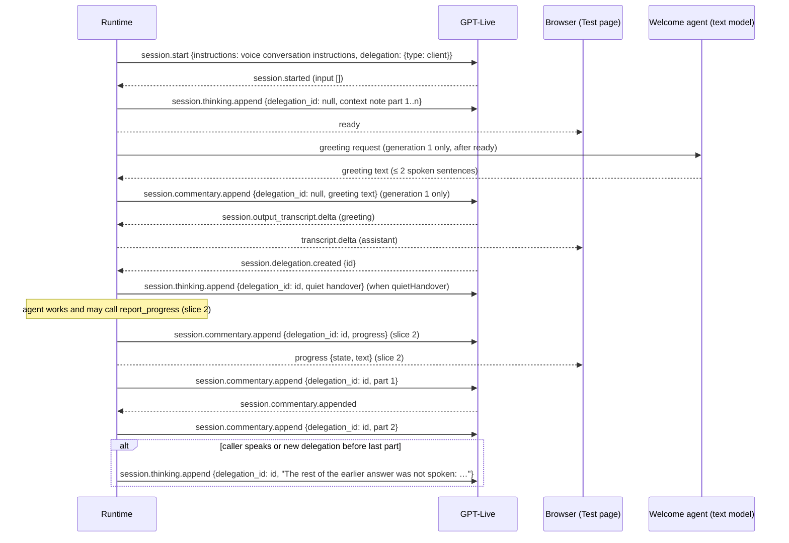

# Contract: GPT-Live session behavior (voice)

**Owner**: runtime (`adapters/gpt_live.py`, `services/conversation.py`, `services/conversation_policy.py`). **Provider**: Azure AI Foundry `gpt-live-1`, client delegation. The behavior was checked live on int on 2026-11-12.

## Event sequence



## Rules

**Session start**

| Rule | Detail |
|------|--------|
| Instructions (FR-014) | `instructions` = voice conversation instructions + the existing delegation suffix, at most 16 KiB. |
| Greeting (R1) | Generation 1 only: after `ready`, the runtime requests the greeting text from the Welcome agent (outside the admission budget, low effort, at most 256 tokens, no tools) and sends it through `session.commentary.append` with `delegation_id: null`, split into parts of at most 500 bytes. The request is cancelled if the caller speaks or a delegation arrives first, or if no text has arrived 5 s after `ready`; a late greeting is never spoken. Only the first greeting audio must start within 5 s, and the greeting may keep playing afterwards. There is no fallback. Later generations never greet. |
| `session.started` validation | Unchanged: `input` must be `[]`. |

**Updates sent to the model**

| Rule | Detail |
|------|--------|
| Context note (FR-038) | Sent after every `session.started`. Each line is `<name> (<role>)`, then `Communities you can route to: <name>: <description ≤160 chars>`. At most 2,000 bytes in total, sent in parts of at most 500 bytes. |
| Quiet handover (FR-016/017) | Sent when `quietHandover` is not `false`. It goes out before any backend work and ahead of the holding timer. |
| Spoken reply (FR-008) | Parts of at most 500 bytes. A part is sent after the previous part's acknowledgement, or after 2 s without one. The first verified user transcript or a new delegation drops the remaining parts. The dropped text goes in one quiet note of at most 1,500 bytes, sent as at most 3 thinking appends. |
| Fixed lines | Slice 1 keeps the holding line (5 s) and the failure line. Slice 2 drops the holding line and keeps the failure line only when no final progress state was reported for the work item (FR-023). |

**Content limits**

| Rule | Detail |
|------|--------|
| Content bound | Every append is non-empty and at most 500 UTF-8 bytes, unchanged. |

## Browser control events (voice wire, slice 2)

```json
{"type": "progress", "sequence": 41, "generation": 1, "sessionId": "…", "state": "completed", "text": "Your order was updated."}
```

The browser validates the fields like the other control events. It shows the update as a status row next to the captions (FR-020, FR-041).
