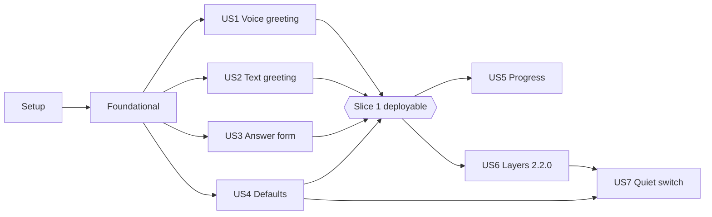

---

description: "Task list for feature 006: Modality-Aware Agent Interaction"
---

# Tasks: Modality-Aware Agent Interaction

**Input**: Design documents from `specs/006-modality-aware-agents/`

**Prerequisites**: [plan.md](plan.md), [spec.md](spec.md), [research.md](research.md), [data-model.md](data-model.md), contracts ([voice-live](contracts/voice-live.md), [text-endpoint](contracts/text-endpoint.md), [configuration-v2.2](contracts/configuration-v2.2.md), [test-console](contracts/test-console.md), [observability](contracts/observability.md)), [quickstart.md](quickstart.md)

**Tests**: Required. Constitution IX requires automated tests for every change, and SC-010 lists the mechanics they must cover. Within each story, tests come first and must fail before the implementation.

**Organization**:

- **Slice 1:** User Stories 1–4 (P1). No stored-configuration change.
- **Slice 2:** User Stories 5–7 (P2/P3). Configuration schema `2.2.0`.

**Paths**: Runtime is `code/backend/src/caller_runtime/` (tests in `code/backend/tests/`). Management is `code/management/management_app/` (tests in `code/management/tests/`).

**Test commands**: see [quickstart.md](quickstart.md). After management tests, always run `git checkout -- code/management/reflex.lock`.

## Format: `[ID] [P?] [Story] Description`

- **[P]**: Can run in parallel (different files, no dependency on incomplete tasks)
- **[Story]**: User story the task belongs to (US1–US7)

---

## Phase 1: Setup (Shared Infrastructure)

**Purpose**: Dependencies and records needed by later phases.

- [X] T001 Add `markdown-it-py` as a direct dependency (pin the version already resolved in the lock file) in `code/management/pyproject.toml`, and refresh `code/management/uv.lock` with `uv lock` (feeds loaded per quickstart).
- [X] T002 [P] Record the `markdown-it-py` decision (Markdown parsed server-side with `html=False` into an allowlisted tree; no HTML reaches the DOM; alternatives `rx.markdown`, browser sanitizer and `nh3` rejected) in `docs/library-decisions.md`.

---

## Phase 2: Foundational (Blocking Prerequisites)

**Purpose**: Shipped default texts and closed-set telemetry that several stories use, and the shared greeting and speech-splitting pieces.

**⚠️ CRITICAL**: Complete before the user story phases.

- [X] T003 [P] Write failing tests for the new closed sets in `code/backend/tests/unit/test_observability.py`. The cases:
  - operations `test.greeting`, `test.speech_parts` and `test.progress`;
  - reasons `ready`, `fallback`, `deadline`, `skipped`, `still_working`, `waiting_for_input`, `completed`, `failed`, `cancellation_confirmed`, `fallback_line`, `rate_limited` and `stale`;
  - measurements `greeting_seconds`, `parts` and `dropped_parts`;
  - any free-text value is refused.

  Follow [contracts/observability.md](contracts/observability.md).
- [X] T004 Add those operations, reasons and measurements to the closed sets in `code/backend/src/caller_runtime/observability.py`, without any content field (FR-035).
- [X] T005 [P] Create `code/management/management_app/services/default_prompts.py` with module-level constants:
  - `WELCOME_PROMPT`, `ROUTING_PROMPT`, `GOODBYE_PROMPT`;
  - `VOICE_INSTRUCTIONS`, following the published live structure: personality and speaking style, then sections headed `Backchannel policy:`, `Interruption policy:` and `Delegation policy:`, using `Generate <|SpawnThinking|>` wording;
  - `VOICE_PLATFORM_RULES`, which requires brief, natural spoken answers without tables or markup (FR-009). It contains **no** progress rules; US5 adds those together with the progress tool;
  - `VOICE_GLOBAL_PROMPT`, `TEXT_PLATFORM_RULES` (allows lists, tables, headings, emphasis, code and links; no progress rules) and `TEXT_GLOBAL_PROMPT`.

  `VOICE_INSTRUCTIONS`, `VOICE_PLATFORM_RULES` and `TEXT_PLATFORM_RULES` each include a language rule: "Start in English. As soon as the user speaks or writes in another language, continue in that language" (FR-006).

  Each constant must be non-empty, contain no NUL, and stay within its limit: `VOICE_INSTRUCTIONS` "at most 12 KiB", each layer "0–8 KiB", each agent prompt "at most 16 KiB".
- [X] T006 [P] Write tests in `code/management/tests/unit/test_default_prompts.py`:
  - every constant from T005 is non-empty and within its stated limit;
  - `VOICE_INSTRUCTIONS` contains the headings `Backchannel policy:`, `Interruption policy:` and `Delegation policy:`;
  - `VOICE_INSTRUCTIONS`, `VOICE_PLATFORM_RULES` and `TEXT_PLATFORM_RULES` contain the language rule;
  - neither platform rules constant mentions `report_progress` (slice 1).
- [X] T007 Create `code/backend/src/caller_runtime/services/modality_defaults.py` with runtime copies of `VOICE_INSTRUCTIONS`, `VOICE_PLATFORM_RULES` and `TEXT_PLATFORM_RULES` from T005 (slice 1 use; data-model "Shipped defaults").
- [X] T008 Add a cross-service contract test in `code/backend/tests/contract/test_modality_defaults.py`. It reads `code/management/management_app/services/default_prompts.py` by repository path, without importing management, and asserts byte equality with the three runtime copies in `modality_defaults.py`.
- [X] T009 [P] Write failing unit tests for `split_reply` in `code/backend/tests/unit/test_speech_parts.py`:
  - splitting prefers sentence ends, then whitespace, then code-point boundaries;
  - every part is "non-empty and at most 500 UTF-8 bytes";
  - concatenating the parts gives back the reply.
- [X] T010 [P] Write failing unit tests for the shared greeting request in `code/backend/tests/unit/test_conversation.py`:
  - `greeting_text(mode, work)` calls the text adapter with the Welcome agent's instructions plus the mode's platform rules, using `VOICE_GREETING_INPUT` for speech and `TEXT_GREETING_INPUT` for text;
  - the request uses `reasoning_effort="low"`, `max_output_tokens=256` and no tools;
  - the request is cancellable.
- [X] T011 [P] Create `code/backend/src/caller_runtime/services/speech_parts.py` with:
  - `split_reply(text) -> list[str]` (parts of at most 500 UTF-8 bytes; sentence, then whitespace, then code-point boundaries);
  - the constant `QUIET_HANDOVER = "Request received; the application is working on it."`.
- [X] T012 [P] Create `code/backend/src/caller_runtime/services/greeting.py` with these constants:
  - `VOICE_GREETING_INPUT = "The caller has just connected. Write the greeting you will say: in English, at most two short sentences, introduce the service and ask how you can help."`;
  - `VOICE_GREETING_SECONDS = 5.0`;
  - `TEXT_GREETING_INPUT = "The user has just opened the conversation. Greet them in English, introduce the service in one sentence and ask how you can help."`;
  - `TEXT_FALLBACK_GREETING = "Hello and welcome! How can I help you today?"`;
  - `TEXT_GREETING_SECONDS = 4.0`.
- [X] T013 Add a cancellable greeting request in `code/backend/src/caller_runtime/adapters/foundry_text.py`: the given instructions and input, `reasoning_effort="low"`, `max_output_tokens=256`, no tools.
- [X] T014 Add `greeting_text(mode, work)` to the executor in `code/backend/src/caller_runtime/services/conversation.py`. It calls the T013 request with the Welcome agent's instructions plus the mode's platform rules from `modality_defaults.py` (slice 1), and with `VOICE_GREETING_INPUT` or `TEXT_GREETING_INPUT`.

**Checkpoint**: Defaults and telemetry are ready, and the user stories can start.

---

## Phase 3: User Story 1 - Voice conversations open with a greeting (Priority: P1) 🎯 MVP

**Goal**: The Welcome agent writes the greeting text after ready, and the speaking model starts saying it within 5 s (first audio), once per session. The greeting may keep playing after 5 s. A greeting whose text is not available by 5 s is cancelled and never spoken, and it is skipped if the caller speaks first (FR-001, FR-004–FR-007, FR-039).

**Independent Test**: Start voice sessions without speaking. The first greeting audio arrives within 5 s, and `test.greeting` is logged with mode `speech`.

### Tests for User Story 1

- [X] T015 [P] [US1] Write failing unit tests in `code/backend/tests/unit/test_greeting.py`. The cases:
  - `GreetingState` moves `pending → greeted`, `pending → skipped` (on first verified caller speech or a delegation) and `pending → missed` (no first audio within 5.0 s; no retry, no fallback);
  - it never resets within a session;
  - `greeting_seconds` is measured from `ready_at` to the first greeting `session.output_audio.delta` or output transcript delta, whichever comes first.
- [X] T016 [P] [US1] Write failing tests in `code/backend/tests/contract/test_voice_endpoint.py`. The cases:
  - after `ready`, outside the admission budget, generation 1 calls `greeting_text("speech", ...)`;
  - the returned text is sent as `session.commentary.append` with `delegation_id: null`, in parts of at most 500 bytes;
  - `session.input` stays `[]`, so the start event and validator are unchanged;
  - an agent change (new segment) never greets;
  - first greeting audio within 5 s logs `test.greeting` success `ready` with `greeting_seconds`, and playback may continue after 5 s;
  - a greeting request that has not returned text by 5.0 s is cancelled, nothing is spoken later, and failure `deadline` is logged;
  - a failing request logs `deadline` with no fallback;
  - caller speech or a delegation first cancels the request, logs success `skipped`, and sends no greeting;
  - the spoken greeting transcript is added to the executor history as the first assistant entry (FR-039).

### Implementation for User Story 1

- [X] T017 [US1] Add the `GreetingState` class to `code/backend/src/caller_runtime/services/greeting.py`: fields `greeted`, `ready_at`, `first_user_input_at`; states pending, greeted, skipped, missed; deadline `VOICE_GREETING_SECONDS`, per [data-model.md](data-model.md#greeting-state-per-test-session).
- [X] T018 [US1] Update `code/backend/src/caller_runtime/api/voice.py`:
  1. After emitting `ready` for generation 1, start the greeting task and the 5 s timer.
  2. When the text arrives before 5.0 s, send it with `append_context(None, part)` for each part from `speech_parts.split_reply`.
  3. At 5.0 s, cancel the request if no text has arrived; a late greeting is never sent.
  4. On the first greeting `session.output_audio.delta` or output transcript delta, mark greeted and log `test.greeting`.
  5. On the first verified caller transcript or delegation before that, cancel the task and mark skipped.
  6. Log `deadline` when no first audio arrives by 5.0 s, or on failure; there is no fallback.
- [X] T019 [US1] Record the greeting transcript (assistant output transcript fragments before the first caller speech or delegation) as the first assistant entry of the executor history in `code/backend/src/caller_runtime/services/conversation.py` (FR-039).

**Checkpoint**: US1 is testable on its own.

---

## Phase 4: User Story 2 - Text conversations open with a greeting (Priority: P1)

**Goal**: An open request with no `text` and no `conversationId` returns the Welcome greeting within 5 s, or the fixed fallback after 4.0 s, stored as the first assistant turn. A message the user sends before the greeting appears is answered right after it (FR-002–FR-005, FR-039).

**Independent Test**: Open a text session on the Test page and type nothing. A greeting appears within 5 s.

### Tests for User Story 2

- [X] T020 [P] [US2] Write failing contract tests in `code/backend/tests/contract/test_text_endpoint.py`. The cases:
  - an open request (no `conversationId`, no `text`) streams `conversation`, `text.delta` and `text.completed` with the greeting;
  - a slow model fake exceeding 4.0 s streams the fallback `"Hello and welcome! How can I help you today?"`;
  - `text` without `conversationId` starts a conversation without a greeting (backward compatibility);
  - `conversationId` without `text` fails with `invalid_request`;
  - `test.greeting` is logged with mode `text` and reason `ready` or `fallback`.

  Follow [contracts/text-endpoint.md](contracts/text-endpoint.md).
- [X] T021 [P] [US2] Write failing unit tests in `code/backend/tests/unit/test_conversation.py`. The cases:
  - the greeting turn is stored as the first assistant turn;
  - a successful model greeting marks readiness proven, so the first user turn skips the readiness request;
  - after a fallback, the first user turn runs the existing readiness request.

  *Implementation note:* text turns have no readiness request today (only speech runs `prepare`), and each text turn is its own admission. The open request therefore makes exactly one model call (the greeting), and the readiness cases reduce to "no extra request"; the tests assert that.
- [X] T022 [P] [US2] Write failing tests in `code/management/tests/unit/test_test_console.py`. The cases:
  - when the text console session becomes ready, the relay sends the open request before any queued `text.submit`;
  - the greeting `text.delta` and `text.completed` are relayed unchanged;
  - a user message submitted before the greeting appears is sent after the greeting and answered right after it (FR-004).

  *Implementation note:* the relay harness lives in `code/management/tests/unit/test_backend_connection.py`, so these cases are there.

### Implementation for User Story 2

- [X] T023 [US2] Make `text` optional in the request model in `code/backend/src/caller_runtime/api/text.py`:
  - accept no `text` only when `conversationId` is absent (the open request);
  - refuse `conversationId` without `text` with `invalid_request`;
  - keep the limit `text` "non-blank and at most 4,096 bytes" when present.
- [X] T024 [US2] Implement the open flow in `code/backend/src/caller_runtime/services/text_conversation.py` and `code/backend/src/caller_runtime/services/conversation.py`:
  1. Create the conversation.
  2. Run `greeting_text("text", ...)` with a `TEXT_GREETING_SECONDS` (4.0 s) deadline; on timeout or error, cancel it and emit `TEXT_FALLBACK_GREETING`.
  3. Stream it as `text.delta` and `text.completed`.
  4. Store it as the first assistant turn.
  5. Set readiness proven only when the model greeting succeeded.
  6. Log `test.greeting`.
- [X] T025 [US2] Send the open request in `code/management/management_app/adapters/text_relay.py` as the first turn when the console text session becomes ready (`compose_request` without `text` and `conversation_id`). Queue user turns behind it, so an early message is answered right after the greeting. Capture the returned `conversationId` as for normal turns.

**Checkpoint**: US1 and US2 work independently.

---

## Phase 5: User Story 3 - Answers fit how they are received (Priority: P1)

**Goal**: Spoken answers are delivered fully in parts of at most 500 bytes, and the rest is dropped with a quiet note when the caller interrupts. Text answers are shown formatted and safe (FR-008–FR-012, FR-041).

**Independent Test**: Ask for a long, structured answer by voice and by text. Voice never plays the failure line; text shows a formatted list or table; `javascript:` links stay inert.

### Tests for User Story 3

- [X] T026 [P] [US3] Write failing unit tests for `dropped_note` in `code/backend/tests/unit/test_speech_parts.py`: the note is prefixed `"The rest of the earlier answer was not spoken: "`, capped at 1,500 bytes, and split into at most 3 parts of at most 500 bytes.
- [X] T027 [P] [US3] Write failing tests in `code/backend/tests/unit/test_conversation.py`. The cases:
  - a 2 KiB speech reply is sent as ordered `session.commentary.append` parts with the same delegation ID, each after the previous `session.commentary.appended` acknowledgement or 2 s;
  - no `WORK_FAILED_LINE` is sent because of length;
  - verified user speech or a new `session.delegation.created` before the last part drops the rest and sends the dropped note as `session.thinking.append`;
  - an exhausted work budget drops parts without a note;
  - `test.speech_parts` is logged with `parts` and `dropped_parts`.
- [X] T028 [P] [US3] Write failing unit tests in `code/management/tests/unit/test_formatted_text.py`. The cases:
  - Markdown converts to the allowlisted tree (nodes `p`, `h1`–`h3`, `ul`, `ol`, `li`, `blockquote`, `pre`, `code`, `table`, `thead`, `tbody`, `tr`, `th`, `td`, `strong`, `em`, `br`, `hr`, `a{href}`, `img{src,alt}`);
  - raw HTML stays literal text (`html=False`);
  - more than "2,000 nodes", depth over 12 or "text nodes of at most 64 KiB in total" returns `None` (plain-text fallback).
- [X] T029 [P] [US3] Write failing tests in `code/management/tests/unit/test_test_console.py`. The cases:
  - after `text.completed`, the relay sends one `text.formatted` with `messageId` and `tree`;
  - no `text.formatted` is sent when the tree is `None`;
  - the browser script builds nodes only with `createElement` and `textContent`, contains no `innerHTML` or `insertAdjacentHTML`, and keeps `href` and `src` only when `new URL(value).protocol === "https:"`.
- [X] T030 [P] [US3] Write failing browser tests in `code/management/tests/browser/test_test_console_formatting.py` (marker `browser`). The cases:
  - a reply with a list and a table renders formatted;
  - `javascript:`, `data:` and `http:` links and images are neither clickable nor loaded;
  - `https` links have `target="_blank"`, `rel="noopener noreferrer"` and `referrerpolicy="no-referrer"`;
  - images use `no-referrer` and lazy loading;
  - `#test-messages` keeps `role="log"` and `aria-live="polite"`.

### Implementation for User Story 3

- [X] T031 [P] [US3] Add `dropped_note(remaining) -> list[str]` (the prefix `"The rest of the earlier answer was not spoken: "`, a 1,500-byte cap, at most 3 parts of at most 500 bytes) to `code/backend/src/caller_runtime/services/speech_parts.py`, next to `split_reply` from T011.
- [X] T032 [US3] Add `event_id` to `context_event` and `append_context` in `code/backend/src/caller_runtime/adapters/gpt_live.py`. Expose an awaitable that resolves on the matching `session.commentary.appended` `client_event_id`, or after 2 s.
- [X] T033 [US3] Replace the single speech append at the end of `_execute` in `code/backend/src/caller_runtime/services/conversation.py` with paced part delivery:
  - check for interruption before each part;
  - on interruption, send the dropped note through `append_context(..., quiet=True)`;
  - log `test.speech_parts`.
- [X] T034 [US3] Signal interruption to the executor from `code/backend/src/caller_runtime/api/voice.py` on the first verified user input transcript or a new `session.delegation.created` while parts are pending.
- [X] T035 [P] [US3] Create `code/management/management_app/services/formatted_text.py`:
  - `to_tree(markdown) -> dict | None`, using `markdown-it-py` (CommonMark plus tables, `html=False`, `linkify=False`);
  - the allowlisted nodes, limits and fallback per [data-model.md](data-model.md#formatted-text-tree-management-relay--browser-slice-1).
- [X] T036 [US3] After relaying `text.completed`, send `text.formatted` with `messageId` and `tree` for the accumulated reply in `code/management/management_app/adapters/text_relay.py`. Keep at most 64 KiB of reply text per message, as today.
- [X] T037 [US3] Handle `text.formatted` in `code/management/management_app/components/live_audio_js.py`:
  - validate the envelope and tree;
  - replace the row of `messageId` in place, using only `createElement` and `textContent`;
  - apply the https-only rule and link and image attributes per [contracts/test-console.md](contracts/test-console.md);
  - set an image max width of 100%;
  - keep the plain-text row when anything is invalid.
- [X] T038 [US3] Append the runtime's shipped `VOICE_PLATFORM_RULES` (speech mode) or `TEXT_PLATFORM_RULES` (text mode) from `modality_defaults.py` to each working agent's instructions in `code/backend/src/caller_runtime/services/conversation_agents.py`. This is slice 1; slice 2 replaces it in T073. It covers FR-009 and FR-012.

**Checkpoint**: US1–US3 work independently.

---

## Phase 6: User Story 4 - Good default behavior out of the box (Priority: P1)

**Goal**: New default prompts are applied once. The speaking model uses the voice conversation instructions plus a quiet context note, and every delegation gets a quiet update (FR-013–FR-016, FR-038).

**Independent Test**: Run the apply command on a configuration with edited Welcome, Routing and Goodbye prompts. They are replaced, and a second run publishes nothing. In a voice session, GPT-Live receives the voice instructions (not the agent prompt), a context note, and a quiet update per delegation.

### Tests for User Story 4

- [X] T039 [P] [US4] Write failing integration tests in `code/management/tests/integration/test_apply_default_prompts.py`. The cases:
  - one revision is published with only the three protected agents' `prompt` replaced, through the normal publication path with audit;
  - a second run prints `already current` and publishes nothing;
  - every other field and the stored shape are unchanged, and the result verifies twice (lesson from PR #43).
- [X] T040 [P] [US4] Update `code/management/tests/unit/test_configuration_bootstrap_audit.py` so that bootstrap uses `WELCOME_PROMPT`, `ROUTING_PROMPT` and `GOODBYE_PROMPT` from `default_prompts.py`.
- [X] T041 [P] [US4] Write failing tests in `code/management/tests/unit/test_configuration_draft.py`. The cases:
  - "Restore default" on a pre-defined agent sets the draft `prompt` to the current shipped default;
  - the action is not offered for custom agents;
  - regression: after the defaults are applied, a pre-defined agent's `prompt` can still be edited and published (FR-015).
- [X] T042 [P] [US4] Write failing tests in `code/backend/tests/unit/test_conversation.py` and `code/backend/tests/contract/test_voice_endpoint.py`. The cases:
  - GPT-Live `instructions` are `VOICE_INSTRUCTIONS` plus the existing delegation suffix and contain no agent prompt;
  - after every `session.started`, the context note is sent as `session.thinking.append` with `delegation_id: null`: lines `<name> (<role>)` and `Communities you can route to: <name>: <description ≤160 chars>`, "at most 2,000 bytes" in total, parts "at most 500 bytes", and "…and N more communities" when it runs over;
  - on `session.delegation.created`, `QUIET_HANDOVER` is sent as `session.thinking.append` with that delegation ID before backend work starts.

### Implementation for User Story 4

- [X] T043 [US4] Use the `default_prompts.py` constants instead of the inline prompts in `code/management/management_app/services/bootstrap.py`.
- [X] T044 [US4] Create the operator command `code/management/management_app/services/apply_default_prompts.py` (`python -m management_app.services.apply_default_prompts`). It:
  1. loads the active revision through the configuration repository;
  2. replaces the three protected agents' `prompt` (identified by role);
  3. publishes through the existing publication service with audit and the actor `system-apply-default-prompts` (actor ids allow only letters, digits, `_` and `-`);
  4. prints `published revision N`, or `already current` when nothing changed.

  It must never write absent fields (FR-013, R7).
- [X] T045 [US4] Add a "Restore default" action for pre-defined agents in `code/management/management_app/pages/agents.py` and the draft handler in `code/management/management_app/state/configuration_editor.py` (FR-013).
- [X] T046 [US4] Replace `instructions(slot)` in `code/backend/src/caller_runtime/composition.py`. GPT-Live instructions become `modality_defaults.VOICE_INSTRUCTIONS` plus the existing delegation suffix, at most 16 KiB (FR-014). `instructions_for` returns the same text for every segment.
- [X] T047 [US4] Add `context_note(snapshot, slot) -> list[str]` (format and caps per T042) in `code/backend/src/caller_runtime/services/conversation_policy.py`. Send its parts with `append_context(None, part, quiet=True)` right after each Live start, both the initial start and `SpeechSegments.continue_with` (FR-038).
- [X] T048 [US4] Send `QUIET_HANDOVER` with `append_context(delegation_id, QUIET_HANDOVER, quiet=True)` in `submit_delegation` in `code/backend/src/caller_runtime/services/conversation.py`, immediately after the delegation is validated and before backend work (FR-016).

**Checkpoint**: Slice 1 (US1–US4) is complete and deployable.

---

## Phase 7: User Story 5 - Users are kept informed while work runs (Priority: P2)

**Goal**: Agents report progress through `report_progress(state, message)`. Text shows status lines, and voice sends each update to be spoken and shows it next to the captions. Updates are rate-limited and stale ones dropped, final states enter history, and fixed lines remain only as a fallback (FR-018–FR-025, FR-040, FR-041).

**Independent Test**: Run the "tool or MCP call with progress" and "failing call" scenarios in both modalities. Status lines appear and match the outcome.

### Tests for User Story 5

- [X] T049 [P] [US5] Write failing unit tests in `code/backend/tests/unit/test_conversation.py`. The cases:
  - `report_progress` accepts `state` ∈ {`still_working`, `waiting_for_input`, `completed`, `failed`, `cancellation_confirmed`} and a "1–200 characters" message, and refuses anything else;
  - the tool result is `"reported"` and the agent loop continues;
  - an update for a replaced or cancelled work item is dropped (`test.progress` `stale`);
  - the rate limit gives one update per state change plus at most one repeated `still_working` per 10 s (`rate_limited`);
  - completed, failed, cancellation confirmed and waiting become history entries `"Status (<state>): <message>"`, but `still_working` does not;
  - `HOLDING_LINE` is never scheduled;
  - `WORK_FAILED_LINE` is sent only when the work fails without a final state (`fallback_line`).
- [X] T050 [P] [US5] Add failing contract tests in `code/backend/tests/contract/test_text_endpoint.py`. The cases:
  - `event: progress` carries `{"messageId", "state", "text"}` during a turn;
  - the turn still ends with `text.completed` or `error`.
- [X] T051 [P] [US5] Add failing contract tests in `code/backend/tests/contract/test_voice_endpoint.py`. The cases:
  - a progress update is sent as `session.commentary.append` (at most 500 bytes) with the delegation ID;
  - a `progress` control event (`state`, `text`) is emitted to the browser in the existing envelope.
- [X] T052 [P] [US5] Add failing tests in `code/management/tests/unit/test_test_console.py`. The cases:
  - the relay forwards `progress` with exactly `messageId`, `state` and `text`;
  - the browser script renders a row with `data-kind="status"` and the visible prefix `Status: ` inside `#test-messages`, for text and for voice.
- [X] T053 [P] [US5] Add failing browser tests in `code/management/tests/browser/test_test_console_formatting.py`: status rows look distinct, stay in history, and are announced through the polite log (FR-041).
- [X] T054 [P] [US5] Extend `code/management/tests/unit/test_default_prompts.py` and `code/backend/tests/contract/test_modality_defaults.py`. Both `VOICE_PLATFORM_RULES` and `TEXT_PLATFORM_RULES` must now contain the progress rules: report `still_working` before any tool, MCP or external call (FR-021); report `completed` or `failed` only after the outcome is known (FR-022); report `waiting_for_input` when asking the user. The runtime copies must stay byte-equal to management.

### Implementation for User Story 5

- [X] T055 [US5] Add the progress rules from T054 to `VOICE_PLATFORM_RULES` and `TEXT_PLATFORM_RULES` in `code/management/management_app/services/default_prompts.py` and in the runtime copies in `code/backend/src/caller_runtime/services/modality_defaults.py`, in the same change as the tool (T056).
- [X] T056 [US5] Add the `report_progress(state, message)` function tool (JSON schema enum for `state`, `message` with `minLength` 1 and `maxLength` 200) to every agent in `code/backend/src/caller_runtime/services/conversation_agents.py`.
- [X] T057 [US5] Implement the progress handler in `code/backend/src/caller_runtime/services/conversation.py`:
  - stale check against the current work item;
  - the rate limit (`last_state`, `last_still_working_at`);
  - emit `{"type": "progress", "messageId", "state", "text"}` for text;
  - send `append_context(delegation_id, message)` plus a `progress` control event for speech;
  - history entries for the final and waiting states;
  - set `final_reported`;
  - `test.progress` events.
- [X] T058 [US5] Make the fixed lines fallback-only in `code/backend/src/caller_runtime/services/conversation.py`: remove the `_hold` scheduling of `HOLDING_LINE`, and send `WORK_FAILED_LINE` only when the item fails without `final_reported` (FR-023).
- [X] T059 [US5] Serialize `progress` as an SSE event in `code/backend/src/caller_runtime/api/text.py`. Add `progress` to the voice control events in `code/backend/src/caller_runtime/api/voice.py`.
- [X] T060 [US5] Relay `progress` (validate `messageId`, `state` in the enum, `text` 1–200 characters) in `code/management/management_app/adapters/text_relay.py`. Accept it in the voice relay path.
- [X] T061 [US5] Render status rows in `code/management/management_app/components/live_audio_js.py`: field check, `data-kind="status"`, the `Status: ` prefix, `textContent` only. Add the status row style in `code/management/management_app/pages/test_console.py`.

**Checkpoint**: US5 works on top of slice 1.

---

## Phase 8: User Story 6 - Editors shape behavior per modality (Priority: P2)

**Goal**: Schema `2.2.0` adds editable voice instructions, voice and text platform rules and global prompts, and per-agent voice and text additions. They are composed in the order platform rules → global prompt → agent prompt → addition. The speaking model never receives the layers (FR-026–FR-034, FR-036, FR-037).

**Independent Test**: Change the text global prompt and a custom agent's voice addition, then publish. Each change appears only in its own modality.

### Tests for User Story 6

- [X] T062 [P] [US6] Write failing tests in `code/management/tests/integration/test_configuration_persistence.py` using `stored_by_earlier_release` for `2.0.0` and `2.1.0`. The cases:
  - each loads, is verified twice, and is projected with all six settings and both additions resolved to the shipped defaults;
  - re-publishing after one 2.2.0 edit writes `schemaVersion` `2.2.0`;
  - absent fields are never written into the stored revision (FR-034, SC-008).
- [X] T063 [P] [US6] Write failing tests in `code/management/tests/contract/test_configuration_api.py`:
  - `configuration_text_too_large` with `path`, for each limit: `voiceInstructions` "at most 12 KiB", each layer "0–8 KiB", each addition "0–4 KiB", composed "at most 36 KiB";
  - `platform_rules_unconfirmed` when platform rules or voice instructions change without the confirmation flag;
  - tester-only users never receive or change these fields.
- [X] T064 [P] [US6] Write failing tests in `code/management/tests/contract/test_runtime_configuration.py`. The cases:
  - the projection always carries `voiceInstructions`, `voicePlatformRules`, `voiceGlobalPrompt`, `textPlatformRules`, `textGlobalPrompt`, `quietHandover` and the agents' `voiceAddition` and `textAddition`;
  - `policyHash` covers the resolved projection.
- [X] T065 [P] [US6] Write failing tests in `code/backend/tests/unit/test_agent_composition.py`:
  - speech and text compose in the order platform rules, global prompt, prompt, addition (blank-line separated), and empty parts are skipped;
  - the composed text is at most 36 KiB, enforced on load;
  - GPT-Live instructions come from `voiceInstructions` and never contain layers or additions;
  - a projection without the fields (slice 1 management) falls back to `modality_defaults.py`;
  - a running session keeps the snapshot pinned at its start after a new revision is published, and only new sessions use the new layers (FR-032).
- [X] T066 [P] [US6] Write failing tests in `code/backend/tests/unit/test_configuration_cache.py`. The cases:
  - `RevisionSnapshot.validate` accepts `2.0.0`, `2.1.0` and `2.2.0`;
  - the resolved projection fields are accepted;
  - unknown fields are refused.
- [X] T067 [P] [US6] Write failing tests in `code/management/tests/unit/test_settings_state.py` and `code/management/tests/browser/test_settings_page.py`. The cases:
  - the Voice section (instructions, platform rules, global prompt) and Text section (platform rules, global prompt) each show a byte counter and "Restore default", which removes the stored value;
  - saving changed platform rules or voice instructions opens the confirmation dialog;
  - a draft without 2.2.0 fields keeps the stored schema version.

### Implementation for User Story 6

- [X] T068 [US6] Extend `code/management/management_app/models/configuration.py`:
  - `SCHEMA_VERSION` set and `Literal["2.0.0", "2.1.0", "2.2.0"]`;
  - optional `ConversationSettings` fields with their data-model limits: `voice_instructions` (alias `voiceInstructions`, "1 byte to 12 KiB"), `voice_platform_rules` and `text_platform_rules` ("0–8 KiB (empty allowed, with a warning)"), `voice_global_prompt` and `text_global_prompt` ("0–8 KiB");
  - optional `Agent` fields `voice_addition` and `text_addition` ("0–4 KiB");
  - optional `quiet_handover: bool` (alias `quietHandover`, default when absent `true`), so slice 2 has a single schema change;
  - all optional fields excluded when unset, no NUL characters.
- [X] T069 [US6] Update `code/contracts/configuration.schema.json` and `code/contracts/README.md` for schema 2.2.0, including `quietHandover`, per [contracts/configuration-v2.2.md](contracts/configuration-v2.2.md).
- [X] T070 [US6] In `code/management/management_app/adapters/configuration_repository.py`:
  - write `2.2.0` only when a 2.2.0 field is present, otherwise keep the stored version;
  - keep `verified_revision` returning the stored shape (`exclude_unset`);
  - in the runtime projection, resolve absent fields from `default_prompts.py` (empty additions as `""`, `quietHandover` as `true`) before computing `policyHash`.
- [X] T071 [US6] Add to `code/management/management_app/services/configuration_validation.py`:
  - per-field and composed limit checks (`configuration_text_too_large`, with `path`);
  - the `platform_rules_unconfirmed` check against the Settings publish request's confirmation flag.
- [X] T072 [US6] Accept `2.2.0` and the resolved fields in `RevisionSnapshot.validate` and `for_runtime` in `code/backend/src/caller_runtime/domain/configuration.py`, with the composed limit re-checked on load.
- [X] T073 [US6] Compose agent instructions from the projection's layers and additions per mode in `code/backend/src/caller_runtime/services/conversation_agents.py`, replacing the slice 1 append from T038. Fall back to `modality_defaults.py` only when fields are missing.
- [X] T074 [US6] Use `conversationSettings.voiceInstructions` from the snapshot for GPT-Live instructions in `code/backend/src/caller_runtime/composition.py`, falling back to `modality_defaults.VOICE_INSTRUCTIONS`.
- [X] T075 [US6] Add drafts and publication for the five text fields in `code/management/management_app/state/settings.py`: byte counts, Restore default (remove the field), the confirmation flag. Add the Voice and Text sections and the confirmation dialog ("This can break voice or text behavior. Publish anyway?") in `code/management/management_app/pages/settings.py`. Both are editor-only and server-checked.
- [X] T076 [US6] Add `voiceAddition` and `textAddition` fields with byte counters to the agent settings panel in `code/management/management_app/pages/agents.py`, with draft handling in `code/management/management_app/state/configuration_editor.py`.
- [X] T077 [US6] Show the notice "Platform rules for <modality> are empty" when the active revision has an empty `voicePlatformRules` or `textPlatformRules`, in `code/management/management_app/pages/test_console.py`.

**Checkpoint**: US6 is independently testable.

---

## Phase 9: User Story 7 - Editors control the quiet update on handover (Priority: P3)

**Goal**: A `quietHandover` switch in the Voice settings, on by default (FR-017). The stored field is added by US6 (T068–T070); this story adds the switch and the runtime behavior.

**Independent Test**: Switch it off and publish. A new voice session sends no quiet update on delegation; switch it on again and the update is sent.

### Tests for User Story 7

- [X] T078 [P] [US7] Write failing tests in `code/management/tests/unit/test_settings_state.py`. The cases:
  - the switch shows on when `quietHandover` is absent;
  - switching off stores `false`;
  - Restore default removes the field.
- [X] T079 [P] [US7] Write failing tests in `code/backend/tests/unit/test_conversation.py`: no `QUIET_HANDOVER` append when the snapshot's `quietHandover` is `false`, and the append is sent when it is `true` or missing.

### Implementation for User Story 7

- [X] T080 [US7] Add the switch to the Voice section in `code/management/management_app/state/settings.py` and `code/management/management_app/pages/settings.py`.
- [X] T081 [US7] Read `quietHandover` from the snapshot (missing means `true`) in `submit_delegation` in `code/backend/src/caller_runtime/services/conversation.py`, and skip the quiet update when it is `false`.

**Checkpoint**: All user stories are complete.

---

## Phase 10: Polish & Cross-Cutting Concerns

- [X] T082 [P] Update `docs/conversation-endpoints.md`: the open request, the `progress` event, the voice greeting, the context note, quiet handover and spoken parts, and Mermaid sequences for the voice and text openings (from [contracts/voice-live.md](contracts/voice-live.md) and [contracts/text-endpoint.md](contracts/text-endpoint.md)).
- [X] T083 [P] Update `docs/configuration-guide.md`: voice conversation instructions, layers, additions, quiet handover, limits, Restore default, composition order.
- [X] T084 [P] Update `docs/runbooks/configuration.md`: the one-time `apply_default_prompts` step for the slice 1 rollout, and the schema 2.2.0 rollback order (publish the last 2.1.0 content as a new revision before rolling management back; roll the runtime back only together with management).
- [X] T085 [P] Update `docs/runbooks/monitoring.md` with the `test.greeting`, `test.speech_parts` and `test.progress` events and the SC-001 query from [contracts/observability.md](contracts/observability.md). Confirm the column names against the existing event schema.
- [X] T086 [P] Update `docs/architecture.md` (speaking model vs working agents, layer composition, with a Mermaid diagram) and `docs/capacity.md` (greeting measurement, one extra bounded model call per new text conversation and per new voice session).
- [X] T087 Add load and failure tests for the greeting target in `code/backend/tests/load/test_greeting_capacity.py`, using the existing test doubles (Constitution VI and quality gate 3). The cases:
  - **Concurrency.** At the declared limit of 5 occupied slots (one active test per manager), run 5 concurrent voice sessions and 5 concurrent text conversations, with Welcome-agent latency drawn from a fixed distribution up to 3 s. Every voice session's first greeting audio arrives within 5 s of ready, and every text greeting arrives within 5 s of the open request.
  - **No added contention.** Admission, slot release and cleanup behave as without greetings: no slot is held longer, no extra admission refusal, and the greeting call runs outside the admission budget.
  - **Failure.** A Welcome agent slower than 5 s, or failing, in all 5 voice sessions cancels every greeting, logs `deadline`, speaks nothing late and leaves the sessions listening. A text model slower than 4 s in all 5 conversations streams the fallback within 5 s. GPT-Live silence never blocks the session.
  - **Bounded resources.** At most one greeting request is in flight per session, and none remains after the session ends.

  Record the declared targets, the test results and the int model-latency measurement (T091) in `docs/capacity.md`.
- [X] T088 Run the backend suite, ruff and mypy in `code/backend`, and the management suite (non-browser and browser), ruff and mypy in `code/management`, per [quickstart.md](quickstart.md). Then run `git checkout -- code/management/reflex.lock`.
- [X] T089 Run `uv run --project code/tools --locked python code/tools/scripts/check_whitespace.py` on all changed files.
- [ ] T090 With the owner's approval (shared infrastructure), deploy slice 1 to int: publish the images, pin the tags in `code/infra/environments/int/int.tfvars.json`, and run the protected `terraform-deploy`. Then run `apply_default_prompts` once and confirm `published revision N`, followed by `already current` on a second run.
- [ ] T091 With the owner's approval, measure SC-001 on int: at least 20 silent voice sessions, then the query passes with `total >= 20` and `rate >= 0.9`. Record the result in `docs/capacity.md`.
- [ ] T092 With the owner, run the six-scenario manual Test-page review (SC-005, SC-009) per [quickstart.md](quickstart.md#3-manual-test-page-review-sc-005-sc-009), and record the results in `specs/006-modality-aware-agents/checklists/review.md`.
- [ ] T093 With the owner's approval, after slice 2 is deployed to int, run the editor check per [quickstart.md](quickstart.md#5-slice-2-editor-checks-sc-007) (SC-007). Change the text global prompt and a custom agent's voice addition, publish, and confirm each change appears only in its own modality in the next session. Confirm that restoring the defaults returns the earlier behavior, and record the result in `specs/006-modality-aware-agents/checklists/review.md`.
- [X] T094 Fix found on int after the slice 1 deployment: the Routing agent never saw the community IDs that `route_community` needs, so it kept asking questions instead of routing. `ConversationPolicy.routing_directory()` now appends the communities `route` accepts at that moment (ID, name, description cut to 1,000 characters; only the pending destination during a transfer) to the Routing agent's instructions in `conversation.py`. Tests in `code/backend/tests/unit/test_conversation.py`; `docs/runbooks/communities.md` updated.
- [X] T095 Fix found on int after the slice 1 deployment: every speech agent change ended the test as "cleanup pending". The runtime sent `audio.credit` of the new generation before `agent.changed`, which the relay refuses, and capture or `audio.played` still in flight for the retired generation was fatal. `SpeechSegments.continue_with` now sends `agent.changed` at the new generation before the new segment starts (text keeps sending it from the executor), no capture credit is granted while a new segment starts, and the runtime (`api/voice.py`) and relay (`relay_frames.py`, `test_session_client.py`) drop capture and ignore acks or interrupts of an older generation. Tests in `code/backend/tests/unit/test_conversation.py` and `code/management/tests/unit/test_test_console.py`; `docs/conversation-endpoints.md` updated.

---

## Dependencies & Execution Order

### Phase dependencies

- **Setup (Phase 1)**: none.
- **Foundational (Phase 2)**: depends on Setup. Blocks all stories. It includes the shared pieces several stories use: `split_reply` and `QUIET_HANDOVER` (T011), the greeting constants (T012), the greeting request (T013) and `greeting_text` (T014).
- **US1–US4 (Phases 3–6, slice 1)**: each depends only on Phase 2 and can be built and tested on its own.
- **US5 (Phase 7)**: depends on slice 1. It needs no schema change. T055 must ship together with T056.
- **US6 (Phase 8)**: depends on slice 1, because T073 replaces T038 and T074 replaces T046. It also adds the `quietHandover` field, so slice 2 has a single schema change.
- **US7 (Phase 9)**: depends on US4 (T048) and on the US6 schema work (T068–T070).
- **Polish (Phase 10)**: after the stories it documents. T090 deploys slice 1 once US1–US4 are done. T093 runs after slice 2 is deployed. T087 (load and failure tests) must pass before the slice 1 deployment (T090).

### Story dependency graph



### Within each story

1. Tests are written first and must fail.
2. Then constants and models, then services, then endpoints and relay, then the browser.
3. Files shared between stories (`conversation.py`, `voice.py`, `live_audio_js.py`, `text_relay.py`) are edited one story at a time.

## Parallel Opportunities

| Phase | Parallel tasks |
|-------|----------------|
| Setup | T001 ∥ T002 |
| Foundational | T003 ∥ T005 ∥ T006 ∥ T009 ∥ T010 ∥ T011 ∥ T012, then T004, T007 → T008, T013 → T014 |
| US1 | T015 ∥ T016, then T017 → T018 → T019 |
| US2 | T020 ∥ T021 ∥ T022, then T025 (management) ∥ T023 → T024 (runtime) |
| US3 | T026 ∥ T027 ∥ T028 ∥ T029 ∥ T030, then T031 ∥ T035. Runtime track: T032 → T033 → T034 → T038. Management track: T036 → T037 |
| US4 | T039 ∥ T040 ∥ T041 ∥ T042, then management track T043 → T044 → T045 ∥ runtime track T046 → T047 → T048 |
| US5 | T049 ∥ T050 ∥ T051 ∥ T052 ∥ T053 ∥ T054, then T055 + T056 together, then runtime T057 → T059 ∥ management T060 → T061 |
| US6 | T062 ∥ T063 ∥ T064 ∥ T065 ∥ T066 ∥ T067, then management T068 → T071, T075 → T077 ∥ runtime T072 → T074 |
| US7 | T078 ∥ T079, then T080 ∥ T081 |
| Polish | T082 ∥ T083 ∥ T084 ∥ T085 ∥ T086 |

### Parallel example: User Story 3

```text
Together: T026 test_speech_parts.py | T028 test_formatted_text.py | T030 browser formatting tests
Then: runtime track T031 → T032 → T033 → T034  ||  management track T035 → T036 → T037
```

## Implementation Strategy

### MVP (User Story 1)

1. Phases 1–2.
2. Phase 3 (US1 voice greeting).
3. Validate: silent voice sessions produce the first greeting audio within 5 s, and `test.greeting` is logged.

### Slice 1 increment (US1–US4)

1. Add US2 (text greeting), US3 (answer form) and US4 (defaults), each validated independently.
2. Run the polish documentation tasks for slice 1 (T082–T086, slice 1 parts) and the load and failure tests (T087).
3. Run T088 and T089, then deploy to int (T090) and measure (T091).

### Slice 2 increment (US5–US7)

1. Add US5 (progress, no schema change).
2. Add US6 (schema 2.2.0, layers, `quietHandover` field), then US7 (switch).
3. Finish the documentation, run the full suites, deploy, then run the manual review (T092) and the editor check (T093).
